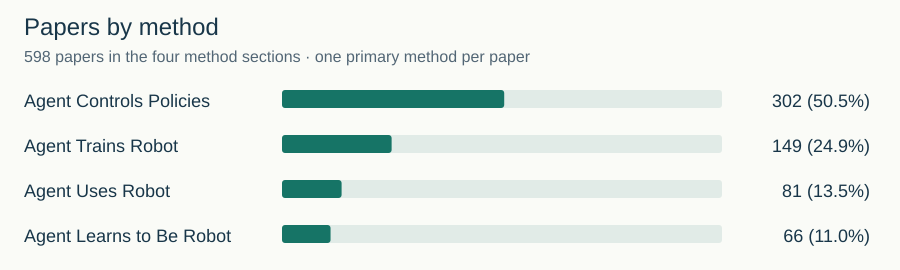
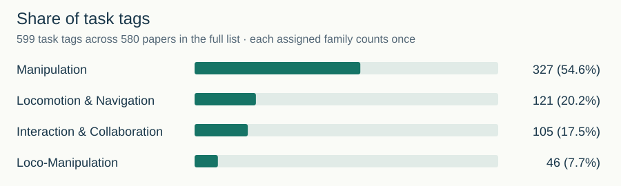
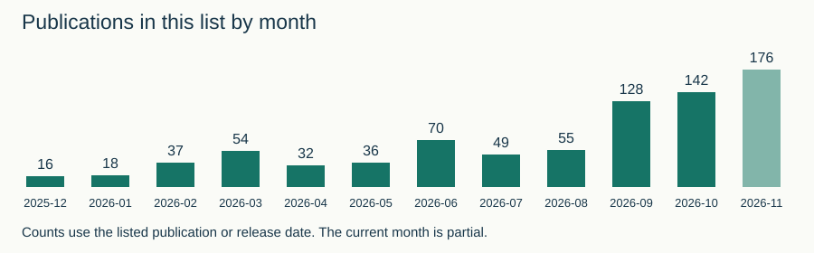

# Awesome Agentic Robotics

A reading list on how robots plan, act and improve through interaction. arXiv dates are first submissions. Project releases, workshop appearances and demos are dated separately. 🌟 marks verified open-source code.

## Trends in the collection

[GitHub star rankings by method and task](STAR-RANKINGS.md)

Each dated entry counts once by its primary link, including workshop papers and project releases. A paper added during a backfill appears in its original publication month. Term percentages use all titles in each period as the denominator.

## Browse by method and task

S1 is the policy or skill that turns a goal into robot motion. Each paper appears once under its main demonstrated agent–S1 relationship. Task labels describe the downstream robot goal.

- [Agent Uses Robot](#agent-uses-robot) — The agent issues robot commands or generates the control program that executes them.
- [Agent Controls Policies](#agent-controls-policies) — The agent selects, sequences or supervises existing skills or policies. The executor translates each subgoal into motion.
- [Agent Trains Robot](#agent-trains-robot) — The agent builds or improves a separate robot policy or reusable skill through data collection, feedback, program revision or training.
- [Agent Learns to Be Robot](#agent-learns-to-be-robot) — The model that reasons about the task is trained to produce robot actions or executable action programs.

[Related evaluations and resources](#related-evaluations-and-resources) includes cross-method benchmarks, infrastructure and surveys.

**Task families** · Manipulation changes an object’s state. Locomotion & Navigation reaches a destination or executes a movement. Loco-Manipulation requires both moving the robot and handling an object. Interaction & Collaboration requires responding to a person or coordinating with another robot. Multiple labels indicate distinct evaluated goals.

## Agent Uses Robot

The agent issues robot commands or generates the control program that executes them.

- 🌟[arXiv 2026.11.19](https://arxiv.org/abs/2611.25415), Stuck in Place: Stall Diagnosis and Remedies for JEPA Planners, [GitHub](https://github.com/jhlee0619/unstick)
  **Task · Manipulation**
- [arXiv 2026.11.19](https://arxiv.org/abs/2611.25679), LeCompass: Task-Level Execution through State-Indexed Interfaces, [GitHub](https://github.com/LeCompass/LeCompass.github.io)
  **Task · Manipulation**
- [arXiv 2026.11.19](https://arxiv.org/abs/2611.25927), Fast-JEPA: Advancing the Success-Latency Frontier for Latent World Models, [GitHub](https://github.com/Sofilyzia/Fast-JEPA)
  **Task · Manipulation**
- [arXiv 2026.11.19](https://arxiv.org/abs/2611.26503), JARVIS: An Agent That Designs, Builds, and Tests Circuit Boards on Its Own
  **Task · Manipulation**
- [arXiv 2026.11.18](https://arxiv.org/abs/2611.24470), When to Refine: Selective Search for Frozen Visual World Models
  **Task · Manipulation**
- [arXiv 2026.11.18](https://arxiv.org/abs/2611.24375), SearchDiffusion: Information-Guided Diffusion Planning for Object Search
  **Task · Locomotion & Navigation**
- [arXiv 2026.11.18](https://arxiv.org/abs/2611.24229), ProbeShare: Probing a Few, Sharing Across Many for Fast World-Model Planning
  **Task · Manipulation**
- [arXiv 2026.11.17](https://arxiv.org/abs/2611.23620), How Uncertain Is My Action? Self-Correcting Visual Planning with Frozen World Models
  **Task · Manipulation**
- [arXiv 2026.11.17](https://arxiv.org/abs/2611.22132), DailyBrick: Language-Guided Synthesis of Brick Assembly Instructions, [website](https://spatialagentlab.github.io/DailyBrick.github.io/), [GitHub](https://github.com/SpatialAgentLab/DailyBrick.github.io)
  **Task · Manipulation**
- [arXiv 2026.11.16](https://arxiv.org/abs/2611.20593), JEPTERA: A Platform Agnostic JEPA-Assisted Model Predictive Planner for Urban UAV Navigation
  **Task · Locomotion & Navigation**
- [arXiv 2026.11.16](https://arxiv.org/abs/2611.21099), ForceHarness: Turning Force into Action and Physics for Frozen Frontier Models, [website](https://showlab.github.io/ForceHarness), [GitHub](https://github.com/showlab/ForceHarness)
  **Task · Manipulation**
- [arXiv 2026.11.14](https://arxiv.org/abs/2611.19198), Self-Calibrating Vision-Agent-Action: Deploying Pick-and-Place to New Robot Cells without Demonstrations or Fine-Tuning
  **Task · Manipulation**
- [arXiv 2026.11.13](https://arxiv.org/abs/2611.18298), Objectives as Policies: Vision-Language Model Cost Programs for Contact-Rich Manipulation, [website](https://zihaolu001.github.io/oap-project/), [GitHub](https://github.com/ZihaoLu001/OaP)
  **Task · Manipulation**
- [CoRL workshop 2026.11.12](https://openreview.net/forum?id=78L8T5nsLM), Contact Code: A Typed Program Interface for Measurable and Repairable Contact-Rich Manipulation
  **Task · Manipulation**
- [arXiv 2026.11.12](https://arxiv.org/abs/2611.16632), Reins: Frontier Multimodal Models Driving Real Robot Arms on Long-Horizon Tasks, Zero-Shot, [GitHub](https://github.com/reins-robot/reins-robot.github.io)
  **Task · Manipulation**
- [CoRL workshop 2026.11.12](https://openreview.net/forum?id=sU18hA2zbD), Generalized Planning Interfaces for Agentic Robotics
  **Task · Manipulation**
- [arXiv 2026.11.11](https://arxiv.org/abs/2611.16009), JustRUA: A Controlled Study of GPT-6 Robot-Use Agents, [GitHub](https://github.com/ZefanW/JustRUA)
  **Task · Manipulation**
- [arXiv 2026.11.09](https://arxiv.org/abs/2611.12885), World In-Context Learning for Agentic Robot Manipulation, [GitHub](https://github.com/ArcheOne-AI/RoboScript), [X · AK’s video post](https://x.com/_akhaliq/status/2120609882663780777) (145 likes · 19,033 views · Nov 16, 2026)
  **Task · Manipulation**
- [arXiv 2026.11.09](https://arxiv.org/abs/2611.12177), Embodied First Exam, [GitHub](https://github.com/mll-lab-nu/embodied-first-exam)
  **Task · Manipulation + Loco-Manipulation**
- [arXiv 2026.11.06](https://arxiv.org/abs/2611.09847), Computer-Use Agents Are Embodied Generalists, [GitHub](https://github.com/Pranjal2041/cua-embodied)
  **Task · Locomotion & Navigation**
- [arXiv 2026.11.06](https://arxiv.org/abs/2611.09892), On Agentic Manipulation Policies, [GitHub](https://github.com/apple-aiml-research/ml-amp)
  **Task · Manipulation + Loco-Manipulation**
- [arXiv 2026.11.05](https://arxiv.org/abs/2611.08209), RoboARCade: Benchmarking Agentic Robot Control
  **Evaluation**
- [arXiv 2026.11.04](https://arxiv.org/abs/2611.06184), Can Astra Solve RoboMME without Breaking the Bank?, [workshop](https://openreview.net/forum?id=F1qPCjfU0x), [GitHub](https://github.com/bingaochen/Astra-on-RoboMME)
  **Task · Manipulation**
- [arXiv 2026.11.04](https://arxiv.org/abs/2611.06863), Rethinking Self-Repair in Code-as-Policy Agents: What Drives Retry Success?
  **Task · Manipulation**
- [arXiv 2026.11.01](https://arxiv.org/abs/2611.01560), Democratizing Robot-Use Agents: A Unified Harness with Open Models, [GitHub](https://github.com/Open-RUA/uni-robot-agent)
  **Task · Manipulation**
- [arXiv 2026.10.31](https://arxiv.org/abs/2611.01112), Auriga Technical Report: A Task-Agnostic Agent Harness for Zero-Shot Embodied Manipulation, [GitHub](https://github.com/lose4578/Auriga)
  **Task · Manipulation**
- [arXiv 2026.10.22](https://arxiv.org/abs/2610.31841), FORCA: A Force-Aware Coding Agent for Contact-Rich Robot Manipulation, [GitHub](https://github.com/tanoom/forca)
  **Task · Manipulation**
- [arXiv 2026.10.21](https://arxiv.org/abs/2610.30051), From Reasoning to Action: Benchmarking Frontier AI Models on LIBERO-10 Robot Manipulation Tasks, [GitHub](https://github.com/IRVLUTD/LLM_LIBERO)
  **Task · Manipulation**
- [arXiv 2026.10.20](https://arxiv.org/abs/2610.27613), Embodied Task Agents Can Perform Fine Manipulation through Tactile In-Context Learning, [GitHub](https://github.com/No-518/Tactile-ETA)
  **Task · Manipulation**
- [arXiv 2026.10.20](https://arxiv.org/abs/2610.27865), Frontier LLMs Enter the World of Robotics: A Cross-Model Evaluation on RoboColiseum
  **Task · Manipulation**
- [arXiv 2026.10.19](https://arxiv.org/abs/2610.27039), Embodied Playground: A Long-Horizon Agentic Robotics Benchmark for Physical, Strategic, and Spatial Reasoning, [GitHub](https://github.com/Winniechen2002/Embodied-Playground)
  **Task · Manipulation**
- [arXiv 2026.10.18](https://arxiv.org/abs/2610.25287), The Bitter Lesson Comes to Robotics
  **Task · Manipulation**
- 🌟[arXiv 2026.10.16](https://arxiv.org/abs/2610.23479), HexaShell: A Universal Harness for Robot Coding Agents in Simulation and the Real World, [website](https://hexafuture.ai/blog/hexashell-universal/), [code](https://github.com/HexaFuture/HexaShell)
  **Task · Manipulation**
- [arXiv 2026.10.15](https://arxiv.org/abs/2610.22496), Scaling Online Exploration for Robot Agents, [GitHub](https://github.com/robot-agent-exploration/rax)
  **Task · Manipulation + Loco-Manipulation**
- [arXiv 2026.10.14](https://arxiv.org/abs/2610.20560), PhySGA: A Physics-Space Grounded Agentic Framework for Generalizable and Interactive 3D Composition, [GitHub](https://github.com/AgenticEI/PhySGA)
  **Evaluation**
- [arXiv 2026.10.14](https://arxiv.org/abs/2610.20998), MoCaP: Mobile Code-as-Policies for Zero-Shot Mobile Manipulation from Passive Human Videos, [GitHub](https://github.com/MoCAP-7/MoCAP)
  **Task · Loco-Manipulation**
- [arXiv 2026.10.13](https://arxiv.org/abs/2610.18874), ChunkAct: Action Chunking for Agentic Robotics
  **Task · Manipulation**
- [arXiv 2026.10.12](https://arxiv.org/abs/2610.17083), Declarative Reactive Robot Behaviors from Imperative Language Models
  **Evaluation**
- [arXiv 2026.10.12](https://arxiv.org/abs/2610.17350), Can a Frontier VLM Serve as a Robot Policy for Memory-Dependent Manipulation?, [GitHub](https://github.com/jackbjed/embodied-astra-robomme)
  **Task · Manipulation**
- [arXiv 2026.10.08](https://arxiv.org/abs/2610.12457), SpatialHarness: Test-Time Spatial Scaffolding for Fine Robotic Manipulation, [GitHub](https://github.com/emilia113/SpatialHarness)
  **Task · Manipulation**
- [arXiv 2026.10.08](https://arxiv.org/abs/2610.12549), Fly-by-Code: Embodied Coding Agents for Aerial Manipulation with Active Visual and Physical Feedback, [GitHub](https://github.com/fly-by-code/fly-by-code.github.io)
  **Task · Loco-Manipulation**
- [arXiv 2026.10.07](https://arxiv.org/abs/2610.10388), RoboQuest: Generalist Physical Agents that Search, Inspect and Test, [GitHub](https://github.com/declare-lab/RoboQuest)
  **Task · Loco-Manipulation**
- [arXiv 2026.10.07](https://arxiv.org/abs/2610.09588), Adaptive Code Generation for Controlling Robots
  **Evaluation**
- [arXiv 2026.10.07](https://arxiv.org/abs/2610.10409), RobotWorld: Benchmarking Multimodal Agents for Robot Use Across Diverse Tasks and Embodiments, [GitHub](https://github.com/robotworldai/robotworld)
  **Evaluation**
- [arXiv 2026.10.05](https://arxiv.org/abs/2610.06843), Recursive Video In-Context Learning for Agentic Robot, [GitHub](https://github.com/BWR-hhh/rvicl)
  **Task · Manipulation**
- [arXiv 2026.10.04](https://arxiv.org/abs/2610.04929), RobotUse: Allocating Computation, Context, and Decisions, [GitHub](https://github.com/robotuse-team/RobotUse)
  **Task · Manipulation**
- [arXiv 2026.10.01](https://arxiv.org/abs/2610.01939), Fewer Tokens, Better Action: GPT-6 Astra Robot Agents with 14% Higher Success but 65% Fewer Tokens, [workshop](https://openreview.net/forum?id=wKgMn9vqUi), [GitHub](https://github.com/DAGroup-PKU/PyRUA-Lean)
  **Task · Manipulation**
- [arXiv 2026.10.01](https://arxiv.org/abs/2610.02459), OpenRUA: Robot-Use Agents Are Zero-Shot Visuomotor Policies, [GitHub](https://github.com/terminalworld/OpenRUA)
  **Task · Manipulation**
- [arXiv 2026.09.30](https://arxiv.org/abs/2609.39507), LIBERO-Agent: Evaluating General-Purpose Agents for Direct Embodied Manipulation, [GitHub](https://github.com/dzj441/Libero-Agent)
  **Task · Manipulation**
- [arXiv 2026.09.29](https://arxiv.org/abs/2609.38078), MotorMind: Scaffolding General Vision Language Models for Zero-Shot Robot Manipulation, [GitHub](https://github.com/Motor-Mind/MotorMind-Code)
  **Task · Manipulation**
- [arXiv 2026.09.29](https://arxiv.org/abs/2610.14018), RoboHarness: A Simple Harness Outperforms VLA and World Action Models, [GitHub](https://github.com/BinceQu/RoboHarness)
  **Evaluation**
- [arXiv 2026.09.27](https://arxiv.org/abs/2609.33807), CodeActionBench: Evaluating Agentic Code-as-Policy for Embodied Manipulation, [GitHub](https://github.com/lyhkk/CodeActionBench)
  **Task · Manipulation**
- [arXiv 2026.09.24](https://arxiv.org/abs/2609.29389), Robo-Harness K1: Harnessing Robot-Use Agents via Perception Augmentation, [GitHub](https://github.com/Robo-Harness/k1)
  **Task · Manipulation**
- [arXiv 2026.09.24](https://arxiv.org/abs/2609.30233), Coding Agents for Generalized Task and Motion Planning Problems, [GitHub](https://github.com/tomsilver/robocode)
  **Evaluation**
- [arXiv 2026.09.22](https://arxiv.org/abs/2609.28530), Know Your Body: A Harness for Direct and Self-Improving Robot Control with VLMs, [GitHub](https://github.com/Loule0-0/KnowBody)
  **Evaluation**
- [arXiv 2026.09.21](https://arxiv.org/abs/2609.24170), An Unexpected Robot Policy: Early Evaluations of GPT-6 Astra on RoboDojo and Beyond, [GitHub](https://github.com/RoboProbe/RoboProbe)
  **Task · Manipulation**
- [arXiv 2026.09.19](https://arxiv.org/abs/2609.22925), "Dear LLaVA, Please Drive": A Depth-Aware Vision-Language Agent for Closed-Loop Robotic Control
  **Task · Locomotion & Navigation**
- [arXiv 2026.09.19](https://arxiv.org/abs/2609.23133), AquaCap: A Training-Free Underwater Embodied Agent with Code-as-Policy
  **Task · Loco-Manipulation**
- [arXiv 2026.09.17](https://arxiv.org/abs/2609.20388), Navi-Agent: Unlocalized Monocular Navigation Agent
  **Task · Locomotion & Navigation**
- [arXiv 2026.09.17](https://arxiv.org/abs/2609.20822), Coding Agents with Harness for Safe Robot Control
  **Task · Manipulation**
- [arXiv 2026.09.16](https://arxiv.org/abs/2609.18435), WetRobo: A Reproducible Robot Kit for Coding Agents in Biological Laboratories, [GitHub](https://github.com/tsudalab/WetRobo)
  **Task · Manipulation**
- [arXiv 2026.09.16](https://arxiv.org/abs/2609.19347), Kinematics-Grounded Agentic AI for Robotic Additive Manufacturing Process Planning
  **Evaluation**
- [arXiv 2026.09.16](https://arxiv.org/abs/2609.19138), In-Context Robot Learning with VLM Agents, [GitHub](https://github.com/cheng-haha/GPT-Policy)
  **Evaluation**
- [arXiv 2026.09.11](https://arxiv.org/abs/2609.12541), Agent as Policy for Robotic Manipulation, [GitHub](https://github.com/agent-as-policy-2026/agent-as-policy)
  **Task · Manipulation**
- [arXiv 2026.09.09](https://arxiv.org/abs/2609.10522), Show-Harness: Just a VLM Agent Can Play Robots, [GitHub](https://github.com/showlab/Show-Harness)
  **Task · Manipulation**
- [arXiv 2026.09.01](https://arxiv.org/abs/2609.01404), Evaluating Multimodal LLMs as Generalist Vision-Language-Action Agents for Drone Control: Commanding, Approaching, Tracking and Searching, [GitHub](https://github.com/naver-ai/DroneCATS)
  **Task · Locomotion & Navigation**
- [arXiv 2026.08.29](https://arxiv.org/abs/2608.29379), Bridging Semantics and Physics with Constrained LLMs for Safe and Trustworthy Robotic Manipulation
  **Task · Manipulation**
- [arXiv 2026.08.21](https://arxiv.org/abs/2608.21031), PhysCaP: Grounding Code-as-Policy Agent with Physics-Informed Exploration, [workshop](https://openreview.net/forum?id=JprkI7JQDW), [GitHub](https://github.com/physcap/physcap)
  **Task · Manipulation**
- [arXiv 2026.08.19](https://arxiv.org/abs/2608.19281), APPROVE: Visual End-User-in-the-Loop Robot Programming with LLMs
  **Task · Interaction & Collaboration**
- [arXiv 2026.08.08](https://arxiv.org/abs/2608.08183), Multi-modal Interactive Control of Robotic Arm based on Offline Large Language Models, [GitHub](https://github.com/2000222/Socratic-Models-ChatGLM)
  **Task · Interaction & Collaboration**
- [arXiv 2026.08.03](https://arxiv.org/abs/2608.11246), Towards the Harness of Embodied Agents, [GitHub](https://github.com/EIT-HAI/Thea)
  **Evaluation**
- [arXiv 2026.08.01](https://arxiv.org/abs/2608.00775), ORCESTRA: VLM-driven Visual Robot programming in Mixed Reality
  **Evaluation**
- [arXiv 2026.07.28](https://arxiv.org/abs/2607.26148), Embodied Agents Take Control: Minimal-Interface Zero-Shot Agents Rival Industrial-Scale Policies in Vision-and-Language Navigation, [GitHub](https://github.com/jianzhou0420/MIP)
  **Task · Locomotion & Navigation**
- [arXiv 2026.07.13](https://arxiv.org/abs/2607.11119), VIA: Visual Interface Agent for Robot Control, [GitHub](https://github.com/hengyuan-hu/via)
  **Task · Manipulation**
- [arXiv 2026.06.30](https://arxiv.org/abs/2606.31158), LLM-Powered Interactive Robotic Action Synthesis from Multimodal Speech, Gestures, and Music
  **Task · Interaction & Collaboration**
- [arXiv 2026.06.15](https://arxiv.org/abs/2606.16458), RHO: Your Coding Agent is Secretly a Roboticist, [GitHub](https://github.com/rho-robotics/rho-robotics.github.io)
  **Task · Manipulation**
- [arXiv 2026.06.02](https://arxiv.org/abs/2606.03047), ModuLoop : Low-Level Code Generation using Modular Synthesizer and Closed-Loop Debugger for Robotic Control
  **Task · Manipulation**
- [arXiv 2026.04.22](https://arxiv.org/abs/2604.20348), Bimanual Robot Manipulation via Multi-Agent In-Context Learning, [GitHub](https://github.com/alesspalma/icl_bimanual)
  **Task · Manipulation**
- [arXiv 2026.04.13](https://arxiv.org/abs/2604.10929), Ro-SLM: Onboard Small Language Models for Robot Task Planning and Operation Code Generation, [GitHub](https://github.com/ai-uavsec/Ro-SLM)
  **Evaluation**
- [arXiv 2026.03.27](https://arxiv.org/abs/2603.26997), ROSClaw: An OpenClaw ROS 2 Framework for Agentic Robot Control and Interaction
  **Evaluation**
- [arXiv 2026.03.23](https://arxiv.org/abs/2603.22435), CaP-X: A Framework for Benchmarking and Improving Coding Agents for Robot Manipulation, [GitHub](https://github.com/capgym/cap-x)
  **Task · Manipulation**
- [arXiv 2026.03.16](https://arxiv.org/abs/2603.15134), Confusion-Aware In-Context-Learning for Vision-Language Models in Robotic Manipulation
  **Task · Manipulation**
- [arXiv 2026.03.05](https://arxiv.org/abs/2603.05621), RACAS: Controlling Diverse Robots With a Single Agentic System, [GitHub](https://github.com/5FX4P/RACAS)
  **Evaluation**
- [arXiv 2026.02.24](https://arxiv.org/abs/2602.21161), ActionReasoning: Robot Action Reasoning in 3D Space with LLM for Robotic Brick Stacking
  **Task · Manipulation**
- [arXiv 2026.02.02](https://arxiv.org/abs/2602.02839), Language Movement Primitives: Grounding Language Models in Robot Motion
  **Task · Manipulation**
- [arXiv 2026.01.28](https://arxiv.org/abs/2601.20334), Demonstration-Free Robotic Control via LLM Agents, [GitHub](https://github.com/robiemusketeer/faea-sim)
  **Task · Manipulation**
- [arXiv 2026.01.27](https://arxiv.org/abs/2601.19510), ALRM: Agentic LLM for Robotic Manipulation
  **Task · Manipulation**
- [arXiv 2025.12.24](https://arxiv.org/abs/2512.21293), Quadrupped-Legged Robot Movement Plan Generation using Large Language Model
  **Task · Locomotion & Navigation**
- [arXiv 2025.12.09](https://arxiv.org/abs/2512.08629), See-Control: A Multimodal Agent Framework for Smartphone Interaction with a Robotic Arm
  **Task · Manipulation**
- [arXiv 2025.12.01](https://arxiv.org/abs/2512.02002), LLM-Driven Corrective Robot Operation Code Generation with Static Text-Based Simulation
  **Evaluation**
- [arXiv 2025.11.24](https://arxiv.org/abs/2511.19315), Rethinking Intermediate Representation for VLM-based Robot Manipulation
  **Task · Manipulation**

## Agent Controls Policies

The agent selects, sequences or supervises existing skills or policies. The executor translates each subgoal into motion.

- 🌟[arXiv 2026.11.19](https://arxiv.org/abs/2611.25587), Cognitive-Horizon Action Chunking: Memory-Guided Adaptive Reasoning for Embodied Navigation, [GitHub](https://github.com/phare111/chac)
  **Task · Locomotion & Navigation**
- [arXiv 2026.11.19](https://arxiv.org/abs/2611.26090), Dynamic Human-Robot Role Allocation through Entropy-Based Monitoring and LLM Reasoning
  **Task · Interaction & Collaboration**
- [arXiv 2026.11.19](https://arxiv.org/abs/2611.26341), Reasoning on Call: Efficient Agentic Robot Control for Long-Horizon Robot Manipulation
  **Task · Manipulation**
- [arXiv 2026.11.19](https://arxiv.org/abs/2611.26596), PGX: Physically Grounded Execution for Long-Horizon Humanoid Loco-Manipulation, [website](https://kl-research.github.io/pgx)
  **Task · Loco-Manipulation**
- [arXiv 2026.11.18](https://arxiv.org/abs/2611.25005), Inhabitant: An Agent Framework for Long-Horizon Human-Scene Interaction with Spatial Control and Quantitative Feedback, [website](https://ryenhails.github.io/Inhabitant/)
  **Task · Loco-Manipulation**
- 🌟[arXiv 2026.11.18](https://arxiv.org/abs/2611.25215), Bridging vision-language reasoning and learned control for legged navigation in the wild, [website](https://roam-hiking.github.io), [GitHub](https://github.com/leggedrobotics/roam)
  **Task · Locomotion & Navigation**
- [arXiv 2026.11.18](https://arxiv.org/abs/2611.23930), A Hierarchical Onboard Vision-Language-Navigation Framework for Aerial Robots in Complex Environments, [website](https://wyz000.github.io/VLN-AR/)
  **Task · Locomotion & Navigation**
- [arXiv 2026.11.18](https://arxiv.org/abs/2611.23926), GTI: Grounding Task Intent Throughout Long-Horizon VLA Manipulation
  **Task · Manipulation**
- [arXiv 2026.11.18](https://arxiv.org/abs/2611.23843), RePlan-VLA: Progress-Aware Replanning for Long-Horizon Vision-Language-Action Models
  **Task · Manipulation**
- [arXiv 2026.11.18](https://arxiv.org/abs/2611.25254), Plan your Self-Adaptation! Ontology-Mediated Task and Architecture Co-adaptation Planning for Robots
  **Task · Locomotion & Navigation**
- 🌟[arXiv 2026.11.18](https://arxiv.org/abs/2611.25243), Verify2Act: Critic-Guided Latent World Models for Verifying Language-Conditioned Manipulation Plans, [website](https://verify2act.github.io/), [GitHub](https://github.com/chrisantuseze/verify2act)
  **Task · Manipulation**
- 🌟[arXiv 2026.11.17](https://arxiv.org/abs/2611.22584), InteractVLA: Turning VLAs into Interactive Tools for Agentic Robotic Manipulation, [website](https://lingwupro.github.io/InteractVLA/), [GitHub](https://github.com/LingwuPro/InteractVLA)
  **Task · Manipulation**
- [arXiv 2026.11.17](https://arxiv.org/abs/2611.22321), Beyond Episodic Recall: Experience-to-Knowledge Evolution for Lifelong Embodied Navigation
  **Task · Locomotion & Navigation**
- [arXiv 2026.11.17](https://arxiv.org/abs/2611.22275), Heave-Ho: Decentralized Long-Horizon Multi-Humanoid Collaboration, [website](https://heaveho-humanoid.github.io/), [GitHub](https://github.com/heaveho-humanoid/Heave-Ho)
  **Task · Loco-Manipulation + Interaction & Collaboration**
- [arXiv 2026.11.16](https://arxiv.org/abs/2611.21517), Lazy-MOSAIC: Accelerating Skill-Centric Manipulation Planning with Learned Skill-Effect World Models
  **Task · Manipulation**
- [arXiv 2026.11.16](https://arxiv.org/abs/2611.20676), Learning and Verifying Progress: Closed-Loop Agentic Planning with Progress-Enhanced Execution for Long-Horizon Vision-Language Navigation
  **Task · Locomotion & Navigation**
- [arXiv 2026.11.15](https://arxiv.org/abs/2611.20230), A Matrix with Steps: An Episodic and Procedural Memory Method for Tool-Using Agents and Robots
  **Evaluation**
- [arXiv 2026.11.15](https://arxiv.org/abs/2611.19952), CRAFT: A Robot-Agent Harness with Scope-Aware Adaptation, [GitHub](https://github.com/zp312/CRAFT)
  **Evaluation**
- [arXiv 2026.11.15](https://arxiv.org/abs/2611.19912), AgenticJevNav: Agentic Object Search and Navigation via Event-Driven Verification
  **Task · Locomotion & Navigation**
- [arXiv 2026.11.14](https://arxiv.org/abs/2611.19324), MARS: Dynamic Routing of Reinforcement-Learned Atomic Skills for Multi-Stage Robotic Manipulation
  **Task · Manipulation**
- [arXiv 2026.11.14](https://arxiv.org/abs/2611.19131), Wireless Edge-Assisted Adaptive Latent Reasoning for Vision-Language-Action Models in Physical AI
  **Task · Manipulation**
- [arXiv 2026.11.13](https://arxiv.org/abs/2611.17730), ERA: Error-Resistant Autonomous Object Navigation with Predicted Depth
  **Task · Locomotion & Navigation**
- [arXiv 2026.11.13](https://arxiv.org/abs/2611.18026), A Generalizable Approach to Safety-Aware Robotic Behavior Planning with an Explicit Constraint Space
  **Task · Manipulation**
- [Demo 2026.11.12](https://atlas-humanoid.github.io/), ATLAS: Agentic Harness for Whole-Body Intelligence from Human Video, [award](https://agentic-robotics-workshop.github.io/#awards), [GitHub](https://github.com/atlas-humanoid/atlas-humanoid.github.io), [X · JunLi Ren’s CoRL demo](https://x.com/junli_r84995/status/2121098492257108116) (173 likes · 15,657 views · Nov 16, 2026)
  **Task · Loco-Manipulation**
- [arXiv 2026.11.12](https://arxiv.org/abs/2611.16487), HeMeR: Heterogeneous Memory Reconciliation for Embodied Agents via Structured KV Reuse
  **Evaluation**
- [CoRL workshop 2026.11.12](https://openreview.net/forum?id=BCdDYO0jo9), SUTO: Failure-Localized Reasoning for Robot Task Planning and Execution
  **Task · Manipulation**
- [arXiv 2026.11.12](https://arxiv.org/abs/2611.16386), Remember What Changes the Odds: Critic-Gated Event Memory for Long-Horizon Manipulation
  **Task · Manipulation**
- [arXiv 2026.11.12](https://arxiv.org/abs/2611.17598), X-Nav Technical Report: Real-World Long-Horizon Indoor-to-Outdoor Navigation on a Humanoid Robot
  **Task · Locomotion & Navigation**
- 🌟[arXiv 2026.11.12](https://arxiv.org/abs/2611.16671), NSDL: Neuro-Symbolic Division of Labor for Multi-Robot Task Planning, [code](https://github.com/Xincheng-Tan/NSDL)
  **Task · Interaction & Collaboration**
- [arXiv 2026.11.11](https://arxiv.org/abs/2611.15317), BiPOP: Partial-Order Planning for Long-Horizon Bimanual Robotic Manipulation, [GitHub](https://github.com/Kchu/BiPOP)
  **Task · Manipulation**
- [arXiv 2026.11.11](https://arxiv.org/abs/2611.15651), Recover, Don't Just Continue: Learning from Feedback for Physical Failure Understanding and Correction, [GitHub](https://github.com/pm1255/embodied-corrector)
  **Task · Manipulation**
- [arXiv 2026.11.11](https://arxiv.org/abs/2611.15589), EMS-Nav: Embodied Multi-Scale Navigation
  **Task · Locomotion & Navigation**
- [arXiv 2026.11.11](https://arxiv.org/abs/2611.15093), Decide Before You Move: Diffusion-Generated Search Reference for Zero-Shot Open-Vocabulary Object Navigation in Semi-Static Environments
  **Task · Locomotion & Navigation**
- [arXiv 2026.11.10](https://arxiv.org/abs/2611.14834), Learning Low-Latency Action Verification for Frozen Vision-Language-Action Models, [GitHub](https://github.com/Wen-HanHsieh/hdh_sim)
  **Task · Manipulation**
- [arXiv 2026.11.09](https://arxiv.org/abs/2611.13251), Curie's Jarvis: Autonomous Robotic Chemistry Experiments from Printed Protocols
  **Task · Manipulation**
- [arXiv 2026.11.09](https://arxiv.org/abs/2611.12409), Bridging Task Planning and Execution for Language-Conditioned Bimanual Manipulation, Humanoids 2026, [website](https://advrhumanoids.github.io/bridging-planning-execution/)
  **Task · Manipulation**
- [arXiv 2026.11.09](https://arxiv.org/abs/2611.13039), Robo-MLT: Dual-System Robotic Manipulation for Long-Horizon Medical Laboratory Tasks, [GitHub](https://github.com/RoboMLT/Robo-MLT)
  **Task · Manipulation**
- [arXiv 2026.11.09](https://arxiv.org/abs/2611.12139), BioMARS 2.0: a robotic biologist for formulating and adapting biological experiments
  **Evaluation**
- [arXiv 2026.11.09](https://arxiv.org/abs/2611.13161), Cognitive Multi-Agent Search and Rescue: Language-Grounded Hierarchical Reinforcement Learning for Collaborative Robotics
  **Task · Interaction & Collaboration**
- [arXiv 2026.11.08](https://arxiv.org/abs/2611.12983), CAFE: Closed-Loop Autonomous Task Formulation and Execution without Instance-Specific Instructions, [GitHub](https://github.com/submissionforpaper/CAFE-Closed-Loop-Autonomous-Task-Formulation-and-Execution-without-Instance-Specific-Instructions)
  **Evaluation**
- [arXiv 2026.11.08](https://arxiv.org/abs/2611.11665), HINT-VLM: Humanoid Interactive Navigation over Rough Terrain with Embodiment-Grounded Vision-Language Model
  **Task · Locomotion & Navigation**
- [arXiv 2026.11.03](https://arxiv.org/abs/2611.05058), Do Agentic Policies Need to Look at Every Step? Geometric Abstraction for Reasoning and Action, [website](https://geometric-abstraction.github.io/), [workshop](https://openreview.net/forum?id=CQFstcjx1Z), [GitHub](https://github.com/Spectraorder/geometric-abstraction)
  **Task · Manipulation**
- [arXiv 2026.11.02](https://arxiv.org/abs/2611.03584), TAMPAgent: Agentic Belief-Space Planning for Mobile Manipulation
  **Task · Loco-Manipulation**
- [arXiv 2026.11.02](https://arxiv.org/abs/2611.04080), FEIJOA: Task-Driven Grounding and Execution for Mobile Manipulation, [workshop](https://openreview.net/forum?id=Eq3xq6KZDC)
  **Task · Loco-Manipulation**
- [arXiv 2026.11.01](https://arxiv.org/abs/2611.01404), Serving Agentic Robot Fleets: Workload Characterization, KV-Cache Thrashing, and Admission Control
  **Evaluation**
- [CoRL 2026.11](https://openreview.net/forum?id=k9EjTLL8bA), RAMT-VLA: Reliability-Aware Memory Tracing for Historical Support Assessment in Vision-Language-Action Models
  **Task · Manipulation**
- [CoRL 2026.11](https://openreview.net/forum?id=nBwRDRUdMc), MessyNav: Zero-Shot Navigation via Manipulation in Messy Environments, [website](https://messynav.github.io), [GitHub](https://github.com/messynav/messynav.github.io)
  **Task · Locomotion & Navigation**
- [arXiv 2026.10.30](https://arxiv.org/abs/2610.42053), REA: A Routed Embodied Agent Runtime for Asynchronous Brain-Cerebellum Control, [GitHub](https://github.com/InfRec-Cardinal/REA)
  **Task · Manipulation**
- [arXiv 2026.10.29](https://arxiv.org/abs/2610.40248), LLM-guided Planar Loco-Manipulation for Quadruped Robots
  **Task · Loco-Manipulation**
- [arXiv 2026.10.26](https://arxiv.org/abs/2610.35687), TrySee: Modular Perception-Enhanced VLM Grounding for Closed-Loop Robot Task Planning in Specialized Domains
  **Task · Manipulation**
- [arXiv 2026.10.26](https://arxiv.org/abs/2610.35686), FISRF: Flexible Instructional Scaffolding Reflection Framework for Robotics Task Planning with Large Language Model, [GitHub](https://github.com/fisrfplanning/fisrfplanning.github.io)
  **Evaluation**
- [arXiv 2026.10.26](https://arxiv.org/abs/2610.35832), Profiling a Frontier Agent with EBench: From Direct Control to Harness with Policy, [GitHub](https://github.com/InternRobotics/EBench)
  **Task · Manipulation**
- [arXiv 2026.10.25](https://arxiv.org/abs/2610.34370), ThinkLocoManip: A Whole-Body Control Agentic Harness for Legged Loco-Manipulation
  **Task · Loco-Manipulation**
- [arXiv 2026.10.22](https://arxiv.org/abs/2610.30587), Know When to Escalate: Critic-Guided Adaptive Execution for Cloud-Local Embodied Agents
  **Evaluation**
- [arXiv 2026.10.22](https://arxiv.org/abs/2610.31427), FastHarness: Experience-Driven Review Scheduling for Vision-Language-Action Policies, [GitHub](https://github.com/FastHarness/fast-harness)
  **Task · Manipulation**
- [arXiv 2026.10.21](https://arxiv.org/abs/2610.30043), TARSphere: A Robot-Oriented Full-Stack Framework for Long-Horizon Embodied Agents in Evolving Physical and Social Environments, [GitHub](https://github.com/xuyicheng-zju/TARSphere)
  **Task · Locomotion & Navigation + Loco-Manipulation**
- [arXiv 2026.10.20](https://arxiv.org/abs/2610.28109), FIT-MAC: A Closed-Loop Multi-Agent Framework for Robust Vision-Language-Action Models
  **Task · Manipulation**
- [arXiv 2026.10.17](https://arxiv.org/abs/2610.24603), Refuse the Harm, Complete the Task via Graph-of-Rules Planning for LLM-Enabled Robots
  **Evaluation**
- [arXiv 2026.10.16](https://arxiv.org/abs/2610.24016), CLARO: Clutter Aware Robot Orchestrator for Open-Vocabulary Grasping using VLM Agents
  **Task · Manipulation**
- [arXiv 2026.10.15](https://arxiv.org/abs/2610.21453), CarryOn: A Dual-Loop Harness for Personalized and Reliable Robot Assistance, [GitHub](https://github.com/JIA-Lab-research/CarryOn)
  **Task · Interaction & Collaboration**
- [arXiv 2026.10.15](https://arxiv.org/abs/2610.21211), An Agentic Framework for Proactive Robots with Procedural Assistance Memory, [GitHub](https://github.com/DAVIAN-Robotics/PAM)
  **Task · Interaction & Collaboration**
- [arXiv 2026.10.14](https://arxiv.org/abs/2610.19600), Cracking Mobile Manipulation: From Failure Diagnosis to Agentic Robot System, [GitHub](https://github.com/PKU-VaLuE-Lab/Cracking-Mobile-Manipulation)
  **Task · Loco-Manipulation**
- [arXiv 2026.10.14](https://arxiv.org/abs/2610.19618), F2A-ObjectNav: An Adaptive Agentic Architecture for Object-Goal Navigation
  **Task · Locomotion & Navigation**
- 🌟[arXiv 2026.10.13](https://arxiv.org/abs/2610.17927), GLST: Global-Local Spatio-Temporal Memory Decomposition Framework for Online Chained-Goal Navigation, [CoRL 2026](https://openreview.net/forum?id=xyFvvMLQRo), [code](https://github.com/Yousef-Liang/glst)
  **Task · Locomotion & Navigation**
- [arXiv 2026.10.13](https://arxiv.org/abs/2610.18307), I2O2I-Nav: A Benchmark with a Modular Agent for Long-Horizon Indoor-to-Outdoor-to-Indoor Navigation, [GitHub](https://github.com/i2o2i-nav/i2o2i_nav)
  **Task · Locomotion & Navigation**
- [arXiv 2026.10.12](https://arxiv.org/abs/2610.17089), Interactive Navigation Beyond Reachability: Benchmark and Agentic Framework, [GitHub](https://github.com/ZGCA-HMI-Lab/MultINav)
  **Task · Locomotion & Navigation**
- [arXiv 2026.10.12](https://arxiv.org/abs/2610.16238), Embodied Skill Bench: Benchmarking How Well Agents with Embodied Skills Perform on Physical Tasks, [GitHub](https://github.com/HanZhi306/EmbodiedSkill-Bench)
  **Task · Manipulation**
- [arXiv 2026.10.11](https://arxiv.org/abs/2610.15766), SurgiCLAW: An Interpretable Atomic-Skill Agent for Precision Robotic Micromanipulation
  **Task · Manipulation**
- [arXiv 2026.10.10](https://arxiv.org/abs/2610.15224), Persistent LLM Orchestration of Heterogeneous Robot Teams via Partial Delegation to Multi-Agent Protocols
  **Task · Interaction & Collaboration**
- [arXiv 2026.10.10](https://arxiv.org/abs/2610.15038), Training-Free Multi-Agent Cooperative Embodied Search from Uncertain Vision-Language Priors
  **Task · Interaction & Collaboration**
- [arXiv 2026.10.09](https://arxiv.org/abs/2610.13862), BT-Agent: Deploying Onboard Robot Agents with Behavior Trees and Multi-Fidelity Evaluation, [GitHub](https://github.com/fabiohuebel/bt-agent)
  **Evaluation**
- [arXiv 2026.10.09](https://arxiv.org/abs/2610.14341), CoPlanVLM: Coordinated Path Planning for a Robot Team using Vision Language Models, [GitHub](https://github.com/AICPS/CoPlanVLM)
  **Task · Interaction & Collaboration**
- [arXiv 2026.10.08](https://arxiv.org/abs/2610.14106), Embodied Zero-Shot Task Planning via Hardware-Aware LLM-VLM Integration for Grounded Robotic Manipulation, [GitHub](https://github.com/Ltankersley15/SK-Zero-Shot-Research)
  **Task · Manipulation**
- [arXiv 2026.10.08](https://arxiv.org/abs/2610.12793), Gamma: Grounded Multi-Agent Memory with Mechanical Audit for Memory-Intensive Manipulation, [GitHub](https://github.com/1999Lyd/GAMMA)
  **Task · Manipulation**
- [arXiv 2026.10.08](https://arxiv.org/abs/2610.12126), SuperNav: An Agentic Navigation System for Any Task in Any Scene, [GitHub](https://github.com/zju3dv/SuperNav)
  **Task · Locomotion & Navigation**
- [arXiv 2026.10.08](https://arxiv.org/abs/2610.12761), Verifier-Mediated Multi-LLM Coordination for Multi-Robot Path Planning
  **Task · Interaction & Collaboration**
- [arXiv 2026.10.07](https://arxiv.org/abs/2610.10812), Skill-SLM: Agent Skill-driven Small Language Models for Reliable Robot Operation
  **Task · Locomotion & Navigation**
- [arXiv 2026.10.07](https://arxiv.org/abs/2610.10962), iAm.md: Robot Skill Self-Assessment through Agentic Introspection for Unknown Open-Vocabulary Domains
  **Task · Loco-Manipulation**
- [arXiv 2026.10.07](https://arxiv.org/abs/2610.09358), COOL: Curiosity-Driven Object Ownership Learning for Personalized Robotic Assistance, [CoRL 2026](https://openreview.net/forum?id=v4QUDwGroQ), [GitHub](https://github.com/SamiraHuber/cool)
  **Task · Interaction & Collaboration**
- [arXiv 2026.10.07](https://arxiv.org/abs/2610.10787), NavGPT-3: Harnessing Context in a Hierarchical Navigation Runtime, [GitHub](https://github.com/metacognitionai/NavGPT-3)
  **Task · Locomotion & Navigation**
- [arXiv 2026.10.06](https://arxiv.org/abs/2610.07649), OntoPlan: An Ontology-Grounded Scene Representation and Agentic Framework for Scalable Robot Task Planning, [GitHub](https://github.com/namhyeongwoo/OntoPlan)
  **Evaluation**
- [arXiv 2026.10.05](https://arxiv.org/abs/2610.05964), From Social Reasoning to Embodied Interaction: An Agentic Framework for Social Robots
  **Task · Interaction & Collaboration**
- [arXiv 2026.10.05](https://arxiv.org/abs/2610.08862), CIRRA: Dual-Level Continual Instruction Reconciliation with Ongoing Execution for Embodied Robot Agents in Interactive Household Tasks
  **Task · Interaction & Collaboration**
- [arXiv 2026.10.05](https://arxiv.org/abs/2610.07477), MRPilot: Supervising and Intervening LLM-Based Multi-Robot Teams through Mixed Reality
  **Task · Interaction & Collaboration**
- [arXiv 2026.10.04](https://arxiv.org/abs/2610.04916), PreAct-Nav: Agentic Reasoning Before Action for Urban Navigation, [GitHub](https://github.com/JJingXie/preact-nav-website)
  **Task · Locomotion & Navigation**
- [arXiv 2026.10.01](https://arxiv.org/abs/2610.01178), Recova: Agent-Guided Failure Recovery for Autonomous Robotic Manipulation
  **Task · Manipulation**
- [arXiv 2026.09.30](https://arxiv.org/abs/2609.39915), NavHarness: Adaptive Goals for Agentic Vision-Language Navigation, [GitHub](https://github.com/navharness/navharness.github.io)
  **Task · Locomotion & Navigation**
- [arXiv 2026.09.29](https://arxiv.org/abs/2609.36808), Spotter: Let the Embodied Model Lead, and the VLM Reflect for It, [GitHub](https://github.com/zqc3117/Spotter)
  **Task · Manipulation**
- [arXiv 2026.09.29](https://arxiv.org/abs/2609.37554), Risk-Aware Semantic Grounding for Trustworthy LLM-Based Robot Planning
  **Task · Locomotion & Navigation**
- [arXiv 2026.09.29](https://arxiv.org/abs/2609.36595), Simple Agentic Memory for Generalist Robot Policies, [GitHub](https://github.com/simplearm/SimpleARM)
  **Task · Manipulation**
- [arXiv 2026.09.28](https://arxiv.org/abs/2609.34823), AGRO-SUVIDE: Agentic Robotics for Surgical Viscoelastic Debridement, [GitHub](https://github.com/surgical-robotics/AGRO-SUVIDE)
  **Task · Manipulation**
- [arXiv 2026.09.28](https://arxiv.org/abs/2609.36151), KPI: A Promptable Kernel for Physical Interaction on Humanoids, [workshop](https://openreview.net/forum?id=F7Dp4022mM), [GitHub](https://github.com/kpi-robot/kpi-robot.github.io)
  **Task · Loco-Manipulation**
- [arXiv 2026.09.28](https://arxiv.org/abs/2609.34270), Bayesian Active Learning for Intent Disambiguation in Interactive Robot Planning, [CoRL 2026](https://openreview.net/forum?id=El4EDBhqCG), [GitHub](https://github.com/romanlee6/bal)
  **Task · Interaction & Collaboration**
- [arXiv 2026.09.28](https://arxiv.org/abs/2609.35965), Systematic Multi-Agent Vision-and-Language Navigation: Formulation, Benchmark, and Method, [GitHub](https://github.com/xyz9911/MA-VLN)
  **Task · Interaction & Collaboration**
- [arXiv 2026.09.25](https://arxiv.org/abs/2609.31112), DualManip: Agentic Dynamic Manipulation via Dual-Path Semantic Reasoning and Geometric Adaptation, [GitHub](https://github.com/lichengxi1/Dualmanip)
  **Task · Manipulation**
- [arXiv 2026.09.24](https://arxiv.org/abs/2609.29091), From Passive Execution to Active Exploration: Agentic Embodied Manipulation in Realistic Environments
  **Task · Manipulation**
- [arXiv 2026.09.24](https://arxiv.org/abs/2609.29964), World Action Agent: Harnessing VLMs for Robot Manipulation via World Action Rehearsal, [GitHub](https://github.com/ZYH-Lightyear/world-action-agent)
  **Task · Manipulation**
- [arXiv 2026.09.24](https://arxiv.org/abs/2609.29043), Design and Evaluation of LLM Chaining-Based Task Planning for General Purpose Service Robots
  **Evaluation**
- [arXiv 2026.09.24](https://arxiv.org/abs/2609.29212), ADM-Planner: LLM-Guided Long-Horizon Planning for Mobile Manipulators with Attention-Enhanced Dynamic Memory, [GitHub](https://github.com/xjp99v5/ADM-Planner)
  **Task · Loco-Manipulation**
- [arXiv 2026.09.24](https://arxiv.org/abs/2609.28973), AquaMend: Minimal Re-probing and Conditional Rollback for Latent-Belief Failures in Embodied Agents
  **Evaluation**
- [arXiv 2026.09.23](https://arxiv.org/abs/2609.27612), RegenHarness: A Robot Agent Harness with Evidence-Gated Recursive Self-Improvement
  **Task · Locomotion & Navigation**
- [arXiv 2026.09.23](https://arxiv.org/abs/2609.27340), Spatial and Semantic Reasoning for LLM-Driven Robot Navigation via MCP
  **Task · Locomotion & Navigation**
- [arXiv 2026.09.23](https://arxiv.org/abs/2609.27526), NavProbe: Evidence-Grounded Reasoning with Active Memory Retrieval for Zero-Shot Navigation, [GitHub](https://github.com/liujy25/NavProbe)
  **Task · Locomotion & Navigation**
- [arXiv 2026.09.23](https://arxiv.org/abs/2609.27720), CoRelNav: Collaborative Relational Navigation for Multi-Robot Spatially Constrained Semantic Navigation
  **Task · Interaction & Collaboration**
- [arXiv 2026.09.21](https://arxiv.org/abs/2609.24055), Toward Human-in-the-Loop Robot Failure Recovery: Bridging Communication Gaps in Human-Robot Collaboration
  **Task · Interaction & Collaboration**
- [arXiv 2026.09.20](https://arxiv.org/abs/2609.23841), Structured World-State Reasoning for Agentic Robotic Search
  **Task · Locomotion & Navigation**
- [arXiv 2026.09.20](https://arxiv.org/abs/2609.23944), Topology-Informed Visual Prompting for Hierarchical Vision-Language-Action Control, [workshop](https://openreview.net/forum?id=RkzWx9Sfcz)
  **Task · Manipulation**
- [arXiv 2026.09.17](https://arxiv.org/abs/2609.19974), MaskHarness-WAM: Instance-Grounded Harnessing for Long-Horizon Robot Manipulation, [GitHub](https://github.com/MaskHarness-WAM/maskharness-wam.github.io)
  **Task · Manipulation**
- [arXiv 2026.09.17](https://arxiv.org/abs/2609.20791), StageGuard: Learning Stage Transitions for Long-Horizon Robot Tasks via Agentic Distillation
  **Evaluation**
- [arXiv 2026.09.17](https://arxiv.org/abs/2609.20330), RoboFind: Multi-Agent Personalized Object Search for People Who Are Blind or Have Low Vision
  **Task · Interaction & Collaboration**
- [arXiv 2026.09.16](https://arxiv.org/abs/2609.18869), KINO: A Keyframe Interface for VLM Planning and Whole-Body Control in Humanoid Loco-Manipulation, [GitHub](https://github.com/SC0K/kino)
  **Task · Loco-Manipulation**
- [arXiv 2026.09.16](https://arxiv.org/abs/2609.19315), GAVEL: Graph World Models for Verified and Efficient Long-Horizon LLM Task Planning
  **Evaluation**
- [arXiv 2026.09.16](https://arxiv.org/abs/2609.19413), From Rollout to Reset: A Graph-Based Harness for Autonomous Long-Horizon Manipulation Evaluation, [GitHub](https://github.com/intuitive-robots/HALTER)
  **Task · Manipulation**
- [arXiv 2026.09.15](https://arxiv.org/abs/2609.17771), HINT-Plan: Human Intention-Aware Robot Task Planning in Context-Rich Environments using Vision Language Models
  **Task · Interaction & Collaboration**
- [arXiv 2026.09.14](https://arxiv.org/abs/2609.16331), ManiSkillFormer: Demonstration-Free Compositional Manipulation via Geometric Contracts and Agentic Skill Graph
  **Task · Manipulation**
- [arXiv 2026.09.14](https://arxiv.org/abs/2609.15976), MessyMem: Learning-from-Doing Memory for Mobile Manipulation, [GitHub](https://github.com/messymem/messymem.github.io)
  **Task · Loco-Manipulation**
- [arXiv 2026.09.14](https://arxiv.org/abs/2609.15195), HarnessVLN: Unifying Training-Free Embodied Navigation through an Agent Harness, [GitHub](https://github.com/AgibotGeneral/harnessvln)
  **Task · Locomotion & Navigation**
- [arXiv 2026.09.11](https://arxiv.org/abs/2609.13335), Bridging Thought and Action: Taming Long-Horizon Instability in Open-Source LLM Agents with a MetaTool-Enhanced ROS Framework
  **Evaluation**
- [arXiv 2026.09.10](https://arxiv.org/abs/2609.11225), Harness Robotic OS: A Unified Embodied-Agent Runtime for Closed-Loop Quadruped Inspection
  **Task · Locomotion & Navigation**
- [arXiv 2026.09.10](https://arxiv.org/abs/2609.11308), 2AM: Grounding Agent-Side Memory as Guidance for Steerable Action Models in Long-Horizon Manipulation, [workshop](https://openreview.net/forum?id=y0qBMe2qH3), [GitHub](https://github.com/agent-mem-action-model/agent-mem-action-model.github.io)
  **Task · Manipulation**
- [arXiv 2026.09.09](https://arxiv.org/abs/2609.10895), ReactHuman: A Physics-Grounded Benchmark for Human-Like Reactive Decision-Making in Embodied Multimodal LLMs
  **Task · Interaction & Collaboration**
- [arXiv 2026.09.08](https://arxiv.org/abs/2609.08402), Towards Embodied Air-Ground Cooperative Object Search: Benchmark, Dataset and Agentic Method
  **Task · Interaction & Collaboration**
- [arXiv 2026.09.08](https://arxiv.org/abs/2609.08444), Safe Task Planning with Long-Term Graph Memory for Embodied Agents, [GitHub](https://github.com/lty759/SafeMem)
  **Evaluation**
- [arXiv 2026.09.07](https://arxiv.org/abs/2609.07288), How Long Until Your Robot Ignores You? A Safety Benchmark for LLM Orchestrators in Human-Humanoid Collaboration, [GitHub](https://github.com/ipa-alb/llm-orchestrator-humanoid-safety-bench)
  **Task · Interaction & Collaboration**
- [arXiv 2026.09.06](https://arxiv.org/abs/2609.06508), VLA-Corrector: Stage-Aware Observable State Understanding for Prompt-Based Closed-Loop Recovery of Vision-Language-Action Policies
  **Task · Manipulation**
- [arXiv 2026.09.05](https://arxiv.org/abs/2609.05985), A Brain-inspired Hierarchical Framework for Zero-Shot Robot Task Reasoning and Execution
  **Task · Manipulation**
- [arXiv 2026.09.02](https://arxiv.org/abs/2609.02653), HINT: Human-Intent Inception for Long-Horizon Robot Manipulation, [GitHub](https://github.com/robot-hint/HINT)
  **Task · Manipulation + Interaction & Collaboration**
- [arXiv 2026.09.01](https://arxiv.org/abs/2609.01281), EmbodiedSkills: World Action Model-augmented Cascaded Skills for Vision-Language-Action Agent, [GitHub](https://github.com/ZJU4EmbodiedAI/EmbodiedSkills)
  **Task · Manipulation**
- [arXiv 2026.08.31](https://arxiv.org/abs/2608.30396), Scaffolding Foundation Models into Physical-World Agents Pushes the Frontier of Long-Horizon Navigation
  **Task · Locomotion & Navigation**
- [arXiv 2026.08.30](https://arxiv.org/abs/2608.29537), AGM: Achievement-Grounded Memory for Closed-Loop Agents with Frozen VLA Policies
  **Task · Manipulation**
- [arXiv 2026.08.28](https://arxiv.org/abs/2608.28300), MaCoPlanner: LLM-Assisted Manual-Compiled Task Planning with Proactive Safety Verification for Robotic Industrial Panel Operation, [GitHub](https://github.com/XinGP/MaCoPlanner)
  **Task · Manipulation**
- [arXiv 2026.08.27](https://arxiv.org/abs/2608.26788), Decoupling Planning and Control for Instructable Agents, [GitHub](https://github.com/zinengtang/instruct-to-act-code)
  **Task · Interaction & Collaboration**
- [arXiv 2026.08.27](https://arxiv.org/abs/2608.27225), STEP: State-Aware Task Estimation and Planning with Multi-Modal LLMs for Human-Robot Collaboration
  **Task · Interaction & Collaboration**
- [arXiv 2026.08.24](https://arxiv.org/abs/2608.22971), ParallelWorld: Test-Time Scaling for Agentic Embodied Reasoning, [GitHub](https://github.com/AgenticEI/ParallelWorld)
  **Task · Manipulation**
- [arXiv 2026.08.23](https://arxiv.org/abs/2608.22657), Physical Agentic AI: An Architecture for Orchestrating a Robot Crew with LLMs, [GitHub](https://github.com/Liuuuxy/physical-agentic-ai)
  **Task · Interaction & Collaboration**
- [arXiv 2026.08.23](https://arxiv.org/abs/2608.22149), Meta-Ctrl: Guaranteed Plan Generation by Decoupling Syntactic and Semantic Constraints, [CoRL 2026](https://openreview.net/forum?id=qQs6JndxfZ), [website](https://metactrlg.github.io), [GitHub](https://github.com/yidouweng/meta-ctrl)
  **Task · Manipulation**
- [arXiv 2026.08.22](https://arxiv.org/abs/2608.22035), Ludi₀.₁: An Agentic System for Socially Intelligent Robots
  **Task · Interaction & Collaboration**
- [arXiv 2026.08.20](https://arxiv.org/abs/2608.19661), World-Model-Grounded LLM Planning for AUV and ASV Navigation Near Offshore Wind Farms, [GitHub](https://github.com/alswarya/auv-mission-planner)
  **Task · Locomotion & Navigation**
- [arXiv 2026.08.18](https://arxiv.org/abs/2608.17512), Embodied-Navigator: Point, Think, Memorize, and Align for Efficient Navigation, [GitHub](https://github.com/ZJU-OmniAI/Embodied-Omni)
  **Task · Locomotion & Navigation**
- [arXiv 2026.08.18](https://arxiv.org/abs/2609.27816), Safe Multi-Robot Coordination via VLM-LLM Reasoning and Reachability Analysis
  **Task · Interaction & Collaboration**
- [arXiv 2026.08.17](https://arxiv.org/abs/2608.16794), Neurosymbolic Embodied Agents
  **Evaluation**
- [arXiv 2026.08.17](https://arxiv.org/abs/2608.16889), Don't Drop the BATON: Long-Horizon Robot Manipulation via Agentic Subtask Exploration and Transition-aware Memory
  **Task · Manipulation**
- [arXiv 2026.08.17](https://arxiv.org/abs/2608.17146), PDDL-ART: Autonomous Symbolic Abstraction From Demonstration For Long-Horizon Robotic Manipulation Using Vision-Language Models
  **Task · Manipulation**
- [arXiv 2026.08.15](https://arxiv.org/abs/2608.15175), LAPF: LLM-Agent-Based Path Finder Using the UAVScenes Dataset
  **Task · Locomotion & Navigation**
- [arXiv 2026.08.11](https://arxiv.org/abs/2609.26157), Toward User-Mediated Self-Repair in Ubiquitous Robots Through Goal-Oriented Agentic AI
  **Task · Interaction & Collaboration**
- [arXiv 2026.08.10](https://arxiv.org/abs/2608.09516), HarnessWAM: Bridging Prediction and Deliberation in World Action Models
  **Task · Manipulation**
- [arXiv 2026.08.10](https://arxiv.org/abs/2608.09410), Skills in Weights, Memory in Code: Hybrid Learning for Memory-Dependent Robot Manipulation
  **Task · Manipulation**
- [arXiv 2026.08.10](https://arxiv.org/abs/2608.09816), Hierarchical Fast-Slow ReAct Agent for Zero-Shot Object-Goal Navigation
  **Task · Locomotion & Navigation**
- [arXiv 2026.08.10](https://arxiv.org/abs/2609.26084), Vision-Language Models as copilots for Autonomous UAV Navigation: Analysis of Latency and Reliability in Degraded Environments
  **Task · Locomotion & Navigation**
- [arXiv 2026.08.10](https://arxiv.org/abs/2608.09857), Agentic Harnesses: LLM-Driven Verification Layers for Robot Autonomy
  **Evaluation**
- [arXiv 2026.08.08](https://arxiv.org/abs/2609.26155), Toward Self-Repairing Ubiquitous Robots Using Goal-Oriented Agentic AI in Human-Robot Interactions
  **Task · Interaction & Collaboration**
- [arXiv 2026.08.05](https://arxiv.org/abs/2608.04309), Structured LLM Reasoning for Zero-Shot Human--Robot Coordination Under Hidden Goals
  **Task · Interaction & Collaboration**
- [arXiv 2026.08.05](https://arxiv.org/abs/2608.04933), Mimir: A Neuro-Symbolic Memory System with Dynamic Grounding for Embodied Agents in Interactive Environments
  **Evaluation**
- [arXiv 2026.08.04](https://arxiv.org/abs/2608.03924), ETA: A New Agentic Paradigm for Embodied Tasks, [GitHub](https://github.com/OpenMOSS/OpenETA)
  **Task · Manipulation**
- [arXiv 2026.08.02](https://arxiv.org/abs/2608.01428), When Replanning Becomes the Bottleneck: Budgeted Replanning for Embodied Agents, [GitHub](https://github.com/NEBULIS-Lab/BRACE)
  **Evaluation**
- [arXiv 2026.07.31](https://arxiv.org/abs/2607.29600), HAM-VLN: Harnessing Hierarchical Agentic Memory for Zero-Shot Vision-and-Language Navigation, [GitHub](https://github.com/an1iu/HAM-VLN)
  **Task · Locomotion & Navigation**
- [arXiv 2026.07.30](https://arxiv.org/abs/2607.27599), World Action Planner: Generalizable Robot Decision-Making with Action-Conditioned World Models, [workshop](https://openreview.net/forum?id=rNHO9vQF9h), [GitHub](https://github.com/XiangchengZhang/world-action-planner)
  **Task · Manipulation**
- [arXiv 2026.07.30](https://arxiv.org/abs/2607.27881), RoboBRIDGE: A Modular Framework for Bridging Policies to Robust Real-World Robotic Agents
  **Task · Manipulation**
- [arXiv 2026.07.29](https://arxiv.org/abs/2607.27180), HumanCLAW: Can Vision-Language Models Act Through a Body?, [GitHub](https://github.com/Human-CLAW/HumanCLAW)
  **Task · Locomotion & Navigation**
- [arXiv 2026.07.29](https://arxiv.org/abs/2607.26991), RL²-VLA: Adaptive RL Latent Compositional Steering with Test-Time Scaling for Vision-Language-Action Models, [workshop](https://openreview.net/forum?id=DdoqCu21kt), [GitHub](https://github.com/marmotlab/RL2-VLA)
  **Task · Manipulation**
- [arXiv 2026.07.25](https://arxiv.org/abs/2607.23045), Stress-testing large language model agents in a robotic chemistry laboratory
  **Evaluation**
- [arXiv 2026.07.23](https://arxiv.org/abs/2607.21725), Addressing the Orchestration Gap in Generalist Robots via Physical Agency, [workshop version](https://openreview.net/forum?id=SlmaqmaqW0), [GitHub](https://github.com/lianegalanti/Pigey)
  **Task · Manipulation**
- [arXiv 2026.07.20](https://arxiv.org/abs/2607.18060), RoboHarness: Memory-Driven Orchestration of Heterogeneous Robot Policies for Long-Horizon Planning, [GitHub](https://github.com/markli1hoshipu/RoboHarness)
  **Task · Manipulation**
- [arXiv 2026.07.20](https://arxiv.org/abs/2607.18580), STeP: Signal Temporal Logic for Precise Specifications for Action Generation with Vision Language Models, [workshop](https://openreview.net/forum?id=ys5jtBPagk)
  **Task · Manipulation**
- [arXiv 2026.07.19](https://arxiv.org/abs/2607.17213), Retriever: Composing the Perception-Reasoning-Action Loop for Long-Horizon Manipulation, [GitHub](https://github.com/openretriever/retriever)
  **Task · Manipulation**
- [arXiv 2026.07.18](https://arxiv.org/abs/2607.16636), PhyAgentOS: A Self-Evolving Operating System for Embodied Agents with Decoupled Cognitive Planning and Physical Execution, [GitHub](https://github.com/PhyAgentOS/PhyAgentOS-core)
  **Task · Manipulation**
- 🌟[arXiv 2026.07.18](https://arxiv.org/abs/2607.16956), G2-Nav: Grounded and Guarded Vision-Language Costmaps for Robot Social Navigation, [CoRL 2026](https://openreview.net/forum?id=1zWj66605w), [code](https://github.com/centiLinda/G2-Nav)
  **Task · Locomotion & Navigation**
- [arXiv 2026.07.15](https://arxiv.org/abs/2607.13653), Exploratory, Communicative, and Deployable: Vision-Driven Embodied Agents for Open-World Mobile Manipulation, [GitHub](https://github.com/InternRobotics/REAL)
  **Task · Loco-Manipulation**
- [arXiv 2026.07.15](https://arxiv.org/abs/2607.14252), MEMORA: Embodied Action Memory from Egocentric Videos for Reasoning and Planning, [GitHub](https://github.com/yuzihaowashu/MEMORA)
  **Evaluation**
- [arXiv 2026.07.13](https://arxiv.org/abs/2607.12220), Contract-Grounded Behavior Tree Synthesis via Coding Agents
  **Evaluation**
- [arXiv 2026.07.13](https://arxiv.org/abs/2607.12050), EFLUX: Elastic Multi-Robot Formation Navigation and Adaptation with Agentic LLMs
  **Task · Interaction & Collaboration**
- [arXiv 2026.07.09](https://arxiv.org/abs/2607.08448), Harness VLA: Steering Frozen VLAs into Reliable Manipulation Primitives via Memory-Guided Agents, [workshop](https://openreview.net/forum?id=vTOrVYhBnp), [GitHub](https://github.com/RLinf/RPent)
  **Task · Manipulation**
- [arXiv 2026.07.08](https://arxiv.org/abs/2607.06990), A Closed-Loop Multi-Agent Framework for Robust Multi-Robot Manipulation
  **Task · Manipulation + Interaction & Collaboration**
- [arXiv 2026.07.08](https://arxiv.org/abs/2607.07403), Multi-Agent Robotic Control with Onboard Vision-Language Models
  **Task · Interaction & Collaboration**
- [arXiv 2026.07.07](https://arxiv.org/abs/2607.06724), EvoPlan: Evolutionary Neuro-Symbolic Robot Planning with Spatio-Temporal Guarantees, [CoRL 2026](https://openreview.net/forum?id=HeUmGQaw3M), [GitHub](https://github.com/Nbhavyasai/evoplan)
  **Task · Locomotion & Navigation**
- [arXiv 2026.07.07](https://arxiv.org/abs/2607.06256), Diagnosing Semantic Handoff Failures in Agent-Orchestrated Vision-Language-Action Skill Composition
  **Task · Manipulation**
- [arXiv 2026.07.06](https://arxiv.org/abs/2607.05377), Cortex: A Bidirectionally Aligned Embodied Agent Framework for Long-horizon Manipulation, [GitHub](https://github.com/InternRobotics/Cortex)
  **Task · Manipulation**
- [arXiv 2026.07.06](https://arxiv.org/abs/2607.05482), TypeGo: An OS Runtime for Embodied Agents
  **Evaluation**
- [arXiv 2026.07.05](https://arxiv.org/abs/2607.04162), ACE: Agentic Control for Embodied Manipulation via Zero-shot Workflow Reasoning
  **Task · Manipulation**
- [arXiv 2026.06.30](https://arxiv.org/abs/2606.31200), Agentic RAG-VLM: Affordance-Aware Retrieval-Augmented Generation with Self-Reflective Planning for Robotic Grasping, [GitHub](https://github.com/tito02eai/Agentic-RAG-VLM)
  **Task · Manipulation**
- [arXiv 2026.06.30](https://arxiv.org/abs/2606.31339), Verification-Gated Agentic Mission-State Governance for Intelligent Industrial Multi-Robot Systems
  **Task · Interaction & Collaboration**
- [arXiv 2026.06.29](https://arxiv.org/abs/2606.29774), Analytic Concept-Centric Memory for Agentic Embodied Manipulation
  **Task · Manipulation**
- [arXiv 2026.06.29](https://arxiv.org/abs/2606.30696), ViTL: Temporal Logic-Guided Zero-Shot Natural Language Navigation via Vision-Language Models
  **Task · Locomotion & Navigation**
- [arXiv 2026.06.27](https://arxiv.org/abs/2606.28813), Human2Any: Human-to-Robot Transfer via Constraint-Aware Compositional Planning, [CoRL 2026](https://openreview.net/forum?id=h1yqzSoZ49), [website](https://human2any.github.io/), [GitHub](https://github.com/human2any/human2any.github.io)
  **Task · Manipulation**
- [arXiv 2026.06.27](https://arxiv.org/abs/2606.28760), Vision-Language Models for Deployable Social Robot Navigation: Bridging Semantic Reasoning and Low-Level Control
  **Task · Locomotion & Navigation**
- [arXiv 2026.06.25](https://arxiv.org/abs/2606.27251), Advancing Omnimodal Embodied Agents from Isolated Skills to Everyday Physical Autonomy, [GitHub](https://github.com/EmbodiedForge/RAS_interactivate_planner)
  **Task · Loco-Manipulation**
- [arXiv 2026.06.25](https://arxiv.org/abs/2606.26588), Inference-Time Robot Behavior Steering through Physically-Aware Reconfiguration of Task-Structure, [CoRL 2026](https://openreview.net/forum?id=NCeeEHy8d5), [GitHub](https://github.com/PyyWill/ReStruct)
  **Task · Manipulation**
- [arXiv 2026.06.25](https://arxiv.org/abs/2607.09716), RoboNav-Arm: Agentic AI-Driven Navigation and Obstacle Avoidance for Robotic Manipulator in Cluttered Environments
  **Task · Manipulation**
- [arXiv 2026.06.24](https://arxiv.org/abs/2606.26423), CoStream: Composing Simple Behaviors for Generalizable Complex Manipulation, [CoRL 2026](https://openreview.net/forum?id=WeNTfF2Rks), [website](https://costream-simple.github.io), [GitHub](https://github.com/costream-simple/costream)
  **Task · Manipulation**
- [arXiv 2026.06.24](https://arxiv.org/abs/2606.25404), HEART: Coordination of Heterogeneous Expert Agents for Physically Grounded Robotic Task Planning
  **Evaluation**
- [arXiv 2026.06.22](https://arxiv.org/abs/2606.23565), HoloAgent-0: A Unified Embodied Agent Framework with 3D Spatial Memory, [GitHub](https://github.com/HorizonRobotics/HoloAgent)
  **Task · Locomotion & Navigation**
- [arXiv 2026.06.17](https://arxiv.org/abs/2606.19340), ZeroDex: Zero-Shot Long-Horizon Dexterous Manipulation via Multi-View 3D-Grounded VLM Reasoning
  **Task · Manipulation**
- [arXiv 2026.06.12](https://arxiv.org/abs/2606.14882), DynaHMRC: Decentralized Heterogeneous Multi-Robot Collaboration for Dynamic Tasks with Large Language Models
  **Task · Interaction & Collaboration**
- [arXiv 2026.06.11](https://arxiv.org/abs/2606.13049), Y-BotFrame: An Extensible Embodied Agent Framework for Quadruped Robot Assistants, [GitHub](https://github.com/XDEI-Group/Y-BotFrame)
  **Task · Interaction & Collaboration**
- [arXiv 2026.06.11](https://arxiv.org/abs/2606.13878), AnyGoal: Vision-Language Guided Multi-Agent Exploration for Training-Free Lifelong Navigation
  **Task · Locomotion & Navigation**
- [arXiv 2026.06.10](https://arxiv.org/abs/2606.12402), DIRECT: When and Where Should You Allocate Test-Time Compute in Embodied Planners?, [CoRL 2026](https://openreview.net/forum?id=r2uaBmvWgH), [GitHub](https://github.com/jadee-dao/direct)
  **Task · Manipulation**
- [arXiv 2026.06.10](https://arxiv.org/abs/2606.12299), Learning What to Say to Your VLA: Mostly Harmless Vision Language Action Model Steering, [CoRL 2026](https://openreview.net/forum?id=z47bcul4Zk)
  **Task · Manipulation**
- [arXiv 2026.06.09](https://arxiv.org/abs/2606.10577), AgenticNav: Zero-Shot Vision-and-Language Navigation as a Tool-Calling Harness, [GitHub](https://github.com/Eas1L/agenticnav-anonymous-site)
  **Task · Locomotion & Navigation**
- [arXiv 2026.06.09](https://arxiv.org/abs/2606.10267), What Matters in Orchestrating Robot Policies: A Systematic Study of Hierarchical VLA Agents
  **Task · Manipulation**
- [arXiv 2026.06.08](https://arxiv.org/abs/2606.09258), Back to the Familiar Future: Failure Recovery for VLA Policies via Pre-Imagined Milestone Selection, [CoRL 2026](https://openreview.net/forum?id=JQvRoFU5aS)
  **Task · Manipulation**
- [arXiv 2026.06.08](https://arxiv.org/abs/2606.08992), SpaceVLN: A Zero-Shot Vision-and-Language Navigation Agent with Online Spatial Cognitive Memory and Reasoning
  **Task · Locomotion & Navigation**
- [arXiv 2026.06.07](https://arxiv.org/abs/2606.08458), Personalized and Robust Proactive Robot Assistance with Uncertainty-Guided LLM Reasoning, [GitHub](https://github.com/PaInt-Lab/GLOBE)
  **Task · Interaction & Collaboration**
- [arXiv 2026.06.06](https://arxiv.org/abs/2606.08169), CLASP: Language-Driven Robot Skill Selection and Composition using Task-Parameterized Learning
  **Task · Manipulation**
- [arXiv 2026.06.06](https://arxiv.org/abs/2606.08214), Agentic Neuro-Symbolic Planning and Commissioning for Human-in-the-Loop Industrial Robotics with Digital Twins
  **Task · Interaction & Collaboration**
- [arXiv 2026.06.05](https://arxiv.org/abs/2606.07723), VoLo: A Physical Orchestrator for Open-Vocabulary Long-Horizon Manipulation, [GitHub](https://github.com/NVlabs/VoLoAgent)
  **Task · Manipulation**
- [arXiv 2026.06.04](https://arxiv.org/abs/2606.06493), HANDOFF: Humanoid Agentic Task-Space Whole-Body Control via Distilled Complementary Teachers, [GitHub](https://github.com/lzyang2000/HANDOFF)
  **Task · Loco-Manipulation**
- [arXiv 2026.06.04](https://arxiv.org/abs/2606.06061), A Conversational Framework for Human-Robot Collaborative Manipulation with Distributed Generative AI models, [GitHub](https://github.com/cogrob-tuni/franka-llm)
  **Task · Interaction & Collaboration**
- [arXiv 2026.06.02](https://arxiv.org/abs/2606.04226), PerceptTwin: Semantic Scene Reconstruction for Iterative LLM Planning and Verification, [GitHub](https://github.com/Velythyl/PerceptTwin)
  **Evaluation**
- [arXiv 2026.05.31](https://arxiv.org/abs/2606.00990), OSCAR: Obstacle Survival Curves for Adaptive Robot Navigation, [CoRL 2026](https://openreview.net/forum?id=hr2FYFod4n)
  **Task · Locomotion & Navigation**
- [arXiv 2026.05.28](https://arxiv.org/abs/2605.29378), Decentralized LLM-Driven Coordination of Acoustic Robots for Contactless Object Manipulation
  **Task · Manipulation + Interaction & Collaboration**
- [arXiv 2026.05.26](https://arxiv.org/abs/2605.26637), Enabling Extensible Embodied Capabilities with Tools
  **Evaluation**
- [arXiv 2026.05.26](https://arxiv.org/abs/2606.00104), PEACE: A Planner-Executor Agent with Constraint Enforcement for UAVs, [GitHub](https://github.com/erdemuysalx/PEACE)
  **Task · Locomotion & Navigation**
- [arXiv 2026.05.19](https://arxiv.org/abs/2605.19314), ContextFlow: Hierarchical Task-State Alignment for Long-Horizon Embodied Agents
  **Evaluation**
- [arXiv 2026.05.14](https://arxiv.org/abs/2605.14504), When Robots Do the Chores: A Benchmark and Agent for Long-Horizon Household Task Execution
  **Evaluation**
- [arXiv 2026.05.13](https://arxiv.org/abs/2605.12920), Embodied Multi-Agent Coordination by Aligning World Models Through Dialogue, [GitHub](https://github.com/uiuc-conversational-ai-lab/partnr-dial-wmd)
  **Task · Interaction & Collaboration**
- [arXiv 2026.05.12](https://arxiv.org/abs/2605.11951), From Reaction to Anticipation: Proactive Failure Recovery through Agentic Task Graph for Robotic Manipulation, [GitHub](https://github.com/EDEM-AI/AgentChord)
  **Task · Manipulation**
- [arXiv 2026.05.10](https://arxiv.org/abs/2605.09344), PECMAN: Perception-enabled Collaborative Multi-Agent Navigation in Unknown Environments
  **Task · Interaction & Collaboration**
- [arXiv 2026.05.08](https://arxiv.org/abs/2605.07594), MemCompiler: Compile, Don't Inject -- State-Conditioned Memory for Embodied Agents, [GitHub](https://github.com/air-embodied-brain/MemCompiler)
  **Evaluation**
- [arXiv 2026.05.02](https://arxiv.org/abs/2605.01461), LLM-Foraging: Large Language Models for Decentralized Swarm Robot Foraging
  **Task · Interaction & Collaboration**
- [arXiv 2026.05.02](https://arxiv.org/abs/2605.01368), Assistance Without Interruption: A Benchmark and LLM-based Framework for Non-Intrusive Human-Robot Assistance
  **Task · Interaction & Collaboration**
- [arXiv 2026.05.01](https://arxiv.org/abs/2605.00663), Affordance Agent Harness: Verification-Gated Skill Orchestration, [GitHub](https://github.com/tenplusgood/A-Harness)
  **Evaluation**
- [arXiv 2026.05.01](https://arxiv.org/abs/2605.00943), ARIS: Agentic and Relationship Intelligence System for Social Robots
  **Task · Interaction & Collaboration**
- [arXiv 2026.04.29](https://arxiv.org/abs/2604.26569), LLM-Flax : Generalizable Robotic Task Planning via Neuro-Symbolic Approaches with Large Language Models
  **Task · Locomotion & Navigation**
- [arXiv 2026.04.28](https://arxiv.org/abs/2604.26988), Robot Planning and Situation Handling with Active Perception
  **Task · Loco-Manipulation**
- [arXiv 2026.04.23](https://arxiv.org/abs/2604.22014), DM³-Nav: Decentralized Multi-Agent Multimodal Multi-Object Semantic Navigation, [GitHub](https://github.com/Multi-Agent-Robotics-and-Autonomy-Lab/DM3_Nav)
  **Task · Interaction & Collaboration**
- [arXiv 2026.04.20](https://arxiv.org/abs/2604.18271), EmbodiedLGR: Integrating Lightweight Graph Representation and Retrieval for Semantic-Spatial Memory in Robotic Agents
  **Task · Interaction & Collaboration**
- [arXiv 2026.04.19](https://arxiv.org/abs/2604.17252), Seeing Isn't Believing: Mitigating Belief Inertia via Active Intervention in Embodied Agents, [GitHub](https://github.com/WangHanLinHenry/EVU)
  **Evaluation**
- [arXiv 2026.04.15](https://arxiv.org/abs/2604.13942), Goal2Skill: Long-Horizon Manipulation with Adaptive Planning and Reflection
  **Task · Manipulation**
- [arXiv 2026.04.14](https://arxiv.org/abs/2604.12872), OVAL: Open-Vocabulary Augmented Memory Model for Lifelong Object Goal Navigation
  **Task · Locomotion & Navigation**
- [arXiv 2026.04.14](https://arxiv.org/abs/2604.12831), VULCAN: Vision-Language-Model Enhanced Multi-Agent Cooperative Navigation for Indoor Fire-Disaster Response
  **Task · Locomotion & Navigation**
- [arXiv 2026.04.13](https://arxiv.org/abs/2604.11975), M2HRI: An LLM-Driven Multimodal Multi-Agent Framework for Personalized Human-Robot Interaction, [GitHub](https://github.com/project-m2hri/m2hri)
  **Task · Interaction & Collaboration**
- [arXiv 2026.04.11](https://arxiv.org/abs/2604.10096), ABot-Claw: A Foundation for Persistent, Cooperative, and Self-Evolving Robotic Agents, [GitHub](https://github.com/amap-cvlab/ABot-Claw)
  **Evaluation**
- [arXiv 2026.04.09](https://arxiv.org/abs/2604.07833), Harnessing Embodied Agents: Runtime Governance for Policy-Constrained Execution, [GitHub](https://github.com/s20sc/harnessing-embodied-agents)
  **Evaluation**
- [arXiv 2026.04.08](https://arxiv.org/abs/2604.07395), A Physical Agentic Loop for Language-Guided Grasping with Execution-State Monitoring, [GitHub](https://github.com/WenzeWWZ123/Agentic-Loop)
  **Task · Manipulation**
- [arXiv 2026.04.07](https://arxiv.org/abs/2604.05427), Pre-Execution Safety Gate & Task Safety Contracts for LLM-Controlled Robot Systems
  **Evaluation**
- [arXiv 2026.04.06](https://arxiv.org/abs/2604.04664), ROSClaw: A Hierarchical Semantic-Physical Framework for Heterogeneous Multi-Agent Collaboration, [GitHub](https://github.com/ros-claw/rosclaw)
  **Task · Interaction & Collaboration**
- [arXiv 2026.04.02](https://arxiv.org/abs/2604.02318), Stop Wandering: Efficient Vision-Language Navigation via Metacognitive Reasoning
  **Task · Locomotion & Navigation**
- [arXiv 2026.03.29](https://arxiv.org/abs/2603.27583), LLM-Enabled Low-Altitude UAV Natural Language Navigation via Signal Temporal Logic Specification Translation and Repair, [GitHub](https://github.com/ppppyq/UAVs_Meet_Neuro-Symbolic-AI)
  **Task · Locomotion & Navigation**
- [arXiv 2026.03.26](https://arxiv.org/abs/2603.25353), SafeGuard ASF: SR Agentic Humanoid Robot System for Autonomous Industrial Safety, [GitHub](https://github.com/thanhnguyencanh/SafeGuard-ASF)
  **Task · Locomotion & Navigation**
- [arXiv 2026.03.25](https://arxiv.org/abs/2603.23909), DUPLEX: Agentic Dual-System Planning via LLM-Driven Information Extraction
  **Evaluation**
- [arXiv 2026.03.23](https://arxiv.org/abs/2603.21723), Can a Robot Walk the Robotic Dog: Triple-Zero Collaborative Navigation for Heterogeneous Multi-Agent Systems, [GitHub](https://github.com/triple-zeropp/Triple-zero-robot-agent)
  **Task · Interaction & Collaboration**
- [arXiv 2026.03.20](https://arxiv.org/abs/2603.20164), The Robot's Inner Critic: Self-Refinement of Social Behaviors through VLM-based Replanning, [GitHub](https://github.com/LimJiyu99/crisp-robot-behavior)
  **Task · Interaction & Collaboration**
- [arXiv 2026.03.20](https://arxiv.org/abs/2603.20182), IndoorR2X: Indoor Robot-to-Everything Coordination with LLM-Driven Planning, [GitHub](https://github.com/fandulu/IndoorR2X_project_page)
  **Task · Interaction & Collaboration**
- [arXiv 2026.03.19](https://arxiv.org/abs/2603.18520), Robotic Agentic Platform for Intelligent Electric Vehicle Disassembly
  **Task · Manipulation**
- [arXiv 2026.03.18](https://arxiv.org/abs/2603.17670), AgentVLN: Towards Agentic Vision-and-Language Navigation, [GitHub](https://github.com/Allenxinn/AgentVLN)
  **Task · Locomotion & Navigation**
- [arXiv 2026.03.18](https://arxiv.org/abs/2603.18210), GoalVLM: VLM-driven Object Goal Navigation for Multi-Agent System
  **Task · Locomotion & Navigation**
- [arXiv 2026.03.13](https://arxiv.org/abs/2603.12939), RoboStream: Weaving Spatio-Temporal Reasoning with Memory in Vision-Language Models for Robotics, [GitHub](https://github.com/yu2hi13/RoboStream)
  **Task · Manipulation**
- [arXiv 2026.03.12](https://arxiv.org/abs/2603.11461), CoViLLM: An Adaptive Human-Robot Collaborative Assembly Framework Using Large Language Models
  **Task · Interaction & Collaboration**
- [arXiv 2026.03.12](https://arxiv.org/abs/2604.16331), BrainMem: Brain-Inspired Evolving Memory for Embodied Agent Task Planning, [GitHub](https://github.com/MA0004YU/BrainMem)
  **Task · Manipulation + Locomotion & Navigation**
- [arXiv 2026.03.11](https://arxiv.org/abs/2603.10675), Cybo-Waiter: A Physical Agentic Framework for Humanoid Whole-Body Locomotion-Manipulation
  **Task · Loco-Manipulation**
- [arXiv 2026.03.11](https://arxiv.org/abs/2603.10682), OnFly: Onboard Zero-Shot Aerial Vision-Language Navigation toward Safety and Efficiency, [GitHub](https://github.com/Robotics-STAR-Lab/OnFly)
  **Task · Locomotion & Navigation**
- [arXiv 2026.03.10](https://arxiv.org/abs/2603.11080), SELF-VLA: A Skill Enhanced Agentic Vision-Language-Action Framework for Contact-Rich Disassembly
  **Task · Manipulation**
- [arXiv 2026.03.10](https://arxiv.org/abs/2603.09163), SPAN-Nav: Generalized Spatial Awareness for Versatile Embodied Navigation, [CoRL 2026](https://openreview.net/forum?id=nYkpEYmvbg), [GitHub](https://github.com/PKU-EPIC/SPAN-Nav-Web)
  **Task · Locomotion & Navigation**
- [arXiv 2026.03.09](https://arxiv.org/abs/2603.08817), HMR-1: Hierarchical Massage Robot with Vision-Language-Model for Embodied Healthcare, [GitHub](https://github.com/Xiaofeng-Han-Res/HMR-1)
  **Task · Interaction & Collaboration**
- [arXiv 2026.03.09](https://arxiv.org/abs/2603.07892), RoboRouter: Training-Free Policy Routing for Robotic Manipulation
  **Task · Manipulation**
- [arXiv 2026.03.09](https://arxiv.org/abs/2603.08572), MetaWorld-X: Hierarchical World Modeling via VLM-Orchestrated Experts for Humanoid Loco-Manipulation
  **Task · Loco-Manipulation**
- [arXiv 2026.03.09](https://arxiv.org/abs/2603.10052), OmniGuide: Universal Spatial Guidance Fields for Enhancing Generalist Robot Policies, [CoRL 2026](https://openreview.net/forum?id=PEWWDUL10X), [website](https://omniguide.github.io), [GitHub](https://github.com/daniilidis-group/OmniGuide)
  **Task · Manipulation**
- [arXiv 2026.03.09](https://arxiv.org/abs/2603.07997), CMMR-VLN: Vision-and-Language Navigation via Continual Multimodal Memory Retrieval
  **Task · Locomotion & Navigation**
- [arXiv 2026.03.07](https://arxiv.org/abs/2603.20233), SwiftBot: A Decentralized Platform for LLM-Powered Federated Robotic Task Execution
  **Evaluation**
- [arXiv 2026.03.06](https://arxiv.org/abs/2603.06914), SysNav: Multi-Level Systematic Cooperation Enables Real-World, Cross-Embodiment Object Navigation, [GitHub](https://github.com/zwandering/SysNav)
  **Task · Locomotion & Navigation**
- [arXiv 2026.03.06](https://arxiv.org/abs/2603.06064), Agentic LLM Planning via Step-Wise PDDL Simulation: An Empirical Characterisation
  **Evaluation**
- [arXiv 2026.03.05](https://arxiv.org/abs/2603.05185), Critic in the Loop: A Tri-System VLA Framework for Robust Long-Horizon Manipulation
  **Task · Manipulation**
- [arXiv 2026.03.05](https://arxiv.org/abs/2603.04762), LLM-Guided Decentralized Exploration with Self-Organizing Robot Teams
  **Task · Interaction & Collaboration**
- [arXiv 2026.03.04](https://arxiv.org/abs/2603.03640), MistyPilot: An Agentic Fast-Slow Thinking LLM Framework for Misty Social Robots, [later preprint](https://arxiv.org/abs/2608.15549)
  **Task · Interaction & Collaboration**
- [arXiv 2026.03.03](https://arxiv.org/abs/2603.02669), IMR-LLM: Industrial Multi-Robot Task Planning and Program Generation using Large Language Models, [GitHub](https://github.com/XiangyuSu611/IMR-LLM-Code)
  **Task · Interaction & Collaboration**
- [arXiv 2026.03.03](https://arxiv.org/abs/2603.02772), Self-Evolutionary Replanning for Failure-Aware Motion Planning
  **Evaluation**
- [arXiv 2026.03.03](https://arxiv.org/abs/2603.03024), MA-CoNav: A Master-Slave Multi-Agent Framework with Hierarchical Collaboration and Dual-Level Reflection for Long-Horizon Embodied VLN
  **Task · Interaction & Collaboration**
- [arXiv 2026.03.03](https://arxiv.org/abs/2603.03148), From Language to Action: Can LLM-Based Agents Be Used for Embodied Robot Cognition?, [GitHub](https://github.com/ShinasShaji/llm-robot-cognition)
  **Task · Loco-Manipulation**
- [arXiv 2026.03.01](https://arxiv.org/abs/2603.01113), From Dialogue to Execution: Mixture-of-Agents Assisted Interactive Planning for Behavior Tree-Based Long-Horizon Robot Execution
  **Task · Interaction & Collaboration**
- [arXiv 2026.02.25](https://arxiv.org/abs/2602.21670), Hierarchical LLM-Based Multi-Agent Framework with Prompt Optimization for Multi-Robot Task Planning
  **Task · Interaction & Collaboration**
- [arXiv 2026.02.24](https://arxiv.org/abs/2602.21198), Learning from Trials and Errors: Reflective Test-Time Planning for Embodied LLMs, [GitHub](https://github.com/Reflective-Test-Time-Planning/Reflective-Test-Time-Planning)
  **Evaluation**
- [arXiv 2026.02.23](https://arxiv.org/abs/2602.20119), NovaPlan: Zero-Shot Long-Horizon Manipulation via Closed-Loop Video Language Planning, [CoRL 2026](https://openreview.net/forum?id=5cXsYqAjNs), [website](https://nova-plan.github.io/), [GitHub](https://github.com/jiahui-fu/NovaPlan)
  **Task · Manipulation**
- [arXiv 2026.02.23](https://arxiv.org/abs/2602.20323), PhysMem: Scaling Test-Time Memory for Embodied Physical Reasoning, [GitHub](https://github.com/haoyangli16/PhysMem)
  **Task · Manipulation**
- [arXiv 2026.02.18](https://arxiv.org/abs/2602.16898), MALLVI: A Multi-Agent Framework for Integrated Generalized Robotics Manipulation, [GitHub](https://github.com/iman1234ahmadi/MALLVI)
  **Task · Manipulation**
- [arXiv 2026.02.17](https://arxiv.org/abs/2602.15400), One Agent to Guide Them All: Empowering MLLMs for Vision-and-Language Navigation via Explicit World Representation, [GitHub](https://github.com/zeruili22/GTA)
  **Task · Locomotion & Navigation**
- [arXiv 2026.02.16](https://arxiv.org/abs/2602.14551), Replanning Human-Robot Collaborative Tasks with Vision-Language Models via Semantic and Physical Dual-Correction
  **Task · Interaction & Collaboration**
- [arXiv 2026.02.14](https://arxiv.org/abs/2602.13850), Humanoid Hanoi: Investigating Shared Whole-Body Control for Skill-Based Box Rearrangement, [CoRL 2026](https://openreview.net/forum?id=3Ex2nEGqHP), [website](https://osudrl.github.io/Humanoid_Hanoi/), [GitHub](https://github.com/osudrl/Humanoid_Hanoi)
  **Task · Loco-Manipulation**
- [arXiv 2026.02.13](https://arxiv.org/abs/2602.13086), UniManip: Open-World Robotic Manipulation via Agentic Operational Graphs
  **Task · Manipulation**
- [arXiv 2026.02.13](https://arxiv.org/abs/2602.13081), Agentic AI for Robot Control: Flexible but still Fragile
  **Task · Manipulation + Locomotion & Navigation**
- [arXiv 2026.02.10](https://arxiv.org/abs/2602.09430), AtomBridge: Agentic VLA Inference Plugin for Long-Horizon Tasks in Scientific Experiments, [GitHub](https://github.com/DEFENSE-SEU/Sci-VLA)
  **Task · Manipulation**
- [arXiv 2026.02.10](https://arxiv.org/abs/2602.09472), LLM-Grounded Dynamic Task Planning with Hierarchical Temporal Logic for Human-Aware Multi-Robot Handover
  **Task · Interaction & Collaboration**
- [arXiv 2026.02.09](https://arxiv.org/abs/2602.08421), Decentralized Intent-Based Multi-Robot Task Planner with LLM Oracles on Hyperledger Fabric, [GitHub](https://github.com/farhadcuber/task-decomp)
  **Task · Interaction & Collaboration**
- [arXiv 2026.02.09](https://arxiv.org/abs/2602.09002), From Obstacles to Etiquette: Robot Social Navigation with VLM-Informed Path Selection, [GitHub](https://github.com/AdaCompNUS/path-select-social-nav)
  **Task · Locomotion & Navigation**
- [arXiv 2026.02.05](https://arxiv.org/abs/2602.06038), CommCP: Efficient Multi-Agent Coordination via LLM-Based Communication with Conformal Prediction, [GitHub](https://github.com/tasl-lab/CommCP)
  **Task · Interaction & Collaboration**
- [arXiv 2026.02.04](https://arxiv.org/abs/2602.04157), A Modern System Recipe for Situated Embodied Human-Robot Conversation with Real-Time Multimodal LLMs and Tool-Calling
  **Task · Interaction & Collaboration**
- [arXiv 2026.02.04](https://arxiv.org/abs/2602.04419), Integrated Exploration and Sequential Manipulation on Scene Graph with LLM-based Situated Replanning, [GitHub](https://github.com/buaa-colalab/EPoG)
  **Task · Loco-Manipulation**
- [arXiv 2026.02.04](https://arxiv.org/abs/2602.04129), KGLAMP: Knowledge Graph-guided Language model for Adaptive Multi-robot Planning and Replanning
  **Task · Interaction & Collaboration**
- [arXiv 2026.02.03](https://arxiv.org/abs/2602.03973), VLS: Steering Pretrained Robot Policies via Vision-Language Models, [GitHub](https://github.com/Xingting-Li/vls)
  **Task · Manipulation**
- [arXiv 2026.02.02](https://arxiv.org/abs/2602.01662), PLanAR: Planning-Language-Grounded Agentic Reasoning for Robot Manipulation
  **Task · Manipulation**
- [arXiv 2026.01.28](https://arxiv.org/abs/2601.20831), MemCtrl: Using MLLMs as Active Memory Controllers on Embodied Agents
  **Evaluation**
- [arXiv 2026.01.28](https://arxiv.org/abs/2601.20577), MeCo: Enhancing LLM-Empowered Multi-Robot Collaboration via Similar Task Memoization, [GitHub](https://github.com/TomWang-NPU/MeCo)
  **Task · Interaction & Collaboration**
- [arXiv 2026.01.26](https://arxiv.org/abs/2601.18492), DV-VLN: Dual Verification for Reliable LLM-Based Vision-and-Language Navigation, [GitHub](https://github.com/PlumJun/DV-VLN)
  **Task · Locomotion & Navigation**
- [arXiv 2026.01.21](https://arxiv.org/abs/2601.14681), FARE: Fast-Slow Agentic Robotic Exploration
  **Task · Locomotion & Navigation**
- [arXiv 2026.01.20](https://arxiv.org/abs/2601.13685), Toward Agentic AI: Task-Oriented Communication for Hierarchical Planning of Long-Horizon Tasks
  **Evaluation**
- [arXiv 2026.01.20](https://arxiv.org/abs/2601.14091), Zero-shot adaptable task planning for autonomous construction robots: a comparative study of lightweight single and multi-AI agent systems
  **Evaluation**
- [arXiv 2026.01.20](https://arxiv.org/abs/2601.13801), HoverAI: An Embodied Aerial Agent for Natural Human-Drone Interaction
  **Task · Interaction & Collaboration**
- [arXiv 2026.01.16](https://arxiv.org/abs/2601.11063), EmboTeam: Asymmetric State Grounding for Heterogeneous Multi-Robot Collaboration
  **Task · Interaction & Collaboration**
- [arXiv 2026.01.10](https://arxiv.org/abs/2601.06652), Follow the Signs: Using Textual Cues and LLMs to Guide Efficient Robot Navigation, [GitHub](https://github.com/kyj3274/VLM_NAV)
  **Task · Locomotion & Navigation**
- [arXiv 2026.01.09](https://arxiv.org/abs/2603.21013), A Framework for Low-Latency, LLM-driven Multimodal Interaction on the Pepper Robot
  **Task · Interaction & Collaboration**
- [arXiv 2026.01.07](https://arxiv.org/abs/2601.03956), CoINS: Counterfactual Interactive Navigation via Skill-Aware VLM
  **Task · Locomotion & Navigation**
- [arXiv 2026.01.02](https://arxiv.org/abs/2601.00555), LLM-Based Agentic Exploration for Robot Navigation & Manipulation with Skill Orchestration
  **Task · Loco-Manipulation**
- [arXiv 2025.12.29](https://arxiv.org/abs/2602.06967), Leveraging Adaptive Group Negotiation for Heterogeneous Multi-Robot Collaboration with Large Language Models, [GitHub](https://github.com/song-siqi/CLiMRS)
  **Task · Interaction & Collaboration**
- [arXiv 2025.12.24](https://arxiv.org/abs/2512.21220), RoboSafe: Safeguarding Embodied Agents via Executable Safety Logic
  **Evaluation**
- [arXiv 2025.12.22](https://arxiv.org/abs/2512.19453), MaP-AVR: A Meta-Action Planner for Agents Leveraging Vision Language Models and Retrieval-Augmented Generation
  **Evaluation**
- [arXiv 2025.12.17](https://arxiv.org/abs/2512.15840), Large Video Planner Enables Generalizable Robot Control, [CoRL 2026](https://openreview.net/forum?id=PniGejQAdF), [website](https://www.boyuan.space/large-video-planner/), [GitHub](https://github.com/buoyancy99/large-video-planner)
  **Task · Manipulation**
- [arXiv 2025.12.16](https://arxiv.org/abs/2512.13974), Autonomous Construction-Site Safety Inspection Using Mobile Robots: A Multilayer VLM-LLM Pipeline
  **Task · Locomotion & Navigation**
- [arXiv 2025.12.11](https://arxiv.org/abs/2512.10605), LEO-RobotAgent: A General-purpose Robotic Agent for Language-driven Embodied Operator, [GitHub](https://github.com/LegendLeoChen/LEO-RobotAgent)
  **Evaluation**
- [arXiv 2025.12.02](https://arxiv.org/abs/2512.02810), Phase-Adaptive LLM Framework with Multi-Stage Validation for Construction Robot Task Allocation: A Systematic Benchmark Against Traditional Optimization Algorithms
  **Task · Interaction & Collaboration**
- [arXiv 2025.11.30](https://arxiv.org/abs/2512.00797), Transforming Monolithic Foundation Models into Embodied Multi-Agent Architectures for Human-Robot Collaboration
  **Task · Interaction & Collaboration**
- [arXiv 2025.11.28](https://arxiv.org/abs/2511.23300), SafeHumanoid: VLM-RAG-driven Control of Upper Body Impedance for Humanoid Robot
  **Task · Manipulation + Interaction & Collaboration**
- [arXiv 2025.11.27](https://arxiv.org/abs/2511.22354), LLM-Based Generalizable Hierarchical Task Planning and Execution for Heterogeneous Robot Teams with Event-Driven Replanning, [GitHub](https://github.com/DanielMcSheehy/comuros)
  **Task · Interaction & Collaboration**
- [arXiv 2025.11.26](https://arxiv.org/abs/2511.21510), Tool-RoCo: An Agent-as-Tool Self-organization Large Language Model Benchmark in Multi-robot Cooperation, [GitHub](https://github.com/ColaZhang22/Tool-Roco)
  **Task · Interaction & Collaboration**
- [arXiv 2025.11.24](https://arxiv.org/abs/2512.00069), Enhancing Cognitive Robotics with Commonsense through LLM-Generated Preconditions and Subgoals
  **Evaluation**
- [arXiv 2025.11.21](https://arxiv.org/abs/2511.17335), Robot Confirmation Generation and Action Planning Using Long-context Q-Former Integrated with Multimodal LLM
  **Task · Interaction & Collaboration**
- 🌟[arXiv 2025.11.17](https://arxiv.org/abs/2511.13207), PIGEON: VLM-Driven Object Navigation via Points of Interest Selection, [CoRL 2026](https://openreview.net/forum?id=A1Wg3RqdsR), [code](https://github.com/pechpo/pigeon)
  **Task · Locomotion & Navigation**
- 🌟[arXiv 2025.11.02](https://arxiv.org/abs/2511.00917), MAESTRO: Orchestrating Robotics Modules with Coding Agents for Zero-Shot Generalist Robots, [CoRL 2026](https://openreview.net/forum?id=BxW31Dilgn), [website](https://maestro-robot.github.io/), [code](https://github.com/penn-pal-lab/maestro)
  **Task · Manipulation + Loco-Manipulation**
- [arXiv 2025.09.19](https://arxiv.org/abs/2509.16176), Agentic Aerial Cinematography: From Dialogue Cues to Cinematic Trajectories, [workshop](https://openreview.net/forum?id=AVqVpgtKYF), [GitHub](https://github.com/acdc-drone/acdc-drone.github.io)
  **Task · Locomotion & Navigation**
- [arXiv 2025.08.02](https://arxiv.org/abs/2508.01415), RoboMemory: A Brain-inspired Multi-memory Agentic Framework for Interactive Environmental Learning in Physical Embodied Systems, [CoRL 2026](https://openreview.net/forum?id=Q4ehHMIPmb), [GitHub](https://github.com/SP4595/RoboMemory-Code)
  **Evaluation**

## Agent Trains Robot

The agent builds or improves a separate robot policy or reusable skill through data collection, feedback, program revision or training.

- [arXiv 2026.11.19](https://arxiv.org/abs/2611.25529), CoachSI: Self-Improvement of Robot Policies with a Language Coach, [website](https://tlxhlll.github.io/CoachSI/)
  **Task · Manipulation**
- [arXiv 2026.11.19](https://arxiv.org/abs/2611.25656), A²-VLA: Adapting Vision-Language-Action Policies to New Tools through Agentic Affordance Discovery
  **Task · Manipulation**
- [arXiv 2026.11.19](https://arxiv.org/abs/2611.26046), Agentic Scaling of Embodied Tasks in Simulation for Synthetic Data Collection and Policy Evaluation, [website](https://zxl502.github.io/AgenticTask/), [GitHub](https://github.com/ZXL502/AgenticTask)
  **Task · Manipulation**
- [arXiv 2026.11.19](https://arxiv.org/abs/2611.26376), Alignment Drives Reuse: Learning Generalizable Robot-Use Agents from Heterogeneous Experience
  **Task · Manipulation**
- [arXiv 2026.11.18](https://arxiv.org/abs/2611.24077), AeroRSI: Recursive Self-Improvement for Aerial Vision-Language Navigation, [website](https://starsholic.github.io/AeroRSI/)
  **Task · Locomotion & Navigation**
- 🌟[arXiv 2026.11.18](https://arxiv.org/abs/2611.23855), RoboBuilder: Agentic Robot Co-Design with Real-world Video Feedback in the Loop, [website](https://ghadinehme.com/robobuilder.github.io/), [GitHub](https://github.com/ghadinehme/RoboBuilder)
  **Task · Locomotion & Navigation**
- [arXiv 2026.11.18](https://arxiv.org/abs/2611.23774), Improve How You Improve: Recursive Policy Self-Improvement for Zero-Shot Open-Vocabulary Multi-Object Navigation
  **Task · Locomotion & Navigation**
- [arXiv 2026.11.16](https://arxiv.org/abs/2611.21958), Weight-space programming for tractor guidance controller: large language models natively write neural network weights that steer a real tractor
  **Task · Locomotion & Navigation**
- [arXiv 2026.11.14](https://arxiv.org/abs/2611.19081), RoboCoEvo: Expanding Robot Capabilities through Agent-Policy Co-Evolution
  **Task · Manipulation**
- [arXiv 2026.11.14](https://arxiv.org/abs/2611.19196), Ego2Sim2Humanoid: Agentic Real-to-Sim for Learning Loco-Manipulation VLAs without Robot Demonstrations, [website](https://robonana.github.io/ego2sim2humanoid/), [GitHub](https://github.com/robonana/ego2sim2humanoid)
  **Task · Loco-Manipulation**
- [arXiv 2026.11.13](https://arxiv.org/abs/2611.18176), ESI: An Embodied Self-Improvement Flywheel for LLM-VLA Agents, [GitHub](https://github.com/ZERITH-ZLab/ESI)
  **Task · Manipulation**
- [arXiv 2026.11.13](https://arxiv.org/abs/2611.17619), TouchTwin: Scaling Human Touch Data via Real-to-Sim-to-Real, [GitHub](https://github.com/TouchTwin/touchtwin.github.io)
  **Task · Manipulation**
- [arXiv 2026.11.12](https://arxiv.org/abs/2611.16872), ACE-CaP-0: Real-World Code-as-Policies in the Era of Experience, [GitHub](https://github.com/acerobotics2025/ACE-CaP)
  **Task · Manipulation**
- [arXiv 2026.11.12](https://arxiv.org/abs/2611.17394), Agentic-Teacher: An Agentic Data Engine for Failure-Driven VLA Post-Training
  **Task · Manipulation**
- [arXiv 2026.11.12](https://arxiv.org/abs/2611.16246), What Can a VLA Learn from the Agent That Calls It? Task-Level Experience Distillation for Embodied Navigation
  **Task · Locomotion & Navigation**
- [CoRL workshop 2026.11.12](https://openreview.net/forum?id=l0BBYNeW4A), ComDex: A Compositional Framework for Dexterity Learning from Offline Human Manipulation Videos
  **Task · Manipulation**
- [arXiv 2026.11.12](https://arxiv.org/abs/2611.16867), ControlHarbor: A Benchmark for Control Design by Coding Agents
  **Evaluation**
- [arXiv 2026.11.09](https://arxiv.org/abs/2611.11941), Flip Anything with Agentic Robotics Self-Learning, [GitHub](https://github.com/BerkeleyAutomation/flipanything)
  **Task · Manipulation**
- [arXiv 2026.11.09](https://arxiv.org/abs/2611.13034), RoboACE: Adversarial Co-Evolution for Robot Self-Improvement
  **Task · Manipulation**
- [arXiv 2026.11.09](https://arxiv.org/abs/2611.11894), Distilling Instructions into Weights: Closed-Form Edits Fix a Robot Policy's Misreading, [GitHub](https://github.com/adeeb10abbas/weightsmith)
  **Task · Manipulation**
- [arXiv 2026.11.08](https://arxiv.org/abs/2611.11509), Review the Episodes, Refine the Lessons: Simple Memory Evolution for Embodied Agents
  **Task · Manipulation**
- [arXiv 2026.11.07](https://arxiv.org/abs/2611.10510), ReSkill: Selective Self-Improvement for Robot Manipulation
  **Task · Manipulation**
- [arXiv 2026.11.07](https://arxiv.org/abs/2611.10748), REINS: A Self-Evolving Agent Harness for Real-Time Trajectory Planning, [GitHub](https://github.com/ZhihongCui/REINS)
  **Task · Locomotion & Navigation**
- [arXiv 2026.11.06](https://arxiv.org/abs/2611.09376), Can LLMs Debug Robots by Editing Their Weights?, [GitHub](https://github.com/jushengzhang/robot-weight-debugging)
  **Task · Manipulation**
- [arXiv 2026.11.06](https://arxiv.org/abs/2611.09030), A Controlled Study of Models, Skills, Feedback, and Curriculum in Agentic Robotics, [GitHub](https://github.com/graph-robots/graph-as-policy)
  **Task · Manipulation**
- [arXiv 2026.11.05](https://arxiv.org/abs/2611.08318), Learning the Task or Learning the Verifier? Rethinking Criteria Exposure in Embodied Self-Improvement
  **Evaluation**
- [arXiv 2026.11.03](https://arxiv.org/abs/2611.05368), GUILD: Guided Iterative Data Collection for Imitation Learning, [CoRL 2026](https://openreview.net/forum?id=6TXMWx1Wih), [website](https://UT-Austin-RobIn.github.io/guild2026/), [GitHub](https://github.com/UT-Austin-RobIn/guild2026)
  **Task · Manipulation**
- [arXiv 2026.11.03](https://arxiv.org/abs/2611.04974), LLMs as MDP Designers: A Dependency-Aware Agentic Framework for Automated Robot Policy Generation
  **Evaluation**
- [arXiv 2026.11.03](https://arxiv.org/abs/2611.05320), PyRUA-DataFarm: LLM Agent as a Cost-Efficient Teleoperator for Real-Ready Robot Data, [GitHub](https://github.com/DAGroup-PKU/PyRUA-Lean)
  **Task · Manipulation**
- [arXiv 2026.11.02](https://arxiv.org/abs/2611.02691), Closing the Dynamics Gap through Self-Directed Robotic Interaction, [GitHub](https://github.com/cue-dynamics/cue-dynamics.github.io)
  **Task · Manipulation**
- [arXiv 2026.11.02](https://arxiv.org/abs/2611.02391), Late Autumn: LLM Agents Specialize a General Multi-Robot Planner for One Warehouse
  **Task · Interaction & Collaboration**
- [CoRL 2026.11](https://openreview.net/forum?id=gUSryIAaeN), TUTOR: Learning Recovery from Policy-Induced Deviations
  **Task · Manipulation**
- [arXiv 2026.10.30](https://arxiv.org/abs/2610.41868), META-Robot: Self-Cognition and Capability Scaling in Agentic Robots, [GitHub](https://github.com/neo866626-blip/META-Robot)
  **Evaluation**
- [arXiv 2026.10.30](https://arxiv.org/abs/2610.42141), RoboArchitect: Automating the Design of Robotic Agents with Persistent Memory, [GitHub](https://github.com/roboarchitect-ai/RoboArchitect)
  **Task · Manipulation**
- [arXiv 2026.10.29](https://arxiv.org/abs/2610.39180), EmbodiExp: Compositional Experience Transfer for Embodied Agents
  **Evaluation**
- [arXiv 2026.10.29](https://arxiv.org/abs/2610.39446), Ask to Evolve: A Unified Harness for Lifelong Embodied Navigation with Hybrid Action Space and Persistent Memory
  **Task · Locomotion & Navigation**
- [arXiv 2026.10.28](https://arxiv.org/abs/2610.38388), ELEVATE: Agentic Controller Acquisition from Task Failure for Quadrupedal Manipulation
  **Task · Loco-Manipulation**
- [arXiv 2026.10.26](https://arxiv.org/abs/2610.35051), VISTA: Active Exploration for Self-Improvement in Embodied Agents, [GitHub](https://github.com/AgenticEI/VISTA)
  **Task · Manipulation**
- [arXiv 2026.10.24](https://arxiv.org/abs/2610.33446), MOTIO: Agentic Skill Engineering for Reality-Grounded Humanoid Loco-Manipulation, [GitHub](https://github.com/IIIIQIIII/motio)
  **Task · Loco-Manipulation**
- [arXiv 2026.10.21](https://arxiv.org/abs/2610.29560), From VLM Planners to Robotic Agents: Self-Evolving Harnesses for History-Dependent Manipulation, [GitHub](https://github.com/StevenKKXS/SERA)
  **Task · Manipulation**
- [arXiv 2026.10.20](https://arxiv.org/abs/2610.28893), Flexible Language-Guided Representation Editing for Adaptive Robot Behavior, [CoRL 2026](https://openreview.net/forum?id=OJkazbkLtE), [website](https://mit-clear-lab.github.io/FLEX/), [GitHub](https://github.com/MIT-CLEAR-Lab/FLEX)
  **Task · Manipulation + Locomotion & Navigation**
- [arXiv 2026.10.19](https://arxiv.org/abs/2610.26848), Where is Physical RSI capability from? An Observational Scaling Law of LLM-as-policy, [GitHub](https://github.com/PhysRSI-Eval/PhysRSI-Eval-code)
  **Evaluation**
- [arXiv 2026.10.18](https://arxiv.org/abs/2610.25114), Compile Once, Run Cheap: Frozen, Portable Skills for Embodied Agents, and What Recursive Self-Improvement Adds, [GitHub](https://github.com/Orillusion/embodied-skill-rsi)
  **Evaluation**
- [arXiv 2026.10.16](https://arxiv.org/abs/2610.23098), InstAgent: A Recursively Self-Improving Agent Operating System for Heterogeneous Robot Collaboration, [GitHub](https://github.com/hyangwork01/instagent)
  **Task · Interaction & Collaboration**
- [arXiv 2026.10.16](https://arxiv.org/abs/2610.23288), CoEvolve: Self-Evolving Code Policies from Skills to Strategies for Humanoid Robots, [GitHub](https://github.com/Innovationlzc/CoEvolve)
  **Task · Loco-Manipulation**
- [arXiv 2026.10.15](https://arxiv.org/abs/2610.21621), SPEAR: Selective Preference Elicitation with Adaptive Rewards for VLM-Guided Robotic Manipulation, [GitHub](https://github.com/ZevinWu/spear-project)
  **Task · Manipulation**
- [arXiv 2026.10.14](https://arxiv.org/abs/2610.20474), AdaRSI: On-Demand Recursive Self-Improvement for Embodied Agents
  **Task · Manipulation**
- [arXiv 2026.10.13](https://arxiv.org/abs/2610.18792), SEAR: Self-Evolving Agentic Robotics, [GitHub](https://github.com/Self-Evolving-Agentic-Robotics/SEAR)
  **Task · Manipulation**
- [arXiv 2026.10.13](https://arxiv.org/abs/2610.18867), EmbodiedEvo: Self-Evolving Coding Agent For Physical Intelligence, [GitHub](https://github.com/Einsia/EmbodiedEvo)
  **Task · Manipulation**
- 🌟[arXiv 2026.10.12](https://arxiv.org/abs/2610.23973), REAP: Learning General Rearrangement Heuristics from Motion-Planner Feedback, [CoRL 2026](https://openreview.net/forum?id=PAX622BSf6), [code](https://github.com/elicited-preconditions/reap)
  **Task · Manipulation**
- [arXiv 2026.10.12](https://arxiv.org/abs/2610.17174), Generative Flow on Symbolic Abstractions for Embodiment Capability Discovery, [CoRL 2026](https://openreview.net/forum?id=weyfPS89NJ), [website](https://www.youwei-yu.com/fosa), [GitHub](https://github.com/youwyu/FOSA)
  **Evaluation**
- [arXiv 2026.10.12](https://arxiv.org/abs/2610.17114), D-World: An Explicit World-Language-Action Model with Recursive Self-Improvement under Dual Control
  **Task · Manipulation**
- [arXiv 2026.10.11](https://arxiv.org/abs/2610.15814), ReTrace: Cross-Stage Failure Attribution for Self-Improving Robotic Manipulation
  **Task · Manipulation**
- [arXiv 2026.10.11](https://arxiv.org/abs/2610.15782), Data-Centric Recursive Self-Improvement for Navigation via Policy-Synchronized Language-Action Dual Bootstrapping, [GitHub](https://github.com/OpenGVLab/RSI-Nav)
  **Task · Locomotion & Navigation**
- [arXiv 2026.10.10](https://arxiv.org/abs/2610.14977), EnactOpt: Diagnosis-Guided Harness Evolution for Embodied Agents
  **Evaluation**
- [arXiv 2026.10.08](https://arxiv.org/abs/2610.12369), Embodied Turing Machines: Stateful Code for Robot Recursive Self-Improvement, [GitHub](https://github.com/etmcode-bit/etmcode-bit.github.io)
  **Task · Manipulation**
- [arXiv 2026.10.07](https://arxiv.org/abs/2610.10498), EmbodiedRSI: Active Continual Robot Learning Through Hypothesis-Guided Co-Evolution
  **Task · Manipulation**
- [arXiv 2026.10.07](https://arxiv.org/abs/2610.10479), Agentic RSR: Real-to-Sim-to-Real through Scene Reconstruction and Execution-Grounded Robot Policies, [GitHub](https://github.com/HY-LiYihan/agentic_rsr)
  **Task · Manipulation**
- [arXiv 2026.10.06](https://arxiv.org/abs/2610.08432), EMHO: EMbodied Agent Harness Optimization via Experience Traces, [GitHub](https://github.com/hyunjung00/emho)
  **Evaluation**
- [arXiv 2026.10.06](https://arxiv.org/abs/2610.09228), Co-Evolving Robot Orchestrators and Policies through Deployment, [workshop](https://openreview.net/forum?id=UJHkYOreYB), [GitHub](https://github.com/XilunZhangRobo/robo-cop)
  **Task · Manipulation**
- [arXiv 2026.10.06](https://arxiv.org/abs/2610.07969), EmbodiedSmith: Scaling Embodied Data through Recursive Self-Improvement Flywheel in Simulation
  **Evaluation**
- [arXiv 2026.10.02](https://arxiv.org/abs/2610.02717), RoboBridge: A Self-Evolving Embodied Agent Framework for Sim-to-Real Transfer
  **Task · Manipulation**
- [arXiv 2026.10.02](https://arxiv.org/abs/2610.02788), Skill2Real: Agentic Skill Learning for Zero-Shot Sim-to-Real Robot Manipulation, [workshop](https://openreview.net/forum?id=52exBmCzDf), [GitHub](https://github.com/skill2real/skill2real.github.io)
  **Task · Manipulation**
- [arXiv 2026.10.02](https://arxiv.org/abs/2610.03476), MobiAgent: Dual-Loop Recursive Policy Self-Improvement for Long-Horizon Mobile Manipulation, [GitHub](https://github.com/kaiknower/MobiAgent)
  **Task · Loco-Manipulation**
- [arXiv 2026.10.02](https://arxiv.org/abs/2610.03620), UniIntervene++: An Adaptive Intervention Agent for Efficient Real-World Reinforcement Learning, [GitHub](https://github.com/dannyyudong/An-Adaptive-Intervention-Agent-for-Efficient-Real-World-Reinforcement-Learning)
  **Task · Manipulation**
- [arXiv 2026.10.01](https://arxiv.org/abs/2610.02196), InterEvolve: Test-Time Evolution of Reward Programs for Humanoid Loco-Manipulation
  **Task · Loco-Manipulation**
- [arXiv 2026.10.01](https://arxiv.org/abs/2610.02204), Reconstruct, Practice, Go Real: Guided Self-Improvement for Embodied Agents, [workshop](https://openreview.net/forum?id=RxO0XrZm0h)
  **Task · Manipulation**
- [arXiv 2026.09.30](https://arxiv.org/abs/2609.39018), Make Code as Policy Great Again: Frontier Agents Write, Call, and Evolve Robot Tools, [GitHub](https://github.com/HexaFuture/URAI)
  **Task · Manipulation + Interaction & Collaboration**
- [arXiv 2026.09.30](https://arxiv.org/abs/2609.38905), EmbodiRSI: Recursive Self-Improvement for Data-Efficient Robot Adaptation
  **Task · Manipulation**
- [arXiv 2026.09.30](https://arxiv.org/abs/2609.39304), Scale and Selection: What Makes Automatic Harness Evolution Work for Visual-Interface Robot Agents
  **Task · Manipulation**
- [arXiv 2026.09.30](https://arxiv.org/abs/2609.40306), DynaHarness: A Dynamic Physical Harness for Self-Evolving Robot Agents, [GitHub](https://github.com/Denghaoyuan123/Dynaharness_page)
  **Task · Manipulation**
- [arXiv 2026.09.30](https://arxiv.org/abs/2609.39207), ASENA: Self-evolving Agents for Embodied Navigation
  **Task · Locomotion & Navigation**
- [arXiv 2026.09.30](https://arxiv.org/abs/2609.38982), SimEX: Simulation-Integrated Robotics AutoResearch, [workshop](https://openreview.net/forum?id=Hpk5GERa1W), [GitHub](https://github.com/robo-simex/robo-simex.github.io)
  **Task · Manipulation**
- [arXiv 2026.09.29](https://arxiv.org/abs/2609.37519), Video2STL: Grounding VLM-Generated Temporal Specifications for Robot Learning
  **Evaluation**
- [arXiv 2026.09.29](https://arxiv.org/abs/2609.37359), ENCORE: Few-Shot Agentic Discovery of Manipulation Strategies, [workshop](https://openreview.net/forum?id=9CSIakHmiD), [GitHub](https://github.com/YIFANK/encore)
  **Task · Manipulation**
- [arXiv 2026.09.29](https://arxiv.org/abs/2609.37583), RoboHarn-Evo: Evolving Hierarchical Physical Knowledge for Self-Improving Robotic Manipulation, [GitHub](https://github.com/RUCKBReasoning/RoboHarn-Evo)
  **Task · Manipulation**
- [arXiv 2026.09.29](https://arxiv.org/abs/2609.37810), Explore, Execute, Evolve: A Skill Acquisition and Reuse Loop for Embodied Agents, [GitHub](https://github.com/SII-dannyXSC/RoboSkill)
  **Task · Manipulation**
- [arXiv 2026.09.29](https://arxiv.org/abs/2609.38178), Skill-Space Shooting for Autonomous Robot Policy Improvement, [GitHub](https://github.com/UFishs/skill_space_shooting_code)
  **Task · Manipulation**
- [arXiv 2026.09.28](https://arxiv.org/abs/2609.34484), ARS: Agentic Reward System for Robot Learning, [GitHub](https://github.com/midea-ai/ars)
  **Task · Manipulation**
- [arXiv 2026.09.28](https://arxiv.org/abs/2609.35318), DexAgent: An Agentic Human2Sim2Robot Framework for Dexterous Manipulation with Self-Evolving Tool Library, [GitHub](https://github.com/dexagent1/DexAgent)
  **Task · Manipulation**
- [arXiv 2026.09.28](https://arxiv.org/abs/2609.36171), SkillWeaver: Agentic Exploration over Neural Interaction Skills for Scalable Robot Data Generation, [GitHub](https://github.com/Ada4321/SkillWeaver)
  **Task · Manipulation**
- [arXiv 2026.09.28](https://arxiv.org/abs/2609.34210), RLE-Bench: A Qualifying Exam for Coding Agents as Robot Learning Engineers, [workshop](https://openreview.net/forum?id=YxvA7kHDbK), [GitHub](https://github.com/RLE-Bench/RLE-Bench)
  **Evaluation**
- [arXiv 2026.09.26](https://arxiv.org/abs/2609.32698), SEES: A Self-Evolving Embodied System via Failure-Guided VLA Policy Adaptation
  **Task · Manipulation**
- [arXiv 2026.09.26](https://arxiv.org/abs/2609.32862), RoboFoundry: System-as-Policy Evolution for Self-Learning Embodied Agents, [GitHub](https://github.com/robofoundry2026/RoboFoundry)
  **Task · Manipulation**
- [arXiv 2026.09.25](https://arxiv.org/abs/2609.32069), Find Something You Can't Do: Agentic Real-World Reinforcement Learning for Self-Improving VLA Models, [GitHub](https://github.com/FangYzzz/FIND)
  **Task · Manipulation**
- [arXiv 2026.09.24](https://arxiv.org/abs/2609.29204), AdaHVLA: Adaptive Harnesses for Long-Horizon Vision-Language-Action Execution, [GitHub](https://github.com/Haaareally/AdaHVLA-Adaptive_Harness_VLA)
  **Task · Manipulation**
- [arXiv 2026.09.24](https://arxiv.org/abs/2609.29166), HarnessPAI: An Evolving Harness for Physical AI, [GitHub](https://github.com/Darwin-Agent/HarnessPAI)
  **Evaluation**
- [arXiv 2026.09.24](https://arxiv.org/abs/2609.29394), RACaP: Agentic Reasoning, Acting, and Coding as Policies for Evolvable Robot Learning, [GitHub](https://github.com/Robo-Harness/racap)
  **Task · Manipulation**
- [arXiv 2026.09.24](https://arxiv.org/abs/2609.30249), RAPID: Robot Agentic Programming from Demonstrations, [workshop](https://openreview.net/forum?id=xQRzEp0Zhj), [GitHub](https://github.com/nature21/RAPID)
  **Task · Manipulation**
- [arXiv 2026.09.24](https://arxiv.org/abs/2609.30594), HuGo: LLMs as Whole-Body Policy Code Designers for Humanoid Loco-Manipulation, [GitHub](https://github.com/labicon/HuGo)
  **Task · Loco-Manipulation**
- [arXiv 2026.09.23](https://arxiv.org/abs/2609.27308), EMBODIEDSWE: Coding Agents for Long Horizon Dexterous Robotics, [workshop](https://openreview.net/forum?id=3c1CfvfHa7), [GitHub](https://github.com/EmbodiedSWE/EmbodiedSWE)
  **Task · Manipulation**
- [arXiv 2026.09.23](https://arxiv.org/abs/2609.31760), What Stops Recursive Self-Improvement in Robotics? Lessons from 123 Rounds of Agentic Skill Discovery
  **Evaluation**
- [arXiv 2026.09.22](https://arxiv.org/abs/2609.26499), Generalizing Manipulation Skills with a Local Coding Agent, [GitHub](https://github.com/rtalwar2/agentic-coding-for-robot-manipulation)
  **Task · Manipulation**
- [arXiv 2026.09.21](https://arxiv.org/abs/2609.24631), From Semantic Decisions to Feasible Trajectories: Self-Evolving LLM-Guided Optimal Control for Narrow-Space Parking
  **Task · Locomotion & Navigation**
- [arXiv 2026.09.21](https://arxiv.org/abs/2609.24563), ARSTAG: An Agentic Real2Sim2Real System for Task-Specific Robot Data Generation, [GitHub](https://github.com/boweili666/ARSTAG)
  **Task · Manipulation**
- [arXiv 2026.09.18](https://arxiv.org/abs/2609.21319), LEMCA: LLM-Guided Synthesis of Efficient Mode-Switching Control Architectures, [CoRL 2026](https://openreview.net/forum?id=802PZFmFGd), [website](https://lemca-robotics.github.io/), [GitHub](https://github.com/lemca-robotics/lemca-robotics.github.io)
  **Evaluation**
- [arXiv 2026.09.17](https://arxiv.org/abs/2609.20056), MAGMA-GEN: Validated Recovery Supervision from Ambiguous Failures via Counterfactual Re-Execution, [CoRL 2026](https://openreview.net/forum?id=r7ZN8cPEcj), [GitHub](https://github.com/MAGMA-rob/magma-gen)
  **Task · Manipulation**
- [arXiv 2026.09.17](https://arxiv.org/abs/2609.19906), Learning and Transferring Closed-Loop Robot Software
  **Task · Manipulation**
- [arXiv 2026.09.17](https://arxiv.org/abs/2609.20582), V2-STRep: VLM-Grounded Structured Task Representations for Reusable Robot Skills Acquired from Generated Videos, [GitHub](https://github.com/TUWIEN-ASL/V2-STRep)
  **Task · Manipulation**
- [arXiv 2026.09.09](https://arxiv.org/abs/2609.09808), GTA-2: A Multi-VLM Framework for Synthesizing Robot Manipulation Skills via Grounded Task Axes, [GitHub](https://github.com/gta2-project/GTA-2)
  **Task · Manipulation**
- [arXiv 2026.09.09](https://arxiv.org/abs/2609.10873), When Validation Stops Learning: Auditing Update Admission for Continual Embodied Agents, [GitHub](https://github.com/Quinn-Ma/when-validation-stops-learning)
  **Task · Manipulation**
- [arXiv 2026.09.04](https://arxiv.org/abs/2609.05133), A Schema Bounded Language Model for Refining Robot Policies Without Destabilizing Local Learning
  **Task · Locomotion & Navigation**
- [arXiv 2026.08.31](https://arxiv.org/abs/2608.31167), SUN: Agentic Robot Policy Learning with Persistent Task Programs
  **Task · Manipulation**
- [arXiv 2026.08.20](https://arxiv.org/abs/2608.19891), EXIMO: VLM Guided Exploration of VLA Policies
  **Task · Manipulation**
- [arXiv 2026.08.18](https://arxiv.org/abs/2608.18227), Revisiting the "Push-T" Robot Manipulation Task with Agentic Robotics
  **Task · Manipulation**
- [arXiv 2026.08.17](https://arxiv.org/abs/2608.16590), Zetta ζ: An Efficient Closed-Loop Embodied Harness for Self-Evolving Physical Intelligence, [GitHub](https://github.com/air-embodied-brain/Zetta-Embodiment)
  **Task · Manipulation**
- [arXiv 2026.08.17](https://arxiv.org/abs/2608.17209), Teach and Grow: An Agent-Centered Architecture for General Robot Learning, [GitHub](https://github.com/IRMVLab/TGL)
  **Task · Manipulation**
- [arXiv 2026.08.14](https://arxiv.org/abs/2608.14944), SkillComposer: Learning Reusable Skills for Natural-Language Robot Programming
  **Evaluation**
- [arXiv 2026.08.11](https://arxiv.org/abs/2608.11350), Self-Evolving Embodied Agents via Skill-Harness Evolution
  **Evaluation**
- [arXiv 2026.08.04](https://arxiv.org/abs/2608.03387), RoboReact: Agentic Skill Distillation from Generated Egocentric Videos for Generalizable Whole-Body Manipulation, [GitHub](https://github.com/RoboReact/RoboReact.github.io)
  **Task · Manipulation**
- [arXiv 2026.08.02](https://arxiv.org/abs/2608.07555), You Don't Need To Stay in The Loop: An Agentic Robotics Loop for Robot-Policy Improvement
  **Evaluation**
- [arXiv 2026.07.29](https://arxiv.org/abs/2607.26809), Practice Makes Policies: Bootstrapping and Consolidating Robotic Capabilities from Zero Human Demonstrations, [GitHub](https://github.com/hero-agent/hero-agent.github.io)
  **Task · Manipulation**
- [arXiv 2026.07.26](https://arxiv.org/abs/2607.23784), A Few Words Go a Long Way: Language Guided Robot Policy Synthesis, [workshop](https://openreview.net/forum?id=cRzAMT2Jll), [GitHub](https://github.com/robo-architect/architect-franka)
  **Task · Manipulation**
- [arXiv 2026.07.24](https://arxiv.org/abs/2607.22832), MEMENTO: Memory-Guided Memetic Code-as-Policy Evolution, [GitHub](https://github.com/sygkounas/MEMENTO)
  **Task · Manipulation**
- [arXiv 2026.07.15](https://arxiv.org/abs/2607.13818), Learning Robust Execution in Robotic Manipulation with Agentic Reinforcement Learning
  **Task · Manipulation**
- [arXiv 2026.07.15](https://arxiv.org/abs/2607.14047), Zero2Skill: Bootstrapping Robot Skills through Autonomous Data Collection, Training, and Deployment, [GitHub](https://github.com/open-gigaai/Zero2Skill)
  **Task · Manipulation**
- [arXiv 2026.07.06](https://arxiv.org/abs/2607.05369), GaP: A Graph-as-Policy Multi-Agent Self-Learning Harness For Variational Automation Tasks, [GitHub](https://github.com/graph-robots/graph-as-policy)
  **Evaluation**
- [arXiv 2026.07.01](https://arxiv.org/abs/2607.01111), FAR: Failure-Aware Retry for Test-Time Recovery and Continual Policy Improvement, [CoRL 2026](https://openreview.net/forum?id=7jMlaTLtAc), [website](https://hoar012.github.io/FAR-Project), [GitHub](https://github.com/Hoar012/FAR)
  **Task · Manipulation**
- [arXiv 2026.06.30](https://arxiv.org/abs/2607.00272), ASPIRE: Agentic /Skills Discovery for Robotics, [workshop](https://openreview.net/forum?id=LDd7VM2doA), [GitHub](https://github.com/NVlabs/ASPIRE)
  **Task · Manipulation**
- [arXiv 2026.06.29](https://arxiv.org/abs/2606.30111), Automating the Design of Embodied Agent Architectures, [GitHub](https://github.com/jianzhou0420/AgentCanvas)
  **Evaluation**
- [arXiv 2026.06.26](https://arxiv.org/abs/2606.28237), Unleashing Infinite Motion: Scaling Expressive Quadrupedal Motion via Generative Video Priors, [CoRL 2026](https://openreview.net/forum?id=oias4zZRUn), [GitHub](https://github.com/Amap-Robotics/Quad-Imaginarium)
  **Task · Locomotion & Navigation**
- [arXiv 2026.06.18](https://arxiv.org/abs/2606.19980), ENPIRE: Agentic Robot Policy Self-Improvement in the Real World, [GitHub](https://github.com/NVlabs/ENPIRE)
  **Task · Manipulation**
- [arXiv 2026.06.17](https://arxiv.org/abs/2606.19419), Playful Agentic Robot Learning, [GitHub](https://github.com/Playful-RATs/RATs)
  **Task · Manipulation**
- [arXiv 2026.06.16](https://arxiv.org/abs/2606.18328), Recover, Discover, Plan: Learning Skills and Concepts from Robot Failures, [CoRL 2026](https://openreview.net/forum?id=HuFkyUA5RR), [website](https://jaraxxus-me.github.io/ReSYNC/), [GitHub](https://github.com/Jaraxxus-Me/ReSYNC)
  **Evaluation**
- [arXiv 2026.06.16](https://arxiv.org/abs/2606.18247), Visual Verification Enables Inference-time Steering and Autonomous Policy Improvement, [GitHub](https://github.com/princeton-prism/veritas)
  **Task · Manipulation**
- [arXiv 2026.06.10](https://arxiv.org/abs/2606.12372), UniIntervene: Agentic Intervention for Efficient Real-World Reinforcement Learning, [GitHub](https://github.com/Denghaoyuan123/UniIntervene)
  **Task · Manipulation**
- [arXiv 2026.06.08](https://arxiv.org/abs/2606.09630), ReCoVLA: VLM-Guided Reward Compilation for Failure Recovery in Vision-Language-Action Policies
  **Task · Manipulation**
- [arXiv 2026.06.07](https://arxiv.org/abs/2606.08610), HARBOR: A Harness Framework for Agentic Robot Reinforcement Learning, [GitHub](https://github.com/supersglzc/harbor-rl)
  **Task · Manipulation + Locomotion & Navigation**
- [arXiv 2026.06.06](https://arxiv.org/abs/2606.08102), Continual Quadruped Robots Coordination via Semantic Skill Discovery, [CoRL 2026](https://openreview.net/forum?id=2xR8oasJuM), [website](https://conquer-project.pages.dev/)
  **Task · Interaction & Collaboration**
- [arXiv 2026.06.03](https://arxiv.org/abs/2606.05395), VASO: Formally Verifiable Self-Evolving Skills for Physical AI Agents
  **Evaluation**
- [arXiv 2026.06.02](https://arxiv.org/abs/2606.03963), AgenticRL: Agentic Reinforcement Learning with Self-Refinement for Complex UAV Navigation
  **Task · Locomotion & Navigation**
- [arXiv 2026.05.28](https://arxiv.org/abs/2605.29864), LLM-Guided Future Hypotheses for Horizon-Aware Exploration in Multi-Step Robot Manipulation
  **Task · Manipulation**
- [arXiv 2026.05.21](https://arxiv.org/abs/2605.22896), Agentic-VLA: Efficient Online Adaptation for Vision-Language-Action Models
  **Task · Manipulation**
- [arXiv 2026.05.18](https://arxiv.org/abs/2605.18729), Robo-Cortex: A Self-Evolving Embodied Agent via Dual-Grain Cognitive Memory and Autonomous Knowledge Induction
  **Task · Locomotion & Navigation**
- [arXiv 2026.05.12](https://arxiv.org/abs/2605.11665), Nautilus: From One Prompt to Plug-and-Play Robot Learning, [GitHub](https://github.com/YufengJin/nautilus)
  **Evaluation**
- [arXiv 2026.05.12](https://arxiv.org/abs/2605.11859), EvoNav: Evolutionary Reward Function Design for Robot Navigation with Large Language Models
  **Task · Locomotion & Navigation**
- [arXiv 2026.05.11](https://arxiv.org/abs/2605.10332), EmbodiSkill: Skill-Aware Reflection for Self-Evolving Embodied Agents, [GitHub](https://github.com/air-embodied-brain/EmbodiSkill)
  **Evaluation**
- [arXiv 2026.04.24](https://arxiv.org/abs/2604.22199), An LLM-Driven Closed-Loop Autonomous Learning Framework for Robots Facing Uncovered Tasks in Open Environments
  **Evaluation**
- [arXiv 2026.04.15](https://arxiv.org/abs/2604.13533), Evolvable Embodied Agent for Robotic Manipulation via Long Short-Term Reflection and Optimization
  **Task · Manipulation**
- [arXiv 2026.04.10](https://arxiv.org/abs/2604.09036), V-CAGE: Vision-Closed-Loop Agentic Generation Engine for Robotic Manipulation
  **Task · Manipulation**
- [arXiv 2026.04.09](https://arxiv.org/abs/2604.08664), GenPHRI: Agentic Generative Simulation for Physical Human-Robot Interaction, [GitHub](https://github.com/RCHI-Lab/gen_phri)
  **Task · Interaction & Collaboration**
- [arXiv 2026.04.03](https://arxiv.org/abs/2604.02812), Learning Structured Robot Policies from Vision-Language Models via Synthetic Neuro-Symbolic Supervision
  **Evaluation**
- [arXiv 2026.03.28](https://arxiv.org/abs/2603.27416), Agent-Driven Autonomous Reinforcement Learning Research: Iterative Policy Improvement for Quadruped Locomotion
  **Task · Locomotion & Navigation**
- [arXiv 2026.03.23](https://arxiv.org/abs/2603.22118), Programming Manufacturing Robots with Imperfect AI: LLMs as Tuning Experts for FDM Print Configuration Selection
  **Evaluation**
- [arXiv 2026.03.17](https://arxiv.org/abs/2603.16065), Large Reward Models: Generalizable Online Robot Reward Generation with Vision-Language Models, [GitHub](https://github.com/physical-superintelligence-lab/Large-Reward-Models)
  **Task · Manipulation**
- [arXiv 2026.03.12](https://arxiv.org/abs/2603.11558), RoboClaw: An Agentic Framework for Scalable Long-Horizon Robotic Tasks, [GitHub](https://github.com/RoboClaw-Robotics/RoboClaw)
  **Task · Manipulation**
- [arXiv 2026.03.09](https://arxiv.org/abs/2603.08260), Seed2Scale: A Self-Evolving Data Engine with Parallel Worlds Expansion for Scalable Robot Learning, [GitHub](https://github.com/terminators2025/Seed2Scale.github.io)
  **Evaluation**
- [arXiv 2026.03.06](https://arxiv.org/abs/2603.06842), RoboCritics: Enabling Reliable End-to-End LLM Robot Programming through Expert-Informed Critics, [GitHub](https://github.com/Wisc-HCI/RoboCritics)
  **Evaluation**
- [arXiv 2026.03.03](https://arxiv.org/abs/2603.02623), Uni-Skill: Building Self-Evolving Skill Repository for Generalizable Robotic Manipulation
  **Task · Manipulation**
- [arXiv 2026.03.03](https://arxiv.org/abs/2603.04466), Act-Observe-Rewrite: Multimodal Coding Agents as In-Context Policy Learners for Robot Manipulation
  **Task · Manipulation**
- [arXiv 2026.02.28](https://arxiv.org/abs/2603.00455), Test-Driven Agentic Framework for Reliable Robot Controller
  **Evaluation**
- [arXiv 2026.02.22](https://arxiv.org/abs/2602.19313), TOPReward: Token Probabilities as Hidden Zero-Shot Rewards for Robotics, [CoRL 2026](https://openreview.net/forum?id=ZDnuAR0GMn), [GitHub](https://github.com/TOPReward/TOPReward)
  **Task · Manipulation**
- [arXiv 2026.02.12](https://arxiv.org/abs/2602.12065), Scene2Demo: Self-Evolving Embodied Data Generation via Object-Action Graph, [GitHub](https://github.com/scene2demo-anon/scene2demo-anon.github.io)
  **Task · Manipulation**
- [arXiv 2026.02.10](https://arxiv.org/abs/2602.10116), SAGE: Scalable Agentic 3D Scene Generation for Embodied AI, [GitHub](https://github.com/NVlabs/sage)
  **Task · Manipulation**
- [arXiv 2026.02.06](https://arxiv.org/abs/2602.06366), Towards Adaptive Environment Generation for Training Embodied Agents
  **Evaluation**
- [arXiv 2026.01.28](https://arxiv.org/abs/2602.15872), MARVL: Multi-Stage Guidance for Robotic Manipulation via Vision-Language Models
  **Task · Manipulation**
- [arXiv 2025.11.28](https://arxiv.org/abs/2511.23143), Automated Generation of MDPs Using Logic Programming and LLMs for Robotic Applications
  **Task · Interaction & Collaboration**

## Agent Learns to Be Robot

The model that reasons about the task is trained to produce robot actions or executable action programs.

- [arXiv 2026.11.19](https://arxiv.org/abs/2611.26389), ViDecide: Teaching Video Diffusion Models to Reason and Plan Step by Step, [website](https://kevin-thu.github.io/ViDecide)
  **Task · Manipulation**
- [arXiv 2026.11.19](https://arxiv.org/abs/2611.25461), ActMem: From Latent Memory Reasoning to Grounded Robotic Action, [GitHub](https://github.com/LigphiDonk/ActMem)
  **Task · Manipulation**
- [arXiv 2026.11.19](https://arxiv.org/abs/2611.26196), EmbodyAgent: Post-Training Embodied VLM Agents via Distillation, SFT, and RL
  **Task · Manipulation**
- [arXiv 2026.11.19](https://arxiv.org/abs/2611.25589), GraF-VTA: Neuro-Symbolic Trajectory Generation from Vision and Temporal Logic via Graph-Based Fusion
  **Task · Manipulation + Locomotion & Navigation**
- [arXiv 2026.11.18](https://arxiv.org/abs/2611.24247), Allocentric Memory, Egocentric Acting: A Dual-Frame VLA for Urban Aerial Navigation
  **Task · Locomotion & Navigation**
- [arXiv 2026.11.18](https://arxiv.org/abs/2611.24074), SemPhys: Semantic-Physical Co-Learning for Humanoid Motion Generation via Differentiable World Models
  **Task · Locomotion & Navigation**
- [arXiv 2026.11.18](https://arxiv.org/abs/2611.23803), CoT-WAM: Collaborative Training of Vision-Language Models and World-Action Models via Plan Latents
  **Task · Manipulation**
- [arXiv 2026.11.17](https://arxiv.org/abs/2611.22883), Fly as Instructed: Refining World-Action Policies for UAV Vision-Language Navigation
  **Task · Locomotion & Navigation**
- [arXiv 2026.11.16](https://arxiv.org/abs/2611.21258), ThinkWAM: Rethinking Latent Futures for Action Refinement, [website](https://thinkwam-project.github.io/), [GitHub](https://github.com/HaoyunT/Thinkwam)
  **Task · Manipulation**
- [arXiv 2026.11.16](https://arxiv.org/abs/2611.20767), UNITE: Consolidating Embodied VLM Specialists via Shared-Anchor One-Bit Factorization
  **Task · Locomotion & Navigation**
- 🌟[arXiv 2026.11.15](https://arxiv.org/abs/2611.19771), JEPA4R: Embodied JEPA World Models with 4D Point Planning, [website](https://aigeeksgroup.github.io/JEPA4R), [GitHub](https://github.com/AIGeeksGroup/JEPA4R)
  **Task · Manipulation**
- [arXiv 2026.11.15](https://arxiv.org/abs/2611.20010), PlanDiv: Test-Time Scaling with Latent Plans for Vision-Language-Action Models
  **Task · Manipulation**
- [arXiv 2026.11.14](https://arxiv.org/abs/2611.19287), VLN-Flash: Parallel Action Decoding with Adaptive Execution for Vision-and-Language Navigation
  **Task · Locomotion & Navigation**
- 🌟[arXiv 2026.11.13](https://arxiv.org/abs/2611.18562), Training Reasoning Models in Simulation to Natively Use Real Robots, [website](https://mit-han-lab.github.io/pear-blog/), [code](https://github.com/mit-han-lab/pear), [X · Jiaming Tang’s original release thread](https://x.com/jmtang42/status/2121303649976455502) (1,253 likes · 117,786 views · Nov 22, 2026), [X · Kunjun Li’s SpecPilot acceleration test on PEAR](https://x.com/li_kunjun/status/2122455601116856815) (214 likes · 16,640 views · Nov 22, 2026)
  **Task · Manipulation**
- [arXiv 2026.11.12](https://arxiv.org/abs/2611.17160), XBot-Omni: An Omni-Modal Model for Embodied Understanding and Interaction
  **Task · Interaction & Collaboration**
- [arXiv 2026.11.12](https://arxiv.org/abs/2611.17442), Racing the Clock: Teaching VLNs Budget-Conditioned Object Search, [GitHub](https://github.com/GoldenGait/racing-the-clock)
  **Task · Locomotion & Navigation**
- [arXiv 2026.11.10](https://arxiv.org/abs/2611.14432), One Policy for 100 Household Tasks: Our Solution for the 2026 BEHAVIOR Challenge, [GitHub](https://github.com/Robot-Learning-Collective/behavior-1k-solution-2026)
  **Task · Loco-Manipulation**
- [arXiv 2026.11.10](https://arxiv.org/abs/2611.14840), SPIRE: Task-agnostic embodied continual learning through autonomous situation inference and causal motor-primitive reuse
  **Evaluation**
- [arXiv 2026.11.09](https://arxiv.org/abs/2611.12087), Compass 1: Towards Open-World and Persistent Embodied Navigation from Monocular RGB Videos, [website](https://www.archon.tech/research/compass1), [GitHub](https://github.com/OpenDriveLab/Compass)
  **Task · Locomotion & Navigation**
- [arXiv 2026.11.09](https://arxiv.org/abs/2611.12136), LHNav: Long-Horizon Humanoid Navigation via Multirate Coordination and Physics-Grounded Action Data, [website](https://robbyant-research.github.io/LHNav/), [GitHub](https://github.com/robbyant-research/LHNav)
  **Task · Locomotion & Navigation**
- [arXiv 2026.11.06](https://arxiv.org/abs/2611.09124), Toward the Era of Agentic Embodied Intelligence, [GitHub](https://github.com/AutoLab-SAI-SJTU/A2MEAS)
  **Task · Manipulation + Loco-Manipulation**
- [arXiv 2026.11.05](https://arxiv.org/abs/2611.08039), HITCH: Teaching a Vision-Language Model to Operate a Humanoid through a Whole-Body Harness, [GitHub](https://github.com/Axellwppr/HITCH)
  **Task · Loco-Manipulation**
- [arXiv 2026.10.30](https://arxiv.org/abs/2610.41216), TinyAstral: Transferring Self-Evolving Harnesses to Tiny Generalist Manipulation Agents, [GitHub](https://github.com/Garfield-kh/TinyAstral)
  **Task · Manipulation**
- [arXiv 2026.10.29](https://arxiv.org/abs/2610.40799), CaPtain: A Pipeline for Post-Training Code-as-Policy Robot Agents, [GitHub](https://github.com/waltstephen/CaPtain)
  **Task · Manipulation**
- [arXiv 2026.10.26](https://arxiv.org/abs/2610.36013), OmniBrain-0: A Unified Agentic Model for Embodied Intelligence, [GitHub](https://github.com/luo-yc17/OmniBrain-0)
  **Task · Manipulation + Locomotion & Navigation**
- [arXiv 2026.10.26](https://arxiv.org/abs/2610.35817), Pretraining Knows What, Simulation Teaches How: Compositional Generalization for Agentic Robotics
  **Task · Manipulation**
- [arXiv 2026.10.21](https://arxiv.org/abs/2610.29329), Plan First, Act Later: Streaming Reasoning for Executable Memory in Robot Control
  **Task · Manipulation**
- [arXiv 2026.10.21](https://arxiv.org/abs/2610.30136), Agentic World Action Model, [workshop](https://openreview.net/forum?id=RgpYrdqaFM), [GitHub](https://github.com/ZhuoyangLiu2005/agentic-wam)
  **Task · Manipulation**
- [arXiv 2026.10.21](https://arxiv.org/abs/2610.30478), Externalise the Memory: A Pre-Registered Study of Where an Embodied Agent's Experience Should Live, [GitHub](https://github.com/TPEmist/AionGenos)
  **Task · Manipulation**
- [arXiv 2026.10.20](https://arxiv.org/abs/2610.28589), AgenticRoboRL: Bringing Coding-Agent Post-Training to Agentic Robotics, [GitHub](https://github.com/xinxinliu-ai/AgenticRoboRL)
  **Task · Manipulation**
- [arXiv 2026.10.19](https://arxiv.org/abs/2610.25785), Long-Horizon Multi-Object Rearrangement via Distilled Tree Search over Continuous Actions, [CoRL 2026](https://openreview.net/forum?id=hWuk4y2AeR), [website](https://distilled-search.github.io), [GitHub](https://github.com/kallol-saha/DISCO)
  **Task · Manipulation**
- [arXiv 2026.10.16](https://arxiv.org/abs/2610.23018), VLA-Fabric: Learning Interaction for Composable Multi-Arm VLA Agents, [GitHub](https://github.com/NEBULIS-Lab/VLA-Fabric)
  **Task · Manipulation**
- [arXiv 2026.10.16](https://arxiv.org/abs/2610.23334), LAW: Unifying Language, Action, and World Modeling for Agentic Physical Intelligence, [GitHub](https://github.com/hey-cjj/LAW)
  **Task · Manipulation**
- [arXiv 2026.10.11](https://arxiv.org/abs/2610.15572), Look Before You Move: Agent-Interface-Aligned Supervision for Open-World Mobile Manipulation, [GitHub](https://github.com/ConnerQiu/look-before-you-move)
  **Task · Loco-Manipulation + Locomotion & Navigation**
- [arXiv 2026.10.10](https://arxiv.org/abs/2610.14601), StateSkill-Agent: An Effective and Efficient Embodied Agent via State-conditioned Skill
  **Task · Manipulation**
- [arXiv 2026.09.27](https://arxiv.org/abs/2609.33378), Recursive Harness Distillation across Agents for Robot Manipulation
  **Task · Manipulation**
- [arXiv 2026.09.26](https://arxiv.org/abs/2609.32416), RE-0: Verified Recursive Improvement of Embodied Code-as-Policy Agents through Local On-Policy Distillation
  **Task · Manipulation**
- [arXiv 2026.09.23](https://arxiv.org/abs/2609.28256), MemBodied: Recurrent Associative Memory for Vision-Language-Action Models, [workshop](https://openreview.net/forum?id=ttNVX8zEcB), [GitHub](https://github.com/declare-lab/MemBodied)
  **Task · Manipulation**
- [arXiv 2026.09.23](https://arxiv.org/abs/2609.28429), Watch, Recall, Act: Always-On Robots in Concurrent Embodied Streams
  **Evaluation**
- [arXiv 2026.09.20](https://arxiv.org/abs/2609.23578), AR-WAM: A Visual-Conditioned Agent-Ready World Action Model for Robotic Manipulation, [GitHub](https://github.com/AR-WAM/AR-WAM)
  **Task · Manipulation**
- [arXiv 2026.09.19](https://arxiv.org/abs/2609.22895), H-VLA: Hierarchical Vision-Language-Action Model with Key-Action Reasoning and Motion Planning in a Unified Action Space, [CoRL 2026](https://openreview.net/forum?id=ST0jumL7Ma)
  **Task · Manipulation**
- [arXiv 2026.09.17](https://arxiv.org/abs/2609.20820), Workspace Models: Lightweight Robotic Memory via Saliency-Driven Supervision, [CoRL 2026](https://openreview.net/forum?id=aPosmVaV9y)
  **Task · Manipulation**
- [arXiv 2026.09.16](https://arxiv.org/abs/2609.18669), M³P-R1: Reinforcement Learning for Large Language Model Guided Multi-Modal Motion Planning via MIP Code Generation, [CoRL 2026](https://openreview.net/forum?id=GFxjqZVSND), [GitHub](https://github.com/XingpengSun0/CoRL-26-M3P-R1)
  **Evaluation**
- [arXiv 2026.09.10](https://arxiv.org/abs/2609.11561), Memory as Plans: World-Action Modeling with Memory-Grounded Planning, [GitHub](https://github.com/aipixel/MaP-WAM)
  **Task · Manipulation**
- [arXiv 2026.08.26](https://arxiv.org/abs/2608.26053), R³: Training Robots to Reason in Natural Language via Reinforcement Learning, [CoRL 2026](https://openreview.net/forum?id=9I9DPyr2f9), [website](https://robotic-reasoner.github.io/), [GitHub](https://github.com/robotic-reasoner/robotic-reasoner.github.io)
  **Task · Manipulation**
- [arXiv 2026.08.20](https://arxiv.org/abs/2608.19729), SafeBranch: Branch-Pair Safety Alignment for Embodied Agents, [GitHub](https://github.com/98hyunse/SafeBranch)
  **Evaluation**
- [arXiv 2026.08.14](https://arxiv.org/abs/2608.14047), Evolve Vision-Language-Action Model into an Agent with On-the-fly Tool-use
  **Task · Manipulation**
- [arXiv 2026.08.06](https://arxiv.org/abs/2608.05999), Beyond Flat Policies: Hierarchical Post-Training for Embodied Agents in Robotic Manipulation
  **Task · Manipulation**
- [arXiv 2026.07.20](https://arxiv.org/abs/2607.18231), FM-VLA: Force-based Memory for Vision-Language-Action Models in Contact-Rich Manipulation, [CoRL 2026](https://openreview.net/forum?id=42z4ov9nRQ), [website](https://qft-333.github.io/FM-VLA-Page/), [GitHub](https://github.com/qft-333/FM-VLA)
  **Task · Manipulation**
- [arXiv 2026.07.20](https://arxiv.org/abs/2607.18016), Closing the Loop in Humanoid VLA: Persistent 3D Object Tokens for Verifiable Loco-Manipulation, [CoRL 2026](https://openreview.net/forum?id=e9OQ6xsma9)
  **Task · Loco-Manipulation**
- [arXiv 2026.07.08](https://arxiv.org/abs/2607.06882), GemNav: Discrete-Token Visual Robot Navigation using a Multimodal Large Language Model, [GitHub](https://github.com/csiro-robotics/GemNav)
  **Task · Locomotion & Navigation**
- [arXiv 2026.07.07](https://arxiv.org/abs/2607.06678), NativeMEM: Native Memory Compression for Long-Horizon Robotic Manipulation, [CoRL 2026](https://openreview.net/forum?id=hJv9yhbgxR), [website](https://opendrivelab.com/NativeMEM), [GitHub](https://github.com/OpenDriveLab/NativeMEM)
  **Task · Manipulation**
- [arXiv 2026.07.05](https://arxiv.org/abs/2607.04426), ACE-Brain-0.5: A Unified Embodied Foundational Model for Physical Agentic AI, [GitHub](https://github.com/DAXIAORobotics/ACE-Brain-0.5)
  **Evaluation**
- [arXiv 2026.06.26](https://arxiv.org/abs/2606.27871), LocalNav: Distilling Frontier VLMs and Embodied RL for On-Device Object Goal Navigation
  **Task · Locomotion & Navigation**
- 🌟[arXiv 2026.06.18](https://arxiv.org/abs/2606.20092), EventVLA: Event-Driven Visual Evidence Memory for Long-Horizon Vision-Language-Action Policies, [CoRL 2026](https://openreview.net/forum?id=8FGH4qAdNB), [code](https://github.com/InternRobotics/EventVLA)
  **Task · Manipulation**
- [arXiv 2026.06.16](https://arxiv.org/abs/2606.18363), Guava: Distilling Frontier VLMs into a Compact Agent through a Robotic Manipulation Harness, [workshop](https://openreview.net/forum?id=02FSMHg6ii), [GitHub](https://github.com/hdacnw/guava-release)
  **Task · Manipulation**
- [arXiv 2026.06.16](https://arxiv.org/abs/2606.17937), ThinkingVLA: Interleaved Vision and Language Reasoning for Robotic Manipulation, [CoRL 2026](https://openreview.net/forum?id=fGWkovHMQE), [GitHub](https://github.com/Fitz135/thinkingvla)
  **Task · Manipulation**
- [arXiv 2026.06.16](https://arxiv.org/abs/2606.18112), Qwen-RobotNav Technical Report: A Scalable Navigation Model Designed for an Agentic Navigation System, [GitHub](https://github.com/QwenLM/Qwen-RobotNav)
  **Task · Locomotion & Navigation**
- [arXiv 2026.06.13](https://arxiv.org/abs/2606.20679), MemoryVAM: Integrating Memory into Video Action Model for Robot Manipulation, [CoRL 2026](https://openreview.net/forum?id=aITDcHSCTW), [website](https://MemoryVAM.github.io/), [GitHub](https://github.com/memoryvam/memoryvam.github.io)
  **Task · Manipulation**
- [arXiv 2026.06.12](https://arxiv.org/abs/2606.14551), TRACE: Trajectory-Routed Causal Memory for Delayed-Evidence Visuomotor Imitation, [CoRL 2026](https://openreview.net/forum?id=aPppmSJzb5), [website](https://jeong-zju.github.io/trace), [GitHub](https://github.com/Jeong-zju/corl-trace)
  **Task · Manipulation**
- [arXiv 2026.06.06](https://arxiv.org/abs/2606.08029), IntentNav: Learning Spatial-Visual Object Navigation from Human Demonstrations, [CoRL 2026](https://openreview.net/forum?id=6RJsxVCnhB), [website](https://wmn7.github.io/IntentNav/), [GitHub](https://github.com/wmn7/IntentNav)
  **Task · Locomotion & Navigation**
- [arXiv 2026.06.05](https://arxiv.org/abs/2606.07107), Coarse-to-Control: Action-Token Planning for Vision-Language-Action Models, [CoRL 2026](https://openreview.net/forum?id=tegLlXBRCU)
  **Task · Manipulation**
- 🌟[arXiv 2026.06.04](https://arxiv.org/abs/2606.05979), World-Language-Action Model for Unified World Modeling, Language Reasoning, and Action Synthesis, [CoRL 2026](https://openreview.net/forum?id=OIhLrULoIq), [code](https://github.com/SJTU-DENG-Lab/WLA)
  **Task · Manipulation**
- [arXiv 2026.05.13](https://arxiv.org/abs/2605.13119), Towards Long-horizon Embodied Agents with Tool-Aligned Vision-Language-Action Models
  **Task · Manipulation**
- [arXiv 2026.05.04](https://arxiv.org/abs/2605.02881), MolmoAct2: Action Reasoning Models for Real-world Deployment, [CoRL 2026](https://openreview.net/forum?id=Q6xWLHyg6x), [website](https://allenai.org/blog/molmoact2), [GitHub](https://github.com/allenai/molmoact2)
  **Task · Manipulation**
- 🌟[arXiv 2026.04.30](https://arxiv.org/abs/2604.27472), PRTS: A Primitive Reasoning and Tasking System via Contrastive Representations, [CoRL 2026](https://openreview.net/forum?id=QwpnI3BlwT), [code](https://github.com/TeleHuman/PRTS)
  **Task · Manipulation**
- [arXiv 2026.04.24](https://arxiv.org/abs/2604.22615), GazeVLA: Learning Human Intention for Robotic Manipulation, [CoRL 2026](https://openreview.net/forum?id=l0bwpzWRKy), [website](https://gazevla.github.io), [GitHub](https://github.com/lichy2004/GazeVLA)
  **Task · Manipulation + Interaction & Collaboration**
- [arXiv 2026.04.23](https://arxiv.org/abs/2604.21924), Long-Horizon Manipulation via Trace-Conditioned VLA Planning, [CoRL 2026](https://openreview.net/forum?id=n31eEof0k3), [website](https://www.liuisabella.com/LoHoManip)
  **Task · Manipulation**
- [arXiv 2026.04.21](https://arxiv.org/abs/2604.18933), Gated Memory Policy: In-Context Memorization and Adaptation, [CoRL 2026](https://openreview.net/forum?id=TZM6J864Lf), [website](https://gated-memory-policy.github.io), [GitHub](https://github.com/real-stanford/gated-memory-policy)
  **Task · Manipulation**
- [arXiv 2026.04.10](https://arxiv.org/abs/2604.08983), AssemLM: A Spatial Reasoning Multimodal Large Language Model for Robotic Assembly, [GitHub](https://github.com/TeleHuman/AssemLM)
  **Task · Manipulation**
- [arXiv 2026.04.01](https://arxiv.org/abs/2604.01213), Collaborative Task and Path Planning for Heterogeneous Robotic Teams using Multi-Agent PPO, [GitHub](https://github.com/leggedrobotics/multi_robot_global_planner)
  **Task · Interaction & Collaboration**
- [arXiv 2026.03.25](https://arxiv.org/abs/2603.24576), Chameleon: Control-Indexed Prospective Memory for Visuomotor Manipulation, [GitHub](https://github.com/gxyes/MARS_Chameleon)
  **Task · Manipulation**
- [arXiv 2026.03.06](https://arxiv.org/abs/2603.06084), Multimodal Behavior Tree Generation: A Small Vision-Language Model for Robot Task Planning, [GitHub](https://github.com/AIRLab-POLIMI/multimodal-BT)
  **Evaluation**
- [arXiv 2026.03.04](https://arxiv.org/abs/2603.03596), MEM: Multi-Scale Embodied Memory for Vision Language Action Models, [CoRL 2026](https://openreview.net/forum?id=5TiiTY1fK3), [website](https://pi.website/research/memory)
  **Task · Manipulation**
- [arXiv 2026.02.27](https://arxiv.org/abs/2602.24235), SafeGen-LLM: Enhancing Safety Generalization in Task Planning for Robotic Systems
  **Evaluation**
- [arXiv 2026.02.04](https://arxiv.org/abs/2602.04515), EgoActor: Grounding Task Planning into Spatial-aware Egocentric Actions for Humanoid Robots via Visual-Language Models
  **Task · Loco-Manipulation**
- [arXiv 2026.01.05](https://arxiv.org/abs/2601.02295), CycleVLA: Proactive Self-Correcting Vision-Language-Action Models via Subtask Backtracking and Minimum Bayes Risk Decoding, [GitHub](https://github.com/dannymcy/cyclevla_code)
  **Task · Manipulation**
- [arXiv 2025.11.27](https://arxiv.org/abs/2511.22134), DualVLA: Building a Generalizable Embodied Agent via Partial Decoupling of Reasoning and Action, [GitHub](https://github.com/CostaliyA/DualVLA)
  **Task · Manipulation**

## Related evaluations and resources

These works evaluate capabilities across architectures or study components such as perception, simulators, robot design and safety.

- [arXiv 2026.11.19](https://arxiv.org/abs/2611.25980), Learning What Actions Change: Action Effect Matching for Dynamics-Faithful World Models
  **Evaluation**
- 🌟[arXiv 2026.11.19](https://arxiv.org/abs/2611.26444), Mind2Act World: A Diagnostic Benchmark for Embodied Mind, Physical Action, and Mind-Action Composition in Robotic Manipulation, [GitHub](https://github.com/Mind2Act/Mind2Act_World)
  **Evaluation**
- [arXiv 2026.11.19](https://arxiv.org/abs/2611.26519), ACE-Brain-0.7: Learning Execution-Grounded Reasoning for Embodied Agents
  **Evaluation**
- [arXiv 2026.11.19](https://arxiv.org/abs/2611.26565), PhyDEX: A Benchmark for Physical Reasoning in Vision-Language-Action Models via Dynamic Extrinsic Dexterity
  **Evaluation**
- 🌟[arXiv 2026.11.19](https://arxiv.org/abs/2611.26613), AgentRoboCritic: Understanding the Capability of Frontier Agents on Direct Robot Control, [website](https://adu2021.github.io/blog/AgentRoboCritic/), [GitHub](https://github.com/cxcscmu/AgentRoboCritic), [X · Yiyang Du’s intent-grounded action critique thread](https://x.com/YiyangDu21/status/2123827430179713154) (61 likes · 4,897 views · Nov 21, 2026)
  **Evaluation**
- [arXiv 2026.11.18](https://arxiv.org/abs/2611.24778), Counterfactual World Models: JEPAs That Reason About "What If"
  **Evaluation**
- [arXiv 2026.11.18](https://arxiv.org/abs/2611.24187), Worth Another Look:Constrained World-Model Planning for Visual Inspection
  **Evaluation**
- [arXiv 2026.11.18](https://arxiv.org/abs/2611.24100), Lost Between Mind, Model Collaboration, and Motion: Understanding and Measuring Cross-Model Action Misalignment in Commercial Robots
  **Evaluation**
- [arXiv 2026.11.18](https://arxiv.org/abs/2611.23917), Vanguard: Knowing When to Trust the Draft in Speculative Vision-Language Agents
  **Evaluation**
- [arXiv 2026.11.18](https://arxiv.org/abs/2611.23816), RoboDx: Repair and Diagnosis of Faults in Robot Software
  **Evaluation**
- [arXiv 2026.11.17](https://arxiv.org/abs/2611.22483), Manufacturing Differential Sparsity: Planner-Hardware Co-Design for Efficient World Model Planning
  **Evaluation**
- [arXiv 2026.11.17](https://arxiv.org/abs/2611.23070), PAIR: Bringing Household Robots into the Smart Home
  **Evaluation**
- [arXiv 2026.11.17](https://arxiv.org/abs/2611.22761), Network-Exposed Configuration Attacks on LLM-Controlled Social Robots, [GitHub](https://github.com/akingbolastanley1998-byte/reachy-personality-injection)
  **Evaluation**
- [arXiv 2026.11.17](https://arxiv.org/abs/2611.22453), VoxelSBFL: Voxel-Level Spectrum-Based Failure Prediction for Vision-Language-Action Models
  **Evaluation**
- [arXiv 2026.11.17](https://arxiv.org/abs/2611.22291), When the World Is the Test Suite: Agentic Intelligence for the Physical World, [website](https://physicalworldagent.github.io), [GitHub](https://github.com/PhysicalWorldAgent/Awesome-PhysicalWorldAgent)
  **Survey scope**
- [arXiv 2026.11.17](https://arxiv.org/abs/2611.22138), RoboTeam: Benchmarking Vision-Based Multi-Agent Control of Many Robot Arms in Real Time
  **Evaluation**
- [arXiv 2026.11.16](https://arxiv.org/abs/2611.21485), Lost in the Hallway: Benchmarking Persistent Spatial Memory Across Revisits
  **Evaluation**
- [arXiv 2026.11.14](https://arxiv.org/abs/2611.19274), HospitalBench: Diagnosing Where and Why Embodied Agents Fail on Long Hospital Task Chains
  **Evaluation**
- [arXiv 2026.11.13](https://arxiv.org/abs/2611.18924), Dependable Voice Command for Multi-UAV Swarms Using Small Language Models
  **Task · Interaction & Collaboration**
- [arXiv 2026.11.13](https://arxiv.org/abs/2611.18346), VLAN: Vision-Language Accessible Navigation, NeurIPS 2026 Evaluations and Datasets Track, [code](https://github.com/InSAI-Lab/VLAN)
  **Task · Locomotion & Navigation**
- [arXiv 2026.11.13](https://arxiv.org/abs/2611.18123), Evaluating Language Models as Spatial Priors for Object-Goal Navigation
  **Task · Locomotion & Navigation**
- [arXiv 2026.11.13](https://arxiv.org/abs/2611.18359), Envisioning Agentic Robotics: A New Era of Robotic Systems
  **Survey scope**
- [CoRL workshop 2026.11.12](https://openreview.net/forum?id=cPUMmLHDG6), Uncertainty Is the Wrong Trigger: An Exact Account of When an Agent Should Ask Before It Cannot Undo
  **Evaluation**
- [arXiv 2026.11.12](https://arxiv.org/abs/2611.16297), Hibikino-Musashi@Home 2026 Team Description Paper
  **Evaluation**
- [arXiv 2026.11.12](https://arxiv.org/abs/2611.16312), Alloy: A Multi-Material Physics Engine for Robot Learning, [GitHub](https://github.com/argonrobotics-ai/alloy)
  **Evaluation**
- [arXiv 2026.11.12](https://arxiv.org/abs/2611.16221), BWM-Forge: Agentic World Programming for Embodied Intelligence, [GitHub](https://github.com/Lcixs/BWM-Forge)
  **Evaluation**
- [arXiv 2026.11.12](https://arxiv.org/abs/2611.17566), Grounding Object-to-Object Hazard Reasoning into 3D Risk Fields for Task-Conditioned Safety, [website](https://vlm-hazard-riskfield.github.io/)
  **Evaluation**
- [arXiv 2026.11.12](https://arxiv.org/abs/2611.17549), Talk to Act: A Synthetic Multi-Turn Dialogue Benchmark for Human Intent Extraction and Action Planning in Robotics
  **Task · Interaction & Collaboration**
- [CoRL workshop 2026.11.12](https://openreview.net/forum?id=9HKnVoy6O0), Embodied XAI: Tracing Hierarchical Agent Decisions via 4D Spatio-Temporal Saliency
  **Evaluation**
- [CoRL workshop 2026.11.12](https://openreview.net/forum?id=uMkXmX3mAy), Impossible Twins: Judge-Free Measurement of Verifier False Positives in Agentic Robot Controller Search
  **Evaluation**
- [CoRL workshop 2026.11.12](https://openreview.net/forum?id=UPAuYhlq0Y), Recovery Credit: Evaluating Robot Decisions Under Physical-State Uncertainty
  **Evaluation**
- [CoRL workshop 2026.11.12](https://openreview.net/forum?id=z5FsJD37Dj), How Hard Are Current Robot Memory Benchmarks for Agentic Harnesses?
  **Task · Manipulation**
- [arXiv 2026.11.12](https://arxiv.org/abs/2611.17238), HEIR: Harness Egocentric Intent for Human-Robot Interactions
  **Task · Interaction & Collaboration**
- [arXiv 2026.11.12](https://arxiv.org/abs/2611.16590), AstroMemBench: A Benchmark for Memory Systems in Embodied Spacecraft Agents, [GitHub](https://github.com/flyingView/AstroMemBench-v1)
  **Evaluation**
- [arXiv 2026.11.12](https://arxiv.org/abs/2611.16374), ManiLadder: Benchmarking Robot Manipulation Through a Categorized and Multi-Difficulty Level Task Ladder, [website](https://maniladder-benchmark.github.io/), [GitHub](https://github.com/maniladder-benchmark/maniladder-benchmark.github.io)
  **Task · Manipulation**
- [arXiv 2026.11.11](https://arxiv.org/abs/2611.15689), What World Model Does Active Object Search Need? A Study under Imperfect Detection, [GitHub](https://github.com/gokyeongryeol/BAMOS)
  **Task · Locomotion & Navigation**
- [arXiv 2026.11.10](https://arxiv.org/abs/2611.13850), Taxonomy-Agnostic Neurosymbolic Grounding of Robot Kinematics, [GitHub](https://github.com/RIS-WITH/urdf2ontology)
  **Evaluation**
- [arXiv 2026.11.10](https://arxiv.org/abs/2611.14488), Is Your Robot's Memory Just a Clock? Temporal Shortcuts in Memory-Augmented VLA Policies, [GitHub](https://github.com/bennidict23/memory-clock)
  **Task · Manipulation**
- [arXiv 2026.11.10](https://arxiv.org/abs/2611.14115), LEASH: Stay Safe in Agentic Robotics, [GitHub](https://github.com/zhuqinfeng1999/LEASH)
  **Evaluation**
- [arXiv 2026.11.09](https://arxiv.org/abs/2611.13114), ASPIRE: An Agentic System-Identification Platform for Iterative Reasoning and Exploration, [GitHub](https://github.com/erik-derner/aspire-sysid)
  **Evaluation**
- [arXiv 2026.11.09](https://arxiv.org/abs/2611.13344), PneuGen: Task-Driven Agentic Co-Design of Soft Pneumatic Robots
  **Evaluation**
- [arXiv 2026.11.09](https://arxiv.org/abs/2611.11789), HolidayFactory 1.0: Simulating, Generating, and Evaluating Industrial Robot Tasks
  **Evaluation**
- [arXiv 2026.11.09](https://arxiv.org/abs/2611.12654), Correctness Boundaries of Typed Plans for Natural-Language Robot Fleet Control
  **Evaluation**
- [arXiv 2026.11.09](https://arxiv.org/abs/2611.11842), A Benchmark and Layered Evaluation Protocol for Evidence-Grounded Shared Belief Updating in Connected Robotics, [website](https://creg-bench.github.io), [GitHub](https://github.com/creg-bench/creg-bench.github.io)
  **Evaluation**
- [arXiv 2026.11.08](https://arxiv.org/abs/2611.11688), Streaming Failure Forecasting: VLA Failure Monitors That Keep Learning After Deployment, [website](https://sff-research.org)
  **Evaluation**
- [arXiv 2026.11.08](https://arxiv.org/abs/2611.11601), Kinora: A Versioned Workflow for Text-to-Motion Generation, Robot Retargeting, and Interactive Validation, [GitHub](https://github.com/PoirotJin/kinora)
  **Evaluation**
- [arXiv 2026.11.08](https://arxiv.org/abs/2611.11438), When Coding Agents Get Arms: Safety Risks Across the Digital-Physical Boundary
  **Evaluation**
- [arXiv 2026.11.08](https://arxiv.org/abs/2611.11690), A Physical Testbed for Self-Driving Laboratories: Comparing Bayesian and Agentic Optimization in a Minimal Closed-Loop Color Formulation Task
  **Evaluation**
- [arXiv 2026.11.07](https://arxiv.org/abs/2611.10819), Selective Cooperative Perception via Blind Spot Reasoning and Agentic Dialogue with Vision-Language Models
  **Task · Interaction & Collaboration**
- [arXiv 2026.11.05](https://arxiv.org/abs/2611.07825), Generate-then-Rank: Learning Symbolic Goal Interpretation for Embodied Agents
  **Evaluation**
- [arXiv 2026.11.04](https://arxiv.org/abs/2611.06881), VABAR: A Variational Automation Benchmark for Agentic Robotics, [GitHub](https://github.com/BerkeleyAutomation/VABAR)
  **Task · Manipulation**
- [arXiv 2026.11.02](https://arxiv.org/abs/2611.03765), VagueBench: Benchmarking the Robustness of Embodied Agents on Ambient Context Illusions, [GitHub](https://github.com/stardreaming/VagueBench)
  **Evaluation**
- [CoRL 2026.11](https://openreview.net/forum?id=QDJCwo9pmt), Online Robot Manipulation Error Detection and Description, [website](https://omron-sinicx.github.io/Online_Robot_Error_Detection/)
  **Evaluation**
- [arXiv 2026.10.29](https://arxiv.org/abs/2610.40565), Gym-Anything for Robotics: Scaling physical simulations with digital agents, [GitHub](https://github.com/gym-anything/robotics)
  **Evaluation**
- [arXiv 2026.10.27](https://arxiv.org/abs/2610.37533), Which Hand Was Late? Diagnosis for Robot Failure Recovery in Bimanual Tool Use
  **Evaluation**
- [arXiv 2026.10.26](https://arxiv.org/abs/2610.34649), RobotAgentBench: Towards Open-world Robot Autonomy, [GitHub](https://github.com/AetherLabsAI/RobotAgentBench)
  **Evaluation**
- [arXiv 2026.10.26](https://arxiv.org/abs/2610.35385), EmbodiedLab: Benchmarking Embodied Agents That Act to Know, [GitHub](https://github.com/HexaFuture/EmbodiedLab)
  **Evaluation**
- [arXiv 2026.10.26](https://arxiv.org/abs/2610.36143), Program-Level Adversarial Co-Adaptive Self-Play for Robotic Security, [workshop](https://openreview.net/forum?id=LkW6BOlHMY)
  **Evaluation**
- [arXiv 2026.10.25](https://arxiv.org/abs/2610.34151), Execution Logs Sway VLM Judges of Robot Progress, [GitHub](https://github.com/sunnyadn/exec-logs-robot-judges)
  **Evaluation**
- [arXiv 2026.10.25](https://arxiv.org/abs/2610.34527), LLM4Robot-Bench: How Far Can GPT-6 Astra Go in Robotic Manipulation? A Hierarchical, Paired Sim-Real Benchmark, [GitHub](https://github.com/LLM4Robot/LLM4Robot-Bench)
  **Task · Manipulation**
- [arXiv 2026.10.24](https://arxiv.org/abs/2610.33487), ReSight: Task-Driven Self-Improving Memory for Embodied Agents
  **Evaluation**
- [arXiv 2026.10.23](https://arxiv.org/abs/2610.32978), SceneBloom: Agentic Indoor Environment Generation with Realistic and Diverse Layouts for Embodied Learning, [GitHub](https://github.com/Tinaliu0123/scenebloom)
  **Evaluation**
- [arXiv 2026.10.22](https://arxiv.org/abs/2610.31013), Multi-Tool Selection for Robotic Systems: Comparing Semantic Retrieval and LLM
  **Evaluation**
- [arXiv 2026.10.22](https://arxiv.org/abs/2610.31834), WorldMirror: Agentic Real-to-Sim Generation of Interactive Worlds from In-the-Wild Robot Demonstrations
  **Evaluation**
- [arXiv 2026.10.21](https://arxiv.org/abs/2610.30108), Multimodal Embodied Agents: A Unified Capability-centric Perspective from Computer-Use to Robot-Use, [GitHub](https://github.com/showlab/Awesome-Multimodal-Embodied-Agent)
  **Survey scope**
- [arXiv 2026.10.20](https://arxiv.org/abs/2610.28585), SceneRig: An Agentic System for Simulation-Ready 3D Scene Reconstruction from Single Images, [workshop](https://openreview.net/forum?id=C3sG9bZPbs), [GitHub](https://github.com/Red-Fairy/SceneRig)
  **Evaluation**
- [arXiv 2026.10.20](https://arxiv.org/abs/2610.28381), CAPSafe: A Benchmark for Contextual Action and Plan Safety Reasoning in Embodied Agents, [GitHub](https://github.com/Youmna-H/CAPSafe)
  **Evaluation**
- [arXiv 2026.10.19](https://arxiv.org/abs/2610.26554), BetaMem: Learning to Remember a Changing World for Embodied Agents
  **Evaluation**
- [arXiv 2026.10.17](https://arxiv.org/abs/2610.24559), SocialCoAct: Enabling and Benchmarking Egocentric Social Co-Action for VLM-Based Humanoid Robots
  **Task · Interaction & Collaboration**
- [arXiv 2026.10.15](https://arxiv.org/abs/2610.22736), Spatial Memory by Agents, for Agents, [GitHub](https://github.com/BA-FA-3344/BA-FA-3344.github.io)
  **Evaluation**
- [arXiv 2026.10.15](https://arxiv.org/abs/2610.22471), Has GPT-6-Astra Achieved Embodied Intelligence?, [GitHub](https://github.com/OpenSenseNova/SenseNova-RoboRSI)
  **Evaluation**
- [arXiv 2026.10.14](https://arxiv.org/abs/2610.20442), Towards Agentic Robots: Model, Data, Environment, and Harness, [GitHub](https://github.com/chonghanqin/Awesome-Agentic-Robots)
  **Survey scope**
- [arXiv 2026.10.13](https://arxiv.org/abs/2610.17651), Code2Worlds-2: Physically Plausible Agent Harness for Embodied World Simulation, [GitHub](https://github.com/AIGeeksGroup/Code2Worlds-2)
  **Evaluation**
- [arXiv 2026.10.13](https://arxiv.org/abs/2610.17881), Agentic Robot Creation through Generation, Verification, and Revision
  **Evaluation**
- [arXiv 2026.10.13](https://arxiv.org/abs/2610.18835), RoboSimStudio: An Interactive Toolkit for Human and Agent Rapid Real2Sim of Robot Manipulation Tasks, [GitHub](https://github.com/robosimstudio/robosimstudio)
  **Evaluation**
- [arXiv 2026.10.13](https://arxiv.org/abs/2610.17694), HelpMeOut: A Neuropsychology-Grounded Benchmark for Error-Aware Monitoring of Household Task Execution, [CoRL 2026](https://openreview.net/forum?id=59kpavSqlw), [website](https://whrcn.github.io/HelpMeOut-Official/), [GitHub](https://github.com/whrcn/HelpMeOut-Official)
  **Evaluation**
- [arXiv 2026.10.09](https://arxiv.org/abs/2610.13403), Robot-WATCHDOG : failure detection through object-centric graph representation, [CoRL 2026](https://openreview.net/forum?id=1yL1d39r7K), [website](https://cea-list.github.io/Robot-WATCHDOG/), [GitHub](https://github.com/CEA-LIST/robot-watchdog-code)
  **Evaluation**
- [arXiv 2026.10.09](https://arxiv.org/abs/2610.13534), MAGMA-Bench: Evaluating Long-Horizon Embodied Agents under Dynamic Tasks and Execution Failures, [GitHub](https://github.com/MAGMA-rob/magma-bench)
  **Task · Manipulation**
- [arXiv 2026.10.08](https://arxiv.org/abs/2610.12561), What Should Embodied Agents Remember? Benchmarking and Evaluating Memory Modality for Embodied Agents, [GitHub](https://github.com/jimwang418/MeMoREval)
  **Evaluation**
- [alphaXiv 2026.10.07](https://www.alphaxiv.org/abs/2610.rsi-agentic-robotics), A Survey of Agentic Robotics: Toward Continual Self-Improvement, [companion repository](https://github.com/jiaming-ai/awesome-agentic-robotics)
  **Survey scope**
- [arXiv 2026.10.06](https://arxiv.org/abs/2610.07594), BiGym 2.0: Benchmarking Learned and Agent-Developed Policies for Humanoid Household Manipulation, [GitHub](https://github.com/swirl-uk/BiGym2)
  **Task · Manipulation**
- [arXiv 2026.10.05](https://arxiv.org/abs/2610.06306), Inspect Robots: Evaluating the Capabilities and Safety of Embodied AI, [GitHub](https://github.com/robocurve/inspect-robots)
  **Evaluation**
- [arXiv 2026.10.03](https://arxiv.org/abs/2610.04432), Video2World: Benchmarking Coding Agents for Interactive World Modeling from Embodied Videos, [GitHub](https://github.com/AetherLabsAI/Video2World)
  **Evaluation**
- [arXiv 2026.10.03](https://arxiv.org/abs/2610.14043), Refuses in Chat, Complies with Arms: LLM Refusal Does Not Survive Robot Control
  **Evaluation**
- [arXiv 2026.10.01](https://arxiv.org/abs/2610.00854), Are Frontier VLM Agents Ready to Be Robot Generalists? An Empirical Study with the Embodied Agent Arena, [GitHub](https://github.com/embodied-agent-arena/embodied-agent-arena)
  **Evaluation**
- [arXiv 2026.09.30](https://arxiv.org/abs/2610.00604), MIKASA-Robo-VLA: Benchmarking Memory in VLA Models for Long-Horizon Manipulation, [GitHub](https://github.com/CognitiveAISystems/MIKASA-Robo)
  **Task · Manipulation**
- [arXiv 2026.09.28](https://arxiv.org/abs/2609.36024), CoDimRecon: Agentic Reconstruction of Sim-Ready 3D Scenes with Deformable Curves, Surfaces, and Volumes
  **Evaluation**
- [arXiv 2026.09.28](https://arxiv.org/abs/2609.35032), JRDB-AVR: An Active Visual Reasoning Benchmark for Embodied Agents in Real-World Environments, [GitHub](https://github.com/ControlNet/JRDB-AVR)
  **Evaluation**
- [arXiv 2026.09.28](https://arxiv.org/abs/2609.34567), Recent Advances in Agentic Agri-Robotic Phenotyping: A Perspective Review from Fragmented Multimodal Sensing to Unified PhenoAgent Intelligence, [GitHub](https://github.com/Owais-CodeHub/PhenoAgent)
  **Survey scope**
- [arXiv 2026.09.27](https://arxiv.org/abs/2609.33423), Large Language Models for Model-Based Robot Design
  **Evaluation**
- [arXiv 2026.09.26](https://arxiv.org/abs/2609.32801), PlanGuard: A Guardrail for Multi-Step Plan Safety in Embodied Agents
  **Evaluation**
- [arXiv 2026.09.25](https://arxiv.org/abs/2609.30971), SciHorizon-eLab: An Agentic Protocol-to-Task Compiler for Scalable Benchmarking of Scientific Embodied Agents, [GitHub](https://github.com/SciHorizon-elab/SciHorizon-elab)
  **Evaluation**
- [arXiv 2026.09.23](https://arxiv.org/abs/2609.28236), EmbodiedMemory-Bench: Benchmarking Embodied Memory for Long-Horizon Embodied Tasks
  **Evaluation**
- [arXiv 2026.09.22](https://arxiv.org/abs/2609.25636), RoboFollow: Unveiling the Instruction Following Mirage in Embodied Agents, [GitHub](https://github.com/AutoLab-SAI-SJTU/RoboFollow)
  **Evaluation**
- [arXiv 2026.09.19](https://arxiv.org/abs/2609.23103), DiagGen: Agentic Generation of Deformable Assets with Sim-based Diagnostics for Robotic Simulation, [GitHub](https://github.com/diaggen/diaggen)
  **Evaluation**
- [arXiv 2026.09.18](https://arxiv.org/abs/2609.22538), FRAMES: Failure Recovery And Monitoring of Embodied Skills for Humanoid Loco-Manipulation
  **Evaluation**
- [arXiv 2026.09.17](https://arxiv.org/abs/2609.19527), AURORA: A Natural Language-Driven Agentic Framework for Understanding, Reasoning, and Orchestrating Reliable Air-Ground Co-Simulation
  **Evaluation**
- [arXiv 2026.09.17](https://arxiv.org/abs/2609.19554), VABench: Measuring Embodied Spatial Intelligence through Visual Demonstrations, Active Perception, and Metric Control, [GitHub](https://github.com/zhangzhongbo2213/VABench)
  **Evaluation**
- [arXiv 2026.09.16](https://arxiv.org/abs/2609.18620), DeformSmith: Physics Harness-Guided Hierarchical Generation of Deformable Assets for Robot Manipulation, [GitHub](https://github.com/CAN-Lee/DeformSmith)
  **Evaluation**
- [arXiv 2026.09.15](https://arxiv.org/abs/2609.16852), CoAdapt: An LLM-based Framework for Adaptive Collaborative Perception in IIoT Robotic Swarms, [GitHub](https://github.com/houssamhh/coadapt)
  **Task · Interaction & Collaboration**
- [arXiv 2026.09.11](https://arxiv.org/abs/2609.13082), Embodied-BenchForge: A Closed-Loop Agentic Workflow for Embodied Benchmark Construction
  **Evaluation**
- [arXiv 2026.09.11](https://arxiv.org/abs/2609.13458), STAGE: Diagnosing Semantic Transfer at Grounded Execution in Embodied Agents
  **Task · Manipulation**
- [arXiv 2026.09.08](https://arxiv.org/abs/2609.08220), Bridging Language and Physics: Automated Design of Continuum Robots with Large Language Models, [GitHub](https://github.com/UNITES-Lab/AID-SR)
  **Evaluation**
- [arXiv 2026.09.07](https://arxiv.org/abs/2609.07047), MEMOBench: A Process Level Memory Benchmark for Robotic Manipulation, [GitHub](https://github.com/Collab-Gen/MEMOBench)
  **Task · Manipulation**
- [arXiv 2026.09.05](https://arxiv.org/abs/2609.05927), GIF: Agentic Generation of Interactive and Functional Object Compositions for Robot Learning, [GitHub](https://github.com/fufumeichi/gif-project-page)
  **Evaluation**
- [arXiv 2026.09.04](https://arxiv.org/abs/2609.05178), LIBERO-RECOVER: Beyond Task Success Towards Failure Recovery in Robotic Manipulation Models, [GitHub](https://github.com/liulin815/LIBERO-Recovery)
  **Task · Manipulation**
- [arXiv 2026.09.03](https://arxiv.org/abs/2609.03276), R2S-Eval: Robot Evaluation with Real-to-Sim Calibration via Vision-Language Models, [GitHub](https://github.com/R2S-Eval/R2S-Eval.github.io)
  **Evaluation**
- [arXiv 2026.09.03](https://arxiv.org/abs/2609.03611), FailBench: How Reliable are VLMs at Judging Robot Task Success?, [GitHub](https://github.com/Metric-AI-Lab/failbench)
  **Evaluation**
- [arXiv 2026.09.01](https://arxiv.org/abs/2609.00619), DSG: Dynamic 3D Scene Graph Construction for Embodied Agents in Changing Indoor Environments
  **Evaluation**
- [arXiv 2026.08.28](https://arxiv.org/abs/2608.28437), LUCID: An Agentic AI Framework on Digital-Twin in the Loop for QoS-Guaranteeing Robotic Control
  **Evaluation**
- [arXiv 2026.08.28](https://arxiv.org/abs/2608.28266), CoCoBench: A Cooperative Coordination Benchmark for Embodied Multi-Agent Task Planning, [GitHub](https://github.com/AgibotGeneral/CoCoBench)
  **Task · Interaction & Collaboration**
- [arXiv 2026.08.25](https://arxiv.org/abs/2608.25091), Auto-Policy, not Auto-Skill: Compiled Agent Skills for the Physical World
  **Evaluation**
- [arXiv 2026.08.24](https://arxiv.org/abs/2608.23839), Resilience Matters for Embodied Agents System: New Metrics, Systematic Evaluation, and Optimization
  **Evaluation**
- [arXiv 2026.08.18](https://arxiv.org/abs/2608.17386), MANIGUARD: A Benchmark and Data Suite for Specification-Grounded Safety Evaluation and Improvement of Robotic Manipulation, [GitHub](https://github.com/NU-IDEAS-Lab/ManiGuard)
  **Task · Manipulation**
- [arXiv 2026.08.17](https://arxiv.org/abs/2608.16843), Security of Foundation-Model-Powered Embodied Agents: Attack Surfaces, Attacks, Defenses, and Evaluation
  **Survey scope**
- [arXiv 2026.08.13](https://arxiv.org/abs/2608.12743), Spatial Memory Agent: Experience-Grounded Procedural Memory for Spatial Intelligence
  **Evaluation**
- [arXiv 2026.08.08](https://arxiv.org/abs/2608.08036), Compiling and Benchmarking Task-State Horizons for Embodied Agents
  **Evaluation**
- [arXiv 2026.08.03](https://arxiv.org/abs/2608.01851), Weights or Skills? A Survey of Robot-Learning Techniques: from Action-Predicting Weights to Robots that Write their Own Skills
  **Survey scope**
- [arXiv 2026.07.26](https://arxiv.org/abs/2608.07533), MetaSpace: Metamorphic Testing for Spatial Cognition in Embodied Agents, [GitHub](https://github.com/gengyang-xu/MetaSpaceCode)
  **Evaluation**
- [arXiv 2026.07.24](https://arxiv.org/abs/2607.22014), Zero-Shot Mission-Level Evaluation for Aerial MLLM Agents, [GitHub](https://github.com/FraunhoferIVI/MissionBench)
  **Task · Locomotion & Navigation**
- [arXiv 2026.07.22](https://arxiv.org/abs/2607.19695), NavVerse: Benchmarking Indoor-to-Outdoor Embodied Navigation in Continuous Robot Simulation, [CoRL 2026](https://openreview.net/forum?id=0rvhGgRYjx)
  **Task · Locomotion & Navigation**
- [arXiv 2026.07.21](https://arxiv.org/abs/2607.19190), Agentic Real2Sim: Physics-based World Modeling with Vision-Language Agents, [workshop](https://openreview.net/forum?id=G9RmahESMC), [GitHub](https://github.com/agentic-real2sim/agentic_real2sim)
  **Evaluation**
- [arXiv 2026.07.17](https://arxiv.org/abs/2607.15641), IMBench: A Benchmark for Intuitive Robotic Manipulation, [CoRL 2026](https://openreview.net/forum?id=GRyPwVAxpq), [website](https://imbench.org/)
  **Task · Manipulation**
- [arXiv 2026.07.16](https://arxiv.org/abs/2607.14919), Human-Robot Interaction in GenAI Architectures via the Agent-Client Protocol
  **Evaluation**
- [arXiv 2026.07.16](https://arxiv.org/abs/2607.14543), SafeRelBench: A Spatial-Relation-Aware Benchmark for Process-Level Safety in VLM-Driven Embodied Agents
  **Evaluation**
- [arXiv 2026.07.11](https://arxiv.org/abs/2607.10350), ABot-AgentOS: A General Robotic Agent OS with Lifelong Multi-modal Memory
  **Evaluation**
- [arXiv 2026.07.10](https://arxiv.org/abs/2607.09330), Communication-Efficient Digital-Twin Coordination for Heterogeneous LLM Embodied Agents over Computing Power Networks
  **Task · Interaction & Collaboration**
- [arXiv 2026.07.08](https://arxiv.org/abs/2607.07459), EmbodiedGen V2: An Agentic, Simulation-Ready 3D World Engine for Embodied AI, [GitHub](https://github.com/HorizonRobotics/EmbodiedGen)
  **Evaluation**
- [arXiv 2026.07.05](https://arxiv.org/abs/2607.04434), RoboDojo: A Unified Sim-and-Real Benchmark for Comprehensive Evaluation of Generalist Robot Manipulation Policies, [GitHub](https://github.com/RoboDojo-Benchmark/RoboDojo), [X · Anthropic’s Fable 5.2 evaluation](https://x.com/claudeai/status/2119867132452221045) (10,696 likes · 3,460,892 views · Nov 20, 2026), [X · NVIDIA’s integration announcement](https://x.com/NVIDIARobotics/status/2118751657169187110) (325 likes · 15,104 views · Nov 20, 2026), [X · Bo Peng’s simulator and scoring audit](https://x.com/Builtin_Pb/status/2122864201521631480) (171 likes · 37,217 views · Nov 20, 2026), [X · Waddle Labs’ cloud-agent/local-policy RoboDojo-RC release](https://x.com/theWaddleLabs/status/2123886705824452927) (428 likes · 36,987 views · Nov 21, 2026)
  **Task · Manipulation**
- [arXiv 2026.06.30](https://arxiv.org/abs/2607.00218), EgoSafetyBench: A Diagnostic Egocentric Video Benchmark for Evaluating Embodied VLMs as Runtime Safety Guards, [GitHub](https://github.com/AIM-Intelligence/EgoSafetyBench)
  **Evaluation**
- [arXiv 2026.06.29](https://arxiv.org/abs/2607.13049), SPINE: Bridging the Cyber-Physical Gap with Agentic AI, [GitHub](https://github.com/MAGICS-LAB/SPINE-web)
  **Evaluation**
- [arXiv 2026.06.29](https://arxiv.org/abs/2606.30109), TacEvo: Self-Evolving Architecture Discovery for Robotic Tactile Perception via LLM-Driven Quality-Diversity Search, [GitHub](https://github.com/LannWei/TacEvo)
  **Evaluation**
- [arXiv 2026.06.26](https://arxiv.org/abs/2606.27929), When Multi-Robot Systems Meet Agentic AI:Towards Embodied Collective Intelligence
  **Survey scope**
- [arXiv 2026.06.20](https://arxiv.org/abs/2606.22142), RoboLineage: Agent-Native Data Lifecycle Governance Across Robot Policy Iterations, [GitHub](https://github.com/robolineage/robolineage)
  **Evaluation**
- [arXiv 2026.06.19](https://arxiv.org/abs/2606.21386), VLA-FAIL: Efficient Task Failure Detection for Finetuned Vision-Language-Action Models, [CoRL 2026](https://openreview.net/forum?id=mg7X6SFE75), [website](https://vla-fail.github.io/vla-fail-2026), [GitHub](https://github.com/vla-fail/vla-fail-2026)
  **Evaluation**
- [arXiv 2026.06.17](https://arxiv.org/abs/2606.18960), Mem-World: Memory-Augmented Action-Conditioned World Models for Persistent Robot Manipulation, [CoRL 2026](https://openreview.net/forum?id=f9grq4Ncx9)
  **Evaluation**
- [arXiv 2026.06.11](https://arxiv.org/abs/2606.13673), SpatialClaw: Rethinking Action Interface for Agentic Spatial Reasoning, [GitHub](https://github.com/NVlabs/SpatialClaw)
  **Evaluation**
- [arXiv 2026.06.10](https://arxiv.org/abs/2606.11909), Embodied-BenchClaw: An Autonomous Multi-Agent System for Embodied Spatial Intelligence Benchmark Construction, [GitHub](https://github.com/EurecaMoment/BenchClaw)
  **Evaluation**
- [arXiv 2026.06.08](https://arxiv.org/abs/2606.09416), Harness Engineering for Physical AI: Robot Middleware Is the Harness Layer, [GitHub](https://github.com/csi-dgist/ros2-harness-profile)
  **Evaluation**
- [arXiv 2026.06.05](https://arxiv.org/abs/2606.06832), STRIPS-WM: Learning Grounded Propositional STRIPS-style World Models from Images, [CoRL 2026](https://openreview.net/forum?id=FVPhDDjumI), [website](https://elpislab.org/projects/strips-wm/)
  **Task · Manipulation**
- [arXiv 2026.06.04](https://arxiv.org/abs/2606.05533), What Objects Enable, Not What They Are: Functional Latent Spaces for Affordance Reasoning, [CoRL 2026](https://openreview.net/forum?id=8QEFjWSgyu), [website](https://A4Dance-reasoning.github.io), [GitHub](https://github.com/a4dance-reasoning/a4dance-reasoning.github.io)
  **Evaluation**
- [arXiv 2026.06.02](https://arxiv.org/abs/2606.03374), eMEM: A Hybrid Spatio-Temporal Memory System For Embodied Agents
  **Evaluation**
- [arXiv 2026.06.02](https://arxiv.org/abs/2606.03678), EvoDrive: Pareto Evolution for Safety-Critical Autonomous Driving via Self-Improving LLM Agents, [CoRL 2026](https://openreview.net/forum?id=oMvcKDFLRA), [GitHub](https://github.com/tongnie/EvoDrive)
  **Task · Locomotion & Navigation**
- [arXiv 2026.06.02](https://arxiv.org/abs/2606.28345), Auditing LLM-Governed Social Robots with Culture-Specific Moral Gradients
  **Task · Interaction & Collaboration**
- [arXiv 2026.05.29](https://arxiv.org/abs/2606.00267), StressDream: Steering Video World Models for Robust Policy Evaluation and Improvement, [CoRL 2026](https://openreview.net/forum?id=9uM5JbXz4T), [website](https://stressdream.github.io/), [GitHub](https://github.com/CMU-IntentLab/StressDream)
  **Evaluation**
- [arXiv 2026.05.29](https://arxiv.org/abs/2605.31196), Probing Collision Grounding in Vision-Language Models for Safe Human-Robot Collaboration, [CoRL 2026](https://openreview.net/forum?id=hvArz6F8eA), [website](https://jun25336-bit.github.io/TouchSafeBench/), [GitHub](https://github.com/jun25336-bit/TouchSafeBench)
  **Task · Interaction & Collaboration**
- [arXiv 2026.05.28](https://arxiv.org/abs/2605.30326), RoboWits: Unexpected Challenges for Robotic Creative Problem Solving, [GitHub](https://github.com/UMass-Embodied-AGI/RoboWits)
  **Task · Manipulation**
- [arXiv 2026.05.25](https://arxiv.org/abs/2605.25832), When Search Becomes Memory: Accelerating Robot Design Discovery with Self-Evolving Skills, [GitHub](https://github.com/wangyf9/Auto-Robotist)
  **Evaluation**
- [arXiv 2026.05.25](https://arxiv.org/abs/2605.25653), When Agents Control Robots: A Zero Trust Policy Model for Agentic Cyber-Physical Systems
  **Evaluation**
- [arXiv 2026.05.19](https://arxiv.org/abs/2605.20544), The Yes-Man Syndrome: Benchmarking Abstention in Embodied Robotic Agents, [GitHub](https://github.com/purseclab/RoboAbstention)
  **Evaluation**
- [arXiv 2026.05.18](https://arxiv.org/abs/2605.18727), DexHoldem: An Agentic Robotics Benchmark for Dexterous Manipulation in Texas Hold'em, [GitHub](https://github.com/DexHoldem/Dexholdem)
  **Task · Manipulation**
- [arXiv 2026.05.14](https://arxiv.org/abs/2605.14398), ChronoAgentic: A Code-based Multi-Agent World Simulator for Physically Grounded Simulation Construction, [GitHub](https://github.com/uwsbel/chrono-agentic-website)
  **Evaluation**
- [arXiv 2026.05.14](https://arxiv.org/abs/2605.14700), SR-Platform: An Agentic Pipeline for Natural Language-Driven Robot Simulation Environment Synthesis
  **Evaluation**
- [arXiv 2026.05.14](https://arxiv.org/abs/2605.15187), Articraft: An Agentic System for Scalable Articulated 3D Asset Generation, [GitHub](https://github.com/articraftresearch/Articraft)
  **Evaluation**
- [arXiv 2026.05.11](https://arxiv.org/abs/2605.10921), RoboMemArena: A Comprehensive and Challenging Robotic Memory Benchmark, [GitHub](https://github.com/OpenHelix-Team/RoboMemArena)
  **Task · Manipulation**
- [arXiv 2026.05.10](https://arxiv.org/abs/2605.09423), SimWorld Studio: Automatic Environment Generation with Evolving Coding Agent for Embodied Agent Learning
  **Task · Locomotion & Navigation**
- [arXiv 2026.05.04](https://arxiv.org/abs/2605.02983), Human-in-the-Loop Uncertainty Analysis in Self-Adaptive Robots Using LLMs, [GitHub](https://github.com/Simula-COMPLEX/uncertax)
  **Evaluation**
- [arXiv 2026.05.04](https://arxiv.org/abs/2605.03111), Benchmarking Local Language Models for Social Robots using Edge Devices
  **Task · Interaction & Collaboration**
- [arXiv 2026.04.29](https://arxiv.org/abs/2604.26577), Benchmarking the Safety of Large Language Models for Robotic Health Attendant Control, [GitHub](https://github.com/kztakemoto/RHASafety)
  **Task · Interaction & Collaboration**
- [arXiv 2026.04.13](https://arxiv.org/abs/2604.11174), EmbodiedGovBench: A Benchmark for Governance, Recovery, and Upgrade Safety in Embodied Agent Systems, [GitHub](https://github.com/s20sc/embodied-gov-bench)
  **Evaluation**
- [arXiv 2026.04.09](https://arxiv.org/abs/2604.07705), Vision-Language Navigation for Aerial Robots: Towards the Era of Large Language Models
  **Survey scope**
- [arXiv 2026.04.08](https://arxiv.org/abs/2604.07034), KITE: Keyframe-Indexed Tokenized Evidence for VLM-Based Robot Failure Analysis, [GitHub](https://github.com/m80hz/kite)
  **Evaluation**
- [arXiv 2026.03.23](https://arxiv.org/abs/2603.21726), LSAI: A Large Small AI Model Codesign Framework for Agentic Robot Scenarios
  **Task · Interaction & Collaboration**
- [arXiv 2026.03.21](https://arxiv.org/abs/2603.20827), Swim2Real: Vision-Language Models for Simulator Calibration of a Soft Robotic Fish, [GitHub](https://github.com/kevinxqiu/swim2real)
  **Task · Locomotion & Navigation**
- [arXiv 2026.03.17](https://arxiv.org/abs/2603.16537), Designing for Disagreement: Front-End Guardrails for Assistance Allocation in LLM-Enabled Robots
  **Evaluation**
- [arXiv 2026.03.13](https://arxiv.org/abs/2603.13100), Evaluating VLMs' Spatial Reasoning Over Robot Motion: A Step Towards Robot Planning with Motion Preferences
  **Evaluation**
- [arXiv 2026.03.12](https://arxiv.org/abs/2603.11975), HomeSafe-Bench: Evaluating Vision-Language Models on Unsafe Action Detection for Embodied Agents in Household Scenarios, [GitHub](https://github.com/pujiayue/HomeSafe-Bench)
  **Evaluation**
- [arXiv 2026.03.04](https://arxiv.org/abs/2603.04639), RoboMME: Benchmarking and Understanding Memory for Robotic Generalist Policies, [GitHub](https://github.com/RoboMME/robomme_benchmark)
  **Task · Manipulation**
- [arXiv 2026.03.02](https://arxiv.org/abs/2603.01505), FATE: Closed-Loop Feasibility-Aware Task Generation with Active Repair for Physically Grounded Robotic Curricula
  **Evaluation**
- [arXiv 2026.02.25](https://arxiv.org/abs/2602.22452), CWM: Contrastive World Models for Action Feasibility Learning in Embodied Agent Pipelines
  **Evaluation**
- [arXiv 2026.02.23](https://arxiv.org/abs/2602.19983), Contextual Safety Reasoning and Grounding for Open-World Robots, [GitHub](https://github.com/KumarRobotics/CORE)
  **Evaluation**
- [arXiv 2026.02.18](https://arxiv.org/abs/2602.16444), RoboGene: Diversity-Driven Agentic Task Generation Framework for VLA Pre-training, [GitHub](https://github.com/RoboGene-Boost-VLA/RoboGene-Boost-VLA.github.io)
  **Evaluation**
- [arXiv 2026.02.16](https://arxiv.org/abs/2602.14438), RoboSolver: A Multi-Agent Large Language Model Framework for Solving Robotic Arm Problems
  **Evaluation**
- [arXiv 2026.02.16](https://arxiv.org/abs/2602.14968), PhyScensis: Physics-Augmented LLM Agents for Complex Physical Scene Arrangement, [GitHub](https://github.com/physcensis/physcensis.github.io)
  **Evaluation**
- [arXiv 2026.02.12](https://arxiv.org/abs/2602.12405), Self-Refining Vision Language Model for Robotic Failure Detection and Reasoning
  **Evaluation**
- [arXiv 2026.02.09](https://arxiv.org/abs/2602.09153), SceneSmith: Agentic Generation of Simulation-Ready Indoor Scenes, [GitHub](https://github.com/nepfaff/scenesmith)
  **Evaluation**
- [arXiv 2026.02.02](https://arxiv.org/abs/2602.01640), A2Eval: Agentic and Automated Evaluation for Embodied Brain
  **Evaluation**
- [arXiv 2026.01.21](https://arxiv.org/abs/2601.14622), Probing Prompt Design for Socially Compliant Robot Navigation with Vision Language Models
  **Task · Locomotion & Navigation**
- [arXiv 2026.01.16](https://arxiv.org/abs/2601.11801), RobotDesignGPT: Automated Robot Design Synthesis using Vision Language Models
  **Evaluation**
- [arXiv 2025.12.31](https://arxiv.org/abs/2512.24851), VLN-MME: Diagnosing MLLMs as Language-guided Visual Navigation agents, [GitHub](https://github.com/billzhao1030/VLN-MME)
  **Task · Locomotion & Navigation**
- [arXiv 2025.12.23](https://arxiv.org/abs/2512.20083), Detecting Non-Optimal Decisions of Embodied Agents via Diversity-Guided Metamorphic Testing
  **Evaluation**
- [arXiv 2025.12.17](https://arxiv.org/abs/2601.02377), Trust in LLM-controlled Robotics: a Survey of Security Threats, Defenses and Challenges
  **Survey scope**
- [arXiv 2025.12.16](https://arxiv.org/abs/2512.14442), A4-Agent: An Agentic Framework for Zero-Shot Affordance Reasoning, [GitHub](https://github.com/EnVision-Research/A4-Agent)
  **Evaluation**
- [arXiv 2025.12.11](https://arxiv.org/abs/2512.10394), RoboNeuron: A Middle-Layer Infrastructure for Agent-Driven Orchestration in Embodied AI, [GitHub](https://github.com/guanweifan/RoboNeuron)
  **Evaluation**
- [arXiv 2025.12.01](https://arxiv.org/abs/2512.01946), Guardian: Detecting Robotic Manipulation Failures with Vision-Language Models, [GitHub](https://github.com/paulpacaud/Guardian-FailCot)
  **Evaluation**
- [arXiv 2025.11.28](https://arxiv.org/abs/2511.23055), MindPower: Enabling Theory-of-Mind Reasoning in VLM-based Embodied Agents
  **Task · Interaction & Collaboration**
- [arXiv 2025.11.24](https://arxiv.org/abs/2511.18685), Beyond Description: Cognitively Benchmarking Fine-Grained Action for Embodied Agents, [GitHub](https://github.com/CFG-Bench/CFG-Bench)
  **Evaluation**
- [arXiv 2025.11.21](https://arxiv.org/abs/2511.17178), Efficient Robot Design with Multi-Objective Black-Box Optimization and Large Language Models
  **Evaluation**
- [arXiv 2025.11.21](https://arxiv.org/abs/2511.17384), IndustryNav: Evaluating Spatial Reasoning and Safety of Embodied Agents in Dynamic Industrial Navigation
  **Task · Locomotion & Navigation**
- [arXiv 2025.10.13](https://arxiv.org/abs/2510.10912), More than A Point: Capturing Uncertainty with Adaptive Affordance Heatmaps for Spatial Grounding in Robotic Tasks, [CoRL 2026](https://openreview.net/forum?id=xOhVCWilYJ), [website](https://robo-map.github.io/), [GitHub](https://github.com/xyshao23/RoboMAP)
  **Evaluation**
- [arXiv 2025.09.25](https://arxiv.org/abs/2509.21651), Can AI Perceive Physical Danger and Intervene?, [CoRL 2026](https://openreview.net/forum?id=7BXJJYw05E), [website](https://asimov-benchmark.github.io/v2)
  **Evaluation**
