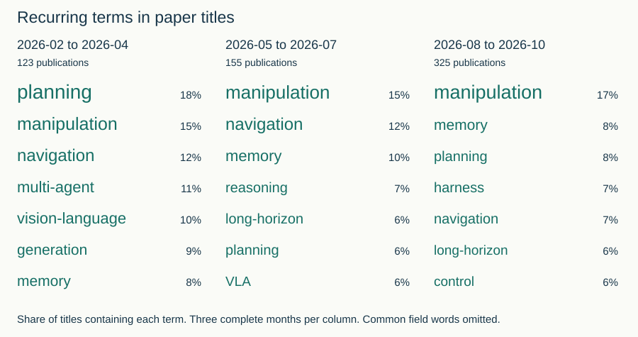

# Awesome Agentic Robotics

A reading list on how robots plan, act and improve through interaction. arXiv dates are first submissions. Project releases, workshop appearances and demos are dated separately. 🌟 marks verified open-source code.

## Trends in the collection

Each dated entry counts once by its primary link, including workshop papers and project releases. A paper added during a backfill appears in its original publication month. Term percentages use all titles in each period as the denominator.

## Where to start reading

Two papers shared the Best Paper Award at the [CoRL 2026 Workshop on Agentic Robotics](https://agentic-robotics-workshop.github.io/#awards). They explore different ways to reuse a robot skill.

- **[Agentic World Action Models](https://arxiv.org/abs/2610.30136)** generates reusable skill programs alongside predicted video and motor commands. Read it for how a world model connects a program to its expected physical outcome.
- **[EmbodiedSWE](https://arxiv.org/abs/2609.27308)** starts with a coding agent solving one simulated task instance, then varies that solution to generate demonstrations. Read it for the transfer experiment where a policy trained on those demonstrations performs a long-horizon task on hardware.

## Browse by method and task

S1 is the policy or skill that turns a goal into robot motion. Each paper appears once under its main demonstrated agent–S1 relationship. Task labels describe the downstream robot goal. Entries with a component-level or offline evaluation name what the authors tested.

- [Agent Uses Robot](#agent-uses-robot) — The agent issues robot commands or generates the control program that executes them.
- [Agent Controls Policies](#agent-controls-policies) — The agent selects, sequences or supervises existing skills or policies. The executor translates each subgoal into motion.
- [Agent Trains Robot](#agent-trains-robot) — The agent builds or improves a separate robot policy or reusable skill through data collection, feedback, program revision or training.
- [Agent Learns to Be Robot](#agent-learns-to-be-robot) — The model that reasons about the task is trained to produce robot actions or executable action programs.

[Related evaluations and resources](#related-evaluations-and-resources) includes cross-method benchmarks, infrastructure and surveys.

**Task families** · Manipulation changes an object’s state. Locomotion & Navigation reaches a destination or executes a movement. Loco-Manipulation requires both moving the robot and handling an object. Interaction & Collaboration requires responding to a person or coordinating with another robot. Multiple labels indicate distinct evaluated goals.

## Agent Uses Robot

The agent issues robot commands or generates the control program that executes them.

- [arXiv 2026.11.16](https://arxiv.org/abs/2611.21099), ForceHarness: Turning Force into Action and Physics for Frozen Frontier Models, [website](https://showlab.github.io/ForceHarness)
  **Task · Manipulation** — Force-regulated contact on ForceBench, HiddenPhys and a physical arm.
- [arXiv 2026.11.14](https://arxiv.org/abs/2611.19198), Self-Calibrating Vision-Agent-Action: Deploying Pick-and-Place to New Robot Cells without Demonstrations or Fine-Tuning
  **Task · Manipulation** — Pick-and-place after gripper or robot-base changes.
- [arXiv 2026.11.13](https://arxiv.org/abs/2611.18298), Objectives as Policies: Vision-Language Model Cost Programs for Contact-Rich Manipulation, [website](https://zihaolu001.github.io/oap-project/)
  **Task · Manipulation** — Pick-and-place, cup reorientation, direct pushing and pushing with a tool.
- [CoRL workshop 2026.11.12](https://openreview.net/forum?id=78L8T5nsLM), Contact Code: A Typed Program Interface for Measurable and Repairable Contact-Rich Manipulation
  **Task · Manipulation** — Repairing force- and touch-sensitive manipulation programs in simulation.
- [arXiv 2026.11.12](https://arxiv.org/abs/2611.16632), Reins: Frontier Multimodal Models Driving Real Robot Arms on Long-Horizon Tasks, Zero-Shot
  **Task · Manipulation** — Long-horizon contact-rich arm manipulation.
- [CoRL workshop 2026.11.12](https://openreview.net/forum?id=sU18hA2zbD), Generalized Planning Interfaces for Agentic Robotics
  **Task · Manipulation** — Multi-step manipulation across eight simulated tasks using generated motion-planning interfaces.
- [arXiv 2026.11.11](https://arxiv.org/abs/2611.16009), JustRUA: A Controlled Study of GPT-6 Robot-Use Agents
  **Task · Manipulation** — Zero-shot manipulation on RoboDojo.
- [arXiv 2026.11.09](https://arxiv.org/abs/2611.12885), World In-Context Learning for Agentic Robot Manipulation, [X · AK’s video post](https://x.com/_akhaliq/status/2120609882663780777) (145 likes · 19,033 views · Nov 16, 2026)
  **Task · Manipulation** — Generating manipulation programs across RoboTwin 2.0 tasks.
- [arXiv 2026.11.09](https://arxiv.org/abs/2611.12177), Embodied First Exam
  **Task · Manipulation + Loco-Manipulation** — Coding-agent control on spatial puzzles, dexterous manipulation and whole-body tasks in simulation.
- [arXiv 2026.11.06](https://arxiv.org/abs/2611.09847), Computer-Use Agents Are Embodied Generalists
  **Task · Locomotion & Navigation** — Following routes and asking for directions on VLNVerse and DialNav, plus visual grounding challenges.
- [arXiv 2026.11.06](https://arxiv.org/abs/2611.09892), On Agentic Manipulation Policies
  **Task · Manipulation + Loco-Manipulation** — Single-arm, bimanual and mobile manipulation across real robot platforms.
- [arXiv 2026.11.05](https://arxiv.org/abs/2611.08209), RoboARCade: Benchmarking Agentic Robot Control
  **Evaluation** — Solving robot-control challenges with and without demonstrations.
- [arXiv 2026.11.04](https://arxiv.org/abs/2611.06184), Can Astra Solve RoboMME without Breaking the Bank?, [workshop](https://openreview.net/forum?id=F1qPCjfU0x)
  **Task · Manipulation** — Memory-dependent manipulation on RoboMME under inference-cost constraints.
- [arXiv 2026.11.04](https://arxiv.org/abs/2611.06863), Rethinking Self-Repair in Code-as-Policy Agents: What Drives Retry Success?
  **Task · Manipulation** — Recovering from failed simulated manipulation with matched retry budgets.
- [arXiv 2026.11.01](https://arxiv.org/abs/2611.01560), Democratizing Robot-Use Agents: A Unified Harness with Open Models, [X · Yuxin Zuo’s uni-robot-agent release](https://x.com/zuo_yuxin/status/2117635294115795134) (282 likes · 109,021 views · Nov 16, 2026)
  **Task · Manipulation** — RoboDojo manipulation and real-robot task execution.
- [arXiv 2026.10.31](https://arxiv.org/abs/2611.01112), Auriga Technical Report: A Task-Agnostic Agent Harness for Zero-Shot Embodied Manipulation
  **Task · Manipulation** — Zero-shot manipulation on RoboDojo.
- [arXiv 2026.10.22](https://arxiv.org/abs/2610.31841), FORCA: A Force-Aware Coding Agent for Contact-Rich Robot Manipulation
  **Task · Manipulation** — Adjusting contact force as objects or surfaces change on a real arm.
- [arXiv 2026.10.21](https://arxiv.org/abs/2610.30051), From Reasoning to Action: Benchmarking Frontier AI Models on LIBERO-10 Robot Manipulation Tasks
  **Task · Manipulation** — Controlling simulated household manipulation on LIBERO-10.
- [arXiv 2026.10.20](https://arxiv.org/abs/2610.27613), Embodied Task Agents Can Perform Fine Manipulation through Tactile In-Context Learning
  **Task · Manipulation** — Fine manipulation from aligned tactile and visual demonstrations.
- [arXiv 2026.10.20](https://arxiv.org/abs/2610.27865), Frontier LLMs Enter the World of Robotics: A Cross-Model Evaluation on RoboColiseum
  **Task · Manipulation** — Cross-model manipulation trials on RoboColiseum.
- [arXiv 2026.10.19](https://arxiv.org/abs/2610.27039), Embodied Playground: A Long-Horizon Agentic Robotics Benchmark for Physical, Strategic, and Spatial Reasoning
  **Task · Manipulation** — Basic manipulation, sequential puzzles and multi-stage simulated household tasks.
- [arXiv 2026.10.18](https://arxiv.org/abs/2610.25287), The Bitter Lesson Comes to Robotics
  **Task · Manipulation** — Direct arm control on six physical RoboDojo manipulation tasks.
- 🌟[arXiv 2026.10.16](https://arxiv.org/abs/2610.23479), HexaShell: A Universal Harness for Robot Coding Agents in Simulation and the Real World, [website](https://hexafuture.ai/blog/hexashell-universal/), [code](https://github.com/HexaFuture/HexaShell)
  **Task · Manipulation** — Kitchen manipulation on RoboCasa365.
- [arXiv 2026.10.15](https://arxiv.org/abs/2610.22496), Scaling Online Exploration for Robot Agents
  **Task · Manipulation + Loco-Manipulation** — Precision, deformable-object and long-horizon mobile manipulation with generated control code.
- [arXiv 2026.10.14](https://arxiv.org/abs/2610.20560), PhySGA: A Physics-Space Grounded Agentic Framework for Generalizable and Interactive 3D Composition
  **Evaluation** — Constructing physically valid arrangements of 3D objects.
- [arXiv 2026.10.14](https://arxiv.org/abs/2610.20998), MoCaP: Mobile Code-as-Policies for Zero-Shot Mobile Manipulation from Passive Human Videos
  **Task · Loco-Manipulation** — Mobile manipulation from passive human video.
- [arXiv 2026.10.13](https://arxiv.org/abs/2610.18874), ChunkAct: Action Chunking for Agentic Robotics
  **Task · Manipulation** — Batched manipulation actions on LIBERO-Pro.
- [arXiv 2026.10.12](https://arxiv.org/abs/2610.17083), Declarative Reactive Robot Behaviors from Imperative Language Models
  **Evaluation** — Generating reactive robot behaviors through a robot OS interface.
- [arXiv 2026.10.12](https://arxiv.org/abs/2610.17350), Can a Frontier VLM Serve as a Robot Policy for Memory-Dependent Manipulation?
  **Task · Manipulation** — Direct VLM control on sixteen memory-dependent RoboMME tasks.
- [arXiv 2026.10.08](https://arxiv.org/abs/2610.12457), SpatialHarness: Test-Time Spatial Scaffolding for Fine Robotic Manipulation
  **Task · Manipulation** — Geometric alignment, relative placement and articulated-object manipulation.
- [arXiv 2026.10.08](https://arxiv.org/abs/2610.12549), Fly-by-Code: Embodied Coding Agents for Aerial Manipulation with Active Visual and Physical Feedback
  **Task · Loco-Manipulation** — Multi-stage object manipulation with an aerial manipulator.
- [arXiv 2026.10.07](https://arxiv.org/abs/2610.10388), RoboQuest: Generalist Physical Agents that Search, Inspect and Test
  **Task · Loco-Manipulation** — Searching for objects, inspecting hidden properties and testing tools across ten mobile manipulation tasks.
- [arXiv 2026.10.07](https://arxiv.org/abs/2610.09588), Adaptive Code Generation for Controlling Robots
  **Evaluation** — Generating robot operation code under changing conditions.
- [arXiv 2026.10.07](https://arxiv.org/abs/2610.10409), RobotWorld: Benchmarking Multimodal Agents for Robot Use Across Diverse Tasks and Embodiments
  **Evaluation** — Constructing perception and control routines across robot-use benchmarks.
- [arXiv 2026.10.05](https://arxiv.org/abs/2610.06843), Recursive Video In-Context Learning for Agentic Robot
  **Task · Manipulation** — Reusing manipulation demonstrations segmented into grasps and releases.
- [arXiv 2026.10.04](https://arxiv.org/abs/2610.04929), RobotUse: Allocating Computation, Context, and Decisions
  **Task · Manipulation** — Robot control on RoboLab under a limited decision budget.
- [arXiv 2026.10.01](https://arxiv.org/abs/2610.01939), Fewer Tokens, Better Action: GPT-6 Astra Robot Agents with 14% Higher Success but 65% Fewer Tokens, [workshop](https://openreview.net/forum?id=wKgMn9vqUi)
  **Task · Manipulation** — LIBERO-Pro, RoboTwin and RoboCasa manipulation.
- [arXiv 2026.10.01](https://arxiv.org/abs/2610.02459), OpenRUA: Robot-Use Agents Are Zero-Shot Visuomotor Policies
  **Task · Manipulation** — Zero-shot visuomotor manipulation on CaP-Bench and LIBERO-Pro.
- [arXiv 2026.09.30](https://arxiv.org/abs/2609.39507), LIBERO-Agent: Evaluating General-Purpose Agents for Direct Embodied Manipulation
  **Task · Manipulation** — Evaluating agent-native direct manipulation on LIBERO-Agent.
- [arXiv 2026.09.29](https://arxiv.org/abs/2609.38078), MotorMind: Scaffolding General Vision Language Models for Zero-Shot Robot Manipulation
  **Task · Manipulation** — Manipulation under LIBERO-Pro perturbations.
- [arXiv 2026.09.29](https://arxiv.org/abs/2610.14018), RoboHarness: A Simple Harness Outperforms VLA and World Action Models, [X · Bince’s comparison](https://x.com/ce_bin49926/status/2118329123151995299) (136 likes · 7,616 views · Nov 16, 2026), [X · follow-up with trajectories](https://x.com/ce_bin49926/status/2118362817598296358)
  **Evaluation** — Household tasks from the BEHAVIOR Challenge.
- [arXiv 2026.09.27](https://arxiv.org/abs/2609.33807), CodeActionBench: Evaluating Agentic Code-as-Policy for Embodied Manipulation
  **Task · Manipulation** — Executing generated manipulation code on CodeActionBench.
- [arXiv 2026.09.24](https://arxiv.org/abs/2609.29389), Robo-Harness K1: Harnessing Robot-Use Agents via Perception Augmentation
  **Task · Manipulation** — Bimanual manipulation on RoboTwin.
- [arXiv 2026.09.24](https://arxiv.org/abs/2609.30233), Coding Agents for Generalized Task and Motion Planning Problems
  **Evaluation** — Synthesizing programs for generalized task and motion planning.
- [arXiv 2026.09.22](https://arxiv.org/abs/2609.28530), Know Your Body: A Harness for Direct and Self-Improving Robot Control with VLMs
  **Evaluation** — Real-robot control under uncertain body calibration.
- [arXiv 2026.09.21](https://arxiv.org/abs/2609.24170), An Unexpected Robot Policy: Early Evaluations of GPT-6 Astra on RoboDojo and Beyond
  **Task · Manipulation** — Direct model control across 42 RoboDojo tasks.
- [arXiv 2026.09.19](https://arxiv.org/abs/2609.22925), "Dear LLaVA, Please Drive": A Depth-Aware Vision-Language Agent for Closed-Loop Robotic Control
  **Task · Locomotion & Navigation** — Semantic driving and navigation with visual depth feedback.
- [arXiv 2026.09.19](https://arxiv.org/abs/2609.23133), AquaCap: A Training-Free Underwater Embodied Agent with Code-as-Policy
  **Task · Loco-Manipulation** — Underwater grasping and object transport with an ROV.
- [arXiv 2026.09.17](https://arxiv.org/abs/2609.20388), Navi-Agent: Unlocalized Monocular Navigation Agent
  **Task · Locomotion & Navigation** — Zero-shot monocular navigation on VLN-CE and real robots.
- [arXiv 2026.09.17](https://arxiv.org/abs/2609.20822), Coding Agents with Harness for Safe Robot Control
  **Task · Manipulation** — Completing manipulation goals while avoiding specified obstacles.
- [arXiv 2026.09.16](https://arxiv.org/abs/2609.18435), WetRobo: A Reproducible Robot Kit for Coding Agents in Biological Laboratories
  **Task · Manipulation** — Lifting a dish lid, removing a cap and opening a door in a laboratory.
- [arXiv 2026.09.16](https://arxiv.org/abs/2609.19347), Kinematics-Grounded Agentic AI for Robotic Additive Manufacturing Process Planning
  **Evaluation** — Selecting kinematically feasible robotic additive-manufacturing plans.
- [arXiv 2026.09.16](https://arxiv.org/abs/2609.19138), In-Context Robot Learning with VLM Agents
  **Evaluation** — Learning robot behaviors from in-context interaction histories.
- [arXiv 2026.09.11](https://arxiv.org/abs/2609.12541), Agent as Policy for Robotic Manipulation
  **Task · Manipulation** — Precision, dynamic and deformable-object manipulation on hardware.
- [arXiv 2026.09.09](https://arxiv.org/abs/2609.10522), Show-Harness: Just a VLM Agent Can Play Robots
  **Task · Manipulation** — Visuomotor manipulation through a visual interface.
- [arXiv 2026.09.01](https://arxiv.org/abs/2609.01404), Evaluating Multimodal LLMs as Generalist Vision-Language-Action Agents for Drone Control: Commanding, Approaching, Tracking and Searching
  **Task · Locomotion & Navigation** — Drone approach, tracking and search in simulation and flight.
- [arXiv 2026.08.29](https://arxiv.org/abs/2608.29379), Bridging Semantics and Physics with Constrained LLMs for Safe and Trustworthy Robotic Manipulation
  **Task · Manipulation** — Pouring liquids, granules and discrete solids on a physical arm.
- [arXiv 2026.08.21](https://arxiv.org/abs/2608.21031), PhysCaP: Grounding Code-as-Policy Agent with Physics-Informed Exploration, [workshop](https://openreview.net/forum?id=JprkI7JQDW)
  **Task · Manipulation** — Tabletop manipulation on hardware and in LIBERO.
- [arXiv 2026.08.19](https://arxiv.org/abs/2608.19281), APPROVE: Visual End-User-in-the-Loop Robot Programming with LLMs
  **Task · Interaction & Collaboration** — User review and correction of generated robot programs.
- [arXiv 2026.08.08](https://arxiv.org/abs/2608.08183), Multi-modal Interactive Control of Robotic Arm based on Offline Large Language Models
  **Task · Interaction & Collaboration** — Controlling a robotic arm through multimodal instructions.
- [arXiv 2026.08.03](https://arxiv.org/abs/2608.11246), Towards the Harness of Embodied Agents
  **Evaluation** — Composing tools for long-horizon physical tasks.
- [arXiv 2026.08.01](https://arxiv.org/abs/2608.00775), ORCESTRA: VLM-driven Visual Robot programming in Mixed Reality
  **Evaluation** — Validating robot programs in mixed reality across multiple embodiments.
- [arXiv 2026.07.28](https://arxiv.org/abs/2607.26148), Embodied Agents Take Control: Minimal-Interface Zero-Shot Agents Rival Industrial-Scale Policies in Vision-and-Language Navigation
  **Task · Locomotion & Navigation** — Following language navigation instructions with a minimal control interface.
- [arXiv 2026.07.13](https://arxiv.org/abs/2607.11119), VIA: Visual Interface Agent for Robot Control
  **Task · Manipulation** — Simulated tabletop manipulation via a visual robot interface.
- [arXiv 2026.06.30](https://arxiv.org/abs/2606.31158), LLM-Powered Interactive Robotic Action Synthesis from Multimodal Speech, Gestures, and Music
  **Task · Interaction & Collaboration** — Generating robot actions from human speech, gesture and music.
- [arXiv 2026.06.15](https://arxiv.org/abs/2606.16458), RHO: Your Coding Agent is Secretly a Roboticist
  **Task · Manipulation** — Pick-and-place with LIBERO-Pro perturbations.
- [arXiv 2026.06.02](https://arxiv.org/abs/2606.03047), ModuLoop : Low-Level Code Generation using Modular Synthesizer and Closed-Loop Debugger for Robotic Control
  **Task · Manipulation** — Robot calibration followed by pick-and-place validation.
- [arXiv 2026.04.22](https://arxiv.org/abs/2604.20348), Bimanual Robot Manipulation via Multi-Agent In-Context Learning
  **Task · Manipulation** — Bimanual manipulation with in-context coordination.
- [arXiv 2026.04.13](https://arxiv.org/abs/2604.10929), Ro-SLM: Onboard Small Language Models for Robot Task Planning and Operation Code Generation
  **Evaluation** — Generating robot operation code with an onboard model.
- [arXiv 2026.03.27](https://arxiv.org/abs/2603.26997), ROSClaw: An OpenClaw ROS 2 Framework for Agentic Robot Control and Interaction
  **Evaluation** — Executing physical commands through ROS 2 and checking executive behavior.
- [arXiv 2026.03.23](https://arxiv.org/abs/2603.22435), CaP-X: A Framework for Benchmarking and Improving Coding Agents for Robot Manipulation
  **Task · Manipulation** — Generating and executing manipulation code on benchmark tasks.
- [arXiv 2026.03.16](https://arxiv.org/abs/2603.15134), Confusion-Aware In-Context-Learning for Vision-Language Models in Robotic Manipulation
  **Task · Manipulation** — Following manipulation demonstrations on VIMA-Bench.
- [arXiv 2026.03.05](https://arxiv.org/abs/2603.05621), RACAS: Controlling Diverse Robots With a Single Agentic System
  **Evaluation** — Executing instructions on a wheeled robot, an articulated limb and an underwater vehicle.
- [arXiv 2026.02.24](https://arxiv.org/abs/2602.21161), ActionReasoning: Robot Action Reasoning in 3D Space with LLM for Robotic Brick Stacking
  **Task · Manipulation** — Placing and stacking bricks stably.
- [arXiv 2026.02.02](https://arxiv.org/abs/2602.02839), Language Movement Primitives: Grounding Language Models in Robot Motion
  **Task · Manipulation** — Tabletop manipulation via generated movement primitives.
- [arXiv 2026.01.28](https://arxiv.org/abs/2601.20334), Demonstration-Free Robotic Control via LLM Agents
  **Task · Manipulation** — Demonstration-free control on LIBERO, ManiSkill3 and MetaWorld.
- [arXiv 2026.01.27](https://arxiv.org/abs/2601.19510), ALRM: Agentic LLM for Robotic Manipulation
  **Task · Manipulation** — Executing language-specified robotic-arm manipulations.
- [arXiv 2025.12.24](https://arxiv.org/abs/2512.21293), Quadrupped-Legged Robot Movement Plan Generation using Large Language Model
  **Task · Locomotion & Navigation** — Executing quadruped movement plans in indoor scenarios.
- [arXiv 2025.12.09](https://arxiv.org/abs/2512.08629), See-Control: A Multimodal Agent Framework for Smartphone Interaction with a Robotic Arm
  **Task · Manipulation** — Operating a smartphone with a physical robot arm.
- [arXiv 2025.12.01](https://arxiv.org/abs/2512.02002), LLM-Driven Corrective Robot Operation Code Generation with Static Text-Based Simulation
  **Evaluation** — Generating and correcting robot operation code with simulated checks.
- [arXiv 2025.11.24](https://arxiv.org/abs/2511.19315), Rethinking Intermediate Representation for VLM-based Robot Manipulation
  **Task · Manipulation** — Real-world manipulation with alternative intermediate representations.

## Agent Controls Policies

The agent selects, sequences or supervises existing skills or policies. The executor translates each subgoal into motion.

- [arXiv 2026.11.16](https://arxiv.org/abs/2611.21517), Lazy-MOSAIC: Accelerating Skill-Centric Manipulation Planning with Learned Skill-Effect World Models
  **Task · Manipulation** — Planning sequences of parameterized manipulation skills.
- [arXiv 2026.11.16](https://arxiv.org/abs/2611.20676), Learning and Verifying Progress: Closed-Loop Agentic Planning with Progress-Enhanced Execution for Long-Horizon Vision-Language Navigation
  **Task · Locomotion & Navigation** — Checking progress while executing long-horizon navigation instructions.
- [arXiv 2026.11.15](https://arxiv.org/abs/2611.20230), A Matrix with Steps: An Episodic and Procedural Memory Method for Tool-Using Agents and Robots
  **Evaluation** — Comparing self-judged and externally checked task completion in simulation.
- [arXiv 2026.11.15](https://arxiv.org/abs/2611.19952), CRAFT: A Robot-Agent Harness with Scope-Aware Adaptation
  **Evaluation** — Adapting simulated task execution to changing user requirements.
- [arXiv 2026.11.15](https://arxiv.org/abs/2611.19912), AgenticJevNav: Agentic Object Search and Navigation via Event-Driven Verification
  **Task · Locomotion & Navigation** — Object search with bounded search reporting on a physical quadruped.
- [arXiv 2026.11.13](https://arxiv.org/abs/2611.17730), ERA: Error-Resistant Autonomous Object Navigation with Predicted Depth
  **Task · Locomotion & Navigation** — Finding object goals using predicted depth and error recovery.
- [arXiv 2026.11.13](https://arxiv.org/abs/2611.18026), A Generalizable Approach to Safety-Aware Robotic Behavior Planning with an Explicit Constraint Space
  **Task · Manipulation** — Planning tabletop actions under explicit safety constraints.
- [Demo 2026.11.12](https://atlas-humanoid.github.io/), ATLAS: Agentic Harness for Whole-Body Intelligence from Human Video, [award](https://agentic-robotics-workshop.github.io/#awards), [X · JunLi Ren’s CoRL demo](https://x.com/junli_r84995/status/2121098492257108116) (173 likes · 15,657 views · Nov 16, 2026)
  **Task · Loco-Manipulation** — Navigating stairs, picking up objects and carrying them on a humanoid.
- [arXiv 2026.11.12](https://arxiv.org/abs/2611.16487), HeMeR: Heterogeneous Memory Reconciliation for Embodied Agents via Structured KV Reuse
  **Evaluation** — Retrieving and reconciling memories during ALFWorld and Habitat tasks.
- [CoRL workshop 2026.11.12](https://openreview.net/forum?id=BCdDYO0jo9), SUTO: Failure-Localized Reasoning for Robot Task Planning and Execution
  **Task · Manipulation** — Localizing failed execution steps in LIBERO-Pro and real manipulation.
- [arXiv 2026.11.12](https://arxiv.org/abs/2611.16386), Remember What Changes the Odds: Critic-Gated Event Memory for Long-Horizon Manipulation
  **Task · Manipulation** — Long-horizon manipulation using memories of successes and failures.
- [arXiv 2026.11.12](https://arxiv.org/abs/2611.17598), X-Nav Technical Report: Real-World Long-Horizon Indoor-to-Outdoor Navigation on a Humanoid Robot
  **Task · Locomotion & Navigation** — Long-horizon indoor-to-outdoor navigation and R2R-CE/RxR-CE routes.
- 🌟[arXiv 2026.11.12](https://arxiv.org/abs/2611.16671), NSDL: Neuro-Symbolic Division of Labor for Multi-Robot Task Planning, [code](https://github.com/Xincheng-Tan/NSDL)
  **Task · Interaction & Collaboration** — Allocating subtasks across robots with different capabilities.
- [arXiv 2026.11.11](https://arxiv.org/abs/2611.15317), BiPOP: Partial-Order Planning for Long-Horizon Bimanual Robotic Manipulation
  **Task · Manipulation** — Sequencing bimanual subtasks with partial-order plans.
- [arXiv 2026.11.11](https://arxiv.org/abs/2611.15651), Recover, Don't Just Continue: Learning from Feedback for Physical Failure Understanding and Correction
  **Task · Manipulation** — Diagnosing physical failures and selecting corrections for a frozen VLA.
- [arXiv 2026.11.11](https://arxiv.org/abs/2611.15589), EMS-Nav: Embodied Multi-Scale Navigation
  **Task · Locomotion & Navigation** — Multi-scale route following in real indoor environments.
- [arXiv 2026.11.11](https://arxiv.org/abs/2611.15093), Decide Before You Move: Diffusion-Generated Search Reference for Zero-Shot Open-Vocabulary Object Navigation in Semi-Static Environments
  **Task · Locomotion & Navigation** — Finding open-vocabulary objects after their locations change.
- [arXiv 2026.11.10](https://arxiv.org/abs/2611.14834), Learning Low-Latency Action Verification for Frozen Vision-Language-Action Models
  **Task · Manipulation** — Verifying action execution in LIBERO-10 and on real manipulation tasks.
- [arXiv 2026.11.09](https://arxiv.org/abs/2611.13251), Curie's Jarvis: Autonomous Robotic Chemistry Experiments from Printed Protocols
  **Task · Manipulation** — Following printed experimental protocols with a Franka arm.
- [arXiv 2026.11.09](https://arxiv.org/abs/2611.12409), Bridging Task Planning and Execution for Language-Conditioned Bimanual Manipulation, Humanoids 2026, [website](https://advrhumanoids.github.io/bridging-planning-execution/)
  **Task · Manipulation** — Planning and executing language-conditioned bimanual manipulation.
- [arXiv 2026.11.09](https://arxiv.org/abs/2611.13039), Robo-MLT: Dual-System Robotic Manipulation for Long-Horizon Medical Laboratory Tasks
  **Task · Manipulation** — Tracking multi-stage laboratory manipulation workflows.
- [arXiv 2026.11.09](https://arxiv.org/abs/2611.12139), BioMARS 2.0: a robotic biologist for formulating and adapting biological experiments
  **Evaluation** — Robotic execution and adaptation of experimental workflows.
- [arXiv 2026.11.09](https://arxiv.org/abs/2611.13161), Cognitive Multi-Agent Search and Rescue: Language-Grounded Hierarchical Reinforcement Learning for Collaborative Robotics
  **Task · Interaction & Collaboration** — Coordinating multiple agents during search and rescue.
- [arXiv 2026.11.08](https://arxiv.org/abs/2611.12983), CAFE: Closed-Loop Autonomous Task Formulation and Execution without Instance-Specific Instructions
  **Evaluation** — Formulating and executing tasks across AI2-THOR household scenes.
- [arXiv 2026.11.08](https://arxiv.org/abs/2611.11665), HINT-VLM: Humanoid Interactive Navigation over Rough Terrain with Embodiment-Grounded Vision-Language Model
  **Task · Locomotion & Navigation** — Humanoid navigation over rough terrain.
- [arXiv 2026.11.03](https://arxiv.org/abs/2611.05058), Do Agentic Policies Need to Look at Every Step? Geometric Abstraction for Reasoning and Action, [website](https://geometric-abstraction.github.io/), [workshop](https://openreview.net/forum?id=CQFstcjx1Z)
  **Task · Manipulation** — Building a bridge tower, placing a ring on a peg and relocating a tower in simulation.
- [arXiv 2026.11.02](https://arxiv.org/abs/2611.03584), TAMPAgent: Agentic Belief-Space Planning for Mobile Manipulation
  **Task · Loco-Manipulation** — Planning mobile manipulation with uncertain scene state.
- [arXiv 2026.11.02](https://arxiv.org/abs/2611.04080), FEIJOA: Task-Driven Grounding and Execution for Mobile Manipulation, [workshop](https://openreview.net/forum?id=Eq3xq6KZDC)
  **Task · Loco-Manipulation** — Grounding and executing mobile manipulation with a Spot robot.
- [arXiv 2026.11.01](https://arxiv.org/abs/2611.01404), Serving Agentic Robot Fleets: Workload Characterization, KV-Cache Thrashing, and Admission Control
  **Evaluation** — Serving planner and VLA requests from LIBERO-Pro episode traces.
- [CoRL 2026.11](https://openreview.net/forum?id=k9EjTLL8bA), RAMT-VLA: Reliability-Aware Memory Tracing for Historical Support Assessment in Vision-Language-Action Models
  **Task · Manipulation** — Reranking frozen-policy action candidates using interaction history on LIBERO.
- [CoRL 2026.11](https://openreview.net/forum?id=nBwRDRUdMc), MessyNav: Zero-Shot Navigation via Manipulation in Messy Environments, [website](https://messynav.github.io)
  **Task · Locomotion & Navigation** — Reaching a physical goal by moving or bypassing obstructing objects.
- [arXiv 2026.10.30](https://arxiv.org/abs/2610.42053), REA: A Routed Embodied Agent Runtime for Asynchronous Brain-Cerebellum Control
  **Task · Manipulation** — Selecting controllers during LIBERO-Pro manipulation.
- [arXiv 2026.10.29](https://arxiv.org/abs/2610.40248), LLM-guided Planar Loco-Manipulation for Quadruped Robots
  **Task · Loco-Manipulation** — Pushing objects across a plane with a quadruped.
- [arXiv 2026.10.26](https://arxiv.org/abs/2610.35687), TrySee: Modular Perception-Enhanced VLM Grounding for Closed-Loop Robot Task Planning in Specialized Domains
  **Task · Manipulation** — Task planning including physical robot disassembly.
- [arXiv 2026.10.26](https://arxiv.org/abs/2610.35686), FISRF: Flexible Instructional Scaffolding Reflection Framework for Robotics Task Planning with Large Language Model
  **Evaluation** — Correcting execution in ALFWorld and on physical robots.
- [arXiv 2026.10.26](https://arxiv.org/abs/2610.35832), Profiling a Frontier Agent with EBench: From Direct Control to Harness with Policy
  **Task · Manipulation** — Comparing direct manipulation with and without policy invocation on EBench.
- [arXiv 2026.10.25](https://arxiv.org/abs/2610.34370), ThinkLocoManip: A Whole-Body Control Agentic Harness for Legged Loco-Manipulation
  **Task · Loco-Manipulation** — Coordinating locomotion and manipulation on a legged robot.
- [arXiv 2026.10.22](https://arxiv.org/abs/2610.30587), Know When to Escalate: Critic-Guided Adaptive Execution for Cloud-Local Embodied Agents
  **Evaluation** — Switching between cloud and local executors during embodied tasks.
- [arXiv 2026.10.22](https://arxiv.org/abs/2610.31427), FastHarness: Experience-Driven Review Scheduling for Vision-Language-Action Policies
  **Task · Manipulation** — Scheduling review and recovery on four simulated manipulation tasks.
- [arXiv 2026.10.21](https://arxiv.org/abs/2610.30043), TARSphere: A Robot-Oriented Full-Stack Framework for Long-Horizon Embodied Agents in Evolving Physical and Social Environments
  **Task · Locomotion & Navigation + Loco-Manipulation** — Navigating and reporting, and fetching and delivering, under changing instructions.
- [arXiv 2026.10.20](https://arxiv.org/abs/2610.28109), FIT-MAC: A Closed-Loop Multi-Agent Framework for Robust Vision-Language-Action Models
  **Task · Manipulation** — Increasing robustness of VLA execution on LIBERO-Pro.
- [arXiv 2026.10.17](https://arxiv.org/abs/2610.24603), Refuse the Harm, Complete the Task via Graph-of-Rules Planning for LLM-Enabled Robots
  **Evaluation** — Completing safe parts of instructions under rule-constrained planning.
- [arXiv 2026.10.16](https://arxiv.org/abs/2610.24016), CLARO: Clutter Aware Robot Orchestrator for Open-Vocabulary Grasping using VLM Agents
  **Task · Manipulation** — Open-vocabulary grasping in clutter on a robot arm.
- [arXiv 2026.10.15](https://arxiv.org/abs/2610.21453), CarryOn: A Dual-Loop Harness for Personalized and Reliable Robot Assistance
  **Task · Interaction & Collaboration** — Executing user-specific assistance subtasks and recovering after failure.
- [arXiv 2026.10.15](https://arxiv.org/abs/2610.21211), An Agentic Framework for Proactive Robots with Procedural Assistance Memory
  **Task · Interaction & Collaboration** — Anticipating desk assistance needs over five days of changing user routines.
- [arXiv 2026.10.14](https://arxiv.org/abs/2610.19600), Cracking Mobile Manipulation: From Failure Diagnosis to Agentic Robot System
  **Task · Loco-Manipulation** — Household mobile manipulation in BEHAVIOR-1K and on hardware.
- [arXiv 2026.10.14](https://arxiv.org/abs/2610.19618), F2A-ObjectNav: An Adaptive Agentic Architecture for Object-Goal Navigation
  **Task · Locomotion & Navigation** — Object navigation in AI2-THOR, RoboTHOR and ProcTHOR.
- 🌟[arXiv 2026.10.13](https://arxiv.org/abs/2610.17927), GLST: Global-Local Spatio-Temporal Memory Decomposition Framework for Online Chained-Goal Navigation, [CoRL 2026](https://openreview.net/forum?id=xyFvvMLQRo), [code](https://github.com/Yousef-Liang/glst)
  **Task · Locomotion & Navigation** — Reaching successive goals using global and local memory on Spot.
- [arXiv 2026.10.13](https://arxiv.org/abs/2610.18307), I2O2I-Nav: A Benchmark with a Modular Agent for Long-Horizon Indoor-to-Outdoor-to-Indoor Navigation
  **Task · Locomotion & Navigation** — Routes connecting interiors and exteriors across buildings.
- [arXiv 2026.10.12](https://arxiv.org/abs/2610.17089), Interactive Navigation Beyond Reachability: Benchmark and Agentic Framework
  **Task · Locomotion & Navigation** — Object-goal navigation through channels or containers in MolmoSpaces.
- [arXiv 2026.10.12](https://arxiv.org/abs/2610.16238), Embodied Skill Bench: Benchmarking How Well Agents with Embodied Skills Perform on Physical Tasks
  **Task · Manipulation** — Testing supplied skills on perturbed LIBERO-Pro tasks.
- [arXiv 2026.10.11](https://arxiv.org/abs/2610.15766), SurgiCLAW: An Interpretable Atomic-Skill Agent for Precision Robotic Micromanipulation
  **Task · Manipulation** — Precision implantation on a physical micromanipulator.
- [arXiv 2026.10.10](https://arxiv.org/abs/2610.15224), Persistent LLM Orchestration of Heterogeneous Robot Teams via Partial Delegation to Multi-Agent Protocols
  **Task · Interaction & Collaboration** — Coordinating robots for simulated urban search and dispatch.
- [arXiv 2026.10.10](https://arxiv.org/abs/2610.15038), Training-Free Multi-Agent Cooperative Embodied Search from Uncertain Vision-Language Priors
  **Task · Interaction & Collaboration** — Cooperative target search in Matterport3D environments.
- [arXiv 2026.10.09](https://arxiv.org/abs/2610.13862), BT-Agent: Deploying Onboard Robot Agents with Behavior Trees and Multi-Fidelity Evaluation
  **Evaluation** — Executing behavior-tree tasks in text and in Habitat.
- [arXiv 2026.10.09](https://arxiv.org/abs/2610.14341), CoPlanVLM: Coordinated Path Planning for a Robot Team using Vision Language Models
  **Task · Interaction & Collaboration** — Coordinating robot routes, loops and area coverage.
- [arXiv 2026.10.08](https://arxiv.org/abs/2610.14106), Embodied Zero-Shot Task Planning via Hardware-Aware LLM-VLM Integration for Grounded Robotic Manipulation
  **Task · Manipulation** — Planning manipulation subject to robot hardware constraints.
- [arXiv 2026.10.08](https://arxiv.org/abs/2610.12793), Gamma: Grounded Multi-Agent Memory with Mechanical Audit for Memory-Intensive Manipulation
  **Task · Manipulation** — Converting remembered evidence into grounded manipulation subgoals.
- [arXiv 2026.10.08](https://arxiv.org/abs/2610.12126), SuperNav: An Agentic Navigation System for Any Task in Any Scene
  **Task · Locomotion & Navigation** — Routing navigation requests to task-appropriate navigation modules.
- [arXiv 2026.10.08](https://arxiv.org/abs/2610.12761), Verifier-Mediated Multi-LLM Coordination for Multi-Robot Path Planning
  **Task · Interaction & Collaboration** — Coordinated paths in CARLA and on Crazyflie robots.
- [arXiv 2026.10.07](https://arxiv.org/abs/2610.10812), Skill-SLM: Agent Skill-driven Small Language Models for Reliable Robot Operation
  **Task · Locomotion & Navigation** — Operating UAVs and ground vehicles from task instructions.
- [arXiv 2026.10.07](https://arxiv.org/abs/2610.10962), iAm.md: Robot Skill Self-Assessment through Agentic Introspection for Unknown Open-Vocabulary Domains
  **Task · Loco-Manipulation** — Assessing skills and executing navigation-and-manipulation tasks on a simulated TIAGo.
- [arXiv 2026.10.07](https://arxiv.org/abs/2610.09358), COOL: Curiosity-Driven Object Ownership Learning for Personalized Robotic Assistance, [CoRL 2026](https://openreview.net/forum?id=v4QUDwGroQ)
  **Task · Interaction & Collaboration** — Identifying and finding objects associated with individual users.
- [arXiv 2026.10.07](https://arxiv.org/abs/2610.10787), NavGPT-3: Harnessing Context in a Hierarchical Navigation Runtime
  **Task · Locomotion & Navigation** — Following navigation instructions with a hierarchical runtime.
- [arXiv 2026.10.06](https://arxiv.org/abs/2610.07649), OntoPlan: An Ontology-Grounded Scene Representation and Agentic Framework for Scalable Robot Task Planning
  **Evaluation** — Planning indoor household tasks across multiple scene scales.
- [arXiv 2026.10.05](https://arxiv.org/abs/2610.05964), From Social Reasoning to Embodied Interaction: An Agentic Framework for Social Robots
  **Task · Interaction & Collaboration** — Expressive social interaction on Sophia.
- [arXiv 2026.10.05](https://arxiv.org/abs/2610.08862), CIRRA: Dual-Level Continual Instruction Reconciliation with Ongoing Execution for Embodied Robot Agents in Interactive Household Tasks
  **Task · Interaction & Collaboration** — Interrupting and revising ongoing household tasks on a G1.
- [arXiv 2026.10.05](https://arxiv.org/abs/2610.07477), MRPilot: Supervising and Intervening LLM-Based Multi-Robot Teams through Mixed Reality
  **Task · Interaction & Collaboration** — Human supervision of multi-robot teams in a simulated home.
- [arXiv 2026.10.04](https://arxiv.org/abs/2610.04916), PreAct-Nav: Agentic Reasoning Before Action for Urban Navigation
  **Task · Locomotion & Navigation** — Selecting actions during urban route following.
- [arXiv 2026.10.01](https://arxiv.org/abs/2610.01178), Recova: Agent-Guided Failure Recovery for Autonomous Robotic Manipulation
  **Task · Manipulation** — Recovering from failed manipulation on LIBERO-Pro and MolmoSpaces.
- [arXiv 2026.09.30](https://arxiv.org/abs/2609.39915), NavHarness: Adaptive Goals for Agentic Vision-Language Navigation
  **Task · Locomotion & Navigation** — Reaching language-specified destinations on eight physical routes.
- [arXiv 2026.09.29](https://arxiv.org/abs/2609.36808), Spotter: Let the Embodied Model Lead, and the VLM Reflect for It
  **Task · Manipulation** — Detecting execution errors and redirecting a running policy.
- [arXiv 2026.09.29](https://arxiv.org/abs/2609.37554), Risk-Aware Semantic Grounding for Trustworthy LLM-Based Robot Planning
  **Task · Locomotion & Navigation** — Following valid navigation instructions and rejecting ambiguous or conflicting goals.
- [arXiv 2026.09.29](https://arxiv.org/abs/2609.36595), Simple Agentic Memory for Generalist Robot Policies
  **Task · Manipulation** — Tracking persistent object identity and task state for robot policies.
- [arXiv 2026.09.28](https://arxiv.org/abs/2609.34823), AGRO-SUVIDE: Agentic Robotics for Surgical Viscoelastic Debridement
  **Task · Manipulation** — Removing fragments with a surgical robot.
- [arXiv 2026.09.28](https://arxiv.org/abs/2609.36151), KPI: A Promptable Kernel for Physical Interaction on Humanoids, [workshop](https://openreview.net/forum?id=F7Dp4022mM)
  **Task · Loco-Manipulation** — Whole-body physical interaction including turning a winch.
- [arXiv 2026.09.28](https://arxiv.org/abs/2609.34270), Bayesian Active Learning for Intent Disambiguation in Interactive Robot Planning, [CoRL 2026](https://openreview.net/forum?id=El4EDBhqCG)
  **Task · Interaction & Collaboration** — Disambiguating human intent during interactive planning.
- [arXiv 2026.09.28](https://arxiv.org/abs/2609.35965), Systematic Multi-Agent Vision-and-Language Navigation: Formulation, Benchmark, and Method
  **Task · Interaction & Collaboration** — Scheduling and coordinating multi-agent language navigation.
- [arXiv 2026.09.25](https://arxiv.org/abs/2609.31112), DualManip: Agentic Dynamic Manipulation via Dual-Path Semantic Reasoning and Geometric Adaptation
  **Task · Manipulation** — Maintaining manipulation under changing scene geometry.
- [arXiv 2026.09.24](https://arxiv.org/abs/2609.29091), From Passive Execution to Active Exploration: Agentic Embodied Manipulation in Realistic Environments
  **Task · Manipulation** — Manipulation with partially observable task state.
- [arXiv 2026.09.24](https://arxiv.org/abs/2609.29964), World Action Agent: Harnessing VLMs for Robot Manipulation via World Action Rehearsal
  **Task · Manipulation** — Reusing manipulation skills on LIBERO-Pro after world-model rehearsal.
- [arXiv 2026.09.24](https://arxiv.org/abs/2609.29043), Design and Evaluation of LLM Chaining-Based Task Planning for General Purpose Service Robots
  **Evaluation** — Planning from randomly generated service-robot commands.
- [arXiv 2026.09.24](https://arxiv.org/abs/2609.29212), ADM-Planner: LLM-Guided Long-Horizon Planning for Mobile Manipulators with Attention-Enhanced Dynamic Memory
  **Task · Loco-Manipulation** — Executing indoor and outdoor mobile-manipulator missions.
- [arXiv 2026.09.24](https://arxiv.org/abs/2609.28973), AquaMend: Minimal Re-probing and Conditional Rollback for Latent-Belief Failures in Embodied Agents
  **Evaluation** — Recovering latent state by selective re-probing in simulated scenarios.
- [arXiv 2026.09.23](https://arxiv.org/abs/2609.27612), RegenHarness: A Robot Agent Harness with Evidence-Gated Recursive Self-Improvement
  **Task · Locomotion & Navigation** — Voice-triggered warehouse patrol, panoramic inspection, return and reporting on a quadruped.
- [arXiv 2026.09.23](https://arxiv.org/abs/2609.27340), Spatial and Semantic Reasoning for LLM-Driven Robot Navigation via MCP
  **Task · Locomotion & Navigation** — Autonomous mapping and reaching spatially or semantically defined goals.
- [arXiv 2026.09.23](https://arxiv.org/abs/2609.27526), NavProbe: Evidence-Grounded Reasoning with Active Memory Retrieval for Zero-Shot Navigation
  **Task · Locomotion & Navigation** — Finding object goals on HM3D-v2 and in real-robot demonstrations.
- [arXiv 2026.09.23](https://arxiv.org/abs/2609.27720), CoRelNav: Collaborative Relational Navigation for Multi-Robot Spatially Constrained Semantic Navigation
  **Task · Interaction & Collaboration** — Collaborative navigation subject to relative spatial constraints.
- [arXiv 2026.09.21](https://arxiv.org/abs/2609.24055), Toward Human-in-the-Loop Robot Failure Recovery: Bridging Communication Gaps in Human-Robot Collaboration
  **Task · Interaction & Collaboration** — Requesting human help to recover from robot execution failures.
- [arXiv 2026.09.20](https://arxiv.org/abs/2609.23841), Structured World-State Reasoning for Agentic Robotic Search
  **Task · Locomotion & Navigation** — Searching for targets using quadrotor sensing waypoints.
- [arXiv 2026.09.20](https://arxiv.org/abs/2609.23944), Topology-Informed Visual Prompting for Hierarchical Vision-Language-Action Control, [workshop](https://openreview.net/forum?id=RkzWx9Sfcz)
  **Task · Manipulation** — Simulated bimanual tasks and real-world box pickup.
- [arXiv 2026.09.17](https://arxiv.org/abs/2609.19974), MaskHarness-WAM: Instance-Grounded Harnessing for Long-Horizon Robot Manipulation
  **Task · Manipulation** — Sequential multi-object manipulation on hardware.
- [arXiv 2026.09.17](https://arxiv.org/abs/2609.20791), StageGuard: Learning Stage Transitions for Long-Horizon Robot Tasks via Agentic Distillation
  **Evaluation** — Predicting when to switch skills in BEHAVIOR-1K and on real robots.
- [arXiv 2026.09.17](https://arxiv.org/abs/2609.20330), RoboFind: Multi-Agent Personalized Object Search for People Who Are Blind or Have Low Vision
  **Task · Interaction & Collaboration** — Finding personally relevant objects for blind or low-vision users.
- [arXiv 2026.09.16](https://arxiv.org/abs/2609.18869), KINO: A Keyframe Interface for VLM Planning and Whole-Body Control in Humanoid Loco-Manipulation
  **Task · Loco-Manipulation** — Picking up, transporting and placing objects with a G1 humanoid.
- [arXiv 2026.09.16](https://arxiv.org/abs/2609.19315), GAVEL: Graph World Models for Verified and Efficient Long-Horizon LLM Task Planning
  **Evaluation** — Planning long-horizon and multi-task BEHAVIOR-1K instructions.
- [arXiv 2026.09.16](https://arxiv.org/abs/2609.19413), From Rollout to Reset: A Graph-Based Harness for Autonomous Long-Horizon Manipulation Evaluation
  **Task · Manipulation** — Resetting and repeating long-horizon manipulation evaluations.
- [arXiv 2026.09.15](https://arxiv.org/abs/2609.17771), HINT-Plan: Human Intention-Aware Robot Task Planning in Context-Rich Environments using Vision Language Models
  **Task · Interaction & Collaboration** — Planning robot actions with contextual human intent.
- [arXiv 2026.09.14](https://arxiv.org/abs/2609.16331), ManiSkillFormer: Demonstration-Free Compositional Manipulation via Geometric Contracts and Agentic Skill Graph
  **Task · Manipulation** — Pick-and-place and functional object manipulation.
- [arXiv 2026.09.14](https://arxiv.org/abs/2609.15976), MessyMem: Learning-from-Doing Memory for Mobile Manipulation
  **Task · Loco-Manipulation** — Reusing previous interactions across successive mobile manipulation tasks.
- [arXiv 2026.09.14](https://arxiv.org/abs/2609.15195), HarnessVLN: Unifying Training-Free Embodied Navigation through an Agent Harness
  **Task · Locomotion & Navigation** — Instruction-following and object-goal navigation.
- [arXiv 2026.09.11](https://arxiv.org/abs/2609.13335), Bridging Thought and Action: Taming Long-Horizon Instability in Open-Source LLM Agents with a MetaTool-Enhanced ROS Framework
  **Evaluation** — Completing long-horizon tasks using a ROS tool interface.
- [arXiv 2026.09.10](https://arxiv.org/abs/2609.11225), Harness Robotic OS: A Unified Embodied-Agent Runtime for Closed-Loop Quadruped Inspection
  **Task · Locomotion & Navigation** — Quadruped navigation and inspection.
- [arXiv 2026.09.10](https://arxiv.org/abs/2609.11308), 2AM: Grounding Agent-Side Memory as Guidance for Steerable Action Models in Long-Horizon Manipulation, [workshop](https://openreview.net/forum?id=y0qBMe2qH3)
  **Task · Manipulation** — Memory-conditioned manipulation on LIBERO-Mem.
- [arXiv 2026.09.09](https://arxiv.org/abs/2609.10895), ReactHuman: A Physics-Grounded Benchmark for Human-Like Reactive Decision-Making in Embodied Multimodal LLMs
  **Task · Interaction & Collaboration** — Responding to physical events through a simulated human body.
- [arXiv 2026.09.08](https://arxiv.org/abs/2609.08402), Towards Embodied Air-Ground Cooperative Object Search: Benchmark, Dataset and Agentic Method
  **Task · Interaction & Collaboration** — Cooperative aerial and ground search for specified objects.
- [arXiv 2026.09.08](https://arxiv.org/abs/2609.08444), Safe Task Planning with Long-Term Graph Memory for Embodied Agents
  **Evaluation** — Planning safe embodied actions on IS-Bench and a physical robot.
- [arXiv 2026.09.07](https://arxiv.org/abs/2609.07288), How Long Until Your Robot Ignores You? A Safety Benchmark for LLM Orchestrators in Human-Humanoid Collaboration
  **Task · Interaction & Collaboration** — Following human interventions over extended interaction sessions.
- [arXiv 2026.09.06](https://arxiv.org/abs/2609.06508), VLA-Corrector: Stage-Aware Observable State Understanding for Prompt-Based Closed-Loop Recovery of Vision-Language-Action Policies
  **Task · Manipulation** — Recovering from task perturbations in LIBERO and LIBERO-Plus.
- [arXiv 2026.09.05](https://arxiv.org/abs/2609.05985), A Brain-inspired Hierarchical Framework for Zero-Shot Robot Task Reasoning and Execution
  **Task · Manipulation** — Board cleaning and pick-and-place.
- [arXiv 2026.09.02](https://arxiv.org/abs/2609.02653), HINT: Human-Intent Inception for Long-Horizon Robot Manipulation
  **Task · Manipulation + Interaction & Collaboration** — Inferring human goals for long-horizon manipulation.
- [arXiv 2026.09.01](https://arxiv.org/abs/2609.01281), EmbodiedSkills: World Action Model-augmented Cascaded Skills for Vision-Language-Action Agent
  **Task · Manipulation** — Chaining actions and pick-and-place skills.
- [arXiv 2026.08.31](https://arxiv.org/abs/2608.30396), Scaffolding Foundation Models into Physical-World Agents Pushes the Frontier of Long-Horizon Navigation
  **Task · Locomotion & Navigation** — Long-horizon physical navigation to distant goals.
- [arXiv 2026.08.30](https://arxiv.org/abs/2608.29537), AGM: Achievement-Grounded Memory for Closed-Loop Agents with Frozen VLA Policies
  **Task · Manipulation** — Counting repeated picks and filling bins in RoboMME.
- [arXiv 2026.08.28](https://arxiv.org/abs/2608.28300), MaCoPlanner: LLM-Assisted Manual-Compiled Task Planning with Proactive Safety Verification for Robotic Industrial Panel Operation
  **Task · Manipulation** — Operating a simulated industrial control panel.
- [arXiv 2026.08.27](https://arxiv.org/abs/2608.26788), Decoupling Planning and Control for Instructable Agents
  **Task · Interaction & Collaboration** — Executing instructed tasks including multi-agent coordination.
- [arXiv 2026.08.27](https://arxiv.org/abs/2608.27225), STEP: State-Aware Task Estimation and Planning with Multi-Modal LLMs for Human-Robot Collaboration
  **Task · Interaction & Collaboration** — Human–robot collaborative assembly in simulation.
- [arXiv 2026.08.24](https://arxiv.org/abs/2608.22971), ParallelWorld: Test-Time Scaling for Agentic Embodied Reasoning
  **Task · Manipulation** — Active spatial reasoning and language-conditioned LIBERO-Pro manipulation.
- [arXiv 2026.08.23](https://arxiv.org/abs/2608.22657), Physical Agentic AI: An Architecture for Orchestrating a Robot Crew with LLMs
  **Task · Interaction & Collaboration** — Drone–ground-vehicle search and humanoid–quadruped transport.
- [arXiv 2026.08.23](https://arxiv.org/abs/2608.22149), Meta-Ctrl: Guaranteed Plan Generation by Decoupling Syntactic and Semantic Constraints, [CoRL 2026](https://openreview.net/forum?id=qQs6JndxfZ), [website](https://metactrlg.github.io)
  **Task · Manipulation** — Grounded tabletop planning with precondition and goal checks.
- [arXiv 2026.08.22](https://arxiv.org/abs/2608.22035), Ludi₀.₁: An Agentic System for Socially Intelligent Robots
  **Task · Interaction & Collaboration** — Clarifying ambiguous requests and coordinating dialogue with navigation and manipulation skills.
- [arXiv 2026.08.20](https://arxiv.org/abs/2608.19661), World-Model-Grounded LLM Planning for AUV and ASV Navigation Near Offshore Wind Farms
  **Task · Locomotion & Navigation** — Surface and underwater navigation near offshore wind farms.
- [arXiv 2026.08.18](https://arxiv.org/abs/2608.17512), Embodied-Navigator: Point, Think, Memorize, and Align for Efficient Navigation
  **Task · Locomotion & Navigation** — Following egocentric navigation instructions on R2R-CE.
- [arXiv 2026.08.18](https://arxiv.org/abs/2609.27816), Safe Multi-Robot Coordination via VLM-LLM Reasoning and Reachability Analysis
  **Task · Interaction & Collaboration** — Coordinating multiple robots while maintaining reachable safe states.
- [arXiv 2026.08.17](https://arxiv.org/abs/2608.16794), Neurosymbolic Embodied Agents
  **Evaluation** — Household instruction following on ALFWorld.
- [arXiv 2026.08.17](https://arxiv.org/abs/2608.16889), Don't Drop the BATON: Long-Horizon Robot Manipulation via Agentic Subtask Exploration and Transition-aware Memory
  **Task · Manipulation** — Memory-dependent long-horizon execution on RoboMemArena.
- [arXiv 2026.08.17](https://arxiv.org/abs/2608.17146), PDDL-ART: Autonomous Symbolic Abstraction From Demonstration For Long-Horizon Robotic Manipulation Using Vision-Language Models
  **Task · Manipulation** — Engine maintenance and household manipulation planning.
- [arXiv 2026.08.15](https://arxiv.org/abs/2608.15175), LAPF: LLM-Agent-Based Path Finder Using the UAVScenes Dataset
  **Task · Locomotion & Navigation** — Planning aerial routes on UAVScenes.
- [arXiv 2026.08.11](https://arxiv.org/abs/2609.26157), Toward User-Mediated Self-Repair in Ubiquitous Robots Through Goal-Oriented Agentic AI
  **Task · Interaction & Collaboration** — Guiding users through physical robot repairs in a participant study.
- [arXiv 2026.08.10](https://arxiv.org/abs/2608.09516), HarnessWAM: Bridging Prediction and Deliberation in World Action Models
  **Task · Manipulation** — Shape-conditioned tidying and memory-dependent box exploration.
- [arXiv 2026.08.10](https://arxiv.org/abs/2608.09410), Skills in Weights, Memory in Code: Hybrid Learning for Memory-Dependent Robot Manipulation
  **Task · Manipulation** — Composing reusable motor skills for history-dependent manipulation.
- [arXiv 2026.08.10](https://arxiv.org/abs/2608.09816), Hierarchical Fast-Slow ReAct Agent for Zero-Shot Object-Goal Navigation
  **Task · Locomotion & Navigation** — Finding named object categories in unseen buildings.
- [arXiv 2026.08.10](https://arxiv.org/abs/2609.26084), Vision-Language Models as copilots for Autonomous UAV Navigation: Analysis of Latency and Reliability in Degraded Environments
  **Task · Locomotion & Navigation** — Evaluating latency and reliability of UAV navigation decisions.
- [arXiv 2026.08.10](https://arxiv.org/abs/2608.09857), Agentic Harnesses: LLM-Driven Verification Layers for Robot Autonomy
  **Evaluation** — Checking whether planned actions are permissible before execution.
- [arXiv 2026.08.08](https://arxiv.org/abs/2609.26155), Toward Self-Repairing Ubiquitous Robots Using Goal-Oriented Agentic AI in Human-Robot Interactions
  **Task · Interaction & Collaboration** — Interactive fault diagnosis and user-assisted robot repair.
- [arXiv 2026.08.05](https://arxiv.org/abs/2608.04309), Structured LLM Reasoning for Zero-Shot Human--Robot Coordination Under Hidden Goals
  **Task · Interaction & Collaboration** — Human–robot coordination when the partner's goal is hidden.
- [arXiv 2026.08.05](https://arxiv.org/abs/2608.04933), Mimir: A Neuro-Symbolic Memory System with Dynamic Grounding for Embodied Agents in Interactive Environments
  **Evaluation** — Long-horizon execution on the EB-Habitat subset.
- [arXiv 2026.08.04](https://arxiv.org/abs/2608.03924), ETA: A New Agentic Paradigm for Embodied Tasks
  **Task · Manipulation** — Simulated manipulation across the Spatial, Object, Goal and Long LIBERO suites.
- [arXiv 2026.08.02](https://arxiv.org/abs/2608.01428), When Replanning Becomes the Bottleneck: Budgeted Replanning for Embodied Agents
  **Evaluation** — Budgeted replanning in Habitat, RoboFactory and AirSim.
- [arXiv 2026.07.31](https://arxiv.org/abs/2607.29600), HAM-VLN: Harnessing Hierarchical Agentic Memory for Zero-Shot Vision-and-Language Navigation
  **Task · Locomotion & Navigation** — Following routes using remembered landmarks and previous decisions.
- [arXiv 2026.07.30](https://arxiv.org/abs/2607.27599), World Action Planner: Generalizable Robot Decision-Making with Action-Conditioned World Models, [workshop](https://openreview.net/forum?id=rNHO9vQF9h)
  **Task · Manipulation** — Planning object manipulation in novel layouts using imagined outcomes.
- [arXiv 2026.07.30](https://arxiv.org/abs/2607.27881), RoboBRIDGE: A Modular Framework for Bridging Policies to Robust Real-World Robotic Agents
  **Task · Manipulation** — Coordinating pretrained policies on LIBERO, RoboCasa and real hardware.
- [arXiv 2026.07.29](https://arxiv.org/abs/2607.27180), HumanCLAW: Can Vision-Language Models Act Through a Body?
  **Task · Locomotion & Navigation** — Executing atomic body skills under simulated whole-body dynamics.
- [arXiv 2026.07.29](https://arxiv.org/abs/2607.26991), RL²-VLA: Adaptive RL Latent Compositional Steering with Test-Time Scaling for Vision-Language-Action Models, [workshop](https://openreview.net/forum?id=DdoqCu21kt)
  **Task · Manipulation** — Steering VLA actions using test-time candidate selection.
- [arXiv 2026.07.25](https://arxiv.org/abs/2607.23045), Stress-testing large language model agents in a robotic chemistry laboratory
  **Evaluation** — Evaluating executability and replanning of laboratory workflows.
- [arXiv 2026.07.23](https://arxiv.org/abs/2607.21725), Addressing the Orchestration Gap in Generalist Robots via Physical Agency, [workshop version](https://openreview.net/forum?id=SlmaqmaqW0)
  **Task · Manipulation** — Long-horizon object manipulation with an existing visuomotor policy.
- [arXiv 2026.07.20](https://arxiv.org/abs/2607.18060), RoboHarness: Memory-Driven Orchestration of Heterogeneous Robot Policies for Long-Horizon Planning
  **Task · Manipulation** — Composing heterogeneous controllers for multi-stage manipulation.
- [arXiv 2026.07.20](https://arxiv.org/abs/2607.18580), STeP: Signal Temporal Logic for Precise Specifications for Action Generation with Vision Language Models, [workshop](https://openreview.net/forum?id=ys5jtBPagk)
  **Task · Manipulation** — Tabletop manipulation with spatial, temporal and logical constraints.
- [arXiv 2026.07.19](https://arxiv.org/abs/2607.17213), Retriever: Composing the Perception-Reasoning-Action Loop for Long-Horizon Manipulation
  **Task · Manipulation** — Long-horizon manipulation and deterministic replay of execution.
- [arXiv 2026.07.18](https://arxiv.org/abs/2607.16636), PhyAgentOS: A Self-Evolving Operating System for Embodied Agents with Decoupled Cognitive Planning and Physical Execution
  **Task · Manipulation** — Running manipulation policies on LIBERO, CALVIN and RoboCasa365.
- 🌟[arXiv 2026.07.18](https://arxiv.org/abs/2607.16956), G2-Nav: Grounded and Guarded Vision-Language Costmaps for Robot Social Navigation, [CoRL 2026](https://openreview.net/forum?id=1zWj66605w), [code](https://github.com/centiLinda/G2-Nav)
  **Task · Locomotion & Navigation** — Navigating around people in unstructured real environments.
- [arXiv 2026.07.15](https://arxiv.org/abs/2607.13653), Exploratory, Communicative, and Deployable: Vision-Driven Embodied Agents for Open-World Mobile Manipulation
  **Task · Loco-Manipulation** — Exploration, articulated-object manipulation and interactive disambiguation.
- [arXiv 2026.07.15](https://arxiv.org/abs/2607.14252), MEMORA: Embodied Action Memory from Egocentric Videos for Reasoning and Planning
  **Evaluation** — Grounding plans in individual users' objects and procedures from video.
- [arXiv 2026.07.13](https://arxiv.org/abs/2607.12220), Contract-Grounded Behavior Tree Synthesis via Coding Agents
  **Evaluation** — Generating behavior trees grounded in available robot skills.
- [arXiv 2026.07.13](https://arxiv.org/abs/2607.12050), EFLUX: Elastic Multi-Robot Formation Navigation and Adaptation with Agentic LLMs
  **Task · Interaction & Collaboration** — Moving a robot formation through constrained passages.
- [arXiv 2026.07.09](https://arxiv.org/abs/2607.08448), Harness VLA: Steering Frozen VLAs into Reliable Manipulation Primitives via Memory-Guided Agents, [workshop](https://openreview.net/forum?id=vTOrVYhBnp)
  **Task · Manipulation** — Perturbed tabletop, kitchen and bimanual manipulation.
- [arXiv 2026.07.08](https://arxiv.org/abs/2607.06990), A Closed-Loop Multi-Agent Framework for Robust Multi-Robot Manipulation
  **Task · Manipulation + Interaction & Collaboration** — Cooperative object manipulation by multiple physical robots.
- [arXiv 2026.07.08](https://arxiv.org/abs/2607.07403), Multi-Agent Robotic Control with Onboard Vision-Language Models
  **Task · Interaction & Collaboration** — Coordinating robots with onboard vision-language models in simulation.
- [arXiv 2026.07.07](https://arxiv.org/abs/2607.06724), EvoPlan: Evolutionary Neuro-Symbolic Robot Planning with Spatio-Temporal Guarantees, [CoRL 2026](https://openreview.net/forum?id=HeUmGQaw3M)
  **Task · Locomotion & Navigation** — Constrained route planning in Gazebo and on a Clearpath Jackal, plus ALFWorld and Blocksworld planning.
- [arXiv 2026.07.07](https://arxiv.org/abs/2607.06256), Diagnosing Semantic Handoff Failures in Agent-Orchestrated Vision-Language-Action Skill Composition
  **Task · Manipulation** — Testing semantic handoffs between BEHAVIOR-1K manipulation skills.
- [arXiv 2026.07.06](https://arxiv.org/abs/2607.05377), Cortex: A Bidirectionally Aligned Embodied Agent Framework for Long-horizon Manipulation
  **Task · Manipulation** — Multi-stage laboratory manipulation with a pretrained VLA.
- [arXiv 2026.07.06](https://arxiv.org/abs/2607.05482), TypeGo: An OS Runtime for Embodied Agents
  **Evaluation** — Executing language-specified behaviors and interrupt handlers on a robot runtime.
- [arXiv 2026.07.05](https://arxiv.org/abs/2607.04162), ACE: Agentic Control for Embodied Manipulation via Zero-shot Workflow Reasoning
  **Task · Manipulation** — Semantic formula assembly and constraint-based retrieval on a physical tabletop.
- [arXiv 2026.06.30](https://arxiv.org/abs/2606.31200), Agentic RAG-VLM: Affordance-Aware Retrieval-Augmented Generation with Self-Reflective Planning for Robotic Grasping
  **Task · Manipulation** — Single grasps and interactive multi-step grasping.
- [arXiv 2026.06.30](https://arxiv.org/abs/2606.31339), Verification-Gated Agentic Mission-State Governance for Intelligent Industrial Multi-Robot Systems
  **Task · Interaction & Collaboration** — Verifying multi-robot mission transitions in factory and construction scenarios.
- [arXiv 2026.06.29](https://arxiv.org/abs/2606.29774), Analytic Concept-Centric Memory for Agentic Embodied Manipulation
  **Task · Manipulation** — Memory-dependent manipulation and generalization across articulated objects.
- [arXiv 2026.06.29](https://arxiv.org/abs/2606.30696), ViTL: Temporal Logic-Guided Zero-Shot Natural Language Navigation via Vision-Language Models
  **Task · Locomotion & Navigation** — Visiting multiple instructed goals subject to temporal constraints.
- [arXiv 2026.06.27](https://arxiv.org/abs/2606.28813), Human2Any: Human-to-Robot Transfer via Constraint-Aware Compositional Planning, [CoRL 2026](https://openreview.net/forum?id=h1yqzSoZ49), [website](https://human2any.github.io/)
  **Task · Manipulation** — Transferring human object interactions to Franka and RBY-1 robots.
- [arXiv 2026.06.27](https://arxiv.org/abs/2606.28760), Vision-Language Models for Deployable Social Robot Navigation: Bridging Semantic Reasoning and Low-Level Control
  **Task · Locomotion & Navigation** — Following socially appropriate paths in the presence of people.
- [arXiv 2026.06.25](https://arxiv.org/abs/2606.27251), Advancing Omnimodal Embodied Agents from Isolated Skills to Everyday Physical Autonomy
  **Task · Loco-Manipulation** — Coordinating physical and digital tools for everyday assistance.
- [arXiv 2026.06.25](https://arxiv.org/abs/2606.26588), Inference-Time Robot Behavior Steering through Physically-Aware Reconfiguration of Task-Structure, [CoRL 2026](https://openreview.net/forum?id=NCeeEHy8d5)
  **Task · Manipulation** — Recombining demonstrated behaviors under new task constraints.
- [arXiv 2026.06.25](https://arxiv.org/abs/2607.09716), RoboNav-Arm: Agentic AI-Driven Navigation and Obstacle Avoidance for Robotic Manipulator in Cluttered Environments
  **Task · Manipulation** — Arm motion planning around obstacles.
- [arXiv 2026.06.24](https://arxiv.org/abs/2606.26423), CoStream: Composing Simple Behaviors for Generalizable Complex Manipulation, [CoRL 2026](https://openreview.net/forum?id=WeNTfF2Rks), [website](https://costream-simple.github.io)
  **Task · Manipulation** — Precision assembly, object transfer and everyday manipulation.
- [arXiv 2026.06.24](https://arxiv.org/abs/2606.25404), HEART: Coordination of Heterogeneous Expert Agents for Physically Grounded Robotic Task Planning
  **Evaluation** — Generating physically grounded plans for household tasks.
- [arXiv 2026.06.22](https://arxiv.org/abs/2606.23565), HoloAgent-0: A Unified Embodied Agent Framework with 3D Spatial Memory
  **Task · Locomotion & Navigation** — Long-horizon navigation and object search on a physical robot.
- [arXiv 2026.06.17](https://arxiv.org/abs/2606.19340), ZeroDex: Zero-Shot Long-Horizon Dexterous Manipulation via Multi-View 3D-Grounded VLM Reasoning
  **Task · Manipulation** — Dexterous pick-and-place and tool use with reusable primitives.
- [arXiv 2026.06.12](https://arxiv.org/abs/2606.14882), DynaHMRC: Decentralized Heterogeneous Multi-Robot Collaboration for Dynamic Tasks with Large Language Models
  **Task · Interaction & Collaboration** — Reallocating work in heterogeneous teams as tasks change.
- [arXiv 2026.06.11](https://arxiv.org/abs/2606.13049), Y-BotFrame: An Extensible Embodied Agent Framework for Quadruped Robot Assistants
  **Task · Interaction & Collaboration** — Multimodal assistance with a quadruped robot.
- [arXiv 2026.06.11](https://arxiv.org/abs/2606.13878), AnyGoal: Vision-Language Guided Multi-Agent Exploration for Training-Free Lifelong Navigation
  **Task · Locomotion & Navigation** — Lifelong navigation to successive goals.
- [arXiv 2026.06.10](https://arxiv.org/abs/2606.12402), DIRECT: When and Where Should You Allocate Test-Time Compute in Embodied Planners?, [CoRL 2026](https://openreview.net/forum?id=r2uaBmvWgH)
  **Task · Manipulation** — Zero-shot manipulation and long-horizon chaining on a physical Franka.
- [arXiv 2026.06.10](https://arxiv.org/abs/2606.12299), Learning What to Say to Your VLA: Mostly Harmless Vision Language Action Model Steering, [CoRL 2026](https://openreview.net/forum?id=z47bcul4Zk)
  **Task · Manipulation** — Steering a frozen VLA under visual and semantic perturbations.
- [arXiv 2026.06.09](https://arxiv.org/abs/2606.10577), AgenticNav: Zero-Shot Vision-and-Language Navigation as a Tool-Calling Harness
  **Task · Locomotion & Navigation** — Executing language navigation via tool calls across two physical platforms.
- [arXiv 2026.06.09](https://arxiv.org/abs/2606.10267), What Matters in Orchestrating Robot Policies: A Systematic Study of Hierarchical VLA Agents
  **Task · Manipulation** — Comparing hierarchical manipulation controllers in simulation and on ALOHA.
- [arXiv 2026.06.08](https://arxiv.org/abs/2606.09258), Back to the Familiar Future: Failure Recovery for VLA Policies via Pre-Imagined Milestone Selection, [CoRL 2026](https://openreview.net/forum?id=JQvRoFU5aS)
  **Task · Manipulation** — Recovering from injected failures at controlled times on LIBERO.
- [arXiv 2026.06.08](https://arxiv.org/abs/2606.08992), SpaceVLN: A Zero-Shot Vision-and-Language Navigation Agent with Online Spatial Cognitive Memory and Reasoning
  **Task · Locomotion & Navigation** — Instruction following and object-goal navigation with an online map.
- [arXiv 2026.06.07](https://arxiv.org/abs/2606.08458), Personalized and Robust Proactive Robot Assistance with Uncertainty-Guided LLM Reasoning
  **Task · Interaction & Collaboration** — Proactive robot assistance under noisy user context.
- [arXiv 2026.06.06](https://arxiv.org/abs/2606.08169), CLASP: Language-Driven Robot Skill Selection and Composition using Task-Parameterized Learning
  **Task · Manipulation** — Selecting and composing parameterized robot skills.
- [arXiv 2026.06.06](https://arxiv.org/abs/2606.08214), Agentic Neuro-Symbolic Planning and Commissioning for Human-in-the-Loop Industrial Robotics with Digital Twins
  **Task · Interaction & Collaboration** — Human-in-the-loop planning and commissioning from industrial commands.
- [arXiv 2026.06.05](https://arxiv.org/abs/2606.07723), VoLo: A Physical Orchestrator for Open-Vocabulary Long-Horizon Manipulation
  **Task · Manipulation** — Open-vocabulary long-horizon object manipulation.
- [arXiv 2026.06.04](https://arxiv.org/abs/2606.06493), HANDOFF: Humanoid Agentic Task-Space Whole-Body Control via Distilled Complementary Teachers
  **Task · Loco-Manipulation** — Velocity tracking, fall recovery and commanded loco-manipulation on a Unitree G1.
- [arXiv 2026.06.04](https://arxiv.org/abs/2606.06061), A Conversational Framework for Human-Robot Collaborative Manipulation with Distributed Generative AI models
  **Task · Interaction & Collaboration** — Collaborative manipulation through dialogue on a Franka FR3.
- [arXiv 2026.06.02](https://arxiv.org/abs/2606.04226), PerceptTwin: Semantic Scene Reconstruction for Iterative LLM Planning and Verification
  **Evaluation** — Reconstructing perceived scenes to verify candidate task plans.
- [arXiv 2026.05.31](https://arxiv.org/abs/2606.00990), OSCAR: Obstacle Survival Curves for Adaptive Robot Navigation, [CoRL 2026](https://openreview.net/forum?id=hr2FYFod4n)
  **Task · Locomotion & Navigation** — Navigating among people and obstacles in a real atrium.
- [arXiv 2026.05.28](https://arxiv.org/abs/2605.29378), Decentralized LLM-Driven Coordination of Acoustic Robots for Contactless Object Manipulation
  **Task · Manipulation + Interaction & Collaboration** — Moving objects without contact using coordinated acoustic robots.
- [arXiv 2026.05.26](https://arxiv.org/abs/2605.26637), Enabling Extensible Embodied Capabilities with Tools
  **Evaluation** — Tool use on EmbodiedToolBench and embodied instruction following on EB-ALFRED.
- [arXiv 2026.05.26](https://arxiv.org/abs/2606.00104), PEACE: A Planner-Executor Agent with Constraint Enforcement for UAVs
  **Task · Locomotion & Navigation** — Executing constrained UAV missions in PX4 software-in-the-loop.
- [arXiv 2026.05.19](https://arxiv.org/abs/2605.19314), ContextFlow: Hierarchical Task-State Alignment for Long-Horizon Embodied Agents
  **Evaluation** — Tracking progress through explicit stage contracts.
- [arXiv 2026.05.14](https://arxiv.org/abs/2605.14504), When Robots Do the Chores: A Benchmark and Agent for Long-Horizon Household Task Execution
  **Evaluation** — Household chores evaluated through high-level action sequences.
- [arXiv 2026.05.13](https://arxiv.org/abs/2605.12920), Embodied Multi-Agent Coordination by Aligning World Models Through Dialogue
  **Task · Interaction & Collaboration** — Reducing action conflicts through inter-agent dialogue.
- [arXiv 2026.05.12](https://arxiv.org/abs/2605.11951), From Reaction to Anticipation: Proactive Failure Recovery through Agentic Task Graph for Robotic Manipulation
  **Task · Manipulation** — Executing anticipatory recovery branches during manipulation.
- [arXiv 2026.05.10](https://arxiv.org/abs/2605.09344), PECMAN: Perception-enabled Collaborative Multi-Agent Navigation in Unknown Environments
  **Task · Interaction & Collaboration** — Navigating unknown buildings with two cooperative mobile robots.
- [arXiv 2026.05.08](https://arxiv.org/abs/2605.07594), MemCompiler: Compile, Don't Inject -- State-Conditioned Memory for Embodied Agents
  **Evaluation** — Memory-conditioned task execution in ALFWorld, EmbodiedBench and ScienceWorld.
- [arXiv 2026.05.02](https://arxiv.org/abs/2605.01461), LLM-Foraging: Large Language Models for Decentralized Swarm Robot Foraging
  **Task · Interaction & Collaboration** — Decentralized foraging by simulated TurtleBot3 teams.
- [arXiv 2026.05.02](https://arxiv.org/abs/2605.01368), Assistance Without Interruption: A Benchmark and LLM-based Framework for Non-Intrusive Human-Robot Assistance
  **Task · Interaction & Collaboration** — Deciding when to assist a person without interrupting them.
- [arXiv 2026.05.01](https://arxiv.org/abs/2605.00663), Affordance Agent Harness: Verification-Gated Skill Orchestration
  **Evaluation** — Localizing object affordances across grounding benchmarks.
- [arXiv 2026.05.01](https://arxiv.org/abs/2605.00943), ARIS: Agentic and Relationship Intelligence System for Social Robots
  **Task · Interaction & Collaboration** — Dyadic conversation mediated by a Pepper robot.
- [arXiv 2026.04.29](https://arxiv.org/abs/2604.26569), LLM-Flax : Generalizable Robotic Task Planning via Neuro-Symbolic Approaches with Large Language Models
  **Task · Locomotion & Navigation** — Generalizing planning to larger grid environments.
- [arXiv 2026.04.28](https://arxiv.org/abs/2604.26988), Robot Planning and Situation Handling with Active Perception
  **Task · Loco-Manipulation** — Replanning after changes such as blocked doors and fallen objects.
- [arXiv 2026.04.23](https://arxiv.org/abs/2604.22014), DM³-Nav: Decentralized Multi-Agent Multimodal Multi-Object Semantic Navigation
  **Task · Interaction & Collaboration** — Coordinating searches for multiple target objects.
- [arXiv 2026.04.20](https://arxiv.org/abs/2604.18271), EmbodiedLGR: Integrating Lightweight Graph Representation and Retrieval for Semantic-Spatial Memory in Robotic Agents
  **Task · Interaction & Collaboration** — Grounding interaction with a physical robot using semantic and spatial memory.
- [arXiv 2026.04.19](https://arxiv.org/abs/2604.17252), Seeing Isn't Believing: Mitigating Belief Inertia via Active Intervention in Embodied Agents
  **Evaluation** — Testing and updating uncertain beliefs by interacting with the environment.
- [arXiv 2026.04.15](https://arxiv.org/abs/2604.13942), Goal2Skill: Long-Horizon Manipulation with Adaptive Planning and Reflection
  **Task · Manipulation** — Adaptive long-horizon execution on RMBench.
- [arXiv 2026.04.14](https://arxiv.org/abs/2604.12872), OVAL: Open-Vocabulary Augmented Memory Model for Lifelong Object Goal Navigation
  **Task · Locomotion & Navigation** — Finding object goals in unseen environments over repeated visits.
- [arXiv 2026.04.14](https://arxiv.org/abs/2604.12831), VULCAN: Vision-Language-Model Enhanced Multi-Agent Cooperative Navigation for Indoor Fire-Disaster Response
  **Task · Locomotion & Navigation** — Indoor navigation in simulated smoke and other fire-related hazards.
- [arXiv 2026.04.13](https://arxiv.org/abs/2604.11975), M2HRI: An LLM-Driven Multimodal Multi-Agent Framework for Personalized Human-Robot Interaction
  **Task · Interaction & Collaboration** — Personalized interaction using a team of robots.
- [arXiv 2026.04.11](https://arxiv.org/abs/2604.10096), ABot-Claw: A Foundation for Persistent, Cooperative, and Self-Evolving Robotic Agents
  **Evaluation** — Following natural-language instructions through cooperative robot services.
- [arXiv 2026.04.09](https://arxiv.org/abs/2604.07833), Harnessing Embodied Agents: Runtime Governance for Policy-Constrained Execution
  **Evaluation** — Monitoring compliance before and during embodied task execution.
- [arXiv 2026.04.08](https://arxiv.org/abs/2604.07395), A Physical Agentic Loop for Language-Guided Grasping with Execution-State Monitoring
  **Task · Manipulation** — Detecting and recovering from failed language-guided grasps.
- [arXiv 2026.04.07](https://arxiv.org/abs/2604.05427), Pre-Execution Safety Gate & Task Safety Contracts for LLM-Controlled Robot Systems
  **Evaluation** — Filtering unsafe plans on simulated tasks and in robot experiments.
- [arXiv 2026.04.06](https://arxiv.org/abs/2604.04664), ROSClaw: A Hierarchical Semantic-Physical Framework for Heterogeneous Multi-Agent Collaboration
  **Task · Interaction & Collaboration** — Delegating execution across a heterogeneous robot team.
- [arXiv 2026.04.02](https://arxiv.org/abs/2604.02318), Stop Wandering: Efficient Vision-Language Navigation via Metacognitive Reasoning
  **Task · Locomotion & Navigation** — Reaching language-specified goals without repeated exploration.
- [arXiv 2026.03.29](https://arxiv.org/abs/2603.27583), LLM-Enabled Low-Altitude UAV Natural Language Navigation via Signal Temporal Logic Specification Translation and Repair
  **Task · Locomotion & Navigation** — Executing language-specified low-altitude routes in simulation and real flights.
- [arXiv 2026.03.26](https://arxiv.org/abs/2603.25353), SafeGuard ASF: SR Agentic Humanoid Robot System for Autonomous Industrial Safety
  **Task · Locomotion & Navigation** — Humanoid velocity control and dance tracking for an industrial safety system.
- [arXiv 2026.03.25](https://arxiv.org/abs/2603.23909), DUPLEX: Agentic Dual-System Planning via LLM-Driven Information Extraction
  **Evaluation** — Classical and household planning across twelve domains.
- [arXiv 2026.03.23](https://arxiv.org/abs/2603.21723), Can a Robot Walk the Robotic Dog: Triple-Zero Collaborative Navigation for Heterogeneous Multi-Agent Systems
  **Task · Interaction & Collaboration** — A G1 and Go2 navigating together through indoor and outdoor obstacles.
- [arXiv 2026.03.20](https://arxiv.org/abs/2603.20164), The Robot's Inner Critic: Self-Refinement of Social Behaviors through VLM-based Replanning
  **Task · Interaction & Collaboration** — Refining social robot behavior through critique and replanning.
- [arXiv 2026.03.20](https://arxiv.org/abs/2603.20182), IndoorR2X: Indoor Robot-to-Everything Coordination with LLM-Driven Planning
  **Task · Interaction & Collaboration** — Coordinating indoor robots using environmental and IoT observations.
- [arXiv 2026.03.19](https://arxiv.org/abs/2603.18520), Robotic Agentic Platform for Intelligent Electric Vehicle Disassembly
  **Task · Manipulation** — Electric-vehicle disassembly task planning and execution.
- [arXiv 2026.03.18](https://arxiv.org/abs/2603.17670), AgentVLN: Towards Agentic Vision-and-Language Navigation
  **Task · Locomotion & Navigation** — Following long-horizon language navigation instructions.
- [arXiv 2026.03.18](https://arxiv.org/abs/2603.18210), GoalVLM: VLM-driven Object Goal Navigation for Multi-Agent System
  **Task · Locomotion & Navigation** — Reaching successive object goals in unseen GOAT-Bench scenes.
- [arXiv 2026.03.13](https://arxiv.org/abs/2603.12939), RoboStream: Weaving Spatio-Temporal Reasoning with Memory in Vision-Language Models for Robotics
  **Task · Manipulation** — Long-horizon RLBench execution and real-world block building.
- [arXiv 2026.03.12](https://arxiv.org/abs/2603.11461), CoViLLM: An Adaptive Human-Robot Collaborative Assembly Framework Using Large Language Models
  **Task · Interaction & Collaboration** — Human–robot collaborative assembly.
- [arXiv 2026.03.12](https://arxiv.org/abs/2604.16331), BrainMem: Brain-Inspired Evolving Memory for Embodied Agent Task Planning
  **Task · Manipulation + Locomotion & Navigation** — Manipulation and navigation across EmbodiedBench subsets.
- [arXiv 2026.03.11](https://arxiv.org/abs/2603.10675), Cybo-Waiter: A Physical Agentic Framework for Humanoid Whole-Body Locomotion-Manipulation
  **Task · Loco-Manipulation** — Humanoid tabletop and long-horizon mobile manipulation.
- [arXiv 2026.03.11](https://arxiv.org/abs/2603.10682), OnFly: Onboard Zero-Shot Aerial Vision-Language Navigation toward Safety and Efficiency
  **Task · Locomotion & Navigation** — Following aerial routes in simulation and fully onboard flights.
- [arXiv 2026.03.10](https://arxiv.org/abs/2603.11080), SELF-VLA: A Skill Enhanced Agentic Vision-Language-Action Framework for Contact-Rich Disassembly
  **Task · Manipulation** — Contact-rich component disassembly.
- [arXiv 2026.03.10](https://arxiv.org/abs/2603.09163), SPAN-Nav: Generalized Spatial Awareness for Versatile Embodied Navigation, [CoRL 2026](https://openreview.net/forum?id=nYkpEYmvbg)
  **Task · Locomotion & Navigation** — Generalizing spatial navigation across multiple benchmarks.
- [arXiv 2026.03.09](https://arxiv.org/abs/2603.08817), HMR-1: Hierarchical Massage Robot with Vision-Language-Model for Embodied Healthcare
  **Task · Interaction & Collaboration** — Locating acupoints and delivering robotic massage.
- [arXiv 2026.03.09](https://arxiv.org/abs/2603.07892), RoboRouter: Training-Free Policy Routing for Robotic Manipulation
  **Task · Manipulation** — Routing manipulation attempts to pretrained policies.
- [arXiv 2026.03.09](https://arxiv.org/abs/2603.08572), MetaWorld-X: Hierarchical World Modeling via VLM-Orchestrated Experts for Humanoid Loco-Manipulation
  **Task · Loco-Manipulation** — Planning humanoid loco-manipulation with a hierarchical world model.
- [arXiv 2026.03.09](https://arxiv.org/abs/2603.10052), OmniGuide: Universal Spatial Guidance Fields for Enhancing Generalist Robot Policies, [CoRL 2026](https://openreview.net/forum?id=PEWWDUL10X), [website](https://omniguide.github.io)
  **Task · Manipulation** — Guiding pretrained manipulation policies under spatial constraints.
- [arXiv 2026.03.09](https://arxiv.org/abs/2603.07997), CMMR-VLN: Vision-and-Language Navigation via Continual Multimodal Memory Retrieval
  **Task · Locomotion & Navigation** — Following routes with retrieval of past multimodal observations.
- [arXiv 2026.03.07](https://arxiv.org/abs/2603.20233), SwiftBot: A Decentralized Platform for LLM-Powered Federated Robotic Task Execution
  **Evaluation** — Federated multimedia task execution and resource scheduling.
- [arXiv 2026.03.06](https://arxiv.org/abs/2603.06914), SysNav: Multi-Level Systematic Cooperation Enables Real-World, Cross-Embodiment Object Navigation
  **Task · Locomotion & Navigation** — Cross-embodiment navigation to object goals.
- [arXiv 2026.03.06](https://arxiv.org/abs/2603.06064), Agentic LLM Planning via Step-Wise PDDL Simulation: An Empirical Characterisation
  **Evaluation** — Generating plans with intermediate PDDL simulation checks.
- [arXiv 2026.03.05](https://arxiv.org/abs/2603.05185), Critic in the Loop: A Tri-System VLA Framework for Robust Long-Horizon Manipulation
  **Task · Manipulation** — Replanning during long-horizon VLA manipulation.
- [arXiv 2026.03.05](https://arxiv.org/abs/2603.04762), LLM-Guided Decentralized Exploration with Self-Organizing Robot Teams
  **Task · Interaction & Collaboration** — Decentralized exploration by simulated teams of tens to hundreds of robots.
- [arXiv 2026.03.04](https://arxiv.org/abs/2603.03640), MistyPilot: An Agentic Fast-Slow Thinking LLM Framework for Misty Social Robots, [later preprint](https://arxiv.org/abs/2608.15549)
  **Task · Interaction & Collaboration** — Interaction on a Misty social robot.
- [arXiv 2026.03.03](https://arxiv.org/abs/2603.02669), IMR-LLM: Industrial Multi-Robot Task Planning and Program Generation using Large Language Models
  **Task · Interaction & Collaboration** — Industrial multi-robot task planning and program generation.
- [arXiv 2026.03.03](https://arxiv.org/abs/2603.02772), Self-Evolutionary Replanning for Failure-Aware Motion Planning
  **Evaluation** — Replanning motion after observed failures in simulated and physical environments.
- [arXiv 2026.03.03](https://arxiv.org/abs/2603.03024), MA-CoNav: A Master-Slave Multi-Agent Framework with Hierarchical Collaboration and Dual-Level Reflection for Long-Horizon Embodied VLN
  **Task · Interaction & Collaboration** — Cooperative vision-and-language route following.
- [arXiv 2026.03.03](https://arxiv.org/abs/2603.03148), From Language to Action: Can LLM-Based Agents Be Used for Embodied Robot Cognition?
  **Task · Loco-Manipulation** — Placing items on cupboard shelves and swapping a mug with a cube.
- [arXiv 2026.03.01](https://arxiv.org/abs/2603.01113), From Dialogue to Execution: Mixture-of-Agents Assisted Interactive Planning for Behavior Tree-Based Long-Horizon Robot Execution
  **Task · Interaction & Collaboration** — Resolving incomplete instructions while building behavior trees.
- [arXiv 2026.02.25](https://arxiv.org/abs/2602.21670), Hierarchical LLM-Based Multi-Agent Framework with Prompt Optimization for Multi-Robot Task Planning
  **Task · Interaction & Collaboration** — Allocating compound multi-robot tasks on MAT-THOR.
- [arXiv 2026.02.24](https://arxiv.org/abs/2602.21198), Learning from Trials and Errors: Reflective Test-Time Planning for Embodied LLMs
  **Evaluation** — Revising embodied task plans after failed trials.
- [arXiv 2026.02.23](https://arxiv.org/abs/2602.20119), NovaPlan: Zero-Shot Long-Horizon Manipulation via Closed-Loop Video Language Planning, [CoRL 2026](https://openreview.net/forum?id=5cXsYqAjNs), [website](https://nova-plan.github.io/)
  **Task · Manipulation** — Long-horizon object manipulation with non-prehensile corrections.
- [arXiv 2026.02.23](https://arxiv.org/abs/2602.20323), PhysMem: Scaling Test-Time Memory for Embodied Physical Reasoning
  **Task · Manipulation** — Brick insertion and other interactions with changing physical conditions.
- [arXiv 2026.02.18](https://arxiv.org/abs/2602.16898), MALLVI: A Multi-Agent Framework for Integrated Generalized Robotics Manipulation
  **Task · Manipulation** — Zero-shot manipulation with coordinated agents.
- [arXiv 2026.02.17](https://arxiv.org/abs/2602.15400), One Agent to Guide Them All: Empowering MLLMs for Vision-and-Language Navigation via Explicit World Representation
  **Task · Locomotion & Navigation** — Following visual navigation instructions on wheeled, legged and aerial robots.
- [arXiv 2026.02.16](https://arxiv.org/abs/2602.14551), Replanning Human-Robot Collaborative Tasks with Vision-Language Models via Semantic and Physical Dual-Correction
  **Task · Interaction & Collaboration** — Replanning collaborative manipulation after human feedback.
- [arXiv 2026.02.14](https://arxiv.org/abs/2602.13850), Humanoid Hanoi: Investigating Shared Whole-Body Control for Skill-Based Box Rearrangement, [CoRL 2026](https://openreview.net/forum?id=3Ex2nEGqHP), [website](https://osudrl.github.io/Humanoid_Hanoi/)
  **Task · Loco-Manipulation** — Whole-body box rearrangement with shared low-level control.
- [arXiv 2026.02.13](https://arxiv.org/abs/2602.13086), UniManip: Open-World Robotic Manipulation via Agentic Operational Graphs
  **Task · Manipulation** — Open-world manipulation in LIBERO-Pro and on real robots.
- [arXiv 2026.02.13](https://arxiv.org/abs/2602.13081), Agentic AI for Robot Control: Flexible but still Fragile
  **Task · Manipulation + Locomotion & Navigation** — Tabletop grasping, placement and box insertion, plus agricultural navigation and sensing.
- [arXiv 2026.02.10](https://arxiv.org/abs/2602.09430), AtomBridge: Agentic VLA Inference Plugin for Long-Horizon Tasks in Scientific Experiments
  **Task · Manipulation** — Executing sequences of scientific manipulation operations.
- [arXiv 2026.02.10](https://arxiv.org/abs/2602.09472), LLM-Grounded Dynamic Task Planning with Hierarchical Temporal Logic for Human-Aware Multi-Robot Handover
  **Task · Interaction & Collaboration** — Dynamic task planning in the presence of moving people.
- [arXiv 2026.02.09](https://arxiv.org/abs/2602.08421), Decentralized Intent-Based Multi-Robot Task Planner with LLM Oracles on Hyperledger Fabric
  **Task · Interaction & Collaboration** — Coordinating decentralized robot task assignments.
- [arXiv 2026.02.09](https://arxiv.org/abs/2602.09002), From Obstacles to Etiquette: Robot Social Navigation with VLM-Informed Path Selection
  **Task · Locomotion & Navigation** — Choosing socially compliant paths in four human-navigation contexts.
- [arXiv 2026.02.05](https://arxiv.org/abs/2602.06038), CommCP: Efficient Multi-Agent Coordination via LLM-Based Communication with Conformal Prediction
  **Task · Interaction & Collaboration** — Communicating selectively during decentralized coordination.
- [arXiv 2026.02.04](https://arxiv.org/abs/2602.04157), A Modern System Recipe for Situated Embodied Human-Robot Conversation with Real-Time Multimodal LLMs and Tool-Calling
  **Task · Interaction & Collaboration** — Deciding when to use tools during situated robot conversations.
- [arXiv 2026.02.04](https://arxiv.org/abs/2602.04419), Integrated Exploration and Sequential Manipulation on Scene Graph with LLM-based Situated Replanning
  **Task · Loco-Manipulation** — Exploring unknown scenes and manipulating objects sequentially.
- [arXiv 2026.02.04](https://arxiv.org/abs/2602.04129), KGLAMP: Knowledge Graph-guided Language model for Adaptive Multi-robot Planning and Replanning
  **Task · Interaction & Collaboration** — Planning and replanning collaborative tasks on MAT-THOR.
- [arXiv 2026.02.03](https://arxiv.org/abs/2602.03973), VLS: Steering Pretrained Robot Policies via Vision-Language Models
  **Task · Manipulation** — Steering pretrained policies on CALVIN and LIBERO-Pro.
- [arXiv 2026.02.02](https://arxiv.org/abs/2602.01662), PLanAR: Planning-Language-Grounded Agentic Reasoning for Robot Manipulation
  **Task · Manipulation** — Stacking, crossword solving and multi-step kitchen workflows.
- [arXiv 2026.01.28](https://arxiv.org/abs/2601.20831), MemCtrl: Using MLLMs as Active Memory Controllers on Embodied Agents
  **Evaluation** — Using active memory during EmbodiedBench tasks.
- [arXiv 2026.01.28](https://arxiv.org/abs/2601.20577), MeCo: Enhancing LLM-Empowered Multi-Robot Collaboration via Similar Task Memoization
  **Task · Interaction & Collaboration** — Reusing past team solutions to plan related multi-robot tasks.
- [arXiv 2026.01.26](https://arxiv.org/abs/2601.18492), DV-VLN: Dual Verification for Reliable LLM-Based Vision-and-Language Navigation
  **Task · Locomotion & Navigation** — Following instructions on R2R, RxR and REVERIE.
- [arXiv 2026.01.21](https://arxiv.org/abs/2601.14681), FARE: Fast-Slow Agentic Robotic Exploration
  **Task · Locomotion & Navigation** — Exploring environments by following globally selected waypoints.
- [arXiv 2026.01.20](https://arxiv.org/abs/2601.13685), Toward Agentic AI: Task-Oriented Communication for Hierarchical Planning of Long-Horizon Tasks
  **Evaluation** — Long-horizon task planning in AI2-THOR.
- [arXiv 2026.01.20](https://arxiv.org/abs/2601.14091), Zero-shot adaptable task planning for autonomous construction robots: a comparative study of lightweight single and multi-AI agent systems
  **Evaluation** — Generating and comparing plans for construction-robot tasks.
- [arXiv 2026.01.20](https://arxiv.org/abs/2601.13801), HoverAI: An Embodied Aerial Agent for Natural Human-Drone Interaction
  **Task · Interaction & Collaboration** — Interpreting spoken commands and interacting with a drone.
- [arXiv 2026.01.16](https://arxiv.org/abs/2601.11063), EmboTeam: Asymmetric State Grounding for Heterogeneous Multi-Robot Collaboration
  **Task · Interaction & Collaboration** — Coordinating heterogeneous robots through grounded state expectations.
- [arXiv 2026.01.10](https://arxiv.org/abs/2601.06652), Follow the Signs: Using Textual Cues and LLMs to Guide Efficient Robot Navigation
  **Task · Locomotion & Navigation** — Using signs and other textual cues to find destinations.
- [arXiv 2026.01.09](https://arxiv.org/abs/2603.21013), A Framework for Low-Latency, LLM-driven Multimodal Interaction on the Pepper Robot
  **Task · Interaction & Collaboration** — Low-latency multimodal interaction on Pepper.
- [arXiv 2026.01.07](https://arxiv.org/abs/2601.03956), CoINS: Counterfactual Interactive Navigation via Skill-Aware VLM
  **Task · Locomotion & Navigation** — Navigating around obstacles through skill-aware interaction.
- [arXiv 2026.01.02](https://arxiv.org/abs/2601.00555), LLM-Based Agentic Exploration for Robot Navigation & Manipulation with Skill Orchestration
  **Task · Loco-Manipulation** — Following a shopping request by navigating and manipulating items.
- [arXiv 2025.12.29](https://arxiv.org/abs/2602.06967), Leveraging Adaptive Group Negotiation for Heterogeneous Multi-Robot Collaboration with Large Language Models
  **Task · Interaction & Collaboration** — Negotiating task assignments among heterogeneous robots.
- [arXiv 2025.12.24](https://arxiv.org/abs/2512.21220), RoboSafe: Safeguarding Embodied Agents via Executable Safety Logic
  **Evaluation** — Enforcing executable safety rules during embodied task execution.
- [arXiv 2025.12.22](https://arxiv.org/abs/2512.19453), MaP-AVR: A Meta-Action Planner for Agents Leveraging Vision Language Models and Retrieval-Augmented Generation
  **Evaluation** — Planning with robot-specific meta-actions.
- [arXiv 2025.12.17](https://arxiv.org/abs/2512.15840), Large Video Planner Enables Generalizable Robot Control, [CoRL 2026](https://openreview.net/forum?id=PniGejQAdF), [website](https://www.boyuan.space/large-video-planner/)
  **Task · Manipulation** — Controlling manipulation from predicted video plans.
- [arXiv 2025.12.16](https://arxiv.org/abs/2512.13974), Autonomous Construction-Site Safety Inspection Using Mobile Robots: A Multilayer VLM-LLM Pipeline
  **Task · Locomotion & Navigation** — Mobile inspection of construction hazards in a laboratory mock-up.
- [arXiv 2025.12.11](https://arxiv.org/abs/2512.10605), LEO-RobotAgent: A General-purpose Robotic Agent for Language-driven Embodied Operator
  **Evaluation** — Task execution across aerial, wheeled and arm platforms.
- [arXiv 2025.12.02](https://arxiv.org/abs/2512.02810), Phase-Adaptive LLM Framework with Multi-Stage Validation for Construction Robot Task Allocation: A Systematic Benchmark Against Traditional Optimization Algorithms
  **Task · Interaction & Collaboration** — Assigning construction tasks across robots subject to validation.
- [arXiv 2025.11.30](https://arxiv.org/abs/2512.00797), Transforming Monolithic Foundation Models into Embodied Multi-Agent Architectures for Human-Robot Collaboration
  **Task · Interaction & Collaboration** — Human–robot collaboration with a heterogeneous robot team.
- [arXiv 2025.11.28](https://arxiv.org/abs/2511.23300), SafeHumanoid: VLM-RAG-driven Control of Upper Body Impedance for Humanoid Robot
  **Task · Manipulation + Interaction & Collaboration** — Wiping, handover and pouring with adaptive upper-body impedance.
- [arXiv 2025.11.27](https://arxiv.org/abs/2511.22354), LLM-Based Generalizable Hierarchical Task Planning and Execution for Heterogeneous Robot Teams with Event-Driven Replanning
  **Task · Interaction & Collaboration** — Allocating and sequencing robot-team tasks on a textual benchmark.
- [arXiv 2025.11.26](https://arxiv.org/abs/2511.21510), Tool-RoCo: An Agent-as-Tool Self-organization Large Language Model Benchmark in Multi-robot Cooperation
  **Task · Interaction & Collaboration** — Coordinating multiple robots using other agents as tools.
- [arXiv 2025.11.24](https://arxiv.org/abs/2512.00069), Enhancing Cognitive Robotics with Commonsense through LLM-Generated Preconditions and Subgoals
  **Evaluation** — Generating executable plans with commonsense preconditions.
- [arXiv 2025.11.21](https://arxiv.org/abs/2511.17335), Robot Confirmation Generation and Action Planning Using Long-context Q-Former Integrated with Multimodal LLM
  **Task · Interaction & Collaboration** — Producing clarification requests and action plans from long context.
- 🌟[arXiv 2025.11.17](https://arxiv.org/abs/2511.13207), PIGEON: VLM-Driven Object Navigation via Points of Interest Selection, [CoRL 2026](https://openreview.net/forum?id=A1Wg3RqdsR), [code](https://github.com/pechpo/pigeon)
  **Task · Locomotion & Navigation** — Selecting points of interest to find target objects on Habitat ObjectNav.
- 🌟[arXiv 2025.11.02](https://arxiv.org/abs/2511.00917), MAESTRO: Orchestrating Robotics Modules with Coding Agents for Zero-Shot Generalist Robots, [CoRL 2026](https://openreview.net/forum?id=BxW31Dilgn), [website](https://maestro-robot.github.io/), [code](https://github.com/penn-pal-lab/maestro)
  **Task · Manipulation + Loco-Manipulation** — Tabletop manipulation and mobile manipulation using modular robot tools.
- [arXiv 2025.09.19](https://arxiv.org/abs/2509.16176), Agentic Aerial Cinematography: From Dialogue Cues to Cinematic Trajectories, [workshop](https://openreview.net/forum?id=AVqVpgtKYF)
  **Task · Locomotion & Navigation** — Producing requested aerial camera tours in simulated scenes and hardware-in-the-loop flight tests.
- [arXiv 2025.08.02](https://arxiv.org/abs/2508.01415), RoboMemory: A Brain-inspired Multi-memory Agentic Framework for Interactive Environmental Learning in Physical Embodied Systems, [CoRL 2026](https://openreview.net/forum?id=Q4ehHMIPmb)
  **Evaluation** — Reusing interaction history for long-horizon embodied tasks.

## Agent Trains Robot

The agent builds or improves a separate robot policy or reusable skill through data collection, feedback, program revision or training.

- [arXiv 2026.11.14](https://arxiv.org/abs/2611.19081), RoboCoEvo: Expanding Robot Capabilities through Agent-Policy Co-Evolution
  **Task · Manipulation** — Household manipulation on BEHAVIOR-1K, RoboCasa and RoboTwin.
- [arXiv 2026.11.14](https://arxiv.org/abs/2611.19196), Ego2Sim2Humanoid: Agentic Real-to-Sim for Learning Loco-Manipulation VLAs without Robot Demonstrations, [website](https://robonana.github.io/ego2sim2humanoid/)
  **Task · Loco-Manipulation** — Training humanoid loco-manipulation from converted egocentric videos.
- [arXiv 2026.11.13](https://arxiv.org/abs/2611.18176), ESI: An Embodied Self-Improvement Flywheel for LLM-VLA Agents
  **Task · Manipulation** — Completing ten selected RoboDojo manipulation tasks.
- [arXiv 2026.11.13](https://arxiv.org/abs/2611.17619), TouchTwin: Scaling Human Touch Data via Real-to-Sim-to-Real
  **Task · Manipulation** — Replaying human contact and generating manipulation demonstrations with force labels.
- [arXiv 2026.11.12](https://arxiv.org/abs/2611.16872), ACE-CaP-0: Real-World Code-as-Policies in the Era of Experience
  **Task · Manipulation** — Alignment, multi-object handling and bimanual coordination on hardware.
- [arXiv 2026.11.12](https://arxiv.org/abs/2611.17394), Agentic-Teacher: An Agentic Data Engine for Failure-Driven VLA Post-Training
  **Task · Manipulation** — Recovery-driven manipulation on LIBERO-10, MetaWorld-10 and RoboCasa.
- [arXiv 2026.11.12](https://arxiv.org/abs/2611.16246), What Can a VLA Learn from the Agent That Calls It? Task-Level Experience Distillation for Embodied Navigation
  **Task · Locomotion & Navigation** — Object-directed navigation and stopping near the goal on REVERIE-CE.
- [CoRL workshop 2026.11.12](https://openreview.net/forum?id=l0BBYNeW4A), ComDex: A Compositional Framework for Dexterity Learning from Offline Human Manipulation Videos
  **Task · Manipulation** — Learning dexterous object interactions from offline human video.
- [arXiv 2026.11.12](https://arxiv.org/abs/2611.16867), ControlHarbor: A Benchmark for Control Design by Coding Agents
  **Evaluation** — Designing controllers against a common executable task suite.
- [arXiv 2026.11.09](https://arxiv.org/abs/2611.11941), Flip Anything with Agentic Robotics Self-Learning
  **Task · Manipulation** — Flipping objects with self-learned robot behaviors.
- [arXiv 2026.11.09](https://arxiv.org/abs/2611.13034), RoboACE: Adversarial Co-Evolution for Robot Self-Improvement
  **Task · Manipulation** — Robust manipulation under LIBERO-Pro perturbations.
- [arXiv 2026.11.09](https://arxiv.org/abs/2611.11894), Distilling Instructions into Weights: Closed-Form Edits Fix a Robot Policy's Misreading
  **Task · Manipulation** — Placing a cube and banana into a bowl in the requested order.
- [arXiv 2026.11.08](https://arxiv.org/abs/2611.11509), Review the Episodes, Refine the Lessons: Simple Memory Evolution for Embodied Agents
  **Task · Manipulation** — Transferring past manipulation experience to new layouts on EBench and RoboDojo.
- [arXiv 2026.11.07](https://arxiv.org/abs/2611.10510), ReSkill: Selective Self-Improvement for Robot Manipulation
  **Task · Manipulation** — Improving reusable skills across ten RoboDojo tasks.
- [arXiv 2026.11.07](https://arxiv.org/abs/2611.10748), REINS: A Self-Evolving Agent Harness for Real-Time Trajectory Planning
  **Task · Locomotion & Navigation** — Collision-aware real-time trajectory planning.
- [arXiv 2026.11.06](https://arxiv.org/abs/2611.09376), Can LLMs Debug Robots by Editing Their Weights?
  **Task · Manipulation** — Correcting execution by editing learned action models.
- [arXiv 2026.11.06](https://arxiv.org/abs/2611.09030), A Controlled Study of Models, Skills, Feedback, and Curriculum in Agentic Robotics
  **Task · Manipulation** — Comparing skill reuse, feedback and curricula across nine simulated tasks.
- [arXiv 2026.11.05](https://arxiv.org/abs/2611.08318), Learning the Task or Learning the Verifier? Rethinking Criteria Exposure in Embodied Self-Improvement
  **Evaluation** — Testing whether apparent self-improvement transfers beyond an exposed verifier.
- [arXiv 2026.11.03](https://arxiv.org/abs/2611.05368), GUILD: Guided Iterative Data Collection for Imitation Learning, [CoRL 2026](https://openreview.net/forum?id=6TXMWx1Wih), [website](https://UT-Austin-RobIn.github.io/guild2026/)
  **Task · Manipulation** — Collecting demonstrations for imitation in simulation and on hardware.
- [arXiv 2026.11.03](https://arxiv.org/abs/2611.04974), LLMs as MDP Designers: A Dependency-Aware Agentic Framework for Automated Robot Policy Generation
  **Evaluation** — Producing runnable MDP specifications and training resulting policies.
- [arXiv 2026.11.03](https://arxiv.org/abs/2611.05320), PyRUA-DataFarm: LLM Agent as a Cost-Efficient Teleoperator for Real-Ready Robot Data
  **Task · Manipulation** — Training physical manipulation policies with agent-collected demonstrations.
- [arXiv 2026.11.02](https://arxiv.org/abs/2611.02691), Closing the Dynamics Gap through Self-Directed Robotic Interaction
  **Task · Manipulation** — Calibrating contact dynamics through robot–object interaction.
- [arXiv 2026.11.02](https://arxiv.org/abs/2611.02391), Late Autumn: LLM Agents Specialize a General Multi-Robot Planner for One Warehouse
  **Task · Interaction & Collaboration** — Optimizing multi-robot warehouse routing and throughput.
- [CoRL 2026.11](https://openreview.net/forum?id=gUSryIAaeN), TUTOR: Learning Recovery from Policy-Induced Deviations
  **Task · Manipulation** — Recovering a manipulation policy from its own off-trajectory states.
- [arXiv 2026.10.30](https://arxiv.org/abs/2610.41868), META-Robot: Self-Cognition and Capability Scaling in Agentic Robots
  **Evaluation** — Assessing robot capabilities and extending executable skills.
- [arXiv 2026.10.30](https://arxiv.org/abs/2610.42141), RoboArchitect: Automating the Design of Robotic Agents with Persistent Memory
  **Task · Manipulation** — Evolving robot-agent designs and reusing learned grasp parameters.
- [arXiv 2026.10.29](https://arxiv.org/abs/2610.39180), EmbodiExp: Compositional Experience Transfer for Embodied Agents
  **Evaluation** — Transferring experience between embodied tasks with shared subgoals.
- [arXiv 2026.10.29](https://arxiv.org/abs/2610.39446), Ask to Evolve: A Unified Harness for Lifelong Embodied Navigation with Hybrid Action Space and Persistent Memory
  **Task · Locomotion & Navigation** — Improving navigation across repeat visits using interaction history.
- [arXiv 2026.10.28](https://arxiv.org/abs/2610.38388), ELEVATE: Agentic Controller Acquisition from Task Failure for Quadrupedal Manipulation
  **Task · Loco-Manipulation** — Learning missing quadrupedal manipulation controllers after failure.
- [arXiv 2026.10.26](https://arxiv.org/abs/2610.35051), VISTA: Active Exploration for Self-Improvement in Embodied Agents
  **Task · Manipulation** — Improving execution on LIBERO-Pro, RoboCasa and RoboTwin.
- [arXiv 2026.10.24](https://arxiv.org/abs/2610.33446), MOTIO: Agentic Skill Engineering for Reality-Grounded Humanoid Loco-Manipulation
  **Task · Loco-Manipulation** — Acquiring composed humanoid loco-manipulation skills.
- [arXiv 2026.10.21](https://arxiv.org/abs/2610.29560), From VLM Planners to Robotic Agents: Self-Evolving Harnesses for History-Dependent Manipulation
  **Task · Manipulation** — Manipulation with history-dependent decisions.
- [arXiv 2026.10.20](https://arxiv.org/abs/2610.28893), Flexible Language-Guided Representation Editing for Adaptive Robot Behavior, [CoRL 2026](https://openreview.net/forum?id=OJkazbkLtE), [website](https://mit-clear-lab.github.io/FLEX/)
  **Task · Manipulation + Locomotion & Navigation** — Language-directed behavior changes in 2D navigation and Franka manipulation.
- [arXiv 2026.10.19](https://arxiv.org/abs/2610.26848), Where is Physical RSI capability from? An Observational Scaling Law of LLM-as-policy
  **Evaluation** — Measuring generalization across recursive robot-agent improvement runs.
- [arXiv 2026.10.18](https://arxiv.org/abs/2610.25114), Compile Once, Run Cheap: Frozen, Portable Skills for Embodied Agents, and What Recursive Self-Improvement Adds
  **Evaluation** — Compiling portable embodied skills and evaluating them on unseen layouts.
- [arXiv 2026.10.16](https://arxiv.org/abs/2610.23098), InstAgent: A Recursively Self-Improving Agent Operating System for Heterogeneous Robot Collaboration
  **Task · Interaction & Collaboration** — Building and revising skills for heterogeneous robot teams.
- [arXiv 2026.10.16](https://arxiv.org/abs/2610.23288), CoEvolve: Self-Evolving Code Policies from Skills to Strategies for Humanoid Robots
  **Task · Loco-Manipulation** — Acquiring and composing humanoid whole-body control programs.
- [arXiv 2026.10.15](https://arxiv.org/abs/2610.21621), SPEAR: Selective Preference Elicitation with Adaptive Rewards for VLM-Guided Robotic Manipulation
  **Task · Manipulation** — Learning three real Mobile ALOHA tasks from elicited preferences.
- [arXiv 2026.10.14](https://arxiv.org/abs/2610.20474), AdaRSI: On-Demand Recursive Self-Improvement for Embodied Agents
  **Task · Manipulation** — Improving a frozen executor's performance across RoboCasa365 tasks.
- [arXiv 2026.10.13](https://arxiv.org/abs/2610.18792), SEAR: Self-Evolving Agentic Robotics
  **Task · Manipulation** — Comparing direct execution, learned code and VLA updates on manipulation.
- [arXiv 2026.10.13](https://arxiv.org/abs/2610.18867), EmbodiedEvo: Self-Evolving Coding Agent For Physical Intelligence
  **Task · Manipulation** — Self-improving control on RoboDojo-Sim.
- 🌟[arXiv 2026.10.12](https://arxiv.org/abs/2610.23973), REAP: Learning General Rearrangement Heuristics from Motion-Planner Feedback, [CoRL 2026](https://openreview.net/forum?id=PAX622BSf6), [code](https://github.com/elicited-preconditions/reap)
  **Task · Manipulation** — Rearranging objects as object counts and plan lengths vary.
- [arXiv 2026.10.12](https://arxiv.org/abs/2610.17174), Generative Flow on Symbolic Abstractions for Embodiment Capability Discovery, [CoRL 2026](https://openreview.net/forum?id=weyfPS89NJ), [website](https://www.youwei-yu.com/fosa)
  **Evaluation** — Discovering feasible capabilities and generating learning curricula.
- [arXiv 2026.10.12](https://arxiv.org/abs/2610.17114), D-World: An Explicit World-Language-Action Model with Recursive Self-Improvement under Dual Control
  **Task · Manipulation** — Dual-arm towel and toaster interactions.
- [arXiv 2026.10.11](https://arxiv.org/abs/2610.15814), ReTrace: Cross-Stage Failure Attribution for Self-Improving Robotic Manipulation
  **Task · Manipulation** — Attributing manipulation failures and learning reusable corrections.
- [arXiv 2026.10.11](https://arxiv.org/abs/2610.15782), Data-Centric Recursive Self-Improvement for Navigation via Policy-Synchronized Language-Action Dual Bootstrapping
  **Task · Locomotion & Navigation** — Improving instruction-following on R2R-CE and RxR-CE.
- [arXiv 2026.10.10](https://arxiv.org/abs/2610.14977), EnactOpt: Diagnosis-Guided Harness Evolution for Embodied Agents
  **Evaluation** — Improving embodied execution on VLABench, ALFWorld and EAI.
- [arXiv 2026.10.08](https://arxiv.org/abs/2610.12369), Embodied Turing Machines: Stateful Code for Robot Recursive Self-Improvement
  **Task · Manipulation** — Generating reusable stateful control programs for RoboDojo tasks.
- [arXiv 2026.10.07](https://arxiv.org/abs/2610.10498), EmbodiedRSI: Active Continual Robot Learning Through Hypothesis-Guided Co-Evolution
  **Task · Manipulation** — Improving kitchen and tabletop manipulation on RoboCasa365 and LIBERO-Pro.
- [arXiv 2026.10.07](https://arxiv.org/abs/2610.10479), Agentic RSR: Real-to-Sim-to-Real through Scene Reconstruction and Execution-Grounded Robot Policies
  **Task · Manipulation** — Transferring simulation-acquired manipulation behavior to a real robot.
- [arXiv 2026.10.06](https://arxiv.org/abs/2610.08432), EMHO: EMbodied Agent Harness Optimization via Experience Traces
  **Evaluation** — Optimizing a shared execution harness across EmbodiedBench subtasks.
- [arXiv 2026.10.06](https://arxiv.org/abs/2610.09228), Co-Evolving Robot Orchestrators and Policies through Deployment, [workshop](https://openreview.net/forum?id=UJHkYOreYB)
  **Task · Manipulation** — Improving manipulation across RoboLab tasks and real objects.
- [arXiv 2026.10.06](https://arxiv.org/abs/2610.07969), EmbodiedSmith: Scaling Embodied Data through Recursive Self-Improvement Flywheel in Simulation
  **Evaluation** — Generating and refining simulated tasks and trajectories, including long horizons.
- [arXiv 2026.10.02](https://arxiv.org/abs/2610.02717), RoboBridge: A Self-Evolving Embodied Agent Framework for Sim-to-Real Transfer
  **Task · Manipulation** — Transferring LIBERO-Pro skills to corresponding physical tasks.
- [arXiv 2026.10.02](https://arxiv.org/abs/2610.02788), Skill2Real: Agentic Skill Learning for Zero-Shot Sim-to-Real Robot Manipulation, [workshop](https://openreview.net/forum?id=52exBmCzDf)
  **Task · Manipulation** — Executing simulation-acquired LIBERO skills on four real tasks.
- [arXiv 2026.10.02](https://arxiv.org/abs/2610.03476), MobiAgent: Dual-Loop Recursive Policy Self-Improvement for Long-Horizon Mobile Manipulation
  **Task · Loco-Manipulation** — Mobile manipulation on RoboCasa, BEHAVIOR-1K and real robots.
- [arXiv 2026.10.02](https://arxiv.org/abs/2610.03620), UniIntervene++: An Adaptive Intervention Agent for Efficient Real-World Reinforcement Learning
  **Task · Manipulation** — Learning robot actions from agent interventions during real-world RL.
- [arXiv 2026.10.01](https://arxiv.org/abs/2610.02196), InterEvolve: Test-Time Evolution of Reward Programs for Humanoid Loco-Manipulation
  **Task · Loco-Manipulation** — Reward-driven humanoid locomotion and object interaction.
- [arXiv 2026.10.01](https://arxiv.org/abs/2610.02204), Reconstruct, Practice, Go Real: Guided Self-Improvement for Embodied Agents, [workshop](https://openreview.net/forum?id=RxO0XrZm0h)
  **Task · Manipulation** — Manipulating objects from held-out initial configurations after practice.
- [arXiv 2026.09.30](https://arxiv.org/abs/2609.39018), Make Code as Policy Great Again: Frontier Agents Write, Call, and Evolve Robot Tools
  **Task · Manipulation + Interaction & Collaboration** — Cloth folding, object handling and human-interactive tic-tac-toe.
- [arXiv 2026.09.30](https://arxiv.org/abs/2609.38905), EmbodiRSI: Recursive Self-Improvement for Data-Efficient Robot Adaptation
  **Task · Manipulation** — Tabletop manipulation across three environments and fourteen subtasks.
- [arXiv 2026.09.30](https://arxiv.org/abs/2609.39304), Scale and Selection: What Makes Automatic Harness Evolution Work for Visual-Interface Robot Agents
  **Task · Manipulation** — Improving manipulation through harness selection and policy distillation.
- [arXiv 2026.09.30](https://arxiv.org/abs/2609.40306), DynaHarness: A Dynamic Physical Harness for Self-Evolving Robot Agents
  **Task · Manipulation** — Manipulation from unseen LIBERO-Pro initial conditions.
- [arXiv 2026.09.30](https://arxiv.org/abs/2609.39207), ASENA: Self-evolving Agents for Embodied Navigation
  **Task · Locomotion & Navigation** — Extending navigation behaviors through online programming.
- [arXiv 2026.09.30](https://arxiv.org/abs/2609.38982), SimEX: Simulation-Integrated Robotics AutoResearch, [workshop](https://openreview.net/forum?id=Hpk5GERa1W)
  **Task · Manipulation** — Towel folding, barcode scanning and handling plates on real hardware.
- [arXiv 2026.09.29](https://arxiv.org/abs/2609.37519), Video2STL: Grounding VLM-Generated Temporal Specifications for Robot Learning
  **Evaluation** — Inferring temporal task specifications from videos for policy learning.
- [arXiv 2026.09.29](https://arxiv.org/abs/2609.37359), ENCORE: Few-Shot Agentic Discovery of Manipulation Strategies, [workshop](https://openreview.net/forum?id=9CSIakHmiD)
  **Task · Manipulation** — Bimanual cube handover and cup inversion after demonstrations.
- [arXiv 2026.09.29](https://arxiv.org/abs/2609.37583), RoboHarn-Evo: Evolving Hierarchical Physical Knowledge for Self-Improving Robotic Manipulation
  **Task · Manipulation** — Manipulation with reusable physical knowledge and corrected execution errors.
- [arXiv 2026.09.29](https://arxiv.org/abs/2609.37810), Explore, Execute, Evolve: A Skill Acquisition and Reuse Loop for Embodied Agents
  **Task · Manipulation** — First-episode manipulation on LIBERO-10 using previously acquired skills.
- [arXiv 2026.09.29](https://arxiv.org/abs/2609.38178), Skill-Space Shooting for Autonomous Robot Policy Improvement
  **Task · Manipulation** — Correcting manipulation trajectories by searching over short skills.
- [arXiv 2026.09.28](https://arxiv.org/abs/2609.34484), ARS: Agentic Reward System for Robot Learning
  **Task · Manipulation** — Judging progress on object manipulation and training from the reward.
- [arXiv 2026.09.28](https://arxiv.org/abs/2609.35318), DexAgent: An Agentic Human2Sim2Robot Framework for Dexterous Manipulation with Self-Evolving Tool Library
  **Task · Manipulation** — Transferring human-derived supervision to real dexterous manipulation.
- [arXiv 2026.09.28](https://arxiv.org/abs/2609.36171), SkillWeaver: Agentic Exploration over Neural Interaction Skills for Scalable Robot Data Generation
  **Task · Manipulation** — Collecting contact-rich manipulation data by composing interaction skills.
- [arXiv 2026.09.28](https://arxiv.org/abs/2609.34210), RLE-Bench: A Qualifying Exam for Coding Agents as Robot Learning Engineers, [workshop](https://openreview.net/forum?id=YxvA7kHDbK)
  **Evaluation** — Evaluating coding agents on robot-learning engineering workflows.
- [arXiv 2026.09.26](https://arxiv.org/abs/2609.32698), SEES: A Self-Evolving Embodied System via Failure-Guided VLA Policy Adaptation
  **Task · Manipulation** — Failure-guided improvement of long-horizon manipulation.
- [arXiv 2026.09.26](https://arxiv.org/abs/2609.32862), RoboFoundry: System-as-Policy Evolution for Self-Learning Embodied Agents
  **Task · Manipulation** — Long-horizon manipulation on RoboMemArena and LIBERO-Pro.
- [arXiv 2026.09.25](https://arxiv.org/abs/2609.32069), Find Something You Can't Do: Agentic Real-World Reinforcement Learning for Self-Improving VLA Models
  **Task · Manipulation** — Real-world RL on tasks selected from a robot's own capability gaps.
- [arXiv 2026.09.24](https://arxiv.org/abs/2609.29204), AdaHVLA: Adaptive Harnesses for Long-Horizon Vision-Language-Action Execution
  **Task · Manipulation** — Adapting a long-horizon VLA execution harness.
- [arXiv 2026.09.24](https://arxiv.org/abs/2609.29166), HarnessPAI: An Evolving Harness for Physical AI
  **Evaluation** — Improving an embodied agent's decision and control harness.
- [arXiv 2026.09.24](https://arxiv.org/abs/2609.29394), RACaP: Agentic Reasoning, Acting, and Coding as Policies for Evolvable Robot Learning
  **Task · Manipulation** — Evolving code policies for manipulation on LIBERO-Pro.
- [arXiv 2026.09.24](https://arxiv.org/abs/2609.30249), RAPID: Robot Agentic Programming from Demonstrations, [workshop](https://openreview.net/forum?id=xQRzEp0Zhj)
  **Task · Manipulation** — Contact-rich nonprehensile manipulation and prehensile object handling.
- [arXiv 2026.09.24](https://arxiv.org/abs/2609.30594), HuGo: LLMs as Whole-Body Policy Code Designers for Humanoid Loco-Manipulation
  **Task · Loco-Manipulation** — Transferring humanoid whole-body policies from simulation to hardware.
- [arXiv 2026.09.23](https://arxiv.org/abs/2609.27308), EMBODIEDSWE: Coding Agents for Long Horizon Dexterous Robotics, [workshop](https://openreview.net/forum?id=3c1CfvfHa7)
  **Task · Manipulation** — Acquiring long-horizon manipulation skills from agent-generated demonstrations.
- [arXiv 2026.09.23](https://arxiv.org/abs/2609.31760), What Stops Recursive Self-Improvement in Robotics? Lessons from 123 Rounds of Agentic Skill Discovery
  **Evaluation** — Measuring which discovered skills transfer across repeated improvement rounds.
- [arXiv 2026.09.22](https://arxiv.org/abs/2609.26499), Generalizing Manipulation Skills with a Local Coding Agent
  **Task · Manipulation** — Transferring existing manipulation skills to new task variations.
- [arXiv 2026.09.21](https://arxiv.org/abs/2609.24631), From Semantic Decisions to Feasible Trajectories: Self-Evolving LLM-Guided Optimal Control for Narrow-Space Parking
  **Task · Locomotion & Navigation** — Autonomous parking in narrow spaces.
- [arXiv 2026.09.21](https://arxiv.org/abs/2609.24563), ARSTAG: An Agentic Real2Sim2Real System for Task-Specific Robot Data Generation
  **Task · Manipulation** — Training grasping, placement and stacking policies from generated demonstrations.
- [arXiv 2026.09.18](https://arxiv.org/abs/2609.21319), LEMCA: LLM-Guided Synthesis of Efficient Mode-Switching Control Architectures, [CoRL 2026](https://openreview.net/forum?id=802PZFmFGd), [website](https://lemca-robotics.github.io/)
  **Evaluation** — Synthesizing and evaluating mode-switching control architectures.
- [arXiv 2026.09.17](https://arxiv.org/abs/2609.20056), MAGMA-GEN: Validated Recovery Supervision from Ambiguous Failures via Counterfactual Re-Execution, [CoRL 2026](https://openreview.net/forum?id=r7ZN8cPEcj)
  **Task · Manipulation** — Recovering from ambiguous failures in long-horizon manipulation.
- [arXiv 2026.09.17](https://arxiv.org/abs/2609.19906), Learning and Transferring Closed-Loop Robot Software
  **Task · Manipulation** — Transferring closed-loop robot programs to further RoboCasa tasks.
- [arXiv 2026.09.17](https://arxiv.org/abs/2609.20582), V2-STRep: VLM-Grounded Structured Task Representations for Reusable Robot Skills Acquired from Generated Videos
  **Task · Manipulation** — Transferring subskills across scenes in six real manipulation tasks.
- [arXiv 2026.09.09](https://arxiv.org/abs/2609.09808), GTA-2: A Multi-VLM Framework for Synthesizing Robot Manipulation Skills via Grounded Task Axes
  **Task · Manipulation** — Synthesizing grounded manipulation routines.
- [arXiv 2026.09.09](https://arxiv.org/abs/2609.10873), When Validation Stops Learning: Auditing Update Admission for Continual Embodied Agents
  **Task · Manipulation** — Testing policy-update admission on a controlled pushing task.
- [arXiv 2026.09.04](https://arxiv.org/abs/2609.05133), A Schema Bounded Language Model for Refining Robot Policies Without Destabilizing Local Learning
  **Task · Locomotion & Navigation** — Reaching goals with three heterogeneous simulated robots.
- [arXiv 2026.08.31](https://arxiv.org/abs/2608.31167), SUN: Agentic Robot Policy Learning with Persistent Task Programs
  **Task · Manipulation** — Multi-stage manipulation with policies transferred to Franka and Kinova robots.
- [arXiv 2026.08.20](https://arxiv.org/abs/2608.19891), EXIMO: VLM Guided Exploration of VLA Policies
  **Task · Manipulation** — Exploring and adapting pretrained manipulation policies.
- [arXiv 2026.08.18](https://arxiv.org/abs/2608.18227), Revisiting the "Push-T" Robot Manipulation Task with Agentic Robotics
  **Task · Manipulation** — Pushing T-shaped and other letter-shaped objects into target poses.
- [arXiv 2026.08.17](https://arxiv.org/abs/2608.16590), Zetta ζ: An Efficient Closed-Loop Embodied Harness for Self-Evolving Physical Intelligence
  **Task · Manipulation** — Closed-loop manipulation on LIBERO and RoboCasa.
- [arXiv 2026.08.17](https://arxiv.org/abs/2608.17209), Teach and Grow: An Agent-Centered Architecture for General Robot Learning
  **Task · Manipulation** — Manipulation across LIBERO suites and LIBERO-Plus perturbations.
- [arXiv 2026.08.14](https://arxiv.org/abs/2608.14944), SkillComposer: Learning Reusable Skills for Natural-Language Robot Programming
  **Evaluation** — Acquiring reusable routines for natural-language robot programming.
- [arXiv 2026.08.11](https://arxiv.org/abs/2608.11350), Self-Evolving Embodied Agents via Skill-Harness Evolution
  **Evaluation** — Improving skill execution on VLABench and ESI-Bench.
- [arXiv 2026.08.04](https://arxiv.org/abs/2608.03387), RoboReact: Agentic Skill Distillation from Generated Egocentric Videos for Generalizable Whole-Body Manipulation
  **Task · Manipulation** — Learning manipulation skills from generated egocentric video.
- [arXiv 2026.08.02](https://arxiv.org/abs/2608.07555), You Don't Need To Stay in The Loop: An Agentic Robotics Loop for Robot-Policy Improvement
  **Evaluation** — Checking promotion, rollback and crash recovery during robot-policy training.
- [arXiv 2026.07.29](https://arxiv.org/abs/2607.26809), Practice Makes Policies: Bootstrapping and Consolidating Robotic Capabilities from Zero Human Demonstrations
  **Task · Manipulation** — Acquiring and consolidating manipulation skills through practice.
- [arXiv 2026.07.26](https://arxiv.org/abs/2607.23784), A Few Words Go a Long Way: Language Guided Robot Policy Synthesis, [workshop](https://openreview.net/forum?id=cRzAMT2Jll)
  **Task · Manipulation** — Synthesizing reusable manipulation programs on a Franka Panda.
- [arXiv 2026.07.24](https://arxiv.org/abs/2607.22832), MEMENTO: Memory-Guided Memetic Code-as-Policy Evolution
  **Task · Manipulation** — Transferring evolved control programs to held-out manipulation tasks.
- [arXiv 2026.07.15](https://arxiv.org/abs/2607.13818), Learning Robust Execution in Robotic Manipulation with Agentic Reinforcement Learning
  **Task · Manipulation** — Learning robust execution on the LIBERO manipulation suite.
- [arXiv 2026.07.15](https://arxiv.org/abs/2607.14047), Zero2Skill: Bootstrapping Robot Skills through Autonomous Data Collection, Training, and Deployment
  **Task · Manipulation** — Learning new skills with autonomous data collection and verification.
- [arXiv 2026.07.06](https://arxiv.org/abs/2607.05369), GaP: A Graph-as-Policy Multi-Agent Self-Learning Harness For Variational Automation Tasks
  **Evaluation** — Variational automation tasks in simulation and on hardware.
- [arXiv 2026.07.01](https://arxiv.org/abs/2607.01111), FAR: Failure-Aware Retry for Test-Time Recovery and Continual Policy Improvement, [CoRL 2026](https://openreview.net/forum?id=7jMlaTLtAc), [website](https://hoar012.github.io/FAR-Project)
  **Task · Manipulation** — Retrying failed manipulation and reusing successful recovery trajectories.
- [arXiv 2026.06.30](https://arxiv.org/abs/2607.00272), ASPIRE: Agentic /Skills Discovery for Robotics, [workshop](https://openreview.net/forum?id=LDd7VM2doA)
  **Task · Manipulation** — Discovering reusable skills across LIBERO-Pro tasks.
- [arXiv 2026.06.29](https://arxiv.org/abs/2606.30111), Automating the Design of Embodied Agent Architectures
  **Evaluation** — Searching embodied-agent architectures and evaluating task completion.
- [arXiv 2026.06.26](https://arxiv.org/abs/2606.28237), Unleashing Infinite Motion: Scaling Expressive Quadrupedal Motion via Generative Video Priors, [CoRL 2026](https://openreview.net/forum?id=oias4zZRUn)
  **Task · Locomotion & Navigation** — Generating and transferring expressive quadrupedal motion.
- [arXiv 2026.06.18](https://arxiv.org/abs/2606.19980), ENPIRE: Agentic Robot Policy Self-Improvement in the Real World
  **Task · Manipulation** — Learning dexterous manipulation policies on a physical robot.
- [arXiv 2026.06.17](https://arxiv.org/abs/2606.19419), Playful Agentic Robot Learning
  **Task · Manipulation** — Transferring play-acquired skills to LIBERO-Pro and MolmoSpaces tasks.
- [arXiv 2026.06.16](https://arxiv.org/abs/2606.18328), Recover, Discover, Plan: Learning Skills and Concepts from Robot Failures, [CoRL 2026](https://openreview.net/forum?id=HuFkyUA5RR), [website](https://jaraxxus-me.github.io/ReSYNC/)
  **Evaluation** — Recovering from execution failures by acquiring skills and planning predicates.
- [arXiv 2026.06.16](https://arxiv.org/abs/2606.18247), Visual Verification Enables Inference-time Steering and Autonomous Policy Improvement
  **Task · Manipulation** — Steering and improving visuomotor policies from visual success checks.
- [arXiv 2026.06.10](https://arxiv.org/abs/2606.12372), UniIntervene: Agentic Intervention for Efficient Real-World Reinforcement Learning
  **Task · Manipulation** — Learning real-world manipulation from agent-guided interventions.
- [arXiv 2026.06.08](https://arxiv.org/abs/2606.09630), ReCoVLA: VLM-Guided Reward Compilation for Failure Recovery in Vision-Language-Action Policies
  **Task · Manipulation** — Learning recovery behaviors and transferring them from simulation to hardware.
- [arXiv 2026.06.07](https://arxiv.org/abs/2606.08610), HARBOR: A Harness Framework for Agentic Robot Reinforcement Learning
  **Task · Manipulation + Locomotion & Navigation** — Training manipulation, locomotion and bimanual dexterity policies.
- [arXiv 2026.06.06](https://arxiv.org/abs/2606.08102), Continual Quadruped Robots Coordination via Semantic Skill Discovery, [CoRL 2026](https://openreview.net/forum?id=2xR8oasJuM), [website](https://conquer-project.pages.dev/)
  **Task · Interaction & Collaboration** — Coordinating multiple quadrupeds using acquired semantic skills.
- [arXiv 2026.06.03](https://arxiv.org/abs/2606.05395), VASO: Formally Verifiable Self-Evolving Skills for Physical AI Agents
  **Evaluation** — Learning robot skills subject to executable formal contracts.
- [arXiv 2026.06.02](https://arxiv.org/abs/2606.03963), AgenticRL: Agentic Reinforcement Learning with Self-Refinement for Complex UAV Navigation
  **Task · Locomotion & Navigation** — Training UAV navigation policies through automated reward refinement.
- [arXiv 2026.05.28](https://arxiv.org/abs/2605.29864), LLM-Guided Future Hypotheses for Horizon-Aware Exploration in Multi-Step Robot Manipulation
  **Task · Manipulation** — Exploring multi-step manipulation with hypothesized future states.
- [arXiv 2026.05.21](https://arxiv.org/abs/2605.22896), Agentic-VLA: Efficient Online Adaptation for Vision-Language-Action Models
  **Task · Manipulation** — Online adaptation on LIBERO and dual-arm RoboTwin 2.0.
- [arXiv 2026.05.18](https://arxiv.org/abs/2605.18729), Robo-Cortex: A Self-Evolving Embodied Agent via Dual-Grain Cognitive Memory and Autonomous Knowledge Induction
  **Task · Locomotion & Navigation** — Navigation and exploration in unseen environments using experience from prior trajectories.
- [arXiv 2026.05.12](https://arxiv.org/abs/2605.11665), Nautilus: From One Prompt to Plug-and-Play Robot Learning
  **Evaluation** — Building robot-learning workflows from a task prompt.
- [arXiv 2026.05.12](https://arxiv.org/abs/2605.11859), EvoNav: Evolutionary Reward Function Design for Robot Navigation with Large Language Models
  **Task · Locomotion & Navigation** — Training navigation policies with iteratively revised rewards.
- [arXiv 2026.05.11](https://arxiv.org/abs/2605.10332), EmbodiSkill: Skill-Aware Reflection for Self-Evolving Embodied Agents
  **Evaluation** — Transferring learned skills on ALFWorld and EmbodiedBench.
- [arXiv 2026.04.24](https://arxiv.org/abs/2604.22199), An LLM-Driven Closed-Loop Autonomous Learning Framework for Robots Facing Uncovered Tasks in Open Environments
  **Evaluation** — Acquiring skills for tasks outside a robot's current repertoire.
- [arXiv 2026.04.15](https://arxiv.org/abs/2604.13533), Evolvable Embodied Agent for Robotic Manipulation via Long Short-Term Reflection and Optimization
  **Task · Manipulation** — Improving manipulation through reflection across trials.
- [arXiv 2026.04.10](https://arxiv.org/abs/2604.09036), V-CAGE: Vision-Closed-Loop Agentic Generation Engine for Robotic Manipulation
  **Task · Manipulation** — Generating visually verified scenes and trajectories for manipulation.
- [arXiv 2026.04.09](https://arxiv.org/abs/2604.08664), GenPHRI: Agentic Generative Simulation for Physical Human-Robot Interaction
  **Task · Interaction & Collaboration** — Transferring policies trained on simulated physical human–robot interactions.
- [arXiv 2026.04.03](https://arxiv.org/abs/2604.02812), Learning Structured Robot Policies from Vision-Language Models via Synthetic Neuro-Symbolic Supervision
  **Evaluation** — Learning executable structured policies from synthetic supervision.
- [arXiv 2026.03.28](https://arxiv.org/abs/2603.27416), Agent-Driven Autonomous Reinforcement Learning Research: Iterative Policy Improvement for Quadruped Locomotion
  **Task · Locomotion & Navigation** — Training rough-terrain locomotion and tracking commanded velocity in Isaac Lab.
- [arXiv 2026.03.23](https://arxiv.org/abs/2603.22118), Programming Manufacturing Robots with Imperfect AI: LLMs as Tuning Experts for FDM Print Configuration Selection
  **Evaluation** — Optimizing FDM printing configurations against a print evaluator.
- [arXiv 2026.03.17](https://arxiv.org/abs/2603.16065), Large Reward Models: Generalizable Online Robot Reward Generation with Vision-Language Models
  **Task · Manipulation** — Learning real manipulation from estimated progress rewards.
- [arXiv 2026.03.12](https://arxiv.org/abs/2603.11558), RoboClaw: An Agentic Framework for Scalable Long-Horizon Robotic Tasks
  **Task · Manipulation** — Collecting manipulation experience with forward and reset behaviors.
- [arXiv 2026.03.09](https://arxiv.org/abs/2603.08260), Seed2Scale: A Self-Evolving Data Engine with Parallel Worlds Expansion for Scalable Robot Learning
  **Evaluation** — Generating robot trajectories across parallel variants of a task.
- [arXiv 2026.03.06](https://arxiv.org/abs/2603.06842), RoboCritics: Enabling Reliable End-to-End LLM Robot Programming through Expert-Informed Critics
  **Evaluation** — Generating robot programs and checking motion-level execution traces.
- [arXiv 2026.03.03](https://arxiv.org/abs/2603.02623), Uni-Skill: Building Self-Evolving Skill Repository for Generalizable Robotic Manipulation
  **Task · Manipulation** — Reusing stored skills for new manipulation tasks.
- [arXiv 2026.03.03](https://arxiv.org/abs/2603.04466), Act-Observe-Rewrite: Multimodal Coding Agents as In-Context Policy Learners for Robot Manipulation
  **Task · Manipulation** — Rewriting control programs across three robosuite manipulation tasks.
- [arXiv 2026.02.28](https://arxiv.org/abs/2603.00455), Test-Driven Agentic Framework for Reliable Robot Controller
  **Evaluation** — Generating robot controllers and checking them against executable tests.
- [arXiv 2026.02.22](https://arxiv.org/abs/2602.19313), TOPReward: Token Probabilities as Hidden Zero-Shot Rewards for Robotics, [CoRL 2026](https://openreview.net/forum?id=ZDnuAR0GMn)
  **Task · Manipulation** — Detecting task success and learning policies with offline reward weights.
- [arXiv 2026.02.12](https://arxiv.org/abs/2602.12065), Scene2Demo: Self-Evolving Embodied Data Generation via Object-Action Graph
  **Task · Manipulation** — Training behavior-cloning policies from generated scene demonstrations.
- [arXiv 2026.02.10](https://arxiv.org/abs/2602.10116), SAGE: Scalable Agentic 3D Scene Generation for Embodied AI
  **Task · Manipulation** — Evaluating policies trained on generated scenes with new objects and layouts.
- [arXiv 2026.02.06](https://arxiv.org/abs/2602.06366), Towards Adaptive Environment Generation for Training Embodied Agents
  **Evaluation** — Adapting training environments to the current embodied agent.
- [arXiv 2026.01.28](https://arxiv.org/abs/2602.15872), MARVL: Multi-Stage Guidance for Robotic Manipulation via Vision-Language Models
  **Task · Manipulation** — Learning sparse-reward manipulation tasks in MetaWorld.
- [arXiv 2025.11.28](https://arxiv.org/abs/2511.23143), Automated Generation of MDPs Using Logic Programming and LLMs for Robotic Applications
  **Task · Interaction & Collaboration** — Generating executable decision processes for three HRI scenarios.

## Agent Learns to Be Robot

The model that reasons about the task is trained to produce robot actions or executable action programs.

- [arXiv 2026.11.16](https://arxiv.org/abs/2611.21258), ThinkWAM: Rethinking Latent Futures for Action Refinement, [website](https://thinkwam-project.github.io/)
  **Task · Manipulation** — Manipulation on LIBERO, RoboTwin and a Galaxea A1Z arm.
- 🌟[arXiv 2026.11.13](https://arxiv.org/abs/2611.18562), Training Reasoning Models in Simulation to Natively Use Real Robots, [website](https://mit-han-lab.github.io/pear-blog/), [code](https://github.com/mit-han-lab/pear), [X · Jiaming Tang’s original release thread](https://x.com/jmtang42/status/2121303649976455502) (1,182 likes · 101,110 views · Nov 16, 2026), [X · Kunjun Li’s SpecPilot acceleration test on PEAR](https://x.com/li_kunjun/status/2122455601116856815) (134 likes · 9,673 views · Nov 17, 2026)
  **Task · Manipulation** — Using a set square to align three blocks and lifting named objects 10 cm on a real dual-arm YAM.
- [arXiv 2026.11.12](https://arxiv.org/abs/2611.17160), XBot-Omni: An Omni-Modal Model for Embodied Understanding and Interaction
  **Task · Interaction & Collaboration** — Generating coordinated speech, facial expressions and body motion.
- [arXiv 2026.11.12](https://arxiv.org/abs/2611.17442), Racing the Clock: Teaching VLNs Budget-Conditioned Object Search
  **Task · Locomotion & Navigation** — Finding objects under variable episode time budgets.
- [arXiv 2026.11.10](https://arxiv.org/abs/2611.14432), One Policy for 100 Household Tasks: Our Solution for the 2026 BEHAVIOR Challenge
  **Task · Loco-Manipulation** — Long-horizon household tasks in OmniGibson's BEHAVIOR Challenge.
- [arXiv 2026.11.10](https://arxiv.org/abs/2611.14840), SPIRE: Task-agnostic embodied continual learning through autonomous situation inference and causal motor-primitive reuse
  **Evaluation** — Coordinate, three-joint and hidden-force control under changing conditions.
- [arXiv 2026.11.09](https://arxiv.org/abs/2611.12087), Compass 1: Towards Open-World and Persistent Embodied Navigation from Monocular RGB Videos, [website](https://www.archon.tech/research/compass1)
  **Task · Locomotion & Navigation** — Persistent open-world navigation across camera heights and robots.
- [arXiv 2026.11.09](https://arxiv.org/abs/2611.12136), LHNav: Long-Horizon Humanoid Navigation via Multirate Coordination and Physics-Grounded Action Data, [website](https://robbyant-research.github.io/LHNav/)
  **Task · Locomotion & Navigation** — Single-goal and long-horizon navigation on a G1 humanoid.
- [arXiv 2026.11.06](https://arxiv.org/abs/2611.09124), Toward the Era of Agentic Embodied Intelligence
  **Task · Manipulation + Loco-Manipulation** — Household tasks on BEHAVIOR and RoboTwin, including real pour-over coffee preparation.
- [arXiv 2026.11.05](https://arxiv.org/abs/2611.08039), HITCH: Teaching a Vision-Language Model to Operate a Humanoid through a Whole-Body Harness
  **Task · Loco-Manipulation** — Carrying a box and walking to a goal on a Unitree G1.
- [arXiv 2026.10.30](https://arxiv.org/abs/2610.41216), TinyAstral: Transferring Self-Evolving Harnesses to Tiny Generalist Manipulation Agents
  **Task · Manipulation** — Transferring a teacher harness into a compact RoboTwin manipulation agent.
- [arXiv 2026.10.29](https://arxiv.org/abs/2610.40799), CaPtain: A Pipeline for Post-Training Code-as-Policy Robot Agents
  **Task · Manipulation** — Generating executable manipulation code on LIBERO-Pro.
- [arXiv 2026.10.26](https://arxiv.org/abs/2610.36013), OmniBrain-0: A Unified Agentic Model for Embodied Intelligence
  **Task · Manipulation + Locomotion & Navigation** — Household manipulation and instruction-following navigation on R2R-CE.
- [arXiv 2026.10.26](https://arxiv.org/abs/2610.35817), Pretraining Knows What, Simulation Teaches How: Compositional Generalization for Agentic Robotics
  **Task · Manipulation** — Transferring simulated training to real-robot manipulation.
- [arXiv 2026.10.21](https://arxiv.org/abs/2610.29329), Plan First, Act Later: Streaming Reasoning for Executable Memory in Robot Control
  **Task · Manipulation** — Streaming plans during four physical manipulation tasks.
- [arXiv 2026.10.21](https://arxiv.org/abs/2610.30136), Agentic World Action Model, [workshop](https://openreview.net/forum?id=RgpYrdqaFM)
  **Task · Manipulation** — Bimanual manipulation in RoboTwin and on hardware.
- [arXiv 2026.10.21](https://arxiv.org/abs/2610.30478), Externalise the Memory: A Pre-Registered Study of Where an Embodied Agent's Experience Should Live
  **Task · Manipulation** — Comparing distilled robot execution with retrieval from previous trials.
- [arXiv 2026.10.20](https://arxiv.org/abs/2610.28589), AgenticRoboRL: Bringing Coding-Agent Post-Training to Agentic Robotics
  **Task · Manipulation** — Post-trained agents invoking manipulation skills or generating control code.
- [arXiv 2026.10.19](https://arxiv.org/abs/2610.25785), Long-Horizon Multi-Object Rearrangement via Distilled Tree Search over Continuous Actions, [CoRL 2026](https://openreview.net/forum?id=hWuk4y2AeR), [website](https://distilled-search.github.io)
  **Task · Manipulation** — Rearranging multiple objects in simulation and on hardware.
- [arXiv 2026.10.16](https://arxiv.org/abs/2610.23018), VLA-Fabric: Learning Interaction for Composable Multi-Arm VLA Agents
  **Task · Manipulation** — Coordinating manipulation across multiple robot arms.
- [arXiv 2026.10.16](https://arxiv.org/abs/2610.23334), LAW: Unifying Language, Action, and World Modeling for Agentic Physical Intelligence
  **Task · Manipulation** — Long-horizon manipulation on a real robot.
- [arXiv 2026.10.11](https://arxiv.org/abs/2610.15572), Look Before You Move: Agent-Interface-Aligned Supervision for Open-World Mobile Manipulation
  **Task · Loco-Manipulation + Locomotion & Navigation** — Open-world mobile manipulation and an EmbodiedBench navigation subset.
- [arXiv 2026.10.10](https://arxiv.org/abs/2610.14601), StateSkill-Agent: An Effective and Efficient Embodied Agent via State-conditioned Skill
  **Task · Manipulation** — Block stacking, flower insertion, object sorting, pen placement and cup nesting.
- [arXiv 2026.09.27](https://arxiv.org/abs/2609.33378), Recursive Harness Distillation across Agents for Robot Manipulation
  **Task · Manipulation** — Distilling manipulation harness behavior into another agent.
- [arXiv 2026.09.26](https://arxiv.org/abs/2609.32416), RE-0: Verified Recursive Improvement of Embodied Code-as-Policy Agents through Local On-Policy Distillation
  **Task · Manipulation** — Improving code-generating policies with verified on-policy execution.
- [arXiv 2026.09.23](https://arxiv.org/abs/2609.28256), MemBodied: Recurrent Associative Memory for Vision-Language-Action Models, [workshop](https://openreview.net/forum?id=ttNVX8zEcB)
  **Task · Manipulation** — Memory-conditioned manipulation on LIBERO-Long.
- [arXiv 2026.09.23](https://arxiv.org/abs/2609.28429), Watch, Recall, Act: Always-On Robots in Concurrent Embodied Streams
  **Evaluation** — Remembering concurrent event streams and acting on later requests.
- [arXiv 2026.09.20](https://arxiv.org/abs/2609.23578), AR-WAM: A Visual-Conditioned Agent-Ready World Action Model for Robotic Manipulation
  **Task · Manipulation** — Memory-dependent and dual-arm object manipulation.
- [arXiv 2026.09.19](https://arxiv.org/abs/2609.22895), H-VLA: Hierarchical Vision-Language-Action Model with Key-Action Reasoning and Motion Planning in a Unified Action Space, [CoRL 2026](https://openreview.net/forum?id=ST0jumL7Ma)
  **Task · Manipulation** — Real-arm manipulation under position and scene changes.
- [arXiv 2026.09.17](https://arxiv.org/abs/2609.20820), Workspace Models: Lightweight Robotic Memory via Saliency-Driven Supervision, [CoRL 2026](https://openreview.net/forum?id=aPosmVaV9y)
  **Task · Manipulation** — Visuomotor control conditioned on compact workspace histories.
- [arXiv 2026.09.16](https://arxiv.org/abs/2609.18669), M³P-R1: Reinforcement Learning for Large Language Model Guided Multi-Modal Motion Planning via MIP Code Generation, [CoRL 2026](https://openreview.net/forum?id=GFxjqZVSND)
  **Evaluation** — Generating executable mixed-integer motion plans.
- [arXiv 2026.09.10](https://arxiv.org/abs/2609.11561), Memory as Plans: World-Action Modeling with Memory-Grounded Planning
  **Task · Manipulation** — Memory-dependent manipulation on RMBench and real robots.
- [arXiv 2026.08.26](https://arxiv.org/abs/2608.26053), R³: Training Robots to Reason in Natural Language via Reinforcement Learning, [CoRL 2026](https://openreview.net/forum?id=9I9DPyr2f9), [website](https://robotic-reasoner.github.io/)
  **Task · Manipulation** — Manipulation tasks requiring instruction decomposition and reasoning.
- [arXiv 2026.08.20](https://arxiv.org/abs/2608.19729), SafeBranch: Branch-Pair Safety Alignment for Embodied Agents
  **Evaluation** — Executing tasks under safety constraints on IS-Bench and SafetyALFRED.
- [arXiv 2026.08.14](https://arxiv.org/abs/2608.14047), Evolve Vision-Language-Action Model into an Agent with On-the-fly Tool-use
  **Task · Manipulation** — Pick-and-place in the dark and from novel viewpoints.
- [arXiv 2026.08.06](https://arxiv.org/abs/2608.05999), Beyond Flat Policies: Hierarchical Post-Training for Embodied Agents in Robotic Manipulation
  **Task · Manipulation** — Hierarchical execution on manipulation benchmarks.
- [arXiv 2026.07.20](https://arxiv.org/abs/2607.18231), FM-VLA: Force-based Memory for Vision-Language-Action Models in Contact-Rich Manipulation, [CoRL 2026](https://openreview.net/forum?id=42z4ov9nRQ), [website](https://qft-333.github.io/FM-VLA-Page/)
  **Task · Manipulation** — Finding a hidden block, pressing a button and repeated dish wiping.
- [arXiv 2026.07.20](https://arxiv.org/abs/2607.18016), Closing the Loop in Humanoid VLA: Persistent 3D Object Tokens for Verifiable Loco-Manipulation, [CoRL 2026](https://openreview.net/forum?id=e9OQ6xsma9)
  **Task · Loco-Manipulation** — Eight real humanoid loco-manipulation task families on a G1.
- [arXiv 2026.07.08](https://arxiv.org/abs/2607.06882), GemNav: Discrete-Token Visual Robot Navigation using a Multimodal Large Language Model
  **Task · Locomotion & Navigation** — Obstacle-aware visual navigation with discrete action tokens.
- [arXiv 2026.07.07](https://arxiv.org/abs/2607.06678), NativeMEM: Native Memory Compression for Long-Horizon Robotic Manipulation, [CoRL 2026](https://openreview.net/forum?id=hJv9yhbgxR), [website](https://opendrivelab.com/NativeMEM)
  **Task · Manipulation** — Memory-dependent long-horizon manipulation in simulation and on hardware.
- [arXiv 2026.07.05](https://arxiv.org/abs/2607.04426), ACE-Brain-0.5: A Unified Embodied Foundational Model for Physical Agentic AI
  **Evaluation** — Embodied perception, reasoning and action across model capability evaluations.
- [arXiv 2026.06.26](https://arxiv.org/abs/2606.27871), LocalNav: Distilling Frontier VLMs and Embodied RL for On-Device Object Goal Navigation
  **Task · Locomotion & Navigation** — On-device object-goal navigation after teacher distillation.
- 🌟[arXiv 2026.06.18](https://arxiv.org/abs/2606.20092), EventVLA: Event-Driven Visual Evidence Memory for Long-Horizon Vision-Language-Action Policies, [CoRL 2026](https://openreview.net/forum?id=8FGH4qAdNB), [code](https://github.com/InternRobotics/EventVLA)
  **Task · Manipulation** — Using earlier visual evidence for non-Markovian RoboTwin-MeM manipulation.
- [arXiv 2026.06.16](https://arxiv.org/abs/2606.18363), Guava: Distilling Frontier VLMs into a Compact Agent through a Robotic Manipulation Harness, [workshop](https://openreview.net/forum?id=02FSMHg6ii)
  **Task · Manipulation** — Object sorting, drawer closing and other multi-step manipulations after teacher distillation.
- [arXiv 2026.06.16](https://arxiv.org/abs/2606.17937), ThinkingVLA: Interleaved Vision and Language Reasoning for Robotic Manipulation, [CoRL 2026](https://openreview.net/forum?id=fGWkovHMQE)
  **Task · Manipulation** — Long-horizon manipulation with interleaved reasoning and action.
- [arXiv 2026.06.16](https://arxiv.org/abs/2606.18112), Qwen-RobotNav Technical Report: A Scalable Navigation Model Designed for an Agentic Navigation System
  **Task · Locomotion & Navigation** — Predicting spatial plans for visual navigation.
- [arXiv 2026.06.13](https://arxiv.org/abs/2606.20679), MemoryVAM: Integrating Memory into Video Action Model for Robot Manipulation, [CoRL 2026](https://openreview.net/forum?id=aITDcHSCTW), [website](https://MemoryVAM.github.io/)
  **Task · Manipulation** — Manipulation requiring memory on LIBERO-Mem.
- [arXiv 2026.06.12](https://arxiv.org/abs/2606.14551), TRACE: Trajectory-Routed Causal Memory for Delayed-Evidence Visuomotor Imitation, [CoRL 2026](https://openreview.net/forum?id=aPppmSJzb5), [website](https://jeong-zju.github.io/trace)
  **Task · Manipulation** — Choosing branches at visually ambiguous stages of real manipulation.
- [arXiv 2026.06.06](https://arxiv.org/abs/2606.08029), IntentNav: Learning Spatial-Visual Object Navigation from Human Demonstrations, [CoRL 2026](https://openreview.net/forum?id=6RJsxVCnhB), [website](https://wmn7.github.io/IntentNav/)
  **Task · Locomotion & Navigation** — Finding goal objects on MP3D and HM3D benchmarks.
- [arXiv 2026.06.05](https://arxiv.org/abs/2606.07107), Coarse-to-Control: Action-Token Planning for Vision-Language-Action Models, [CoRL 2026](https://openreview.net/forum?id=tegLlXBRCU)
  **Task · Manipulation** — Manipulation on LIBERO, SimplerEnv and real hardware.
- 🌟[arXiv 2026.06.04](https://arxiv.org/abs/2606.05979), World-Language-Action Model for Unified World Modeling, Language Reasoning, and Action Synthesis, [CoRL 2026](https://openreview.net/forum?id=OIhLrULoIq), [code](https://github.com/SJTU-DENG-Lab/WLA)
  **Task · Manipulation** — Joint action prediction and manipulation in simulation and on hardware.
- [arXiv 2026.05.13](https://arxiv.org/abs/2605.13119), Towards Long-horizon Embodied Agents with Tool-Aligned Vision-Language-Action Models
  **Task · Manipulation** — Tool-aligned VLA execution on three physical Franka tasks.
- [arXiv 2026.05.04](https://arxiv.org/abs/2605.02881), MolmoAct2: Action Reasoning Models for Real-world Deployment, [CoRL 2026](https://openreview.net/forum?id=Q6xWLHyg6x), [website](https://allenai.org/blog/molmoact2)
  **Task · Manipulation** — Visuomotor action execution and embodied reasoning benchmarks.
- 🌟[arXiv 2026.04.30](https://arxiv.org/abs/2604.27472), PRTS: A Primitive Reasoning and Tasking System via Contrastive Representations, [CoRL 2026](https://openreview.net/forum?id=QwpnI3BlwT), [code](https://github.com/TeleHuman/PRTS)
  **Task · Manipulation** — Primitive-based manipulation execution on LIBERO.
- [arXiv 2026.04.24](https://arxiv.org/abs/2604.22615), GazeVLA: Learning Human Intention for Robotic Manipulation, [CoRL 2026](https://openreview.net/forum?id=l0bwpzWRKy), [website](https://gazevla.github.io)
  **Task · Manipulation + Interaction & Collaboration** — Using human gaze to guide object manipulation.
- [arXiv 2026.04.23](https://arxiv.org/abs/2604.21924), Long-Horizon Manipulation via Trace-Conditioned VLA Planning, [CoRL 2026](https://openreview.net/forum?id=n31eEof0k3), [website](https://www.liuisabella.com/LoHoManip)
  **Task · Manipulation** — Trace-conditioned long-horizon manipulation.
- [arXiv 2026.04.21](https://arxiv.org/abs/2604.18933), Gated Memory Policy: In-Context Memorization and Adaptation, [CoRL 2026](https://openreview.net/forum?id=TZM6J864Lf), [website](https://gated-memory-policy.github.io)
  **Task · Manipulation** — Switching memory use for Markovian and history-dependent manipulation.
- [arXiv 2026.04.10](https://arxiv.org/abs/2604.08983), AssemLM: A Spatial Reasoning Multimodal Large Language Model for Robotic Assembly
  **Task · Manipulation** — Spatial reasoning for assembly operations.
- [arXiv 2026.04.01](https://arxiv.org/abs/2604.01213), Collaborative Task and Path Planning for Heterogeneous Robotic Teams using Multi-Agent PPO
  **Task · Interaction & Collaboration** — Joint task allocation and path planning for heterogeneous exploration teams.
- [arXiv 2026.03.25](https://arxiv.org/abs/2603.24576), Chameleon: Control-Indexed Prospective Memory for Visuomotor Manipulation
  **Task · Manipulation** — Long-horizon manipulation on LIBERO-10, MemoryBench and MIKASA-Robo.
- [arXiv 2026.03.06](https://arxiv.org/abs/2603.06084), Multimodal Behavior Tree Generation: A Small Vision-Language Model for Robot Task Planning
  **Evaluation** — Generating behavior trees for BEHAVIOR-1K household tasks.
- [arXiv 2026.03.04](https://arxiv.org/abs/2603.03596), MEM: Multi-Scale Embodied Memory for Vision Language Action Models, [CoRL 2026](https://openreview.net/forum?id=5TiiTY1fK3), [website](https://pi.website/research/memory)
  **Task · Manipulation** — Multi-stage manipulation requiring recall at different time scales.
- [arXiv 2026.02.27](https://arxiv.org/abs/2602.24235), SafeGen-LLM: Enhancing Safety Generalization in Task Planning for Robotic Systems
  **Evaluation** — Generating robot plans that satisfy safety constraints in novel tasks.
- [arXiv 2026.02.04](https://arxiv.org/abs/2602.04515), EgoActor: Grounding Task Planning into Spatial-aware Egocentric Actions for Humanoid Robots via Visual-Language Models
  **Task · Loco-Manipulation** — Converting humanoid task plans into egocentric actions.
- [arXiv 2026.01.05](https://arxiv.org/abs/2601.02295), CycleVLA: Proactive Self-Correcting Vision-Language-Action Models via Subtask Backtracking and Minimum Bayes Risk Decoding
  **Task · Manipulation** — Correcting execution through subtask backtracking on LIBERO and LIBERO-Plus.
- [arXiv 2025.11.27](https://arxiv.org/abs/2511.22134), DualVLA: Building a Generalizable Embodied Agent via Partial Decoupling of Reasoning and Action
  **Task · Manipulation** — Visuomotor control on SimplerEnv plus multimodal understanding.

## Related evaluations and resources

These works evaluate capabilities across architectures or study components such as perception, simulators, robot design and safety. Surveys list their scope.

- [arXiv 2026.11.14](https://arxiv.org/abs/2611.19274), HospitalBench: Diagnosing Where and Why Embodied Agents Fail on Long Hospital Task Chains
- [arXiv 2026.11.13](https://arxiv.org/abs/2611.18924), Dependable Voice Command for Multi-UAV Swarms Using Small Language Models
  **Task · Interaction & Collaboration** — Recognizing and routing voice commands to a UAV swarm under acoustic noise.
- [arXiv 2026.11.13](https://arxiv.org/abs/2611.18346), VLAN: Vision-Language Accessible Navigation, NeurIPS 2026 Evaluations and Datasets Track, [code](https://github.com/InSAI-Lab/VLAN)
  **Task · Locomotion & Navigation** — Finding accessible routes for different robot embodiments.
- [arXiv 2026.11.13](https://arxiv.org/abs/2611.18123), Evaluating Language Models as Spatial Priors for Object-Goal Navigation
  **Task · Locomotion & Navigation** — Scoring room and object priors for object-goal navigation.
- [arXiv 2026.11.13](https://arxiv.org/abs/2611.18359), Envisioning Agentic Robotics: A New Era of Robotic Systems
  **Survey scope** — Perspective on physically grounded and verifiable robot action.
- [CoRL workshop 2026.11.12](https://openreview.net/forum?id=cPUMmLHDG6), Uncertainty Is the Wrong Trigger: An Exact Account of When an Agent Should Ask Before It Cannot Undo
  **Evaluation** — Deciding when to ask for help before an irreversible action.
- [arXiv 2026.11.12](https://arxiv.org/abs/2611.16297), Hibikino-Musashi@Home 2026 Team Description Paper
  **Evaluation** — RoboCup@Home service-robot competition systems and tasks.
- [arXiv 2026.11.12](https://arxiv.org/abs/2611.16312), Alloy: A Multi-Material Physics Engine for Robot Learning
  **Evaluation** — Simulating robot interactions with multiple material types.
- [arXiv 2026.11.12](https://arxiv.org/abs/2611.16221), BWM-Forge: Agentic World Programming for Embodied Intelligence
  **Evaluation** — Generating controllable robot videos from executable scene programs.
- [arXiv 2026.11.12](https://arxiv.org/abs/2611.17566), Grounding Object-to-Object Hazard Reasoning into 3D Risk Fields for Task-Conditioned Safety, [website](https://vlm-hazard-riskfield.github.io/)
  **Evaluation** — Grounding object-related hazards and judging when an action should be rejected.
- [arXiv 2026.11.12](https://arxiv.org/abs/2611.17549), Talk to Act: A Synthetic Multi-Turn Dialogue Benchmark for Human Intent Extraction and Action Planning in Robotics
  **Task · Interaction & Collaboration** — Extracting intended actions from synthetic multi-turn dialogues.
- [CoRL workshop 2026.11.12](https://openreview.net/forum?id=9HKnVoy6O0), Embodied XAI: Tracing Hierarchical Agent Decisions via 4D Spatio-Temporal Saliency
  **Evaluation** — Attributing quadruped decisions under ambiguous language instructions.
- [CoRL workshop 2026.11.12](https://openreview.net/forum?id=uMkXmX3mAy), Impossible Twins: Judge-Free Measurement of Verifier False Positives in Agentic Robot Controller Search
  **Evaluation** — Measuring verifier false acceptances on impossible paired tasks.
- [CoRL workshop 2026.11.12](https://openreview.net/forum?id=UPAuYhlq0Y), Recovery Credit: Evaluating Robot Decisions Under Physical-State Uncertainty
  **Evaluation** — Evaluating recovery decisions under uncertainty about physical state.
- [CoRL workshop 2026.11.12](https://openreview.net/forum?id=z5FsJD37Dj), How Hard Are Current Robot Memory Benchmarks for Agentic Harnesses?
  **Task · Manipulation** — Testing memory-dependent manipulation with agent harnesses.
- [arXiv 2026.11.12](https://arxiv.org/abs/2611.17238), HEIR: Harness Egocentric Intent for Human-Robot Interactions
  **Task · Interaction & Collaboration** — Offline inference of human intent from egocentric observations.
- [arXiv 2026.11.12](https://arxiv.org/abs/2611.16590), AstroMemBench: A Benchmark for Memory Systems in Embodied Spacecraft Agents
  **Evaluation** — Evaluating memory for embodied spacecraft agents.
- [arXiv 2026.11.12](https://arxiv.org/abs/2611.16374), ManiLadder: Benchmarking Robot Manipulation Through a Categorized and Multi-Difficulty Level Task Ladder, [website](https://maniladder-benchmark.github.io/)
  **Task · Manipulation** — Benchmarking manipulation by task family and difficulty.
- [arXiv 2026.11.11](https://arxiv.org/abs/2611.15689), What World Model Does Active Object Search Need? A Study under Imperfect Detection
  **Task · Locomotion & Navigation** — Active object search with imperfect detections.
- [arXiv 2026.11.10](https://arxiv.org/abs/2611.13850), Taxonomy-Agnostic Neurosymbolic Grounding of Robot Kinematics
  **Evaluation** — Grounding kinematic structures across heterogeneous robots.
- [arXiv 2026.11.10](https://arxiv.org/abs/2611.14488), Is Your Robot's Memory Just a Clock? Temporal Shortcuts in Memory-Augmented VLA Policies
  **Task · Manipulation** — Testing whether pauses and wrist fidgets break RoboMME counting policies.
- [arXiv 2026.11.10](https://arxiv.org/abs/2611.14115), LEASH: Stay Safe in Agentic Robotics
  **Evaluation** — Evaluating safety monitoring during agent-controlled robot execution.
- [arXiv 2026.11.09](https://arxiv.org/abs/2611.13114), ASPIRE: An Agentic System-Identification Platform for Iterative Reasoning and Exploration
  **Evaluation** — Identifying dynamics of a mobile robot, a frictional rotational system and a process vessel.
- [arXiv 2026.11.09](https://arxiv.org/abs/2611.13344), PneuGen: Task-Driven Agentic Co-Design of Soft Pneumatic Robots
  **Evaluation** — Designing and evaluating task-specific soft pneumatic robot morphologies.
- [arXiv 2026.11.09](https://arxiv.org/abs/2611.11789), HolidayFactory 1.0: Simulating, Generating, and Evaluating Industrial Robot Tasks
  **Evaluation** — Evaluating scripted industrial jobs in simulated factory environments.
- [arXiv 2026.11.09](https://arxiv.org/abs/2611.12654), Correctness Boundaries of Typed Plans for Natural-Language Robot Fleet Control
  **Evaluation** — Checking typed fleet plans against pose-based simulation criteria.
- [arXiv 2026.11.09](https://arxiv.org/abs/2611.11842), A Benchmark and Layered Evaluation Protocol for Evidence-Grounded Shared Belief Updating in Connected Robotics, [website](https://creg-bench.github.io)
  **Evaluation** — Measuring updates to shared beliefs as evidence changes.
- [arXiv 2026.11.08](https://arxiv.org/abs/2611.11688), Streaming Failure Forecasting: VLA Failure Monitors That Keep Learning After Deployment, [website](https://sff-research.org)
  **Evaluation** — Forecasting execution failures from streaming VLA observations.
- [arXiv 2026.11.08](https://arxiv.org/abs/2611.11601), Kinora: A Versioned Workflow for Text-to-Motion Generation, Robot Retargeting, and Interactive Validation
  **Evaluation** — Retargeting motion and validating bounded G1 simulation replay.
- [arXiv 2026.11.08](https://arxiv.org/abs/2611.11438), When Coding Agents Get Arms: Safety Risks Across the Digital-Physical Boundary
  **Evaluation** — Evaluating robot-agent safety across digital and physical interfaces.
- [arXiv 2026.11.08](https://arxiv.org/abs/2611.11690), A Physical Testbed for Self-Driving Laboratories: Comparing Bayesian and Agentic Optimization in a Minimal Closed-Loop Color Formulation Task
  **Evaluation** — Comparing closed-loop experimental optimization on a physical laboratory testbed.
- [arXiv 2026.11.07](https://arxiv.org/abs/2611.10819), Selective Cooperative Perception via Blind Spot Reasoning and Agentic Dialogue with Vision-Language Models
  **Task · Interaction & Collaboration** — Detecting driving-relevant blind spots through cooperative perception.
- [arXiv 2026.11.05](https://arxiv.org/abs/2611.07825), Generate-then-Rank: Learning Symbolic Goal Interpretation for Embodied Agents
  **Evaluation** — Translating household instructions into symbolic goals.
- [arXiv 2026.11.04](https://arxiv.org/abs/2611.06881), VABAR: A Variational Automation Benchmark for Agentic Robotics
  **Task · Manipulation** — Automation tasks including tool sorting and hanging.
- [arXiv 2026.11.02](https://arxiv.org/abs/2611.03765), VagueBench: Benchmarking the Robustness of Embodied Agents on Ambient Context Illusions
  **Evaluation** — Executing ambiguous instructions under misleading context in AI2-THOR.
- [CoRL 2026.11](https://openreview.net/forum?id=QDJCwo9pmt), Online Robot Manipulation Error Detection and Description, [website](https://omron-sinicx.github.io/Online_Robot_Error_Detection/)
  **Evaluation** — Localizing and describing manipulation errors in recorded trajectories.
- [arXiv 2026.10.29](https://arxiv.org/abs/2610.40565), Gym-Anything for Robotics: Scaling physical simulations with digital agents
  **Evaluation** — Constructing and evaluating executable simulation tasks for robotics.
- [arXiv 2026.10.27](https://arxiv.org/abs/2610.37533), Which Hand Was Late? Diagnosis for Robot Failure Recovery in Bimanual Tool Use
  **Evaluation** — Attributing the cause of failures in simulated bimanual tool use.
- [arXiv 2026.10.26](https://arxiv.org/abs/2610.34649), RobotAgentBench: Towards Open-world Robot Autonomy
  **Evaluation** — Measuring autonomy and recovery across open-world robot tasks.
- [arXiv 2026.10.26](https://arxiv.org/abs/2610.35385), EmbodiedLab: Benchmarking Embodied Agents That Act to Know
  **Evaluation** — Acting to acquire evidence and answer questions about the physical world.
- [arXiv 2026.10.26](https://arxiv.org/abs/2610.36143), Program-Level Adversarial Co-Adaptive Self-Play for Robotic Security, [workshop](https://openreview.net/forum?id=LkW6BOlHMY)
  **Evaluation** — Evaluating robustness of robot controllers in simulated interactions.
- [arXiv 2026.10.25](https://arxiv.org/abs/2610.34151), Execution Logs Sway VLM Judges of Robot Progress
  **Evaluation** — Judging progress with and without robot execution logs.
- [arXiv 2026.10.25](https://arxiv.org/abs/2610.34527), LLM4Robot-Bench: How Far Can GPT-6 Astra Go in Robotic Manipulation? A Hierarchical, Paired Sim-Real Benchmark
  **Task · Manipulation** — Evaluating manipulation under progressively harder interactions.
- [arXiv 2026.10.24](https://arxiv.org/abs/2610.33487), ReSight: Task-Driven Self-Improving Memory for Embodied Agents
  **Evaluation** — Answering queries from stored robot patrol observations.
- [arXiv 2026.10.23](https://arxiv.org/abs/2610.32978), SceneBloom: Agentic Indoor Environment Generation with Realistic and Diverse Layouts for Embodied Learning
  **Evaluation** — Generating diverse indoor layouts for embodied simulation.
- [arXiv 2026.10.22](https://arxiv.org/abs/2610.31013), Multi-Tool Selection for Robotic Systems: Comparing Semantic Retrieval and LLM
  **Evaluation** — Matching a task request to the appropriate robot tool.
- [arXiv 2026.10.22](https://arxiv.org/abs/2610.31834), WorldMirror: Agentic Real-to-Sim Generation of Interactive Worlds from In-the-Wild Robot Demonstrations
  **Evaluation** — Reconstructing interactive simulated worlds from DROID recordings.
- [arXiv 2026.10.21](https://arxiv.org/abs/2610.30108), Multimodal Embodied Agents: A Unified Capability-centric Perspective from Computer-Use to Robot-Use
  **Survey scope** — Capability coverage across existing computer-use and robot-use benchmarks.
- [arXiv 2026.10.20](https://arxiv.org/abs/2610.28585), SceneRig: An Agentic System for Simulation-Ready 3D Scene Reconstruction from Single Images, [workshop](https://openreview.net/forum?id=C3sG9bZPbs)
  **Evaluation** — Reconstructing physically stable editable scenes and replaying manipulation.
- [arXiv 2026.10.20](https://arxiv.org/abs/2610.28381), CAPSafe: A Benchmark for Contextual Action and Plan Safety Reasoning in Embodied Agents
  **Evaluation** — Recognizing hazards and judging the safety of multi-step plans.
- [arXiv 2026.10.19](https://arxiv.org/abs/2610.26554), BetaMem: Learning to Remember a Changing World for Embodied Agents
  **Evaluation** — Recalling events and changing state on robot-memory and QA benchmarks.
- [arXiv 2026.10.17](https://arxiv.org/abs/2610.24559), SocialCoAct: Enabling and Benchmarking Egocentric Social Co-Action for VLM-Based Humanoid Robots
  **Task · Interaction & Collaboration** — Answering questions about social interactions, speakers and joint actions.
- [arXiv 2026.10.15](https://arxiv.org/abs/2610.22736), Spatial Memory by Agents, for Agents
  **Evaluation** — Answering semantic, metric and temporal questions from held-out observation histories.
- [arXiv 2026.10.15](https://arxiv.org/abs/2610.22471), Has GPT-6-Astra Achieved Embodied Intelligence?
  **Evaluation** — Comparing tabletop, humanoid and mobile-robot benchmark results.
- [arXiv 2026.10.14](https://arxiv.org/abs/2610.20442), Towards Agentic Robots: Model, Data, Environment, and Harness
  **Survey scope** — Review of model, data, environment and harness design.
- [arXiv 2026.10.13](https://arxiv.org/abs/2610.17651), Code2Worlds-2: Physically Plausible Agent Harness for Embodied World Simulation
  **Evaluation** — Generating physically parameterized executable world simulations.
- [arXiv 2026.10.13](https://arxiv.org/abs/2610.17881), Agentic Robot Creation through Generation, Verification, and Revision
  **Evaluation** — Designing and fabricating a robot and transferring learned behaviors to hardware.
- [arXiv 2026.10.13](https://arxiv.org/abs/2610.18835), RoboSimStudio: An Interactive Toolkit for Human and Agent Rapid Real2Sim of Robot Manipulation Tasks
  **Evaluation** — Reconstructing manipulation scenes and calibrating simulated contact.
- [arXiv 2026.10.13](https://arxiv.org/abs/2610.17694), HelpMeOut: A Neuropsychology-Grounded Benchmark for Error-Aware Monitoring of Household Task Execution, [CoRL 2026](https://openreview.net/forum?id=59kpavSqlw), [website](https://whrcn.github.io/HelpMeOut-Official/)
  **Evaluation** — Monitoring household task sequences and recognizing human errors.
- [arXiv 2026.10.09](https://arxiv.org/abs/2610.13403), Robot-WATCHDOG : failure detection through object-centric graph representation, [CoRL 2026](https://openreview.net/forum?id=1yL1d39r7K), [website](https://cea-list.github.io/Robot-WATCHDOG/)
  **Evaluation** — Detecting errors in object-centric manipulation traces.
- [arXiv 2026.10.09](https://arxiv.org/abs/2610.13534), MAGMA-Bench: Evaluating Long-Horizon Embodied Agents under Dynamic Tasks and Execution Failures
  **Task · Manipulation** — Long-horizon execution with injected failures and task interruptions.
- [arXiv 2026.10.08](https://arxiv.org/abs/2610.12561), What Should Embodied Agents Remember? Benchmarking and Evaluating Memory Modality for Embodied Agents
  **Evaluation** — Testing which memory representations support subsequent embodied decisions.
- [alphaXiv 2026.10.07](https://www.alphaxiv.org/abs/2610.rsi-agentic-robotics), A Survey of Agentic Robotics: Toward Continual Self-Improvement, [companion repository](https://github.com/jiaming-ai/awesome-agentic-robotics)
  **Survey scope** — Review of task orchestration, motion generation and continual improvement.
- [arXiv 2026.10.06](https://arxiv.org/abs/2610.07594), BiGym 2.0: Benchmarking Learned and Agent-Developed Policies for Humanoid Household Manipulation
  **Task · Manipulation** — Benchmarking humanoid household manipulation and learned or generated policies.
- [arXiv 2026.10.05](https://arxiv.org/abs/2610.06306), Inspect Robots: Evaluating the Capabilities and Safety of Embodied AI
  **Evaluation** — Comparing task capability and safety across frontier-model robot policies.
- [arXiv 2026.10.03](https://arxiv.org/abs/2610.04432), Video2World: Benchmarking Coding Agents for Interactive World Modeling from Embodied Videos
  **Evaluation** — Reconstructing interactive simulations from embodied videos.
- [arXiv 2026.10.03](https://arxiv.org/abs/2610.14043), Refuses in Chat, Complies with Arms: LLM Refusal Does Not Survive Robot Control
  **Evaluation** — Comparing instruction refusal in dialogue and physical robot operation.
- [arXiv 2026.10.01](https://arxiv.org/abs/2610.00854), Are Frontier VLM Agents Ready to Be Robot Generalists? An Empirical Study with the Embodied Agent Arena
  **Evaluation** — Testing visual geometry, motion, depth and scale across robot-agent evaluations.
- [arXiv 2026.09.30](https://arxiv.org/abs/2610.00604), MIKASA-Robo-VLA: Benchmarking Memory in VLA Models for Long-Horizon Manipulation
  **Task · Manipulation** — Executing manipulation after informative visual cues disappear.
- [arXiv 2026.09.28](https://arxiv.org/abs/2609.36024), CoDimRecon: Agentic Reconstruction of Sim-Ready 3D Scenes with Deformable Curves, Surfaces, and Volumes
  **Evaluation** — Reconstructing deformable assets and testing interactions including paper folding.
- [arXiv 2026.09.28](https://arxiv.org/abs/2609.35032), JRDB-AVR: An Active Visual Reasoning Benchmark for Embodied Agents in Real-World Environments
  **Evaluation** — Active visual reasoning in real-world robot recordings.
- [arXiv 2026.09.28](https://arxiv.org/abs/2609.34567), Recent Advances in Agentic Agri-Robotic Phenotyping: A Perspective Review from Fragmented Multimodal Sensing to Unified PhenoAgent Intelligence
  **Survey scope** — Perspective on agricultural phenotyping and embodied sensing.
- [arXiv 2026.09.27](https://arxiv.org/abs/2609.33423), Large Language Models for Model-Based Robot Design
  **Evaluation** — Evaluating feasibility of proposed robot designs under model constraints.
- [arXiv 2026.09.26](https://arxiv.org/abs/2609.32801), PlanGuard: A Guardrail for Multi-Step Plan Safety in Embodied Agents
  **Evaluation** — Detecting physical risks in complete multi-step plans.
- [arXiv 2026.09.25](https://arxiv.org/abs/2609.30971), SciHorizon-eLab: An Agentic Protocol-to-Task Compiler for Scalable Benchmarking of Scientific Embodied Agents
  **Evaluation** — Compiling scientific protocols into executable benchmark tasks.
- [arXiv 2026.09.23](https://arxiv.org/abs/2609.28236), EmbodiedMemory-Bench: Benchmarking Embodied Memory for Long-Horizon Embodied Tasks
  **Evaluation** — Evaluating memory use in long-horizon embodied tasks.
- [arXiv 2026.09.22](https://arxiv.org/abs/2609.25636), RoboFollow: Unveiling the Instruction Following Mirage in Embodied Agents
  **Evaluation** — Measuring instruction following under controlled changes in task semantics.
- [arXiv 2026.09.19](https://arxiv.org/abs/2609.23103), DiagGen: Agentic Generation of Deformable Assets with Sim-based Diagnostics for Robotic Simulation
  **Evaluation** — Generating deformable assets and validating their simulated behavior.
- [arXiv 2026.09.18](https://arxiv.org/abs/2609.22538), FRAMES: Failure Recovery And Monitoring of Embodied Skills for Humanoid Loco-Manipulation
  **Evaluation** — Monitoring humanoid loco-manipulation failures; complete recovery loop untested.
- [arXiv 2026.09.17](https://arxiv.org/abs/2609.19527), AURORA: A Natural Language-Driven Agentic Framework for Understanding, Reasoning, and Orchestrating Reliable Air-Ground Co-Simulation
  **Evaluation** — Generating executable scenarios and verifying their realized behavior.
- [arXiv 2026.09.17](https://arxiv.org/abs/2609.19554), VABench: Measuring Embodied Spatial Intelligence through Visual Demonstrations, Active Perception, and Metric Control
  **Evaluation** — Spatial reasoning with visual demonstrations and active perception.
- [arXiv 2026.09.16](https://arxiv.org/abs/2609.18620), DeformSmith: Physics Harness-Guided Hierarchical Generation of Deformable Assets for Robot Manipulation
  **Evaluation** — Constructing and testing physics-grounded deformable simulation assets.
- [arXiv 2026.09.15](https://arxiv.org/abs/2609.16852), CoAdapt: An LLM-based Framework for Adaptive Collaborative Perception in IIoT Robotic Swarms
  **Task · Interaction & Collaboration** — Sharing sensory observations across an industrial robot swarm.
- [arXiv 2026.09.11](https://arxiv.org/abs/2609.13082), Embodied-BenchForge: A Closed-Loop Agentic Workflow for Embodied Benchmark Construction
  **Evaluation** — Building and repairing executable embodied benchmarks.
- [arXiv 2026.09.11](https://arxiv.org/abs/2609.13458), STAGE: Diagnosing Semantic Transfer at Grounded Execution in Embodied Agents
  **Task · Manipulation** — Testing whether controllers act on changed object names and spatial relations.
- [arXiv 2026.09.08](https://arxiv.org/abs/2609.08220), Bridging Language and Physics: Automated Design of Continuum Robots with Large Language Models
  **Evaluation** — Designing tendon-driven continuum robots for reaching, grasping and locomotion.
- [arXiv 2026.09.07](https://arxiv.org/abs/2609.07047), MEMOBench: A Process Level Memory Benchmark for Robotic Manipulation
  **Task · Manipulation** — Diagnosing memory failures during multi-stage manipulation.
- [arXiv 2026.09.05](https://arxiv.org/abs/2609.05927), GIF: Agentic Generation of Interactive and Functional Object Compositions for Robot Learning
  **Evaluation** — Generating functional object arrangements across contact-geometry classes.
- [arXiv 2026.09.04](https://arxiv.org/abs/2609.05178), LIBERO-RECOVER: Beyond Task Success Towards Failure Recovery in Robotic Manipulation Models
  **Task · Manipulation** — Recovering from failures during LIBERO manipulation.
- [arXiv 2026.09.03](https://arxiv.org/abs/2609.03276), R2S-Eval: Robot Evaluation with Real-to-Sim Calibration via Vision-Language Models
  **Evaluation** — Calibrating simulated scenes and evaluating correspondence with real robot outcomes.
- [arXiv 2026.09.03](https://arxiv.org/abs/2609.03611), FailBench: How Reliable are VLMs at Judging Robot Task Success?
  **Evaluation** — Detecting robot task success and failure from observations.
- [arXiv 2026.09.01](https://arxiv.org/abs/2609.00619), DSG: Dynamic 3D Scene Graph Construction for Embodied Agents in Changing Indoor Environments
  **Evaluation** — Reconstructing changing indoor scene graphs in DynTHOR.
- [arXiv 2026.08.28](https://arxiv.org/abs/2608.28437), LUCID: An Agentic AI Framework on Digital-Twin in the Loop for QoS-Guaranteeing Robotic Control
  **Evaluation** — Optimizing robot-system configurations under changing service constraints.
- [arXiv 2026.08.28](https://arxiv.org/abs/2608.28266), CoCoBench: A Cooperative Coordination Benchmark for Embodied Multi-Agent Task Planning
  **Task · Interaction & Collaboration** — Measuring team coordination during collaborative embodied planning.
- [arXiv 2026.08.25](https://arxiv.org/abs/2608.25091), Auto-Policy, not Auto-Skill: Compiled Agent Skills for the Physical World
  **Evaluation** — Checking action authorization on an edge control-plane testbed.
- [arXiv 2026.08.24](https://arxiv.org/abs/2608.23839), Resilience Matters for Embodied Agents System: New Metrics, Systematic Evaluation, and Optimization
  **Evaluation** — Measuring recovery cost and stability under task and execution changes.
- [arXiv 2026.08.18](https://arxiv.org/abs/2608.17386), MANIGUARD: A Benchmark and Data Suite for Specification-Grounded Safety Evaluation and Improvement of Robotic Manipulation
  **Task · Manipulation** — Checking manipulation safety independently of task completion.
- [arXiv 2026.08.17](https://arxiv.org/abs/2608.16843), Security of Foundation-Model-Powered Embodied Agents: Attack Surfaces, Attacks, Defenses, and Evaluation
  **Survey scope** — Survey of security evaluation and defenses for embodied agents.
- [arXiv 2026.08.13](https://arxiv.org/abs/2608.12743), Spatial Memory Agent: Experience-Grounded Procedural Memory for Spatial Intelligence
  **Evaluation** — Retrieving experience for spatial reasoning.
- [arXiv 2026.08.08](https://arxiv.org/abs/2608.08036), Compiling and Benchmarking Task-State Horizons for Embodied Agents
  **Evaluation** — Tracking task state across delayed spatial and temporal dependencies.
- [arXiv 2026.08.03](https://arxiv.org/abs/2608.01851), Weights or Skills? A Survey of Robot-Learning Techniques: from Action-Predicting Weights to Robots that Write their Own Skills
  **Survey scope** — Review of learned action policies and robot-authored executable skills.
- [arXiv 2026.07.26](https://arxiv.org/abs/2608.07533), MetaSpace: Metamorphic Testing for Spatial Cognition in Embodied Agents
  **Evaluation** — Measuring consistency of embodied spatial reasoning under transformations.
- [arXiv 2026.07.24](https://arxiv.org/abs/2607.22014), Zero-Shot Mission-Level Evaluation for Aerial MLLM Agents
  **Task · Locomotion & Navigation** — Evaluating complete aerial missions with multimodal agents.
- [arXiv 2026.07.22](https://arxiv.org/abs/2607.19695), NavVerse: Benchmarking Indoor-to-Outdoor Embodied Navigation in Continuous Robot Simulation, [CoRL 2026](https://openreview.net/forum?id=0rvhGgRYjx)
  **Task · Locomotion & Navigation** — Object navigation and route following across indoor and outdoor scenes.
- [arXiv 2026.07.21](https://arxiv.org/abs/2607.19190), Agentic Real2Sim: Physics-based World Modeling with Vision-Language Agents, [workshop](https://openreview.net/forum?id=G9RmahESMC)
  **Evaluation** — Reconstructing rigid, deformable and humanoid-motion scenes in simulation.
- [arXiv 2026.07.17](https://arxiv.org/abs/2607.15641), IMBench: A Benchmark for Intuitive Robotic Manipulation, [CoRL 2026](https://openreview.net/forum?id=GRyPwVAxpq), [website](https://imbench.org/)
  **Task · Manipulation** — Testing intuitive object manipulation using perception and physical reasoning.
- [arXiv 2026.07.16](https://arxiv.org/abs/2607.14919), Human-Robot Interaction in GenAI Architectures via the Agent-Client Protocol
  **Evaluation** — Agent–client communication, authorization and interruption for HRI.
- [arXiv 2026.07.16](https://arxiv.org/abs/2607.14543), SafeRelBench: A Spatial-Relation-Aware Benchmark for Process-Level Safety in VLM-Driven Embodied Agents
  **Evaluation** — Judging process-level safety from spatial relations during task execution.
- [arXiv 2026.07.11](https://arxiv.org/abs/2607.10350), ABot-AgentOS: A General Robotic Agent OS with Lifelong Multi-modal Memory
  **Evaluation** — Memory and embodied question answering on OpenEQA and related benchmarks.
- [arXiv 2026.07.10](https://arxiv.org/abs/2607.09330), Communication-Efficient Digital-Twin Coordination for Heterogeneous LLM Embodied Agents over Computing Power Networks
  **Task · Interaction & Collaboration** — Coordinating heterogeneous agents under communication and compute constraints.
- [arXiv 2026.07.08](https://arxiv.org/abs/2607.07459), EmbodiedGen V2: An Agentic, Simulation-Ready 3D World Engine for Embodied AI
  **Evaluation** — Building simulation-ready interactive assets and task environments.
- [arXiv 2026.07.05](https://arxiv.org/abs/2607.04434), RoboDojo: A Unified Sim-and-Real Benchmark for Comprehensive Evaluation of Generalist Robot Manipulation Policies, [X · Anthropic’s Fable 5.2 evaluation](https://x.com/claudeai/status/2119867132452221045) (10,681 likes · 3,439,139 views · Nov 16, 2026), [X · NVIDIA’s integration announcement](https://x.com/NVIDIARobotics/status/2118751657169187110) (323 likes · 14,974 views · Nov 17, 2026)
  **Task · Manipulation** — Generalist manipulation across simulated and physical RoboDojo tasks.
- [arXiv 2026.06.30](https://arxiv.org/abs/2607.00218), EgoSafetyBench: A Diagnostic Egocentric Video Benchmark for Evaluating Embodied VLMs as Runtime Safety Guards
  **Evaluation** — Detecting hazards from time-annotated egocentric robot video.
- [arXiv 2026.06.29](https://arxiv.org/abs/2607.13049), SPINE: Bridging the Cyber-Physical Gap with Agentic AI
  **Evaluation** — Integration of semantic commands with robot execution infrastructure.
- [arXiv 2026.06.29](https://arxiv.org/abs/2606.30109), TacEvo: Self-Evolving Architecture Discovery for Robotic Tactile Perception via LLM-Driven Quality-Diversity Search
  **Evaluation** — Predicting tactile forces and distinguishing fine contact conditions.
- [arXiv 2026.06.26](https://arxiv.org/abs/2606.27929), When Multi-Robot Systems Meet Agentic AI:Towards Embodied Collective Intelligence
  **Survey scope** — Survey of agentic coordination in multi-robot systems.
- [arXiv 2026.06.20](https://arxiv.org/abs/2606.22142), RoboLineage: Agent-Native Data Lifecycle Governance Across Robot Policy Iterations
  **Evaluation** — Tracking data and policy revisions in real manipulation workflows.
- [arXiv 2026.06.19](https://arxiv.org/abs/2606.21386), VLA-FAIL: Efficient Task Failure Detection for Finetuned Vision-Language-Action Models, [CoRL 2026](https://openreview.net/forum?id=mg7X6SFE75), [website](https://vla-fail.github.io/vla-fail-2026)
  **Evaluation** — Detecting impending VLA manipulation failures in simulation and hardware traces.
- [arXiv 2026.06.17](https://arxiv.org/abs/2606.18960), Mem-World: Memory-Augmented Action-Conditioned World Models for Persistent Robot Manipulation, [CoRL 2026](https://openreview.net/forum?id=f9grq4Ncx9)
  **Evaluation** — Predicting persistent manipulation rollouts and evaluating candidate policies.
- [arXiv 2026.06.11](https://arxiv.org/abs/2606.13673), SpatialClaw: Rethinking Action Interface for Agentic Spatial Reasoning
  **Evaluation** — Static and dynamic 3D/4D spatial reasoning benchmarks.
- [arXiv 2026.06.10](https://arxiv.org/abs/2606.11909), Embodied-BenchClaw: An Autonomous Multi-Agent System for Embodied Spatial Intelligence Benchmark Construction
  **Evaluation** — Generating and validating embodied spatial-reasoning benchmark items.
- [arXiv 2026.06.08](https://arxiv.org/abs/2606.09416), Harness Engineering for Physical AI: Robot Middleware Is the Harness Layer
  **Evaluation** — Proposed ROS 2 runtime specification for model deployment.
- [arXiv 2026.06.05](https://arxiv.org/abs/2606.06832), STRIPS-WM: Learning Grounded Propositional STRIPS-style World Models from Images, [CoRL 2026](https://openreview.net/forum?id=FVPhDDjumI), [website](https://elpislab.org/projects/strips-wm/)
  **Task · Manipulation** — Predicting symbolic actions for visual object rearrangement.
- [arXiv 2026.06.04](https://arxiv.org/abs/2606.05533), What Objects Enable, Not What They Are: Functional Latent Spaces for Affordance Reasoning, [CoRL 2026](https://openreview.net/forum?id=8QEFjWSgyu), [website](https://A4Dance-reasoning.github.io)
  **Evaluation** — Predicting actionable object affordances in planning problems.
- [arXiv 2026.06.02](https://arxiv.org/abs/2606.03374), eMEM: A Hybrid Spatio-Temporal Memory System For Embodied Agents
  **Evaluation** — Spatial and temporal recall, including concept-to-location queries.
- [arXiv 2026.06.02](https://arxiv.org/abs/2606.03678), EvoDrive: Pareto Evolution for Safety-Critical Autonomous Driving via Self-Improving LLM Agents, [CoRL 2026](https://openreview.net/forum?id=oMvcKDFLRA)
  **Task · Locomotion & Navigation** — Generating and evaluating driving scenarios in MetaDrive and CARLA.
- [arXiv 2026.06.02](https://arxiv.org/abs/2606.28345), Auditing LLM-Governed Social Robots with Culture-Specific Moral Gradients
  **Task · Interaction & Collaboration** — Auditing moral trade-offs in multilingual social-robot decisions.
- [arXiv 2026.05.29](https://arxiv.org/abs/2606.00267), StressDream: Steering Video World Models for Robust Policy Evaluation and Improvement, [CoRL 2026](https://openreview.net/forum?id=9uM5JbXz4T), [website](https://stressdream.github.io/)
  **Evaluation** — Generating difficult imagined cases for driving and manipulation policy evaluation.
- [arXiv 2026.05.29](https://arxiv.org/abs/2605.31196), Probing Collision Grounding in Vision-Language Models for Safe Human-Robot Collaboration, [CoRL 2026](https://openreview.net/forum?id=hvArz6F8eA), [website](https://jun25336-bit.github.io/TouchSafeBench/)
  **Task · Interaction & Collaboration** — Classifying current collision risk and predicting imminent collisions.
- [arXiv 2026.05.28](https://arxiv.org/abs/2605.30326), RoboWits: Unexpected Challenges for Robotic Creative Problem Solving
  **Task · Manipulation** — Solving unexpected manipulation problems with generalist robot policies.
- [arXiv 2026.05.25](https://arxiv.org/abs/2605.25832), When Search Becomes Memory: Accelerating Robot Design Discovery with Self-Evolving Skills
  **Evaluation** — Designing EvoGym robot morphologies for traversal and object interaction.
- [arXiv 2026.05.25](https://arxiv.org/abs/2605.25653), When Agents Control Robots: A Zero Trust Policy Model for Agentic Cyber-Physical Systems
  **Evaluation** — Evaluating authorization of physical actions from recorded execution traces.
- [arXiv 2026.05.19](https://arxiv.org/abs/2605.20544), The Yes-Man Syndrome: Benchmarking Abstention in Embodied Robotic Agents
  **Evaluation** — Choosing when to abstain from an infeasible robot instruction.
- [arXiv 2026.05.18](https://arxiv.org/abs/2605.18727), DexHoldem: An Agentic Robotics Benchmark for Dexterous Manipulation in Texas Hold'em
  **Task · Manipulation** — Dexterous card manipulation and decision routing in Texas Hold'em.
- [arXiv 2026.05.14](https://arxiv.org/abs/2605.14398), ChronoAgentic: A Code-based Multi-Agent World Simulator for Physically Grounded Simulation Construction
  **Evaluation** — Generating interactive world simulations including a ROS driving environment.
- [arXiv 2026.05.14](https://arxiv.org/abs/2605.14700), SR-Platform: An Agentic Pipeline for Natural Language-Driven Robot Simulation Environment Synthesis
  **Evaluation** — Generating robot simulation environments from natural language.
- [arXiv 2026.05.14](https://arxiv.org/abs/2605.15187), Articraft: An Agentic System for Scalable Articulated 3D Asset Generation
  **Evaluation** — Generating articulated 3D assets and evaluating their downstream utility.
- [arXiv 2026.05.11](https://arxiv.org/abs/2605.10921), RoboMemArena: A Comprehensive and Challenging Robotic Memory Benchmark
  **Task · Manipulation** — Testing robotic policies on manipulation subtasks that depend on memory.
- [arXiv 2026.05.10](https://arxiv.org/abs/2605.09423), SimWorld Studio: Automatic Environment Generation with Evolving Coding Agent for Embodied Agent Learning
  **Task · Locomotion & Navigation** — Generating simulation environments and evaluating downstream navigation.
- [arXiv 2026.05.04](https://arxiv.org/abs/2605.02983), Human-in-the-Loop Uncertainty Analysis in Self-Adaptive Robots Using LLMs
  **Evaluation** — Practitioner evaluation of uncertainty analysis in four industrial use cases.
- [arXiv 2026.05.04](https://arxiv.org/abs/2605.03111), Benchmarking Local Language Models for Social Robots using Edge Devices
  **Task · Interaction & Collaboration** — Measuring on-device dialogue performance for social and educational robots.
- [arXiv 2026.04.29](https://arxiv.org/abs/2604.26577), Benchmarking the Safety of Large Language Models for Robotic Health Attendant Control
  **Task · Interaction & Collaboration** — Evaluating responses to unsafe requests in robotic healthcare assistance.
- [arXiv 2026.04.13](https://arxiv.org/abs/2604.11174), EmbodiedGovBench: A Benchmark for Governance, Recovery, and Upgrade Safety in Embodied Agent Systems
  **Evaluation** — Governance, recovery and upgrade scenarios for robots and fleets.
- [arXiv 2026.04.09](https://arxiv.org/abs/2604.07705), Vision-Language Navigation for Aerial Robots: Towards the Era of Large Language Models
  **Survey scope** — Review and comparison of aerial language-navigation benchmarks.
- [arXiv 2026.04.08](https://arxiv.org/abs/2604.07034), KITE: Keyframe-Indexed Tokenized Evidence for VLM-Based Robot Failure Analysis
  **Evaluation** — Analyzing robot failures using keyframes, including dual-arm examples.
- [arXiv 2026.03.23](https://arxiv.org/abs/2603.21726), LSAI: A Large Small AI Model Codesign Framework for Agentic Robot Scenarios
  **Task · Interaction & Collaboration** — Cooperative environmental sensing with simulated robot teams.
- [arXiv 2026.03.21](https://arxiv.org/abs/2603.20827), Swim2Real: Vision-Language Models for Simulator Calibration of a Soft Robotic Fish
  **Task · Locomotion & Navigation** — Calibrating a soft robotic fish simulator and replaying commands on hardware.
- [arXiv 2026.03.17](https://arxiv.org/abs/2603.16537), Designing for Disagreement: Front-End Guardrails for Assistance Allocation in LLM-Enabled Robots
  **Evaluation** — Public-concourse assistance vignette and evaluation proposal.
- [arXiv 2026.03.13](https://arxiv.org/abs/2603.13100), Evaluating VLMs' Spatial Reasoning Over Robot Motion: A Step Towards Robot Planning with Motion Preferences
  **Evaluation** — Answering questions about spatial properties of robot motion.
- [arXiv 2026.03.12](https://arxiv.org/abs/2603.11975), HomeSafe-Bench: Evaluating Vision-Language Models on Unsafe Action Detection for Embodied Agents in Household Scenarios
  **Evaluation** — Detecting unsafe actions in household robot scenarios.
- [arXiv 2026.03.04](https://arxiv.org/abs/2603.04639), RoboMME: Benchmarking and Understanding Memory for Robotic Generalist Policies
  **Task · Manipulation** — Counting actions and manipulating temporarily occluded objects.
- [arXiv 2026.03.02](https://arxiv.org/abs/2603.01505), FATE: Closed-Loop Feasibility-Aware Task Generation with Active Repair for Physically Grounded Robotic Curricula
  **Evaluation** — Building diverse, physically feasible task curricula and repairing failures.
- [arXiv 2026.02.25](https://arxiv.org/abs/2602.22452), CWM: Contrastive World Models for Action Feasibility Learning in Embodied Agent Pipelines
  **Evaluation** — Predicting action feasibility against hard negative examples.
- [arXiv 2026.02.23](https://arxiv.org/abs/2602.19983), Contextual Safety Reasoning and Grounding for Open-World Robots
  **Evaluation** — Reasoning about contextual hazards and grounding safety constraints.
- [arXiv 2026.02.18](https://arxiv.org/abs/2602.16444), RoboGene: Diversity-Driven Agentic Task Generation Framework for VLA Pre-training
  **Evaluation** — Generating diverse robot tasks for VLA pretraining.
- [arXiv 2026.02.16](https://arxiv.org/abs/2602.14438), RoboSolver: A Multi-Agent Large Language Model Framework for Solving Robotic Arm Problems
  **Evaluation** — Robot-arm kinematics, dynamics, simulation and control problems.
- [arXiv 2026.02.16](https://arxiv.org/abs/2602.14968), PhyScensis: Physics-Augmented LLM Agents for Complex Physical Scene Arrangement
  **Evaluation** — Arranging simulated objects with physically consistent contact and support.
- [arXiv 2026.02.12](https://arxiv.org/abs/2602.12405), Self-Refining Vision Language Model for Robotic Failure Detection and Reasoning
  **Evaluation** — Detecting and explaining failures in robot execution.
- [arXiv 2026.02.09](https://arxiv.org/abs/2602.09153), SceneSmith: Agentic Generation of Simulation-Ready Indoor Scenes
  **Evaluation** — Generating simulation-ready indoor scenes for robot policy evaluation.
- [arXiv 2026.02.02](https://arxiv.org/abs/2602.01640), A2Eval: Agentic and Automated Evaluation for Embodied Brain
  **Evaluation** — Selecting evaluation subsets while preserving model rankings.
- [arXiv 2026.01.21](https://arxiv.org/abs/2601.14622), Probing Prompt Design for Socially Compliant Robot Navigation with Vision Language Models
  **Task · Locomotion & Navigation** — Judging socially compliant navigation choices under different prompts.
- [arXiv 2026.01.16](https://arxiv.org/abs/2601.11801), RobotDesignGPT: Automated Robot Design Synthesis using Vision Language Models
  **Evaluation** — Generating kinematically valid robot designs from natural-language descriptions.
- [arXiv 2025.12.31](https://arxiv.org/abs/2512.24851), VLN-MME: Diagnosing MLLMs as Language-guided Visual Navigation agents
  **Task · Locomotion & Navigation** — Diagnosing language-guided visual navigation reasoning.
- [arXiv 2025.12.23](https://arxiv.org/abs/2512.20083), Detecting Non-Optimal Decisions of Embodied Agents via Diversity-Guided Metamorphic Testing
  **Evaluation** — Detecting non-optimal plans through metamorphic tests in AI2-THOR.
- [arXiv 2025.12.17](https://arxiv.org/abs/2601.02377), Trust in LLM-controlled Robotics: a Survey of Security Threats, Defenses and Challenges
  **Survey scope** — Survey of trust and security in language-model-controlled robots.
- [arXiv 2025.12.16](https://arxiv.org/abs/2512.14442), A4-Agent: An Agentic Framework for Zero-Shot Affordance Reasoning
  **Evaluation** — Object-part affordance localization in benchmark images.
- [arXiv 2025.12.11](https://arxiv.org/abs/2512.10394), RoboNeuron: A Middle-Layer Infrastructure for Agent-Driven Orchestration in Embodied AI
  **Evaluation** — Connecting robot middleware to agents through a common interface.
- [arXiv 2025.12.01](https://arxiv.org/abs/2512.01946), Guardian: Detecting Robotic Manipulation Failures with Vision-Language Models
  **Evaluation** — Detecting failures in manipulation videos.
- [arXiv 2025.11.28](https://arxiv.org/abs/2511.23055), MindPower: Enabling Theory-of-Mind Reasoning in VLM-based Embodied Agents
  **Task · Interaction & Collaboration** — Inferring human beliefs, intentions and actions from multimodal observations.
- [arXiv 2025.11.24](https://arxiv.org/abs/2511.18685), Beyond Description: Cognitively Benchmarking Fine-Grained Action for Embodied Agents
  **Evaluation** — Answering questions about fine-grained actions in recorded videos.
- [arXiv 2025.11.21](https://arxiv.org/abs/2511.17178), Efficient Robot Design with Multi-Objective Black-Box Optimization and Large Language Models
  **Evaluation** — Optimizing robot designs against multiple competing objectives.
- [arXiv 2025.11.21](https://arxiv.org/abs/2511.17384), IndustryNav: Evaluating Spatial Reasoning and Safety of Embodied Agents in Dynamic Industrial Navigation
  **Task · Locomotion & Navigation** — Navigating new routes and layouts in dynamic warehouse environments.
- [arXiv 2025.10.13](https://arxiv.org/abs/2510.10912), More than A Point: Capturing Uncertainty with Adaptive Affordance Heatmaps for Spatial Grounding in Robotic Tasks, [CoRL 2026](https://openreview.net/forum?id=xOhVCWilYJ), [website](https://robo-map.github.io/)
  **Evaluation** — Spatial affordance grounding and transfer to navigation.
- [arXiv 2025.09.25](https://arxiv.org/abs/2509.21651), Can AI Perceive Physical Danger and Intervene?, [CoRL 2026](https://openreview.net/forum?id=7BXJJYw05E), [website](https://asimov-benchmark.github.io/v2)
  **Evaluation** — Recognizing physical danger and judging when to intervene.
